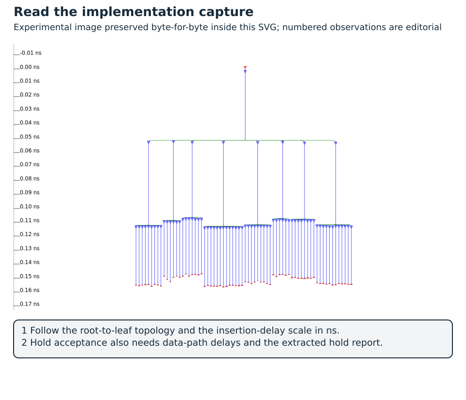

# Complete Case Study: From RTL Specification to an Implemented SoC {#sec-complete-case}

This case follows one component from its numerical specification to an executable Wally system and physical implementations in two technologies, including two FPGA targets. The component is the book's AXI/DMA signed dot-product accelerator. Its RTL is not replaced by the accumulator used to introduce implementation tools. The same source bytes and baseline parameters are used for independent checking, Wally firmware integration, FPGA placement/routing and ASIC layout generation.

The implementation boundary tells you how to read every number that follows. **The complete Wally system is exercised in RTL simulation; the accelerator IP is physically implemented as a block.** ECP5 uses an out-of-context implementation, Nexys Video adds a serial boundary fixture and real board pin constraints, and ASIC produces a core block without pads. No result is a physically qualified complete Wally SoC. This is a reproducible engineering case with actual implementation results and explicit remaining obligations, not a claim of a manufactured chip or a board-running SoC.

The runnable project walkthrough in @sec-executable-project explains the firmware platform. This appendix makes it the book's common thread: every stage names its configuration, inputs, observed result and next decision. [Lab 17](../labs/17-complete-case/README.md) supplies the common manifest, stage runners, result collector, report bundle and visualization scripts. Students can reproduce the tools or analyse the supplied evidence without an FPGA or fabricated ASIC.

## One release identity across the journey

The [common manifest](../labs/17-complete-case/manifest.json) identifies release `dotproduct-256-2026.10`. It records individual SHA-256 identities for the three IP RTL modules, the AHB control adapter and the firmware. This content-addressed RTL revision is the common identity even when different tools flatten hierarchy or assign different gate names. The report collector rejects a mismatched source, manifest, seed, failed stage command or modified recorded artifact.

| Shared item | Baseline contract |
| --- | --- |
| Physical IP top | `dotproduct_axi` |
| Arithmetic / sequencing / control | `dotproduct_mac`, `dotproduct_engine`, `dotproduct_axi` |
| Legal baseline maximum | `MAX_LENGTH=256` |
| Trusted DMA window | `[0x80008000, 0x8000c000)` |
| Clock and reset | Single clock; active-high synchronous coordinated reset |
| Requested implementation period | 10 ns / 100 MHz |
| Reproduction seed | 2026 |
| Wally dependency | Fork `antoniofloresgil/cvw`, revision `3b30ba6b6519bd2c26c1437e6d61f632a35cef6c` |
| Firmware control slot | `0x10060000` |

: Shared items of the baseline contract {#tbl-complete-case-study-shared-items-baseline-contract}

The manifest also records **declared stage differences**. The reuse simulation exercises maximum lengths 256 and 16. Bounded control checking uses maximum 16 with a 20-cycle bound; the engine proof uses one pair and a 24-cycle bound. Those checks use the same RTL revision, but they do not prove every baseline job unboundedly. FPGA and ASIC both implement maximum 256. The physical targets and I/O assumptions necessarily differ and are separate named profiles; a shared manifest does not pretend that two technologies have the same constraints or cost units.

The manifest fixes the design and its interpretation. Each tool report separately records command lines, image/tool identity, recipe hashes and output hashes. A changed RTL file requires a new release and new evidence. Editing a manifest hash to match a changed file does not transfer the old proof or implementation result: the old stage's manifest fingerprint then no longer matches.

## The book itinerary for this component

| Stage | Concepts reused from the book | Concrete evidence in this case |
| --- | --- | --- |
| Specification/model | Width, signedness, interfaces and IP requirements | Exact integer oracle and register/DMA contract |
| RTL | State, arithmetic, reset and ready/valid ownership | Three reusable SystemVerilog modules |
| Independent verification | Scoreboards, accepted transactions and formal scope | All-length tests, error/security/reset checks, bounded assertions, DONE witness and rejected mutations |
| Wally integration | AHB/AXI, memory ownership, interrupts and firmware | Real Wally executes polling and interrupt firmware and checks result words |
| FPGA | Technology mapping, dedicated arithmetic and timing | ECP5 and Nexys Video mapping/routing reports, actual placement maps and explicit boundary costs |
| ASIC | Views, floorplan, CTS, routing, extraction and stream-out | Nangate45 routed block, extracted STA, power model, GDSII readback and GUI exports |
| Engineering decision | Controlled comparison, reproducibility and IP release | Joined result dossier, limitations and an acceptance decision |

: Book stages, reused concepts and concrete evidence {#tbl-complete-case-study-book-stages-reused-concepts}

Read the relevant chapters at each boundary; the 6 ECTS course has no room for every extension. P1–P4 establish the IP, checks and firmware. P5 uses the physical reports and release analysis within its existing workload. Complete-core formal refinement, physical integration of Wally and memories, board bring-up and fabrication remain extensions.

## Stage 1: specification and an independent reference model

[Core · P1 · C1](../learning-paths.qmd#sec-path-labels){#act-case-specification .learning-activity}

The job computes

$$
r=\sum_{i=0}^{N-1} a_i b_i,\qquad 1\le N\le256.
$$

Each operand occupies one 32-bit memory word. Its low 16 bits represent a signed two's-complement integer; the upper 16 bits are ignored. Products and the accumulated result are exact within a signed 64-bit result. There is no rounding, saturation or fixed-point scaling. The output is two little-endian words, low word first, at an eight-byte-aligned destination.

The independent Python generator explicitly decodes the signed low half-word and accumulates with unrestricted integers. Firmware uses a separate C derivation and compares both result words. Neither checker should copy the RTL's state sequencing or obtain its expected result from the hardware multiplier being evaluated. Signed extrema, noisy upper bits and a sum exceeding 32 bits make the numerical requirements observable.

The control contract includes more than the equation. A trusted static window bounds every source/result range. Validation rejects zero/excessive length, bad alignment, address wrap and destination/source overlap before any DMA request. The sources may overlap each other because both are read-only. DONE means both result writes received successful responses; reset or a write error can leave a partial result, which software must not accept as successful.

An architectural decision follows immediately: the two 32-bit writes are not atomic. The software-visible status/result protocol is part of correctness, not an optional optimization around a multiplier.

## Stage 2: SystemVerilog RTL and reusable boundaries

[Core · P1 · C1](../learning-paths.qmd#sec-path-labels){#act-case-rtl .learning-activity}

The arithmetic module computes a signed 16-by-16 product and adds its sign-extended value to a 64-bit accumulator. The engine sequences two reads per pair and two final writes. The AXI wrapper owns independent control channels, latches accepted descriptors and enforces the trusted range. The AHB-to-AXI4-Lite adapter is a platform component, outside the physical IP boundary used for the area figures below.

This separation exposes different engineering questions. Does the multiplier interpret the sign bit correctly? Does the engine use an accepted response exactly once? Does the wrapper prevent a configuration write from changing a running job? Does the bridge capture AHB's following data phase? Giving each question its own observation point reduces the chance that one full-system PASS hides a local defect.

The first baseline keeps one DMA operation outstanding and uses single-beat 32-bit AXI transfers. This is intentionally conservative. A job consumes exactly `2*N` accepted operand reads and two accepted result writes. Adding bursts changes response capacity, error draining and ordering obligations, so it becomes a new checked design configuration and not a free performance switch.

## Stage 3: independent tests, bounded formal checks and counterexamples

[Core · P4 · C1](../learning-paths.qmd#sec-path-labels){#act-case-verification .learning-activity}

The recorded standalone run passes every legal length at maximum 256 and repeats at maximum 16. Directed tests exercise signs and wide accumulation, independent AW/W arrivals, byte strobes, response stalls, busy rejection, invalid descriptors, interrupt acknowledgement, read/write faults and reset/restart. Seeded memory waits vary legal response timing, while a memory scoreboard checks actual effects.

The bounded tasks constrain initial reset and retain explicit environment/design obligations. Control checks run for 20 cycles and engine checks for 24 cycles. A reachable DONE witness demonstrates that the engine completion case is admitted. These are bounded results; they do not inherit the FIFO's separate induction/equivalence result from @sec-formal-verification.

The [negative-control results](../labs/17-complete-case/reference/negative-results.json) record two deliberately faulty copies of the same reference IP. An unsigned multiplier is rejected by numerical checking. Premature DONE is rejected by simulation and produces a formal counterexample. The copies live only under ignored build directories. The reference RTL remains unchanged, and the repaired baseline retains its passing results.

This closes the stated numerical/protocol test obligations, not all verification. The dossier still lists project-specific RTL-to-mapped-netlist equivalence, broader functional coverage and an unbounded protocol proof as unexecuted. Source identity is necessary for a meaningful claim, but is not itself a correctness proof for a synthesis transformation.

## Stage 4: real Wally SoC integration

[Core · P3 · C2](../learning-paths.qmd#sec-path-labels){#act-case-wally .learning-activity}

The same IP and its control adapter are instantiated beside the real pinned `wallypipelinedcore`. Clang/LLD build the RV32IM/Zicsr firmware, an ELF loader initializes simulated memory, and Verilator executes the actual processor RTL. There is no behavioral CPU replacement. The platform in @fig-executable-project separates CPU control, DMA traffic and completion interrupts.

The derived Wally configuration disables caches and internal instruction/data memories and uses 64 KiB of shared simulated RAM. Code, stack and result-mailbox bookkeeping are outside the trusted DMA buffer window. Firmware transfers buffer ownership with the documented fences, launches work and validates both result words. A direct single-source `MExtInt` route exercises the real trap handler, IP acknowledgement and `mret`; it is not a PLIC demonstration.

The following results were extracted from the completed firmware run with the manifest seed. Both alternatives use the same input dataset and numerical contract.

| N | Software cycles | Accelerator end-to-end cycles | Cycle speedup |
| ---: | ---: | ---: | ---: |
| 1 | 90 | 114 | 0.79× |
| 8 | 664 | 195 | 3.41× |
| 32 | 2632 | 384 | 6.85× |
| 128 | 10504 | 1275 | 8.24× |
| 256 | 21000 | 2490 | 8.43× |

: Software and accelerator cycles by vector length in the Wally SoC {#tbl-complete-case-study-software-accelerator-cycles-vector}

The [machine-readable cycle table](../labs/17-complete-case/reference/cycles.csv) preserves the exact values. The complete firmware run reaches its PASS mailbox after 53,153 simulated cycles, including initialization, all polling jobs, an interrupt job and invalid-descriptor handling. That total covers the whole run, so it is not the latency of one dot product.

The accelerator wins on longer jobs and loses on the single-pair case because setup/completion overhead matters. Its reported interval includes register setup, DMA, polling and result access. The CPU memory is zero-wait in this fixture while DMA has modeled waits; the shared array is not a synthesized arbitration fabric. These are measurements in the documented cycle model, not board throughput or whole-chip energy.

The 8.43× cycle ratio and a physical IP clock number cannot be multiplied into a measured SoC speedup, because the complete processor, memories, interconnect and clock distribution have not been physically implemented together in either result below.

## Stage 5: FPGA mapping, placement, routing and frequency

[Core · P5 · C0 review / C3 rerun](../learning-paths.qmd#sec-path-labels){#act-case-fpga .learning-activity}

The FPGA route uses the same maximum-256 IP with Yosys `synth_ecp5` and nextpnr for an ECP5 `LFE5U-25F`, package `CABGA381`, speed grade 6. The dedicated multiplier maps into one DSP. The official OSS CAD Suite release dated 14 October 2026 is downloaded by a supplied Dockerfile with a checked archive SHA-256 [@caseOssSuite]. The report identifies Yosys `0.70+16` and nextpnr `0.11.1-63-g44a6c739`; these are different technology tools from the ASIC mapping environment.

The IP is routed **out of context**: no board I/O buffers, package pin assignments or complete SoC are present. The mode also omits the normal board clock-distribution context. nextpnr produces a post-route JSON and timing/resource report, not a programmable board bitstream. The broad AXI ports remain a block interface. This avoids disguising an arbitrary pin mapping as a Nexys Video deployment and lets students without hardware study a real routed implementation [@caseNextpnr].

| Resource/result | Extracted FPGA result |
| --- | ---: |
| `TRELLIS_COMB` units | 1,092 / 24,288 (4.50%) |
| `TRELLIS_FF` registers | 469 / 24,288 (1.93%) |
| `MULT18X18D` blocks | 1 / 28 |
| `DP16KD` block RAM | 0 / 56 |
| Requested clock | 100 MHz |
| Post-route estimated Fmax | **86.99 MHz** |
| 100 MHz setup target | **Failed** |
| FPGA power | Not estimated by the supplied tool flow |

: Extracted FPGA resources and results of the out-of-context IP {#tbl-complete-case-study-extracted-fpga-resources-results}

`TRELLIS_COMB` is the backend's LUT/carry resource accounting, not a square-micrometre area. Zero BRAM does not mean that the complete workload needs no memory: operand/result RAM belongs to the integration platform, outside this IP implementation. The [actual timing/utilization JSON](../labs/17-complete-case/reference/fpga/timing.json) retains the full reported resource categories and critical paths.

The runner explicitly allows a timing failure so that the routed design and reports are retained. It records tool completion separately from `setup_target_met=false`. That option keeps the evidence and does not accept an unmet architectural clock. An initial engineering response is to examine the critical path and evaluate a lower target with margin or an RTL change, then repeat the relevant integration checks.

{#fig-complete-case-fpga fig-alt="Actual post-route ECP5 placement map of the manifest-locked dot-product accelerator" width=100%}

Use @fig-complete-case-fpga with its numbered reading notes and the [original full-resolution capture](../figures/complete-case-fpga.png). The panel explains what to inspect; acceptance values remain in the accompanying implementation reports.

`fpga_plot.py` derives this spatial map from `NEXTPNR_BEL` attributes and checks every plotted resource has a placement. It preserves the source JSON hash, plot-script hash, resource counts and Matplotlib version. The tool's raw placement SVG is also generated during reproduction. The image shows actual implementation placement, and it makes no claim about physical transistor dimensions or a board's electrical connections.

### Nexys Video: the same IP on the book's Artix-7 {#sec-nexys-complete-case}

The additional [Nexys Video profile](../labs/17-complete-case/nexys-profile.json) selects the board's actual `xc7a200tsbg484-1` so ECP5 counts are never translated into Artix-7 numbers. It binds the unchanged common RTL/firmware manifest to a separate wrapper, pin constraints and implementation recipe. Wally's pinned nextpnr-Xilinx revision is `8f178fc6a6d4dfbc57bef66c3ccff34d558047d5`; its chip database is generated specifically for this part. Yosys maps with `synth_xilinx -arch xc7 -abc9 -nodsp`, matching the Wally board recipe. The multiplier therefore uses LUT/carry logic.

This legacy XC7 backend automatically inserts physical IO buffers and does not offer the ECP5 out-of-context switch. Exposing every AXI signal as an arbitrary package pin would not describe a Nexys Video integration. The supplied `nexys_video.sv` therefore keeps the entire accelerator behind a **serial boundary fixture**: 101 input bits are shifted in and applied as an atomic snapshot; 206 output bits can be captured and shifted out. The fixture adds input/output registers, synchronized controls and a BUFG. Its separate simulation checks serial transfer, actual AXI register write/read, capture/shift and reset. The fixture is not an automatic AXI master, shared RAM or Wally firmware system.

Seven physical IOs use the board's actual pin/voltage assignments: R4 for the 100 MHz oscillator, G4 for active-low reset, E22/F21/G21/G22 for four switches and T14 for LED0. Switches supply data, shift tick, apply and capture; LED0 displays the current output bit. The [XDC](../labs/17-complete-case/nexys-video.xdc) follows Digilent's master constraints [@caseNexysXdc]. Input data/controls need a stable synchronization interval; switch bounce is not filtered, and physical interaction has not been validated. The IP continues clocking between snapshots, so this fixture must not be mistaken for a cycle-accurate memory responder or a complete accelerator demo application.

The [completed Nexys dossier](../labs/17-complete-case/reference/nexys/results.json) contains the following measured results. The timing/resource result belongs to **accelerator plus fixture**. The synthesis report separates their mapped primitives by hierarchy before flattening.

| Nexys Video result | Extracted value |
| --- | ---: |
| Accelerator mapped LUT2–LUT6 primitives | 1,314 |
| Accelerator mapped FF / CARRY4 primitives | 495 / 100 |
| Additional fixture mapped LUT / FF primitives | 209 / 421 |
| Complete post-pack `SLICE_LUTX` / `SLICE_FFX` counts | 2,148 / 916 |
| Complete post-pack CARRY4 / DSP / BRAM | 102 / 0 / 0 |
| Physical IOs / global clock buffers | 7 / 1 |
| Requested clock | 100 MHz |
| Post-route estimated Fmax | **85.42 MHz** |
| 100 MHz target | **Failed** |
| Power | Not estimated |

: Extracted Nexys Video results {#tbl-complete-case-study-extracted-nexys-video-results}

The backend's `SLICE_LUTX` count is not interchangeable with a vendor LUT6 utilization figure. Its packed design contains 625 `LUT1` cells in addition to the 1,523 mapped LUT2–LUT6 primitives; packing introduces inversion/feed-through logic. Its capacity list also enumerates alternative BELs. Use the actual reported resource categories, not an inferred percentage against a mismatched capacity. A direct LUT-area comparison against the bare ECP5 IP would also mix implementation boundaries.

Likewise, the two FPGA Fmax figures compare different mappings and boundaries: ECP5 uses a DSP and no board fixture, whereas this XC7 run uses LUT arithmetic and includes the fixture. They therefore give no speed ranking of the FPGA families themselves.

{#fig-complete-case-nexys fig-alt="Actual post-route placement of the dot-product accelerator and serial fixture on the Nexys Video XC7A200T" width=100%}

Use @fig-complete-case-nexys with its numbered reading notes and the [original full-resolution capture](../figures/complete-case-nexys.png). The panel explains what to inspect; acceptance values remain in the accompanying implementation reports.

The [routing/timing log](../labs/17-complete-case/reference/nexys/command-04.txt) reports a path from registered `operand_a` through the LUT multiplier and the long 64-bit carry chain to a `next_sum` capture register. Its rounded breakdown is 4.3 ns logic plus 7.4 ns routing, approximately 11.7 ns total. The clock target therefore fails even though the design occupies only a small part of the device. Inspect the carry-chain column in the placement map and the per-net path report before proposing a pipelined product/add operation. That change would also require revisiting engine state, latency and reset/error regressions under a new release.

An initial DSP-enabled run failed during routing of the DSP's constant `MULTSIGNIN` connection. Its [preserved failure log](../labs/17-complete-case/reference/nexys/dsp-attempt-routing.txt) shows a compatibility limitation of this tool/configuration, and the board's DSPs are fine. The completed run uses `-nodsp`, as does the documented Wally board build. The original RTL remains unchanged.

nextpnr writes routed JSON, timing/utilization JSON and FASM. Binary `.bit` conversion and physical programming are unexecuted. The experiment does not validate vendor STA, CDC, board switching behavior or electrical operation at 100 MHz. In particular, a timing-failing result cannot be presented as a working deployment on the direct 100 MHz board clock. A lower-clock candidate needs an actual clock-generation change and fresh implementation evidence, not merely a smaller `--freq` argument. FPGA power remains unestimated.

The complete Wally-on-Nexys integration remains a separate extension: it requires the AHB control adapter, an arbitrated shared-memory/DMA fabric, wrapper/reset integration and firmware placement. Neither an ECP5 block report nor the serial fixture proves that full-SoC board integration.

## Stage 6: ASIC mapping through GDSII

[Core · P5 · C0 review / C3 rerun](../learning-paths.qmd#sec-path-labels){#act-case-asic .learning-activity}

The ASIC route maps the identical IP source and parameters to Nangate45 typical cells using Yosys 0.60, then invokes direct OpenROAD Tcl in the recorded ORFS image. This is the same physical-design engine family used in @sec-openroad-study, but the implemented netlist here is the full accelerator IP, not the introductory accumulator.

The manifest profile requests a 10 ns clock and 45% core utilization. Its SDC states 100 ps uncertainty, 2 ns maximum / 0.2 ns minimum input delays, 2 ns maximum / 0 ns minimum output delays, 50 ps input transition and 5 fF output loads. Mapping uses actual tie cells; the physical flow creates rows and pins, a power grid, placement, a clock tree, global routing and detailed routing. OpenRCX extracts parasitics, which are written to SPEF and imported before final STA and power analysis.

KLayout then reads the routed DEF with the matching LEF/layer mapping, merges the actual standard-cell GDS shapes and writes `dotproduct_axi.gds`. The stream-out script rejects empty unresolved cells and reopens the GDS to check the expected top-level hierarchy. This establishes a generated/readable layout with resolved cell geometry. It does not perform foundry DRC/LVS or prove that the layout implements the intended logic.

{#fig-complete-case-asic fig-alt="Actual routed Nangate45 physical implementation of the same dot-product accelerator" width=100%}

Use @fig-complete-case-asic with its numbered reading notes and the [original full-resolution capture](../figures/complete-case-asic.png). The panel explains what to inspect; acceptance values remain in the accompanying implementation reports.

For grayscale printing, read these captures as geometry and topology overviews. Layer identity and exact critical-path pins come from the linked reports and original full-resolution captures; a colored highlight illustrates, and the reports carry the timing evidence. The numeric result tables remain the basis for the acceptance decision.

{#fig-complete-case-critical fig-alt="Critical path highlighted in the actual OpenROAD dot-product implementation" width=100%}

Use @fig-complete-case-critical with its numbered reading notes and the [original full-resolution capture](../figures/complete-case-asic-critical.png). The panel explains what to inspect; acceptance values remain in the accompanying implementation reports.

{#fig-complete-case-clocktree fig-alt="Clock-tree viewer export for the physically implemented dot-product IP" width=100%}

Use @fig-complete-case-clocktree with its numbered reading notes and the [original full-resolution capture](../figures/complete-case-clocktree.png). The panel explains what to inspect; acceptance values remain in the accompanying implementation reports.

| Geometry/timing result | Extracted ASIC result |
| --- | ---: |
| Standard-cell area reported by OpenROAD | **7,355 µm²** |
| Core area | **15,743.21 µm²** |
| GDS bounding box | 136.5 × 136.5 µm |
| Requested clock | 100 MHz |
| Extracted setup slack | **+4.04594 ns** |
| Extracted hold slack | **−0.03355 ns** |
| Setup-only limiting-period estimate | 5.95406 ns / approximately **167.95 MHz** |
| Electrical checks | Slew/capacitance violations remain |
| Detailed-router DRC report | Empty final report for that router's checks |
| Full physical qualification | Open |

: Extracted ASIC geometry and timing results {#tbl-complete-case-study-extracted-asic-geometry-timing}

The setup-only limit is `1000 / (10 − 4.04594)` MHz under the unchanged block budgets, single timing corner and extracted geometry. It is a **setup-only figure and no validated operating Fmax**: hold is negative, electrical limits are violated, and neither multi-corner nor complete-SoC timing has closed. Large slew violations also limit confidence in a timing extrapolation outside characterized operating conditions. A positive setup number alone does not make this an accepted implementation.

The [setup report](../labs/17-complete-case/reference/asic/routed-setup.rpt), [hold report](../labs/17-complete-case/reference/asic/routed-hold.rpt), [electrical report](../labs/17-complete-case/reference/asic/routed-limits.rpt) and [GDS readback record](../labs/17-complete-case/reference/asic/gds-readback.json) provide the evidence behind @tbl-complete-case-study-extracted-asic-geometry-timing. The GDS contains a block boundary, not pads, package or complete SoC geometry. It uses a teaching/reference technology rather than a fabrication qualification.

## Power estimates and the meaning of consumption

The [ASIC power report](../labs/17-complete-case/reference/asic/power.rpt) is generated at the requested 100 MHz with `set_power_activity -global -activity 0.1`. It uses the Liberty power models, propagated clock and post-route parasitics. Activity is vectorless; no VCD/SAIF from the Wally job has been annotated. The figures are estimates for this block/model, not a current measurement or whole-system power budget.

| Power component | ASIC estimate at 100 MHz |
| --- | ---: |
| Internal cell power | 0.442 mW |
| Net switching power | 0.256 mW |
| Leakage | 0.159 mW |
| Total | **0.857 mW** |
| Clock-group contribution, included in total | approximately 0.223 mW / 26.1% |

: ASIC power estimate by component {#tbl-complete-case-study-asic-power-estimate-component}

The clock contribution is already part of the total and is counted once. The power estimate is evaluated at 100 MHz, not at the setup-derived 167.95 MHz limit. No energy-per-dot-product claim follows from multiplying this vectorless block power by the virtual SoC cycle counts: those observations have different activity, memory and implementation boundaries.

The supplied FPGA flow has no characterized device power estimator. Its result therefore records `power_w=null` and an explicit reason. A complete FPGA consumption experiment needs the chosen device/voltage/temperature, clock networks, I/O loads and measured or annotated switching activity with a suitable estimator or board measurement. FPGA watts cannot be inferred from LUT counts, and the ASIC power figure does not belong in that column.

## The joined result and engineering decision

The [joined dossier](../labs/17-complete-case/reference/results.json) connects all four stages to the common release. Its result collector checks actual source/artifact identities and expected checker completions before extracting metrics. The accompanying [inventory](../labs/17-complete-case/reference/inventory.json) records preserved-report and figure hashes. Large routed JSON/ODB/SPEF/GDS files are generated by reproduction and identified by their report hashes; they are not silently reconstructed from the compact report bundle.

| Acceptance question | Decision supported by this release |
| --- | --- |
| Does the specified arithmetic/control/DMA work within the tested scope? | Yes: independent tests, bounded checks, negative controls and real-Wally result checks pass |
| Is acceleration always beneficial? | No: N=1 loses; the measured longer-job cycle ratios improve within the stated fixture |
| Do the FPGA implementations meet the requested 100 MHz? | No: ECP5 reports 86.99 MHz; Nexys Video plus fixture reports 85.42 MHz |
| Is the ASIC block routed and streamable to GDSII? | Yes, with resolved cell geometry/readback; physical qualification remains open |
| Is ASIC timing closed? | No: positive setup coexists with negative hold and electrical violations |
| Is power known for both technologies? | ASIC has a vectorless estimate; FPGA consumption remains unestimated |
| Has a complete Wally SoC been physically qualified? | No; integration here is executable RTL simulation |

: Acceptance questions of the joined result and the decision each supports {#tbl-complete-case-study-acceptance-questions-joined-result}

A defensible decision is to retain the functional IP as a verified baseline while declining a 100 MHz FPGA release and a timing-qualified ASIC release. For FPGA, inspect the critical path and compare an explicitly constrained lower-clock candidate against an RTL change. For ASIC, repair electrical fanout/slew and hold before treating a setup-frequency extrapolation as a usable clock. Every repair needs fresh correctness and physical evidence.

The workload data suggest a separate architectural experiment: reduce per-job setup or DMA transaction overhead for short vectors. Bursts/concurrency may improve long jobs but add protocol/error obligations. A faster multiplier alone may not address the observed software-visible bottleneck. A power decision needs workload-derived switching and a full-system boundary before claiming energy savings.

Those findings describe the original release. The continuation below executes repairs under a separate manifest, preserving the original dossier and its failed acceptance decisions. This is the connection from specification to implementation: the result is a reviewable engineering decision, including an explicit decision not to accept a candidate with open requirements.

## From Timing Violations to a Qualified Implementation {#sec-complete-closure}

[Advanced · C0 review / C3 rerun](../learning-paths.qmd#sec-path-labels){#act-case-closure .learning-activity}

The continuation uses the same dot-product specification, maximum length, DMA window, seed and target boundaries. [Lab 21](../labs/21-physical-closure/README.md) supplies a [new manifest](../labs/21-physical-closure/manifest.json), executable recipes, independent regressions and a [collected comparison](../labs/21-physical-closure/reference/results.json). The original Lab 17 reports remain unchanged. The process developed in @sec-physical-closure now leads to an accepted ASIC candidate within a stated block-level scope, rather than ending with a list of proposed repairs.

### Establish a comparable baseline

The historical baseline remains useful evidence: ASIC setup +4.04594 ns, hold −0.03355 ns, 237 reported electrical violations and 7,355 µm² of cells. The continuation also reruns a 100 MHz baseline through its own runner. Its elaboration sets the same parameters in one Yosys command instead of three separate commands; this changes generated names and the mapped-file hash. Implementation differences must therefore not be attributed entirely to the repair.

To isolate the intervention, the new ASIC baseline, 75 MHz candidate and repaired 100 MHz candidate all start with a **byte-identical mapped netlist**. The collector enforces this identity. Only the clock target changes in the slow experiment; only the physical repair recipe changes in the repaired experiment. The source RTL is unchanged in all three. Retaining both the historical and contemporaneous baselines makes this distinction reviewable.

The acceptance gate requires nonnegative extracted setup/hold, zero reported slew/capacitance/fanout violations, no unconstrained-path warnings, an empty final detailed-router DRC report, mapped/routed netlist equivalence and nonempty GDS readback. Qualification covers Nangate45 typical, this block and the supplied interface budgets. It does not close manufacturing DRC/LVS, multi-corner timing, complete-SoC timing or board qualification.

| ASIC candidate | Setup (ns) | Hold (ns) | Electrical violations | Block gate |
| --- | ---: | ---: | ---: | --- |
| Historical baseline, 100 MHz | +4.04594 | −0.03355 | 237 | Reject |
| Comparable baseline, 100 MHz | +4.56402 | −0.01845 | 48 | Reject |
| Lower clock, 75 MHz | +7.89736 | −0.01845 | 48 | Reject |
| Physical repair, 100 MHz | **+5.20410** | **+0.02968** | **0** | Accept in declared scope |

: ASIC candidates compared on setup, hold and electrical violations {#tbl-complete-case-study-asic-candidates-compared-setup}

| ASIC candidate | Cell area (µm²) | Vectorless power (mW) |
| --- | ---: | ---: |
| Historical baseline, 100 MHz | 7,355 | 0.857 |
| Comparable baseline, 100 MHz | 7,350 | 0.846 |
| Lower clock, 75 MHz | 7,350 | 0.674 |
| Physical repair, 100 MHz | **7,811** | **0.860** |

: ASIC candidates compared on cell area and vectorless power {#tbl-complete-case-study-asic-candidates-compared-cell}

The last three rows have the same mapped-input hash. Their identical negative hold result before repair makes the distinction particularly clear: the longer period helps setup while leaving the minimum-delay problem intact. Relative to the comparable baseline, repair adds 461 µm² of cells, approximately 6.3%, within the same core. Power remains a vectorless model estimate with the limitations discussed below.

Read these failures before choosing a repair, as @sec-physical-closure describes. The original ASIC's worst hold report starts at the `m_bvalid` input and ends at a clocked register. Its minimum input budget is 0.2 ns, while the propagated capture clock and hold uncertainty leave a small negative margin. Other short paths start at reset; the report shows reset driving 419 loads. The electrical report also includes an internal output transition of 3.41 ns against a 0.20 ns limit. These observations lead to two specific actions: build appropriate buffering for heavily loaded signals and add controlled delay to short data paths after CTS. They do not justify declaring reset or every input path false.

The FPGA diagnosis is different. The preserved critical paths cross the arithmetic network. In ECP5, the path includes the unregistered DSP multiplier followed by the accumulation carry chain; in Nexys Video, the chosen open flow maps multiplication into LUTs and carry logic. The target is therefore a long combinational calculation between state elements. Improving the ASIC clock tree would leave that FPGA path unchanged.

### Candidate 1: reduce the requested frequency

Both FPGA targets are resynthesized and placed/routed at **75 MHz**, keeping the original RTL and seed. The resulting clock limits equal the original reported limits in these runs: 86.99 MHz for ECP5 and 85.42 MHz for Nexys Video. The positive period margins are approximately 1.84 ns and 1.63 ns respectively. This accepts a revised 75 MHz requirement; the 100 MHz requirement still fails.

The ASIC is also rerun at 75 MHz. Its extracted setup slack is **+7.89736 ns**, but hold remains **−0.01845 ns** and 48 electrical violations remain. Cell area is 7,350 µm²; the vectorless power estimate at the new clock is 0.674 mW. Lowering the clock is therefore sufficient for the FPGA's reported maximum-frequency objective, but insufficient for the ASIC's minimum-delay and electrical acceptance gate. The ASIC remains rejected even though its setup number improves and its power estimate falls.

### Candidate 2: shorten the arithmetic path in RTL

The separate [engine candidate](../labs/21-physical-closure/dotproduct_engine.sv) registers the signed 16 × 16 product on the accepted second-operand response, then performs the sign-extended 64-bit addition in a new `ACCUMULATE` state. The AXI register map, descriptor checks and number of DMA reads/writes remain fixed. One extra serial cycle per vector element is introduced. This is an architectural latency change, so its identity and evidence remain separate from the original RTL release.

| Target and candidate | Requested clock | Routed clock limit | Period margin | Clock objective |
| --- | ---: | ---: | ---: | --- |
| ECP5, original RTL | 100 MHz | 86.99 MHz | −1.49 ns | Fail |
| ECP5, original RTL, slower target | 75 MHz | 86.99 MHz | +1.84 ns | Pass at 75 MHz |
| ECP5, registered product | 100 MHz | **98.19 MHz** | −0.18 ns | Fail |
| Nexys Video, original RTL plus fixture | 100 MHz | 85.42 MHz | −1.71 ns | Fail |
| Nexys Video, original RTL, slower target | 75 MHz | 85.42 MHz | +1.63 ns | Pass at 75 MHz |
| Nexys Video, registered product plus fixture | 100 MHz | **102.13 MHz** | +0.21 ns | Pass at 100 MHz |

: Targets and candidates of the shorter arithmetic path {#tbl-complete-case-study-targets-candidates-shorter-arithmetic}

Period margins are calculated as requested period minus the period implied by the routed clock limit. They express this nextpnr clock model, without adding a board I/O/CDC/vendor signoff claim. ECP5 remains an out-of-context LFE5U25F block; Nexys remains the XC7A200T implementation with the existing serial boundary fixture, `-nodsp` LUT multiplication and the same pin assignments. Resource columns from these two boundaries must not be treated as a technology-normalized area comparison.

The Nexys result restores the requested 100 MHz clock objective. The ECP5 result is especially instructive: registering the product improves frequency, but the worst path moves into descriptor/destination-address validation, from `dst` to `active_dst`. Its preserved critical path contains approximately 3.62 ns of logic and 6.04 ns of routing, excluding the separate clock-to-Q/setup contributions. The original ECP5 arithmetic path contains approximately 7.14 ns of logic and 3.83 ns of routing. Another arithmetic pipeline stage would not directly target the new worst path.

The next ECP5 experiment would stage descriptor validation before starting DMA, or change its physical placement strategy, then repeat the security-window and protocol checks. Declaring a multicycle path without implementing and proving the matching endpoint protocol would conceal the problem. This continuation retains the 98.19 MHz failure as evidence of a moved bottleneck.

| Routed resources, including each target's stated boundary | Original RTL / 75 MHz | Registered product / 100 MHz |
| --- | ---: | ---: |
| ECP5 `TRELLIS_COMB` | 1,092 | 1,097 |
| ECP5 flip-flops | 469 | 502 |
| ECP5 multipliers | 1 | 1 |
| Nexys `SLICE_LUTX` | 2,148 | 2,140 |
| Nexys `SLICE_FFX` | 916 | 948 |
| Nexys `CARRY4` | 102 | 102 |

: Routed resources of the original and the registered-product RTL {#tbl-complete-case-study-routed-resources-original-registered}

These are actual nextpnr resource categories, not gate-equivalent area or FPGA power estimates. The additional product register is visible in the flip-flop counts. Small LUT changes also reflect elaboration and mapping around the new state; the added state is not free.

Before using the RTL result, both engines pass the original independent integer-oracle tests for lengths 1–256 at seeds 2026 and 2027: **512 length cases per engine**, plus wide signed sums, channel ordering/strobes, DMA stalls/errors, window-policy failures, IRQ/reset and reuse. Both pass the Nexys serial fixture. A deliberately zero-extended negative product fails the same scoreboard at the first length. These are fresh candidate-specific checks; the earlier Wally cycles and bounded formal evidence remain attached to the original engine. No baseline/pipelined sequential-equivalence proof or new Wally cycle measurement is claimed.

### Candidate 3: repair the ASIC without changing RTL

The [physical recipe](../labs/21-physical-closure/repair.tcl) buffers/resizes electrical violations after placement, then repairs setup and hold after CTS with propagated clocks. It repeats repair after global routing, legalizes, reroutes, performs detailed routing and extracts fresh SPEF. It keeps the original 100 MHz target, 0.10 ns clock uncertainty, input/output budgets and 45% floorplan utilization. The hold target margin is 0.03 ns. An exploratory 0.10 ns margin exhausted the buffer allowance; the retained recipe records a smaller target and an explicit 50% maximum hold-buffer percentage.

The repaired candidate has **+5.20410 ns setup**, **+0.02968 ns hold**, **zero reported electrical violations**, and an empty final detailed-router DRC report. Its core stays at **15,743.21 µm²**, while cells occupy **7,811 µm²**. The area increase relative to the historical baseline is approximately 6.2%. This is a physical-optimization result using the original RTL, with no extra architectural cycle.

The vectorless power estimate is **0.860 mW at 100 MHz**, split into approximately 0.426 mW internal, 0.267 mW switching and 0.168 mW leakage; component rounding explains the sum. It uses the same 0.1 global activity and Liberty power model as the earlier estimate. The historical 0.857 mW estimate was evaluated with electrical violations, so this small difference is not evidence of a measured energy improvement or a precisely calibrated repair cost. No FPGA watts or workload energy are inferred.

The final worst setup path now starts at `m_rdata[2]`, so its interpretation includes the external input budget as well as the internal logic and capture clock. The worst hold path is register-to-register. Read the [extracted setup report](../labs/21-physical-closure/reference/asic-repair/routed-setup.rpt), [hold report](../labs/21-physical-closure/reference/asic-repair/routed-hold.rpt), [electrical report](../labs/21-physical-closure/reference/asic-repair/routed-limits.rpt) and [constraint report](../labs/21-physical-closure/reference/asic-repair/routed-constraints.rpt) together. A blank violations report is meaningful here because its generating command and successful completion are preserved.

{#fig-complete-closure-routing width=100%}

Use @fig-complete-closure-routing with its numbered reading notes and the [original full-resolution capture](../labs/21-physical-closure/reference/asic-repair/implementation.png). The panel explains what to inspect; acceptance values remain in the accompanying implementation reports.

{#fig-complete-closure-clock width=100%}

Use @fig-complete-closure-clock with its numbered reading notes and the [original full-resolution capture](../labs/21-physical-closure/reference/asic-repair/clocktree.png). The panel explains what to inspect; acceptance values remain in the accompanying implementation reports.

The [capture record](../labs/21-physical-closure/reference/asic-repair/capture.json) binds these images and the separate [critical-path export](../labs/21-physical-closure/reference/asic-repair/critical-path.png) to the final ODB, SDC and SPEF hashes. The layout is streamed to GDSII using actual library cell geometry and reopened successfully. Stream-out/readback and the router's own DRC report do not replace foundry rule decks or extracted LVS.

The repaired netlist must also pass the [mapped/routed functional equivalence check](../labs/21-physical-closure/reference/asic-repair/equivalence.json). The check uses Liberty zero-delay functional cell models, hierarchy/structural checks and asserting Yosys equivalence completion. It proves the stated netlist obligation; it does not establish layout connectivity or analog timing. Together with the fresh extracted reports, this supports acceptance of the repaired block for the declared single-corner timing/electrical gate.

### Compare the decisions and the remaining obligations

| Decision | Evidence | Consequence |
| --- | --- | --- |
| Accept original FPGA RTL at 75 MHz | Both fresh routes exceed 75 MHz in the recorded clock model | Revise the clock requirement; application wall-clock latency still needs review |
| Accept registered-product Nexys clock at 100 MHz | 102.13 MHz routed limit and fresh functional tests | Extra cycle per element; retain candidate identity and board-validation obligations |
| Reject registered-product ECP5 at 100 MHz | 98.19 MHz; new descriptor-validation critical path | Target the moved bottleneck in a further experiment |
| Reject slow ASIC | Hold remains negative and electrical violations remain | Lower frequency alone cannot close this candidate |
| Accept repaired ASIC against the declared block gate | Extracted setup/hold/electrical checks, router DRC, equivalence, GDS readback | Manufacturing/multi-corner/full-SoC qualification remains open |

: Decisions, evidence and consequences of the candidates {#tbl-complete-case-study-decisions-evidence-consequences-candidates}

For assessment, explain the causal path from one baseline failure to one chosen repair. Compare the contemporaneous ASIC baseline, slow and repaired reports with their common mapped-netlist hash. Explain why the extra product register helps Nexys yet does not close ECP5, and state an application-latency test that could change the choice between 75 MHz original RTL and 100 MHz modified RTL. Finally list precisely which checks would still be required before deployment on a board or fabrication of a complete SoC. A useful release decision includes its accepted scope, measured costs and open obligations.

## Actual GDS DRC/LVS and power/body finishing {#sec-layout-verification}

[Advanced · C0 review / C3 rerun](../learning-paths.qmd#sec-path-labels){#act-case-drc-lvs .learning-activity}

The previous section's timing/electrical gate was deliberately narrower than physical signoff. [Lab 22](../labs/22-layout-verification/README.md) now executes the next checks on that same GDS. The existing Wally development environment contains FreePDK45/Nangate45 under its OpenROAD-flow-scripts checkout. Its standard-cell GDS has the same SHA-256 as the library used by this case study. The continuation retains the digest-pinned ORFS image and records its precise DRC, CDL, LEF, Liberty, GDS and extraction-rule identities instead of mixing technology revisions.

The available technology is a **public reference PDK**, not a foundry-qualified fabrication kit. Its DRC deck implements useful front-end, back-end, manufacturing-grid and antenna checks, but includes documented rule omissions. The configured LVS deck is absent from the pinned image. The continuation supplies a batch adapter derived from the attributed [FreePDK45 extraction example](https://github.com/klayoutmatthias/FreePDK45_for_KLayout/tree/ab0495a69fa76fdc726a75f890bbf67b518db42a), with its GPL source/license and Nangate-specific assumptions retained for review. It does not turn an educational technology into an accepted manufacturing process.

### A real failure beyond digital equivalence

The original timing-repaired GDS produces **zero DRC markers across 129 reported rule categories**, but its transistor-level LVS does not match. A separate OpenDB audit finds **1,408 unconnected POWER/GROUND ITerms**. The original flow had applied global power connections before later CTS/resizer cell insertion. Those later cells need the connections applied again. The CDL also contains 56 deliberately unconnected signal outputs from clock-loading cells; these are distinct from missing power pins and must not be included in that count.

This is why successful zero-delay cell-netlist equivalence and positive setup/hold slack still leave physical correctness open. The logical models used for those earlier checks abstract supplies and transistor bodies. The GDS/CDL comparison adds obligations that those models do not represent.

The finishing candidate reruns `global_connect`, fills free sites conservatively with `TAPCELL_X1` body contacts and one-site filler where needed, reconnects the new physical cells, and checks placement. It adds **29,821 physical-only cells** within the same core. This teaching implementation deliberately prioritizes explicit body connectivity over an optimized contact pitch; it is not a recommended density/power optimum. The count must not be presented as added functional logic or a calibrated power estimate. Functional cell masters, placements and signal-pin net assignments are preserved in byte-identical before/after snapshots.

The flow re-extracts SPEF from the finished database, reruns timing/electrical/constraint checks and streams a new GDS. The historical Lab 21 artifacts remain intact. The [collected result](../labs/22-layout-verification/reference/results.json), [power-terminal audit](../labs/22-layout-verification/reference/power-connectivity.json), [fresh timing report](../labs/22-layout-verification/reference/timing.json) and [command/technology record](../labs/22-layout-verification/reference/report.json) bind this continuation to the original repaired block.

| Obligation | Original timing-repaired layout | Finished candidate |
| --- | ---: | ---: |
| DRC categories reported | 129 | 129 |
| DRC markers | 0 | **0** |
| Unconnected POWER/GROUND ITerms | 1,408 | **0** |
| Extracted transistor-level LVS | Mismatch | **Match** |
| PMOS devices after normalization | 22,248 | 22,248 |
| NMOS devices after normalization | 22,223 | 22,223 |
| Extracted setup slack | +5.20410 ns | **+5.20410 ns** |
| Extracted hold slack | +0.02968 ns | **+0.02968 ns** |
| Reported electrical violations | 0 | **0** |
| Foundry manufacturing qualification | Open | **Open** |

: Obligations before and after the finishing step {#tbl-complete-case-study-obligations-finishing-step tbl-colwidths="[48,30,22]"}

The matched finished circuits contain **44,471 MOS devices**, with the same device-class counts, 23,394 nets and 293 retained pins on both sides after consistent simplification. Device extraction follows active/poly/wells, contacts and metal/via geometry; the reference is the exported CDL plus the actual cell CDL. The unchanged timing values are fresh extracted results under the same single-corner model, not a transfer of a number from the older report. The physical-only finish leaves the functional signal implementation unchanged.

### Check the checker and state the assumptions

The LVS adapter makes two important library conventions explicit. Nangate's CDL uses VTL MOS models while its GDS lacks VT-flavour marker shapes; the preflight rejects other marker layers. Its `TAPCELL_X1` contains active/contact/well geometry without implant-marker shapes. Only that known master may have unmarked active, which is interpreted as body-contact geometry. Other masters with unmarked active are rejected. The deck connects body terminals through the actual well/contact/metal geometry; it contains no `connect_global`, `connect_implicit`, `connect_explicit` or transistor black-box shortcut to make the comparison pass.

Both extracted and schematic netlists normalize parallel devices consistently. Top-level pins are established before flattening so that dangling internal cell outputs do not become interface pins. These integration details belong to a reviewable extraction contract, and foundry-approved models and decks remain necessary.

A separate [port-identity audit](../labs/22-layout-verification/reference/port-identity.json) reads the actual LVS cross-reference and verifies the correspondence of all **293 retained top-level pin names**, allowing only SPICE case normalization. It does not force net equivalence or bypass a topology mismatch.

Two faulty layouts provide negative controls. A deliberately **1 nm wide M2 sliver** produces a `METAL2.1` marker. A metal bridge between actual VDD/VSS rails causes **LVS mismatch** while preserving the transistor count; the extracted net count falls from 23,394 to 23,393. Thus the checks reject real geometric defects, and the passing result is not an empty extraction. The compact dossier retains the DRC databases, extraction summaries, diagnostics and exact logs; full GDS/ODB/SPEF/CDL and cross-probing LVS databases are generated on reproduction and identified by their hashes.

The engineering decision now advances from “timing/electrical block gate passed” to **“the stated public-reference DRC/LVS and timing/PG checks passed after physical finishing.”** Manufacturing remains open because FreePDK45 is a reference technology, the deck has incomplete coverage, and this experiment supplies neither foundry acceptance nor complete density/ERC/IR/EM, multi-corner, pad/package or whole-SoC signoff. These are different claims, and the result record keeps `manufacturing_qualified=false`.

## Reproduction and student deliverables

The Linux continuation in @sec-linux-accelerator and [Lab 18](../labs/18-linux-accelerator/README.md) adds a QEMU device model, Device Tree, kernel driver, reserved DMA pool, IRQ/polling and userspace tests, plus a separate advanced real-Wally RV64 RTL platform. It retains this accelerator's source revision but declares a new Linux DMA window and CPU/interrupt profile. Both Linux environments map the accelerator at `0x10080000`, preserving Wally's native GPIO at `0x10060000`; the firmware slot in the historical profile above remains part of its recorded configuration. Its emulator timings and RTL boot evidence do not replace the bare-metal or physical results in this appendix.

Follow [Lab 17](../labs/17-complete-case/README.md) for Linux/WSL and PowerShell commands. It uses the existing unit-lab image for tests/Wally, a SHA-checked OSS CAD Suite image for FPGA, the recorded ORFS image for ASIC, and optional Matplotlib for regenerating the placement map. Building/acquiring environments needs network; stage execution is offline. The Wally clone must contain the pinned fork revision. Each stage keeps a separate namespace and refuses to overwrite existing physical results.

The complete case remains outside the nine automatic `run all` entries. CI checks the preserved common-release dossier without rerunning large physical tools on every book build. The existing executable lab/firmware tests remain separate validation obligations. Reproducing a routed block is the start, and explaining its contract and failures is the real work.

For the final defence, submit the common manifest, requirement-to-evidence map, independent checks and one interpreted counterexample; reconstruct a CPU control transaction, a DMA response and interrupt return; present the two implementation visuals and the area/resource, timing and power tables; finally justify the release decision and the next experiment. Mark every value by design boundary, model, corner and actual execution status. The same evidence-based assessment is available without buying hardware.

The remaining product work includes a synthesized memory/arbitration fabric, full Wally physical integration, board I/O/clock/reset validation, candidate-specific SoC verification, additional ASIC corners/modes, manufacturing/foundry checks and workload-calibrated energy measurements. The continuation closes the declared ASIC block timing/electrical gate, while those wider obligations remain explicit.
