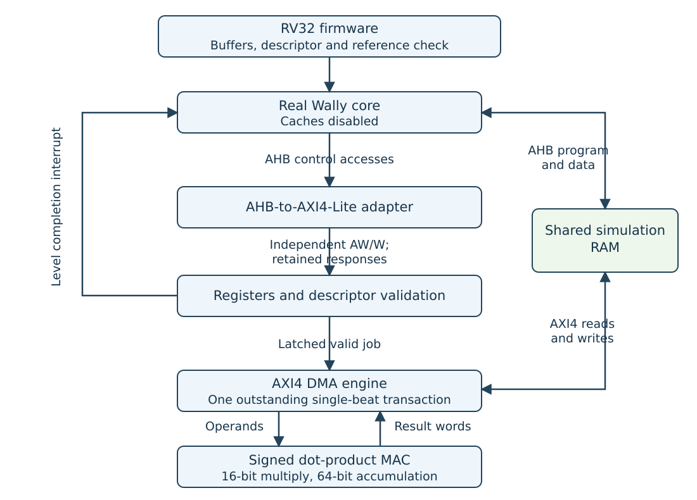
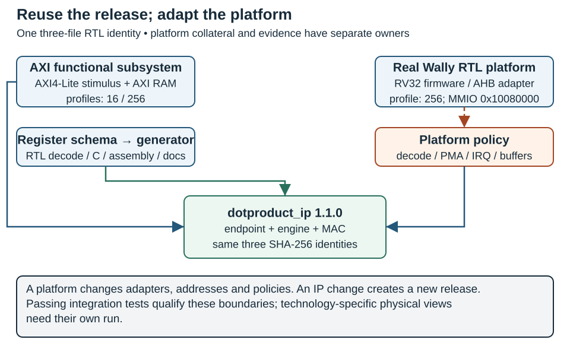

# Executable Cross-Course Project: AXI/DMA Accelerator {#sec-executable-project}

**Recipe status:** standalone and pinned Wally reference runs are checked in the stated environment. @sec-complete-case continues this same IP through a locked ECP5 out-of-context implementation and Nangate45 ASIC block through GDSII, with actual timing/resource/power-model reports. Complete-SoC physical integration, PLIC and coherence remain extensions.

The project in @sec-hsd-coursework now has a runnable reference platform under `labs/10-dotproduct/`. It connects the fundamentals, simulation, SoC integration and implementation blocks around a signed dot-product IP. The standalone suite exercises the accelerator; the integration suite boots firmware on the actual pinned Wally RTL. Both use the same arithmetic, control registers and DMA engine.

Use this appendix as the executable quick start and @sec-complete-case as the full engineering narrative. The latter uses a common manifest/source lock across these tests and both physical targets, extracts actual firmware-cycle and implementation results, shows the physical implementations, and explains why functional success does not close FPGA frequency or ASIC hold/electrical obligations.

This is the executable final-project route for students without an FPGA. Its firmware result/mailbox, polling, DMA checks and interrupt handler replace a live board demonstration within the virtual-platform scope. For implementation work follow [Lab 07's alternative](../labs/07-implementation/README.md#without-a-physical-board), using your own synthesis and generated or instructor-provided physical-report analysis. The [activity map](../labs/NO-FPGA.md) identifies all replacements and remaining board checks. The fixture does not execute a `.bit` or validate the Nexys Video wrapper/DDR3; physical deployment remains an additional route.

Download the [laboratory package](../downloads/hardware-design-labs.zip) for the complete files, or work in the book repository. The archive includes the project README, manifest, RTL, firmware, models, properties and tests. Wally is an explicitly acquired external dependency. Run every command below from the extracted package or repository root.

## From specification to the executable architecture

The job computes an exact signed 64-bit dot product over 1–256 operand pairs. Each signed 16-bit sample occupies the low half of a 32-bit word. There are no packing, rounding or saturation conventions to infer. The destination is two little-endian words. The numerical and register contract is defined in @sec-hsd-coursework and implemented in the project README.

{#fig-executable-project fig-alt="RV32 firmware runs on Wally; AHB control accesses cross an AXI-Lite bridge to the accelerator; the AXI DMA engine and CPU share RAM, and the accelerator reports a level interrupt"}

In @fig-executable-project, follow a firmware load/store through the real Wally core and AHB adapter before following the separate accelerator DMA request into the shared simulation RAM.

The arithmetic module `dotproduct_mac.sv` has no bus policy. `dotproduct_engine.sv` sequences reads, accumulation and result writes. `dotproduct_axi.sv` owns the AXI4-Lite endpoint, validates descriptors, locks active configuration and reports completion. `ahb_to_axil.sv` belongs to the CPU integration platform. Those boundaries make protocol and numerical changes separately reviewable.

The CPU interface is AHB, so the adapter preserves its address and data phases instead of treating signals as AXI names. It stalls the CPU until the AXI response is available and supports aligned 32-bit control transfers. DMA uses a separate AXI4 interface. AXI4-Lite controls a job; it does not transfer the job's operand arrays.

The baseline is intentionally single-clock and single-outstanding. Each pair requires two reads; each complete job requires two writes. This makes the conservation check concrete: `2*N` reads, two writes, and DONE only after both successful write responses. Burst and concurrency extensions must replace that contract with explicit ordering and capacity checks.

## First run: the IP boundary

[Core · P3 · C1](../learning-paths.qmd#sec-path-labels){#act-project-ip .learning-activity}

Build the container described in @sec-reproducible-labs, then run:

```bash
docker run --rm --network none --user "$(id -u):$(id -g)" --env HOME=/tmp \
  --mount "type=bind,source=$PWD,target=/work" \
  from-concept-labs:2026.10 python labs/run.py run dotproduct --seed 2026
```

In PowerShell:

```powershell
docker run --rm --network none --env HOME=/tmp `
  --mount "type=bind,source=${PWD},target=/work" `
  from-concept-labs:2026.10 python labs/run.py run dotproduct --seed 2026
```

This entry is part of the nine automatic entries in `run all`. It generates an independent Python oracle, runs every length from 1 through 256, repeats with `MAX_LENGTH=16`, checks rejected descriptors and error/reset behavior, synthesizes the IP and executes bounded formal checks. A tool error, assertion, timeout or bad result produces a nonzero exit code.

The random seed controls the data and independent memory wait states. The RAM model deliberately allows AW and W to be accepted at different times. The control test also sends AW first and W first, exercises byte strobes and stalls response consumption. Changing a seed is useful, but directed boundary tests remain required.

Inspect `labs/build/report.json` and the numbered command logs in `labs/build/dotproduct/`. `dotproduct.json` contains the generic synthesized netlist. The logs distinguish vector generation, simulation, synthesis and formal checking; a simulation PASS says nothing about timing.

## Second run: real Wally, firmware and interrupts

[Core · P3 · C2](../learning-paths.qmd#sec-path-labels){#act-project-wally .learning-activity}

Acquire Wally before the offline run:

```bash
git clone https://github.com/antoniofloresgil/cvw.git ../cvw
docker run --rm --network none --user "$(id -u):$(id -g)" --env HOME=/tmp --env WALLY_ROOT=/cvw --env LAB_BUILD_DIR=/work/labs/build/wally-platform \
  --mount "type=bind,source=$PWD,target=/work" \
  --mount "type=bind,source=$(cd ../cvw && pwd),target=/cvw,readonly" \
  from-concept-labs:2026.10 python labs/run.py run dotproduct-wally
```

The project README gives the equivalent PowerShell command with an absolute clone path. The runner exports revision `3b30ba6b6519bd2c26c1437e6d61f632a35cef6c` into its build directory; the supplied clone's checked-out branch is unchanged. License/source headers and a file-hash identity record accompany the export. No behavioral CPU substitute is used.

The recipe keeps system artifacts under `labs/build/wally-platform/dotproduct-wally/` and writes `labs/build/wally-platform/report.json`, preserving `labs/build/report.json` for the unit evidence collector.

The runner compiles `firmware/start.S`, `main.c` and `link.ld` with Clang/LLD for RV32IM/Zicsr. A checked ELF32 loader creates the memory image. Verilator then compiles `wallypipelinedcore`, the adapter, the IP and the shared-memory fixture. `dotproduct-wally` is an explicit external entry because a downloaded lab ZIP does not contain a Wally clone.

The derived `rv32imc` configuration disables caches and internal instruction/data memories, enables 64 KiB external RAM and retains cycle counters. CPU code, stack and simulation mailboxes are outside the trusted DMA window `[0x80008000, 0x8000c000)`. The IP control slot is `0x10060000`. This replaces the configured GPIO slot in a fixture that instantiates the core without Wally's complete uncore.

Firmware initializes buffers, computes an independent C result, programs the descriptor and polls completion for lengths 1, 8, 32, 128 and 256. It compares both result words after the required ordering fence. A second job enables an interrupt: the IP drives `MExtInt`, Wally enters the machine trap handler, the handler acknowledges the IP and returns with `mret`. The firmware also rejects a zero-length descriptor.

The direct interrupt connection is a single-source teaching route. It does not demonstrate PLIC configuration. The shared array allows CPU and DMA access in the simulator; software transfers buffer ownership and avoids conflicting accesses. A physical memory arbiter, coherent caches and an OS DMA driver require additional integration and tests.

## Evidence rather than a single PASS message

| Requirement | Executable evidence | Remaining boundary |
| --- | --- | --- |
| Exact arithmetic | Python vectors for every length, signed extremes, noisy upper bits, wide sums; firmware comparison | No alternative numerical formats |
| CPU control | Real Wally firmware through AHB-to-AXI4-Lite | Aligned word accesses; no full uncore/OS |
| DMA | Address/attribute checks, transaction counts and seeded backpressure | Single beat, fixed ID, one outstanding transaction |
| Security policy | Alignment, length, full-range, wrap and destination-overlap rejection before traffic | Trusted static window; no complete SoC isolation policy |
| Error/reliability behavior | Read/write fault injection, reset/restart, interrupt ACK | No rollback, atomic result store or stuck-target watchdog |
| Reuse | Complete suite at maximum lengths 256 and 16 | New windows/platforms require matching models and firmware |
| Formal reasoning | Bounded RTL assertions and a reachable completion witness | No unbounded proof or AXI certification |
| IP strengthening | Manifest, model, firmware, constraints, generic netlist and hashes; separate locked physical dossier in @sec-complete-case | No inserted scan or complete-SoC physical qualification |

: Requirements, executable evidence and the remaining boundary {#tbl-executable-project-requirements-executable-evidence-remaining}

Formal control checks use a 20-cycle bound with symbolic inputs. The engine is checked separately for 24 cycles with a fixed valid one-pair descriptor. A SAT witness reaches DONE, avoiding a completion property that only passes because completion was unreachable. The property set checks retained payloads, active descriptor stability, bounded DMA addresses and terminal-write ordering. State the bound and assumptions when presenting these results; simulation covers long jobs and firmware integration.

Run the deliberate defect checks separately:

```bash
docker run --rm --network none --user "$(id -u):$(id -g)" --env HOME=/tmp \
  --mount "type=bind,source=$PWD,target=/work" \
  from-concept-labs:2026.10 python labs/10-dotproduct/verify_negative.py /work/labs/build/dotproduct-negative
```

The checker must reject unsigned multiplication and premature DONE. The premature-DONE version must also produce a formal counterexample. These copies remain under ignored build directories and never overwrite reference RTL. Explain the failing transaction or cycle in the counterexample; the solver's exit status alone is not an explanation.

## A project that grows across P1–P5

Use the working reference to remove environment uncertainty, then require student changes and reasoning. P1 fixes the specification and independent numerical checks. P2 develops reusable boundaries and protocol ownership. P3 integrates the CPU driver, interrupts and measurements. P4 adds meaningful formal/security work. P5 evaluates implementation, failure behavior and the IP release inventory.

The firmware prints software and accelerator end-to-end cycle counts for the same dataset. Accelerator timing includes register setup, DMA, polling and result access. Compare those counts before proposing bursts or pipelining. The memory model's CPU/DMA latency assumptions strongly influence the result; these measurements are not an FPGA frequency or a silicon throughput claim.

`constraints.sdc` supplies an illustrative clock and interface budget. Yosys checks elaboration, unintended latches and a generic netlist. For a physical extension, choose a real FPGA or ASIC technology, review clocks/reset/interface budgets and produce corresponding implementation evidence. RA7 also requires justified DFT, manufacturability and reliability analysis: accumulator/protocol observability, scan/reset interactions, memory test, partial writes and failure containment all remain relevant.

The unchanged reference is a starting point and is not the final assessed project. Students should specify and demonstrate a defensible extension, preserve regression tests, add evidence for its new contract, and identify every produced, supplied and missing IP view. The existing coursework rubric and individual defence apply.

## Verification plan and evidence collection

Use @sec-verification-methodology for the requirement-driven hierarchy from RTL to physical release and production test. The package includes `labs/verification/project-plan.json`, a reusable plan template and an evidence collector. After the standalone and real Wally runs, generate `verification-evidence.json` using the commands in that chapter. Current source/artifact identities and expected checker completions are checked; equivalence, measured cross coverage, timing, physical and manufacturing obligations remain visible where unexecuted. This dossier complements the runner report rather than turning a simulation PASS into a physical qualification.

## Reusable IP Design and Packaging {#sec-reusable-ip}

A working accelerator answers whether one design computes the expected result in its original environment. A reusable IP must also tell another team what it may connect, which configurations it may select, what software must do, and which evidence applies after integration. That team needs none of the author's working directory, undocumented tool settings or memory of a successful demonstration. This section turns the dot-product example into a concrete release and connects that work to **RA6: reusable architectures, supported parameters and justified design patterns**.

[Lab 23](../labs/23-reusable-ip/README.md) delivers `dotproduct_ip` version **1.1.0**, with register ABI **1.0**. It generates the control endpoint's register-address decoding from a common description and retains the original MAC and DMA engine byte for byte. The release is qualified in an AXI bus-functional subsystem and a real-Wally firmware fixture. Both compile the **same three released RTL files**, without platform-specific edits. The bus-functional subsystem supplies one integration boundary; it is not described as a second processor SoC.

### Draw the IP boundary before arranging files

{#fig-ip-release-boundaries fig-alt="AXI stimulus and a real Wally platform connect to the same released endpoint, engine and MAC; register generation and platform policy remain distinct" width=100%}

In @fig-ip-release-boundaries, `rtl/` contains only `dotproduct_axi`, `dotproduct_engine` and `dotproduct_mac`. The AHB adapter belongs to the integrator because the IP exposes AXI4-Lite, not AHB. A different CPU can replace that adapter without changing arithmetic or DMA. The shared RAM is a supplied simulation model; a physical memory subsystem must implement arbitration, visibility and response behavior separately.

The release uses this layout:

```text
dotproduct_ip/
|-- rtl/          # three released accelerator modules
|-- sim/          # AXI/Wally fixtures, RAM, oracle and runner
|-- formal/       # bounded properties and reachable witness recipe
|-- sw/           # generated headers, RV32 startup and firmware
|-- constraints/  # explicit example clock/interface budgets
|-- docs/         # behavioral contract and generated register table
|-- synthesis/    # synthesis entry/required-view description
+-- manifest/     # release inventory, profiles and dependency locks
```

Folder names are navigation; the manifest is the source list. Compiling every `.sv` recursively would mix testbenches, a platform adapter and checker packages into the delivered design. Simulation and synthesis must consume the declared RTL view. Keep generated build products outside the immutable release tree so a test run cannot quietly replace the delivered implementation.

### Contracts and versions are part of the interface

The contract specifies a single rising-edge clock and active-high synchronous reset, coordinated across CPU, adapter, IP and memory protocol state. An isolated IP reset during an outstanding transaction is unsupported. RAM contents survive reset, and two result-word writes are not an atomic 64-bit transaction. Software accepts the result only after DONE without ERROR. These requirements determine whether an integrator can safely reset, share memory with or recover the device.

AXI4-Lite control uses 32-bit data and byte offsets, independent AW/W capture and retained R/B responses. DMA uses 32-bit AXI4, ID zero, one outstanding single-beat INCR transaction, `SIZE=2` and `LEN=0`. The interrupt is a retained level with W1C acknowledgement; a new completion/error event wins over simultaneous ACK. Neither an AXI port name nor an interrupt wire supplies these behavioral details.

Keep three version questions distinct. The **IP release version** identifies the complete delivered implementation and collateral. The **register ABI version** identifies the software-visible contract. The **manifest schema version** identifies how tools parse the package. Here release 1.1.0 introduces generated packaging while retaining ABI 1.0; it is separate from the historical 1.0.0 source-locked physical studies. Version numbers describe policy; exact hashes identify bytes.

A changed register offset, field meaning, numerical format or reset contract needs an explicit compatibility decision. Adding a supported profile needs new configuration evidence. A decoder refactoring can preserve ABI while still changing the RTL identity and invalidating an old mapped netlist. ABI 1.0 has no readable IP-version register: select the software binding through platform metadata and the release manifest, and avoid inventing a successful discovery read.

### Generate register views from one description

The authoritative [register description](../labs/23-reusable-ip/registers.json) records names, offsets, access policies, reset values, fields and behavioral notes. The package generator produces the endpoint's fourteen read/write case labels, C offsets and masks, assembly offsets, SystemVerilog checker constants and Markdown register table. Software and documentation therefore use the same addresses that enter the generated RTL decoder.

For example, the IRQ acknowledgement entry is:

```json
{"name":"IRQ_ACK","offset":28,"access":"w1c","reset":0,
 "fields":[{"name":"ACK","lsb":0,"width":1}],
 "behavior":"Byte 0 bit 0 clears pending; reads zero; a simultaneous new terminal event wins."}
```

The generated C view exposes `DP_IRQ_ACK` and `DP_IRQ_ACK_ACK_MASK`; the assembly view exposes the offset without C types. The latter matters because the machine interrupt handler acknowledges the peripheral from `start.S`. Generating a C header while leaving a literal address in assembly creates another source of drift.

This is deliberately a small generation backend. It generates addresses and views; **access behavior and field positions remain implemented in an explicit behavioral template**. It rejects unsupported field layouts, so it never accepts metadata that the hardware ignores. A general register compiler would need backends for additional policies, reset domains, side effects and verification. The supplied generator is not presented as such a compiler.

Single-source generation also creates common-mode risk. A wrong offset shared by the RTL, driver and test could make all three agree incorrectly. The AXI regression retains the independently written ABI 1.0 accesses and numerical oracle from Lab 10. The release negative controls reject duplicate offsets and unsupported field layouts. Functional tests still check byte strobes, busy rejection, retained responses and event-versus-ACK priority; a generated table cannot establish those behaviors by itself.

### Support a configuration matrix, not arbitrary elaboration

The underlying RTL permits a configurable maximum length and trusted DMA bounds. This release narrows the supported space to two named profiles, both with DMA window `[0x80008000, 0x8000c000)`:

| Profile | `MAX_LENGTH` | Exercised integration | Claim |
| --- | ---: | --- | --- |
| `compact` | 16 | AXI subsystem | Every accepted job length 1–16, protocol/error suite, generic synthesis |
| `course` | 256 | AXI subsystem | Every accepted job length 1–256, protocol/error suite, generic synthesis |
| `course` | 256 | Real RV32 Wally fixture | Five polling lengths, interrupt job and rejected descriptor |

: Configuration profiles and the claim each one supports {#tbl-executable-project-configuration-profiles-claim-one}

The runner refuses unknown profile names and rejects the compact profile for the current Wally firmware fixture. A parameter value that elaborates successfully is not automatically supported. A new window also needs model storage, linker placement, ownership and protection checks; changing a top-level parameter alone does not discharge them.

The supported numerical contract remains signed 16-bit operands in 32-bit words and an exact 64-bit sum. Maximum length affects descriptor admission; it does not change sample format or add saturation. Record unsupported tuples explicitly and require a new evidence entry before advertising them. This keeps configuration freedom useful to an integrator instead of turning every parameter into an untested promise.

### Integrate the same release in two environments

The AXI platform supplies a bus-functional manager and a randomized, independently stalled memory model. It tests the released IP directly, including AW-first/W-first control writes, response stalls, alignment/range rejection, DMA errors and reset. The Wally platform adds an actual pinned RV32 core, an AHB-to-AXI4-Lite adapter, compiled firmware, shared simulated RAM and a direct machine-external interrupt. No behavioral CPU substitutes for Wally.

The IP sees offsets in both cases. Wally's platform decoder maps them at `0x10080000`, leaving the native GPIO base `0x10060000` available to its own device. The platform manifest generates the fixture's range and the firmware's base; the common register schema supplies offsets. The three-file accelerator RTL identity remains identical across these choices.

An initial decoder/software-only relocation produced a real **store-access fault (`mcause=7`)**. The core's physical-memory attributes still rejected the new range. Reviewing the integration also found the old IRQ_ACK address in assembly startup. The corrected platform adds the decoded range to Wally's derived configuration, classifies it as uncached, non-idempotent, non-atomic and non-executable in the exported PMA policy, and generates the assembly offset. The correction belongs to the platform; the IP did not need a special Wally branch. The checked-out Wally repository remains unchanged.

This failure is the practical difference between connecting wires and integrating a reusable component. The decoder, processor attributes, firmware, exception path and interrupt handler must agree. The fixture disables caches and routes IRQ directly to `MExtInt`; it does not qualify PLIC configuration, cache coherence, Linux or physical memory arbitration. Those are additional platform contracts, not defects to conceal inside the IP.

### Supply models, checkers and assumptions to the integrator

The package supplies an arbitrary-precision Python reference, seeded vectors, an AXI RAM model, a direct-control testbench, Wally firmware and an executable runner. Models describe their response assumptions and failure injection. The `2*N` read/two-write conservation rule and signed numerical comparison give the integrator observable obligations beyond a final PASS string. Software fences and ownership transfers remain part of the system test.

The formal recipe checks control properties at depth 20 with `MAX_LENGTH=16`, and the engine at depth 24 with a fixed one-pair descriptor. It separately obtains a reachable DONE witness. This scope is the same even when the simulation profile allows 256 pairs; it is not an exhaustive proof of long jobs, fairness, arbitrary reset sequences or complete AXI compliance. Deliver the assumptions and bounds beside the result so a new environment can decide whether they still apply.

A useful integration checklist asks who owns each assumption. Does the fabric guarantee a matching response ID and a final beat? Can another master overwrite an input? Can a reset strand a retained response? Who provides a timeout if memory never replies? If the platform cannot satisfy an assumption, change the platform or revise the IP contract and implementation. Unit tests that pass cannot answer a question outside their environment.

### Lock dependencies and preserve ownership

The release inventory records the generated RTL, templates, generator, profile descriptions, firmware and supplied views by SHA-256. The [dependency lock](../labs/23-reusable-ip/dependencies.json) separately names Wally repository, revision and derived configuration. The Wally utility exports the pinned revision from a supplied clone, retaining upstream headers and license; it does not build whatever branch happens to be checked out or modify that clone.

The checked qualification mounts only the delivered package, a results directory and, for Wally, the read-only dependency clone. It runs offline with the package itself read-only. This tests whether the release is autonomous: a hidden include from the author's book checkout cannot rescue a missing delivered file. Tool-image identity and per-command output accompany the evidence.

Checksums detect changes only relative to a trusted identity. A party that can replace both RTL and its inventory can generate matching hashes. Preserve an independently obtained release digest and apply the project's release/authentication policy. Record licenses at the file/dependency boundary; packaging a component leaves its original terms in force.

### Distinguish logical and physical deliverables

| View | Delivered or generated here | Integrator's next obligation |
| --- | --- | --- |
| RTL / registers / drivers | Locked source list and generated views | Select compatible ABI, profile and platform policy |
| Simulation / formal | Executable models, regressions, bounds and witness | Discharge assumptions; add system-specific cases |
| Synthesis | Generic Yosys JSON and log for each AXI profile | Map this release to a declared technology and review resources |
| Constraints | Example clock and interface-delay SDC | Replace budgets with actual clocks, loads, reset/CDC contracts |
| FPGA view | No new board implementation for release 1.1.0 | Pin/device/clock constraints, route/timing and board evidence |
| ASIC view | No new mapped netlist, LEF or GDS for release 1.1.0 | Technology/corner lock, extracted timing, power, DRC/LVS and DFT |

: Logical and physical deliverables and the integrator next step {#tbl-executable-project-logical-physical-deliverables-integrator}

A reusable soft IP need not bundle a technology-specific hard macro, but it must identify which views exist. An example 10 ns clock is a requested budget and not an achieved frequency, and a generic netlist is not yet a placed implementation. Historical results in @sec-complete-case and @sec-layout-verification show how to document physical evidence, but belong to their own hashes. The newly generated endpoint cannot inherit their area, timing, power or DRC/LVS status merely because it preserves register behavior.

### Reproduce and review the release

[Core option · P5 · C1 local / C2 system](../learning-paths.qmd#sec-path-labels){#act-ip-release .learning-activity}

Start with a new output directory; the packager refuses to overwrite a release:

```sh
python labs/23-reusable-ip/package.py \
  --output labs/build/ip-release/dotproduct_ip
python labs/build/ip-release/dotproduct_ip/manifest/verify.py
```

Then use [Lab 23's isolated-container recipes](../labs/23-reusable-ip/README.md#qualify-the-autonomous-release) to run `axi/course`, `axi/compact` and `wally/course`. Build results stay outside the release. The evidence collector requires the same release hash and the same three RTL hashes for all runs, successful command statuses, and rejected negative controls. Its [compact reference](../labs/23-reusable-ip/reference/results.json) and [auditor](../labs/23-reusable-ip/verify_reference.py) let readers inspect the checked outcome without running a simulator or acquiring Wally.

The checked package contains **28 supplied files**. The AXI suites pass all 256 and 16 job lengths respectively; the Wally fixture reaches its successful mailbox after **53,153 simulated cycles**, including five polling jobs, an interrupt job and an invalid descriptor. This is a firmware/integration milestone, not measured hardware throughput. Four separate negative controls reject duplicate offsets, an unsupported field layout, RTL drift and an unsupported Wally/profile pairing. The recorded original relocation failure remains visible beside the corrected run.

For RA6, review the package as the receiving team. Explain one supported profile, one rejected change and one missing physical view. Show exactly which files changed for the Wally address/PMA/interrupt adaptation and prove that the three RTL hashes did not. A stronger extension ports this same release to another real host or adds a new supported profile with its own tests. Repeating an existing PASS without justifying boundaries does not demonstrate reusable-IP design.
