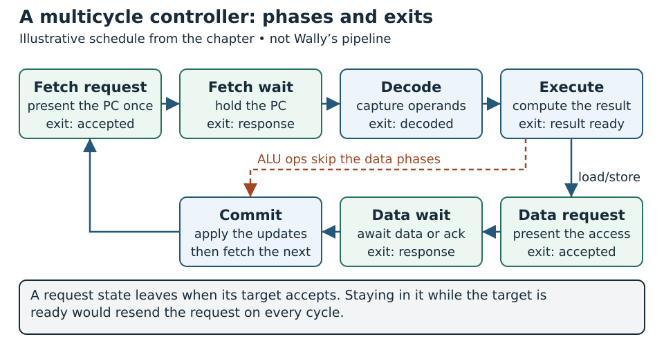
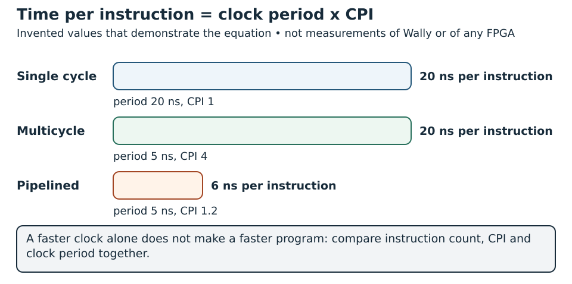

# Microarchitecture Fundamentals {#sec-microarchitecture}

The ISA tells a program what an instruction means. Microarchitecture turns that meaning into storage, arithmetic, selection and control. Two processors can execute the same binary correctly while using different numbers of cycles, different memory organizations and different physical resources.

This chapter establishes the reasoning tools needed before studying Wally. It follows the architectural-state, datapath and control ideas in Chapters 2 and 7 of *RISC-V System-on-Chip Design*, with verification and implementation context from Chapters 5 and 6 [@harrisRiscvSoc]. It develops small reusable units and a multicycle execution plan. Detailed five-stage instruction hazards belong to the Wally chapter; elastic communication pipelines belong to the SoC architecture part.

The units built here, an ALU, a register file and an iterative multiplier, are checked by `python labs/run.py run foundations` in the [laboratory package](../../appendices/reproducible-labs.qmd). The multiplier is tested at widths 1, 8 and 32, with every operand pair at width 8, and the test covers its latency, its output stalls and a reset in the middle of an operation.

## Concepts

### Start with a state transition

Describe an instruction as a transformation of architectural state before designing its circuit. For a normal integer operation, the relevant input includes the current PC, source register values and instruction bits; the output includes a possible register write and a next PC. A store also modifies memory. A fault redirects the architectural transition through a defined trap mechanism in a complete processor.

For `add x6, x4, x5` in RV32, the intended effect is:

```text
x6 := low_32_bits(x4 + x5), unless the destination is x0
PC := old_PC + 4, for an uncompressed ordinary instruction
all other architectural registers remain unchanged
```

This is not a sequencing diagram. It does not require a physical adder for each instruction, nor does it say the result must appear in one clock. The RTL designer can reuse a unit across cycles or instantiate several units, provided visible effects match the contract.

### Architectural and implementation state

| State | Architectural purpose or implementation role |
|---|---|
| Integer registers and PC | Program-visible instruction behavior |
| Applicable CSR and privilege state | Program-visible control and access rules |
| Instruction register | Retains fetched bits while execution proceeds |
| Saved instruction PC | Preserves the address belonging to those bits |
| Operand and result registers | Hold intermediate calculations |
| FSM state and cycle counter | Schedule internal work |
| Cache tags and valid bits | Manage copies in the memory hierarchy |
| Pending-response flag | Tracks transport work not yet consumed |

A physical PC register might temporarily hold a predicted address while another register records the retiring instruction's PC. To compare with a sequential reference, pick the architectural observation point deliberately; the internal signal that happens to be called PC is rarely it.

Implementation state is still essential to correctness. Resetting an FSM while leaving a valid pending write can create an unintended effect. Conversely, the base ISA does not require reset to clear the whole register file, so startup software should not depend on whatever the registers happen to contain.

### Datapath building blocks

A datapath combines registers, arithmetic operators, comparators and multiplexers. Registers retain values across edges. Multiplexers choose sources. Arithmetic generates candidate results. A controller selects those candidates and enables updates.

@fig-microarchitecture-datapath-dependencies draws the value dependencies of a datapath.

{#fig-microarchitecture-datapath-dependencies width=100% fig-alt="Instruction, decode, operands and immediate feeding an ALU, a result selection and a register write"}

An arrow is a value dependency, not proof that the whole path is combinational. Decide where registers belong and annotate the number of cycles between boundaries. For each mux, list its sources and the control condition choosing each source.

Address generation can share an adder with arithmetic, but shared use creates a scheduling constraint. A separate PC incrementer may remove competition for that adder. The extra area can simplify control or improve throughput; whether it is beneficial depends on the implementation target.

### Control is a contract over side effects

A controller does more than choose an ALU operation. It determines which instruction owns a result, when an access is accepted and when architectural state changes.

| Instruction category | Operand selection | Result selection | Side effect |
|---|---|---|---|
| Register ALU | `rs1`, `rs2` | ALU result | Optional register write |
| Immediate ALU | `rs1`, immediate | ALU result | Optional register write |
| Load | Base plus displacement | Extended memory data | Memory request, then register write |
| Store | Base plus displacement | No register result | Memory write |
| Branch | Register comparison | Target or sequential PC | PC update |
| Jump | PC-relative or register-relative target | Link address | PC and optional register update |

The table should also contain legality and exception decisions in a complete design. An unsupported opcode needs its own defined response, because otherwise it inherits stale controls from an earlier instruction. Defaulting every unrecognized encoding to addition is tempting: the decoder looks functional while quietly doing the wrong thing.

Control signals that cause writes require particularly careful defaults. A combinational block with an omitted output assignment can infer a latch; stale `memory_write` is more damaging than stale temporary arithmetic data. Keep an explicit instruction-valid condition attached to side effects.

### Register files and ports

A base integer instruction can read two operands and write one result. A teaching register file can therefore provide two combinational read ports and one clocked write port. Its physical implementation is target dependent: the number and timing of ports may prevent mapping to one FPGA block RAM or one ASIC SRAM macro.

Register zero can be implemented by returning zero when a read address is zero and suppressing writes to that address. This does not require physically storing a permanent zero word. For nonzero registers, specify what a read returns when the same register is written at the same edge.

An explicit bypass can select incoming write data for an equal read address. That is a local read/write collision policy, not the full forwarding network of a pipelined core. Instruction-level forwarding has additional producer age, validity and availability rules developed in the Wally chapter.

### ALU arithmetic and comparison

The RTL must preserve operand widths and interpretation. Subtraction can share addition hardware through complemented input and carry-in, but the HDL `-` operator only states the intent. The synthesis flow chooses the cell topology.

Signed less-than is not simply the top bit of a truncated subtraction: overflow can invalidate that shortcut. Compare signed operands explicitly or derive the full overflow-aware relation. Unsigned less-than uses unsigned interpretation. Equality is independent of whether the bit pattern is called signed or unsigned.

Shifts require both a direction and a fill rule. Cast before arithmetic right shift so the tool sees a signed operand. For RV32 register shifts, use the low five shift-amount bits. Selection of those bits is a semantic requirement, not just an optimization.

### Single-cycle execution as a teaching model

A single-cycle core places fetch, decode, register read, execute, memory and writeback within one clock interval. Its structure is easy to trace, but the clock must accommodate the slowest combinational path.

If an instruction memory or data memory is synchronous, it cannot simply provide its result as a combinational value during that path. A textbook single-cycle diagram using combinational memory is a conceptual starting point, not an automatic FPGA implementation. Adapting the memory contract changes scheduling and storage.

Separate instruction and data ports can also be essential to that diagram. A one-port shared memory cannot independently fetch an instruction and service a load at the same instant. Arbitration or multiple cycles are needed; drawing two arrows to one port does not create another port.

### Multicycle scheduling

A multicycle core stores intermediate values and sequences work with an FSM. A shared ALU can form a PC increment, execute arithmetic and form a load/store address in different cycles. This reduces simultaneous resource demand while adding control and temporary storage.

One possible controller uses the following phases. It is an illustrative schedule, not Wally's pipeline:

| Phase | Action | Condition for leaving |
|---|---|---|
| Fetch request | Present instruction address once | Request accepted |
| Fetch wait | Retain PC context and wait for bits | Response accepted |
| Decode | Validate instruction, capture operands and immediate | Decode completes |
| Execute | Compute arithmetic, address or branch decision | Unit result available |
| Data request | Present a load/store transaction once | Request accepted |
| Data wait | Await data or write completion | Response accepted |
| Commit | Apply permitted architectural updates | Return to fetch |

ALU instructions can skip the data phases. A variable-latency unit can extend execute. The fetch path can use the same transport discipline as a data access while retaining different ownership metadata.

@fig-multicycle-controller draws the schedule above as a controller. Follow it from the fetch request to the commit and back, and notice which exits depend on a handshake.

{#fig-multicycle-controller width=100% fig-alt="A loop of seven controller phases from fetch request to commit, with a shortcut for ALU instructions"}

An FSM transition must follow the actual handshake. Remaining in a request state while its target is ready can resend the request every cycle. After acceptance, move to a waiting state or clear its pending-valid flag. An accepted store is not repeated merely because the processor waits for its acknowledgement.

### Commit and exactly-once effects

**Commit** is an architectural observation point where an instruction's effects become accepted as completed under the design's contract. For an in-order teaching core, it gives a convenient trace for comparison against a sequential model.

The timing of stores needs care. A store can already modify RAM when a request transfers, before a later completion flag. Once issued, that effect may not be undoable. A simple design avoids speculative stores and ensures all earlier required checks are complete before issuing. If the target can report errors after a side effect, the platform must define the resulting behavior.

For register writes, gate the write enable with result validity and successful completion. A stall can retain result data without repeatedly counting the instruction as retired. When `rd` is zero, suppress the register update while preserving all other applicable effects.

A complete processor also needs precise fault behavior: a failing instruction leaves no register updates behind and lets no younger instruction commit past it. This foundation chapter marks that boundary and leaves privileged execution and integration to later chapters, instead of hiding faults by silently dropping them.

### Pipelining, resource duplication and speculation

Instruction pipelining overlaps work from different instructions and introduces dependency and recovery obligations. Only its motivation is needed here: registers divide paths, several instructions occupy resources concurrently, and shared resources can become bottlenecks. The Wally chapter develops its five-stage solution.

Resource duplication is another way to increase concurrency. Separate adders, multiple execution units or distinct memory ports consume more area and power but can reduce contention. Pipelining and duplication are separate choices; a duplicated iterative unit and one deeply pipelined unit can have different latency and throughput.

Speculation allows work before every control condition is resolved. It requires a way to suppress incorrect-path effects. A FIFO preserving request order does not implement speculation recovery, and cancelling an outstanding load is not equivalent to undoing a peripheral write. These distinctions connect to transport and debug topics later in the book.

### Performance, area and power

For a specified workload:

$$
T_{execution}=N_{instructions}\,CPI\,T_{clock}.
$$

Instruction count depends on the binary and ISA choices; cycles per instruction depend on execution, memory and control behavior; clock period depends on the implemented critical path. Compare all three terms. A faster clock does not alone establish a faster program.

For illustration, a design with 20 ns period and CPI 1 spends 20 ns per instruction on average. A multicycle variant at 5 ns with CPI 4 has the same average. A pipelined variant at 5 ns and CPI 1.2 averages 6 ns. These invented values demonstrate the equation; they are not measurements of Wally or any FPGA.

@fig-microarchitecture-execution-time-bars draws the three variants of the example.

{#fig-microarchitecture-execution-time-bars width=100% fig-alt="Three bars for single cycle, multicycle and pipelined time per instruction"}

Dynamic power depends on switching activity, capacitance, voltage and frequency. More units can add switched capacitance even when instruction throughput improves. Clock enables can reduce activity in inactive datapaths, while physical clock gating has technology-specific requirements described in the timing chapter.

Area estimates must also name their domain. FPGA LUTs, flip-flops, DSPs and RAM blocks are not interchangeable with ASIC standard-cell area or SRAM macro area. A synthesis report is not yet a routed timing or power result. The FPGA and ASIC parts of the book provide the physical evidence.

### Configurations and observation boundaries

A configurable core exposes choices such as `XLEN`, extensions, cache organization and optional execution units. Some are ISA-visible; others change timing while preserving the same instruction semantics. A compiler configuration must match the ISA-visible choices.

Maintain a configuration record with source revision, elaboration parameters, memory model, reset PC, compiler options and completion convention. Changing one parameter can affect ports, decoder cases, tests and physical constraints. A smaller configuration is not verified merely because a larger one passed.

For functional comparison, observe retired architectural effects. For performance, observe elapsed cycles and well-defined events. Simulation-only testbench counters are not automatically software-readable PMU hardware. The performance-monitoring chapter develops this distinction for Wally.

### Verify behavior independently of the chosen structure

The plan in @sec-verification-methodology separates numerical correctness from latency, initiation interval, state retention and handshake obligations. Use the same independent arithmetic oracle for alternative datapaths, but compare at their specified completion events rather than forcing equal cycle timing. Check minimum/maximum signed operands, overflow conventions, reset/enable overlap and repeated operations. Review whether a multicycle unit may accept another request while active. Performance comparisons require matching workloads and a measured transaction/cycle window.


## Implementation

### A complete RV32 arithmetic unit

Save this as `foundation_alu.sv`. Its numeric operation selector belongs to this teaching interface; it is not an instruction opcode. A decoder maps validated instructions to it. There are ten supported operations, with an explicit invalid indication for other selectors.

```systemverilog
module foundation_alu (
  input  logic [31:0] a, b,
  input  logic [3:0] operation,
  output logic [31:0] result,
  output logic operation_valid
);
  always_comb begin
    result = '0;
    operation_valid = 1'b1;
    case (operation)
      4'd0: result = a + b;
      4'd1: result = a - b;
      4'd2: result = a & b;
      4'd3: result = a | b;
      4'd4: result = a ^ b;
      4'd5: result = a << b[4:0];
      4'd6: result = a >> b[4:0];
      4'd7: result = $signed(a) >>> b[4:0];
      4'd8: result = {31'b0, ($signed(a) < $signed(b))};
      4'd9: result = {31'b0, (a < b)};
      default: operation_valid = 1'b0;
    endcase
  end
endmodule
```

The result is combinational. A controller captures it when its operands and operation are valid. Arithmetic naturally truncates to the 32-bit output. The signed comparison uses one bit and extends it to an architectural zero/one value.

These operators describe behavior. Inspect synthesis reports to find actual resources and paths. Making the operation selector a parameter would select one unit at elaboration; using an input selects behavior at runtime.

### A two-read, one-write register file

Save this as `foundation_regfile.sv`. The module suppresses writes on reset but does not initialize all registers. Combinational read bypass selects the impending write value when addresses match, except for `x0`. Specify this convention when integrating an operand-capture stage.

```systemverilog
module foundation_regfile (
  input  logic clk, reset,
  input  logic write_enable,
  input  logic [4:0] write_address,
  input  logic [31:0] write_data,
  input  logic [4:0] read_address_a, read_address_b,
  output logic [31:0] read_data_a, read_data_b
);
  logic [31:0] registers [0:31];

  always_ff @(posedge clk) begin
    if (!reset && write_enable && write_address != 0)
      registers[write_address] <= write_data;
  end

  always_comb begin
    read_data_a = '0;
    if (read_address_a != 0) begin
      if (!reset && write_enable && write_address == read_address_a)
        read_data_a = write_data;
      else read_data_a = registers[read_address_a];
    end
    read_data_b = '0;
    if (read_address_b != 0) begin
      if (!reset && write_enable && write_address == read_address_b)
        read_data_b = write_data;
      else read_data_b = registers[read_address_b];
    end
  end
endmodule
```

Reads of unwritten nonzero registers are unspecified for this module. Tests initialize those registers or avoid reading them. Reset prevents a new write but preserves stored values; this is a declared teaching-block contract, not a promise about every processor's reset behavior.

The bypass is active before the writing edge when its inputs are asserted. Integrating this with a controller means choosing deliberately whether an operand capture should see that upcoming value. In a pipelined implementation, additional forwarding rules may override this local behavior.

### An iterative arithmetic unit

An iterative multiplier illustrates multicycle control without constructing another processor. It computes an **unsigned full-width product**, not the entire RISC-V `M` extension. Save it as `iterative_product.sv`; require `WIDTH >= 1`.

The request carries two `WIDTH`-bit operands. The response carries `2*WIDTH` bits. Request ownership transfers on `in_valid && in_ready`; the result stays valid until `out_ready`. Only one operation or unconsumed result is allowed. Reset aborts that protocol state.

```systemverilog
module iterative_product #(
  parameter int WIDTH = 32,
  localparam int CW = (WIDTH < 2) ? 1 : $clog2(WIDTH + 1)
) (
  input  logic clk, reset,
  input  logic in_valid,
  output logic in_ready,
  input  logic [WIDTH-1:0] a, b,
  output logic out_valid,
  input  logic out_ready,
  output logic [2*WIDTH-1:0] product
);
  logic busy, result_pending;
  logic [CW-1:0] remaining;
  logic [WIDTH-1:0] multiplier;
  logic [2*WIDTH-1:0] shifted, accumulator, next_accumulator;

  assign in_ready = !reset && !busy && !result_pending;
  assign out_valid = !reset && result_pending;
  assign next_accumulator = accumulator +
                            (multiplier[0] ? shifted : '0);

  always_ff @(posedge clk) begin
    if (reset) begin
      busy <= 1'b0;
      result_pending <= 1'b0;
      remaining <= '0;
      multiplier <= '0;
      shifted <= '0;
      accumulator <= '0;
      product <= '0;
    end else begin
      if (result_pending && out_ready) result_pending <= 1'b0;
      if (in_valid && in_ready) begin
        busy <= 1'b1;
        remaining <= CW'(WIDTH);
        multiplier <= b;
        shifted <= {{WIDTH{1'b0}}, a};
        accumulator <= '0;
      end else if (busy) begin
        accumulator <= next_accumulator;
        shifted <= shifted << 1;
        multiplier <= multiplier >> 1;
        remaining <= remaining - 1'b1;
        if (remaining == 1) begin
          busy <= 1'b0;
          product <= next_accumulator;
          result_pending <= 1'b1;
        end
      end
    end
  end
endmodule
```

Each work cycle inspects one multiplier bit, conditionally adds a shifted multiplicand, and shifts for the next bit. The last cycle publishes `next_accumulator`, not the old accumulator. Publishing the old value would lose the final partial product because nonblocking assignments use pre-edge state.

If operands transfer at edge $t$, the result becomes valid after edge $t+WIDTH$. The earliest consumption is at $t+WIDTH+1$. The conservative controller accepts a new request only after result consumption, so this latency does not equal a one-cycle initiation interval.

This design uses an adder over multiple cycles; a combinational expression `a*b` describes a different scheduling choice. Technology mapping can use dedicated FPGA DSP resources or ASIC logic. Let the actual reports decide which implementation is smaller or faster.

### Integrating a unit with instruction execution

To use a multicycle unit in a processor, decode must recognize the supported instruction and capture its operands. Execute presents one request, records acceptance and waits for the corresponding result. A result is eligible for register write only while its instruction context remains valid.

Adding this example to a core does not by itself implement `M`: signed products, high-half variants, division, corner cases and instruction legality need their own behavior. The accelerator chapter studies interfaces and ISA extensions more broadly. Here, the aim is to understand scheduling and result ownership.

A practical integration table records the destination register, instruction PC, operation type, pending request and pending result. If a design allows multiple unit requests, that table must expand into tags or context storage. A single saved destination register is sufficient only under a single-outstanding contract.

### Verification at three boundaries

| Boundary | Evidence | Limitation |
|---|---|---|
| Combinational unit | Input/output checks, including width extremes | Does not exercise transaction scheduling |
| Sequential unit | Handshake, reset and retained-result tests | Does not prove instruction decode or retirement |
| Architectural execution | Committed effects compared with a reference | Needs platform modelling and observation rules |

The simulation chapters provide tools for these checks. The later synthesis and physical flows show that a verified behavioral implementation is also realizable under constraints. Passing one boundary does not silently certify the others.

## Hands-on Experiments

### Experiment 1: derive an effect table

[Preparation · P1 · C0](../../learning-paths.qmd#sec-path-labels){#act-microarchitecture-01 .learning-activity}

Use the ISA chapter's sum program. For each real instruction, record its source operands, immediate, candidate result, memory effect and next PC. Mark which architectural state remains unchanged. Compare the effect table with a proposed controller table before writing a CPU.

Add an unsupported encoding to the specification and decide how a complete design reports it. Avoid assigning it convenient ordinary-instruction controls. This review is particularly useful when adding custom instructions later.

### Experiment 2: ALU boundary tests

[Core option · P1 · C1](../../learning-paths.qmd#sec-path-labels){#act-microarchitecture-02 .learning-activity}

Test every supported selector, all invalid selectors, and operand boundaries zero, one, maximum unsigned value, minimum signed value and maximum signed value. Include `0x7fffffff - 0xffffffff`: a subtraction-sign shortcut does not implement signed comparison correctly there.

Randomize operands with a reference model using explicit 32-bit masking, signed conversion and a five-bit shift amount. Ensure the model does not repeat the RTL expression without independently checking its interpretation.

### Experiment 3: register-file collisions

[Core option · P1 · C1](../../learning-paths.qmd#sec-path-labels){#act-microarchitecture-03 .learning-activity}

Initialize registers 1 through 31, read both ports and attempt writes to zero. Verify equal read/write-address bypass before an edge, the stored result after the edge, and absence of writes while reset is asserted. Test both read ports independently and with the same address.

Synthesize for a selected FPGA and inspect whether the array becomes registers, distributed storage or another structure. Explain the mapping using port and read-timing requirements. No target-independent HDL declaration guarantees a desired memory primitive.

### Experiment 4: iterative arithmetic under backpressure

[Core · P1 · C1](../../learning-paths.qmd#sec-path-labels){#act-microarchitecture-04 .learning-activity}

Test `WIDTH` values one, eight and 32. Include zero products, maximum operands and cases that depend on the final multiplier bit. For width eight, exhaustively test all 65536 input pairs if simulation time permits; for width 32, use boundary and randomized cases.

Pause consumption after result production and confirm that product and valid remain stable. Offer another request while the unit is busy and verify the source retains it until accepted. Reset during computation and during a waiting result; the aborted operation must not reappear afterward.

Record request acceptance, result production and result acceptance separately. Confirm the documented latency and distinguish it from initiation interval. Add assertions for retained results and for request/result conservation outside reset.

### Experiment 5: change scheduling without changing results

[Advanced · C1](../../learning-paths.qmd#sec-path-labels){#act-microarchitecture-05 .learning-activity}

Compare the iterative multiplier with a registered combinational multiply. Use equal operands and widths, equivalent reset/response contracts, and the same output checker. Specify whether the alternative accepts every cycle or remains single-outstanding.

Collect synthesis resource counts and, using the later implementation workflow, timing results. Compare like with like: an RTL operator count for one design says little next to another design's routed area. Explain the interaction between latency, initiation interval, frequency and switching.

### Experiment 6: prepare to read Wally

[Preparation · P0 · C0](../../learning-paths.qmd#sec-path-labels){#act-microarchitecture-06 .learning-activity}

Before opening the full pipeline, identify instruction inputs, register-file ports, ALU control, immediate generation and side-effect enables. Trace one arithmetic instruction and one store at the architectural boundary. Then read the Wally chapter's pipeline treatment and ask which additional context must survive between its stages.

Keep a record of source revision, configuration, reset/memory assumptions, expected effects and measured results. This establishes the basis for later verification, FPGA synthesis, ASIC implementation and architectural exploration.

<!-- chapter-review:microarchitecture -->

## Key ideas {#review-microarchitecture-ideas .unnumbered .unlisted}

- Datapaths and control jointly implement an architectural operation.
- Latency, throughput and resource sharing answer different design questions.

## What you should now be able to explain {#review-microarchitecture-explain .unnumbered .unlisted}

Explain the iterative product state transitions and distinguish an operation latency from the clock period of its feedback path.

## Common mistakes {#review-microarchitecture-mistakes .unnumbered .unlisted}

Two mistakes are common. Fewer cycles do not mean a faster implementation, because the clock period may have grown. And a pipeline register added to shorten a path also has to keep the dependencies and the interface behavior intact.

## Try it yourself {#review-microarchitecture-try .unnumbered .unlisted}

[Preparation · C0](../../learning-paths.qmd#sec-path-labels){#act-microarchitecture-review .learning-activity}

Trace one iterative multiplication from acceptance to completion. Count updates and identify the critical feedback operation using the supplied waveform.

## Where this appears in Wally {#review-microarchitecture-wally .unnumbered .unlisted}

::: {.callout-note title="Wally Connection" icon=false}
Inspect the integer datapath in [src/ieu/ieu.sv](https://github.com/antoniofloresgil/cvw/blob/3b30ba6b6519bd2c26c1437e6d61f632a35cef6c/src/ieu/ieu.sv) and pipeline control in [src/hazard/hazard.sv](https://github.com/antoniofloresgil/cvw/blob/3b30ba6b6519bd2c26c1437e6d61f632a35cef6c/src/hazard/hazard.sv). Relate their responsibilities to the smaller teaching modules.
:::

## Further reading {#review-microarchitecture-reading .unnumbered .unlisted}

Continue with @sec-core-v-wally and @sec-clocking-timing. Follow the chapter sources [@harrisRiscvSoc].
