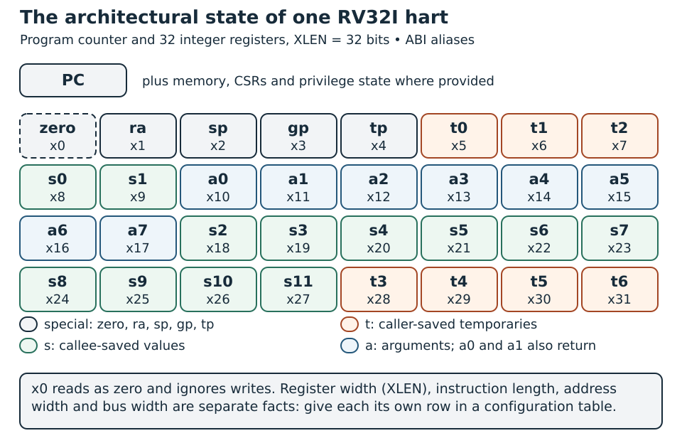
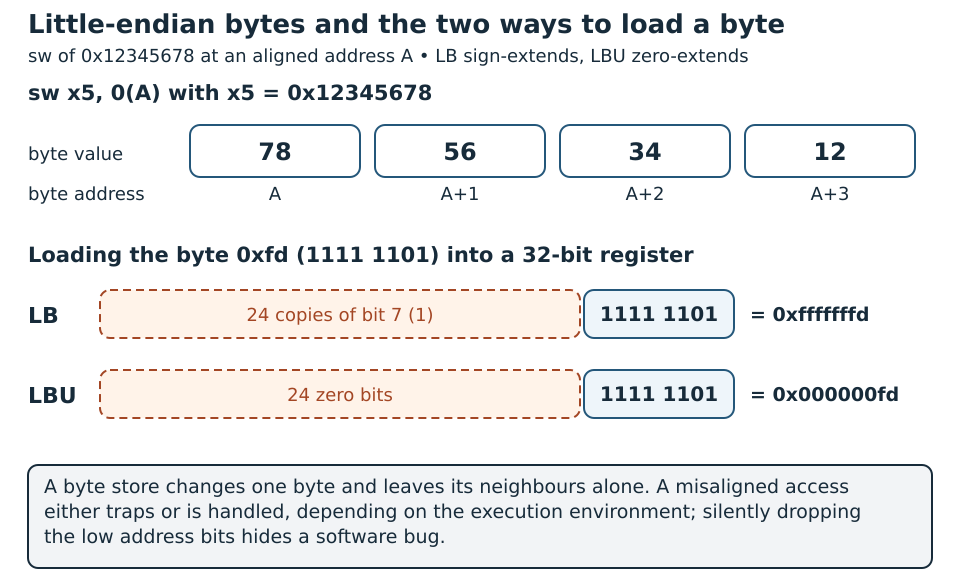

# RISC-V ISA: The Hardware–Software Contract {#sec-riscv-isa}

An instruction-set architecture (ISA) specifies what a program can observe when instructions execute. A microarchitecture specifies how a circuit produces that behavior. A compiler needs the former; an RTL designer chooses the latter. Keeping the distinction explicit makes it possible to compare a functional simulator, Wally RTL and an implemented FPGA without confusing identical results with identical timing.

This chapter develops the integer programming model and the encodings needed to read a RISC-V datapath. It draws on Chapters 2 and 3 and the immediate-extension discussion in Chapter 7 of *RISC-V System-on-Chip Design* [@harrisRiscvSoc]. The ratified instruction-set manuals remain the normative reference [@riscvUnprivilegedSpec]. The examples start with RV32I and explicitly identify extensions and platform services instead of assuming that every RISC-V implementation includes them.

To check what you read here, `python labs/run.py run isa` in the [laboratory package](../../appendices/reproducible-labs.qmd) assembles a short RV32I program and compares its signature with the expected one. `python labs/run.py run foundations` tests the immediate decoder against every I and S immediate, every branch offset and the jump and upper-immediate boundaries.

## Concepts

### ISA, ABI and platform {#isa-abi-and-platform}

Three contracts cooperate to run a program:

| Contract | What it defines | What it leaves open |
|---|---|---|
| ISA | Instruction encodings and architectural effects | Pipeline depth, cache sizes and physical frequency |
| Application binary interface (ABI) | Register conventions, data layout and binary interfaces | Internal implementation of arithmetic or memory |
| Platform/execution environment | Memory map, startup and device/service conventions | Many internal implementation choices |

: ISA, ABI and platform: what each contract defines and leaves open {#tbl-risc-v-isa-isa-abi-platform-contract}

An ISA instruction that stores a word does not specify which address is a UART. The platform defines that address and the peripheral's register behavior. The ABI can specify which registers carry function arguments without making those register roles mandatory for every assembly program.

An ELF binary also depends on its loading environment. A freestanding program linked for a simulation RAM is not automatically a Linux executable or a board boot image. Later simulation and FPGA chapters add those environments; here we make every address assumption visible.

### A hart and its architectural state

A **hart** is a hardware thread of execution. A simple core provides one hart; other implementations can provide several. It is useful to describe one hart as state plus rules for transitions when instructions complete.

For the base RV32I integer programming model, the relevant state consists of a program counter and 32 integer register names, each 32 bits wide. `x0` reads as zero and ignores register writes. `x1` through `x31` can hold addresses, bit masks, signed values or unsigned values; the operation determines their interpretation. These are properties of the programming model, not a required register-file circuit [@riscvRv32Base].

Memory and execution-environment behavior complete the state visible to a program. A richer configuration can also expose CSRs, floating-point state, vector state and privilege state. A cache valid bit or pipeline occupancy bit is implementation state, even though it influences execution time.

`XLEN` is the width of the integer registers, and nothing more. Instructions are not `XLEN` bits long, physical addresses need not be that wide, and a bus does not have to move one `XLEN`-bit word per cycle. Giving register width, address width and data-bus width their own rows in a configuration table saves a surprising amount of debugging later.

### Integer representation and modular arithmetic

An $n$-bit unsigned value ranges from zero to $2^n-1$. The same bit pattern interpreted in two's complement ranges from $-2^{n-1}$ to $2^{n-1}-1$. For 32 bits, `0xffffffff` means either unsigned 4294967295 or signed -1.

Ordinary integer addition keeps the low `XLEN` bits and never traps on signed overflow, so `0x7fffffff + 1` simply produces `0x80000000`. Software that needs overflow detection adds its own checks. The same wrap-around matters in an RTL scoreboard: mask the expected result to the architectural width, because an unlimited host integer will happily compute a value the register can never hold.

Signedness affects comparisons and right shifts. `SLT` and `BLT` interpret operands as signed; `SLTU` and `BLTU` interpret them as unsigned. Arithmetic right shift replicates the sign bit; logical right shift introduces zeros. An incorrect SystemVerilog cast can implement the wrong instruction despite a correct opcode decoder.

| Operation on `0xffffffff` and `1` | Result |
|---|---|
| Signed less-than | True: -1 is below 1 |
| Unsigned less-than | False: maximum unsigned value exceeds 1 |
| Logical right shift by one | `0x7fffffff` |
| Arithmetic right shift by one | `0xffffffff` |

: Signed and unsigned results for the same bit pattern {#tbl-risc-v-isa-signed-unsigned-results-same}

For register shifts in RV32I, the effective shift amount comes from the low five bits of the second operand. A host-language model that shifts by the entire register value gets this wrong, which is a classic way for a reference model to disagree with correct hardware. Encoding checks matter too: an immediate shift borrows part of its apparent immediate field to select the operation.

### Register names and the calling convention

Assembly uses both architectural names and ABI aliases. The alias helps a human understand software intent; it does not create a different register.

| Registers | ABI aliases | Conventional use |
|---|---|---|
| `x0` | `zero` | Constant zero |
| `x1` | `ra` | Return address |
| `x2` | `sp` | Stack pointer |
| `x3`, `x4` | `gp`, `tp` | Global and thread pointers |
| `x5`–`x7`, `x28`–`x31` | `t0`–`t6` | Caller-saved temporaries |
| `x8`, `x9`, `x18`–`x27` | `s0`–`s11` | Callee-saved values; `s0` can be frame pointer |
| `x10`–`x17` | `a0`–`a7` | Arguments; `a0` and `a1` also carry returns |

: Integer registers, ABI aliases and conventional use {#tbl-risc-v-isa-integer-registers-abi-aliases}

For the standard integer calling convention, a callee preserves callee-saved registers it modifies. A caller saves live caller-saved values if a call might overwrite them. The ordinary stack alignment is 16 bytes; reduced-register conventions have separate rules. These conventions are specified by the processor-specific ABI, rather than inferred from a pipeline diagram [@riscvPsabi].

@fig-isa-register-map shows the architectural state of one RV32I hart with the ABI aliases of @tbl-risc-v-isa-integer-registers-abi-aliases.

{#fig-isa-register-map width=100% fig-alt="A program counter and a grid of 32 integer registers with their ABI names"}

### RV32I instruction families

Organize the base instructions by their effects before studying encodings. @tbl-risc-v-isa-rv32i-instruction-families-main is a reading guide, not an exhaustive decoder specification.

| Family | Examples | Main effect |
|---|---|---|
| Register arithmetic | `add`, `sub`, `slt`, `sltu` | Read two registers and write a result |
| Immediate arithmetic | `addi`, `slti`, `sltiu` | Combine register and encoded immediate |
| Bit operations | `and`, `or`, `xor`, immediate variants | Transform bit fields |
| Shifts | `sll`, `srl`, `sra`, immediate variants | Move bits with defined fill and shift width |
| Upper immediate | `lui`, `auipc` | Form constants or PC-relative values |
| Loads | `lb`, `lbu`, `lh`, `lhu`, `lw` | Read bytes and extend a value |
| Stores | `sb`, `sh`, `sw` | Modify selected memory bytes |
| Conditional branches | `beq`, `bne`, `blt`, `bge`, unsigned variants | Choose sequential or target PC |
| Jumps | `jal`, `jalr` | Redirect execution and optionally save a link |
| Ordering/environment | `fence`, `ecall`, `ebreak` | Ordering or execution-environment interaction |

: RV32I instruction families and their main effects {#tbl-risc-v-isa-rv32i-instruction-families-main}

Only loads and stores in this basic programming model access ordinary data memory. An `add` does not implicitly read a memory operand. A store has no integer destination register; a branch compares operands but ordinarily does not write an integer result. These distinctions become control enables in the next foundation chapter.

### Instruction formats and immediate reconstruction

A base instruction word is 32 bits. Common register fields occupy fixed positions: `rd` at bits 11:7, `rs1` at 19:15 and `rs2` at 24:20 when that operand exists. The low seven bits identify an opcode family. `funct3` and, where relevant, upper instruction bits distinguish members of the family.

| Format | Typical use | Fields and immediate |
|---|---|---|
| R | Register arithmetic | `funct7`, `rs2`, `rs1`, `funct3`, `rd`, opcode |
| I | Immediate ALU, loads, `jalr` | 12-bit immediate plus `rs1`, `funct3`, `rd` |
| S | Stores | Immediate split across upper bits and bits 11:7 |
| B | Conditional branches | Signed displacement with implied low zero bit |
| U | `lui`, `auipc` | Upper 20 bits followed by twelve zero bits |
| J | `jal` | Signed displacement assembled from several fields |

: Instruction formats, typical use and immediate fields {#tbl-risc-v-isa-instruction-formats-typical-use}

Follow @fig-isa-formats from bit 31 to bit 0. The register fields stay in the same place across formats, and only the immediate fields move.

{#fig-isa-formats width=100% fig-alt="Six 32-bit instruction formats R, I, S, B, U and J with their bit fields"}

The branch and jump immediates are wiring permutations, not numbers obtained by taking one contiguous instruction slice. For RV32, their reconstruction can be written:

```text
I = sign_extend(instruction[31:20], 12)
S = sign_extend({instruction[31:25], instruction[11:7]}, 12)
B = sign_extend({instruction[31], instruction[7],
                 instruction[30:25], instruction[11:8], 0}, 13)
U = {instruction[31:12], 12 zero bits}
J = sign_extend({instruction[31], instruction[19:12],
                 instruction[20], instruction[30:21], 0}, 21)
```

For a general I-format immediate, the range is -2048 through 2047. B-format offsets span -4096 through 4094 bytes in steps of two; J-format offsets span -1048576 through 1048574 bytes in steps of two. Instruction-target alignment is a separate check: a pure RV32I instruction stream requires four-byte alignment, even though an offset encoding can express a two-byte step.

Decode the whole operation before applying these formulas. Immediate shifts and CSR-immediate instructions share the I format but give their immediate field a different meaning, so a well-formed format is not yet a legal instruction: each opcode still has to be checked against its own rules.

### Loads, stores and byte addresses

Memory addresses identify bytes. A word access at address $A$ covers bytes $A$ through $A+3$ in RV32. Address generation adds a base-register value to a signed displacement; it does not multiply that displacement by four.

This book's teaching systems use little-endian data storage. Storing `0x12345678` at an aligned address produces bytes `78`, `56`, `34`, `12` at increasing addresses. Do not confuse a simulator's word-oriented hex file with this byte-addressed architectural view: the loader must translate its chosen representation correctly.

`LB` sign-extends an eight-bit value; `LBU` zero-extends it. Reading byte `0xfd` yields `0xfffffffd` with `LB` and `0x000000fd` with `LBU`. A byte store changes one byte without changing its neighbours. The LSU and byte-enable logic implement these effects over a potentially wider memory port.

Natural alignment places halfwords at multiples of two and words at multiples of four. Whether a misaligned data access is handled or traps depends on the execution environment. A teaching design that supports only aligned accesses should reject the others explicitly; silently dropping the low address bits turns a software bug into a wrong answer that is hard to trace. Accesses that cross a device or protection boundary need the same care, since they are not just two harmless RAM reads.

@fig-isa-load-store-bytes works through the byte-order and sign-extension examples.

{#fig-isa-load-store-bytes width=100% fig-alt="Four stored bytes at increasing addresses and the two load results"}

### Control flow and PC-relative addressing

In an uncompressed base stream, ordinary sequential execution advances the PC by four. A taken conditional branch adds its signed displacement to the address of the branch instruction, not to the already incremented PC. An untaken branch advances sequentially.

`JAL` computes a PC-relative target and writes the address following the instruction to its destination. `JALR` computes a target from a register and signed immediate and clears target bit zero. Clearing that bit does not make the target four-byte aligned, so a pure RV32I implementation still needs its own target-alignment check.

`AUIPC` combines the current PC with an upper immediate. Together with another instruction it can reach data or a distant function without embedding one absolute address. Linker relocations fill in the actual fields after section placement.

Calls and returns are software uses of jump instructions. `ret` is commonly expanded to `jalr x0, 0(ra)`. Saving a link in `x0` discards the link, while the jump still occurs. Likewise, a load targeting `x0` is not permission to remove the memory access: its exceptions or device-read effects can still matter.

### Pseudoinstructions, relocation and disassembly

An assembler can accept mnemonics that are not separate ISA encodings:

| Assembly form | Typical expansion or interpretation |
|---|---|
| `nop` | `addi x0, x0, 0` |
| `mv rd, rs` | `addi rd, rs, 0` |
| `j label` | `jal x0, label` |
| `ret` | `jalr x0, 0(ra)` |
| `li rd, constant` | One or more instructions depending on value |
| `la rd, symbol` | Address materialization with relocations; depends on code model |

: Pseudoinstructions and their typical expansions {#tbl-risc-v-isa-pseudoinstructions-typical-expansions}

Disassemble the linked ELF, not just the object file, when checking actual control-flow offsets and addresses. Relaxation can shorten sequences, and enabled compressed instructions can change instruction lengths. The exercise below disables both to make the first trace easier to predict.

### Extensions and RV64

Base names describe integer width and an instruction base, not a complete board. `M` adds multiplication/division; `A` adds atomic operations; `F` and `D` add floating-point facilities; `C` adds compressed encodings. `Zicsr`, `Zifencei`, `Zicntr` and `Zihpm` name separate facilities relevant to control, instruction visibility and counters. An advertised extension needs its defined behavior, not one convenient instruction from it.

RV64 requires more than widening every RV32 register declaration. It adds instructions and operand-width rules, including word operations whose 32-bit results are sign-extended to 64 bits. Decode, arithmetic, loads, address handling, ABI and verification all need deliberate review. The book uses RV32 examples for a compact first design and studies configurable Wally instances later.

The compiler's `-march` selects available instructions; `-mabi` selects the binary calling/data convention. An RV32I ELF is not compatible with an arbitrary program compiled using multiplication, compressed instructions or floating-point register arguments. Inspect attributes and disassembly before blaming hardware for an unsupported instruction.

### Privilege, CSRs and traps: the boundary

Machine, supervisor and user modes are sets of access and execution rules, not pipeline stages. A small platform may offer only machine mode, while an application system adds further modes, address translation and protection. Whichever you build, implement the privileged rules that apply to it [@riscvPrivilegedSpec].

CSRs form a separate register address space. `Zicsr` specifies read/write, set and clear operations and their immediate forms. Some CSRs serve unprivileged facilities, so reading a CSR and holding privilege are two separate questions. Reading with `CSRRS` and source register `x0` suppresses its write, whereas `CSRRW` with destination `x0` suppresses its read [@riscvZicsrFoundation].

A trap transfers control for an exception or interrupt. `ECALL` requests execution-environment handling; it is not a universal exit instruction. `EBREAK` is a breakpoint instruction; its routing depends on debug and trap configuration. A simulator-specific stop convention belongs to the harness, not to an invented base-ISA rule.

The simplified processor in the Wally chapter intentionally omits these mechanisms. It is a teaching path through ordinary instruction execution, not evidence that a complete platform can ignore traps or instruction legality. Interrupt integration, debug and performance counters are developed in later chapters.

### Memory ordering is not just execution order

The architectural order seen by software is not necessarily the same as every internal request timestamp. Store buffers, caches and other observers complicate visibility. RISC-V's memory model and ordering instructions constrain allowed observations; the memory and bus chapters apply those constraints to concrete systems [@riscvRvWmo].

C `volatile` only constrains what the compiler may do with an access. It does not synchronize harts or guarantee device ordering, which still require hardware fences and the platform's rules. `FENCE.I` is similarly narrow: it belongs to `Zifencei` and makes writes visible to the local instruction fetch, but it neither flushes the data cache in general nor notifies other harts [@riscvZifenceiFoundation].

## Implementation

### A complete RV32 immediate generator

Save this as `rv32_immediate.sv`. `kind` is selected by a separate validated instruction decoder: zero for I, one for S, two for B, three for U and four for J. `format_valid` reports a supported selector; it does not report whether the entire instruction is legal.

```systemverilog
module rv32_immediate (
  input  logic [31:0] instruction,
  input  logic [2:0] kind,
  output logic [31:0] immediate,
  output logic format_valid
);
  always_comb begin
    immediate = '0;
    format_valid = 1'b1;
    case (kind)
      3'd0: immediate = {{20{instruction[31]}}, instruction[31:20]};
      3'd1: immediate = {{20{instruction[31]}}, instruction[31:25],
                         instruction[11:7]};
      3'd2: immediate = {{19{instruction[31]}}, instruction[31],
                         instruction[7], instruction[30:25],
                         instruction[11:8], 1'b0};
      3'd3: immediate = {instruction[31:12], 12'b0};
      3'd4: immediate = {{11{instruction[31]}}, instruction[31],
                         instruction[19:12], instruction[20],
                         instruction[30:21], 1'b0};
      default: format_valid = 1'b0;
    endcase
  end
endmodule
```

The replicated sign bits express a wiring operation, not a cycle-by-cycle algorithm. The combinational default prevents unintended storage. For a later RV64 variant, extend the reconstructed signed value deliberately, including the U-format result; simply padding upper bits with zeros is wrong for negative values.

### A freestanding program with an observable signature

This original example sums four words, checks signed versus unsigned byte loads and writes three signature words. Save it as `isa_demo.S`. No stack or C runtime is needed.

```asm
.option norvc
.option norelax
.section .text
.globl _start
_start:
    la   t0, values
    addi t1, zero, 4
    addi t2, zero, 0
loop:
    lw   t3, 0(t0)
    add  t2, t2, t3
    addi t0, t0, 4
    addi t1, t1, -1
    bne  t1, zero, loop
    la   t4, signature
    sw   t2, 0(t4)
    la   t0, values
    lb   t5, 0(t0)
    lbu  t6, 0(t0)
    sw   t5, 4(t4)
    sw   t6, 8(t4)
    addi zero, zero, 99
.globl stop
stop:
    jal  zero, stop

.section .data
.balign 4
values:
    .word -3, 7, 10, 2
.section .bss
.balign 4
.globl signature
signature:
    .space 12
```

Its minimal linker script, `isa_demo.ld`, defines an illustrative RAM layout. A simulator or RTL loader must actually supply memory at these addresses. Change the script to match a real board rather than assuming its map is identical.

```ld
ENTRY(_start)
MEMORY { RAM (rwx) : ORIGIN = 0x80000000, LENGTH = 0x2000 }
SECTIONS {
  .text 0x80000000 : { *(.text*) } > RAM
  .data 0x80001000 : { *(.data*) } > RAM
  .bss  0x80001100 (NOLOAD) : { *(.bss*) *(COMMON) } > RAM
}
```

With a RISC-V GNU bare-metal toolchain installed, build and inspect it with:

```bash
riscv64-unknown-elf-gcc -march=rv32i -mabi=ilp32 \
  -nostdlib -nostartfiles -Wl,--no-relax -T isa_demo.ld \
  isa_demo.S -o isa_demo.elf
riscv64-unknown-elf-objdump -d -M no-aliases isa_demo.elf
riscv64-unknown-elf-readelf -h -A -l isa_demo.elf
```

The `riscv64` tool prefix can belong to a toolchain supporting RV32 through target options; check that the installed distribution supports them. The expected ELF is 32-bit. GNU tools are used here for inspection, while the reference-model chapter explains how to load programs into Spike and Sail. A raw binary alone loses ELF addresses and does not supply a universal end-of-test convention.

An LLVM installation with RISC-V target support and the LLD linker can build the same example:

```bash
clang --target=riscv32 -march=rv32i -mabi=ilp32 \
  -c isa_demo.S -o isa_demo.o
ld.lld -m elf32lriscv --no-relax -T isa_demo.ld \
  isa_demo.o -o isa_demo.elf
```

The assembler/compiler and linker are separate dependencies. Whichever flow is chosen, verify section addresses and use the same signature contract.

| Signature byte address | Expected word | Reason |
|---|---|---|
| `0x80001100` | `0x00000010` | -3 + 7 + 10 + 2 = 16 |
| `0x80001104` | `0xfffffffd` | Sign extension of the low byte of -3 |
| `0x80001108` | `0x000000fd` | Zero extension of that same byte |

: Signature bytes of the freestanding program and the reason for each value {#tbl-risc-v-isa-signature-bytes-freestanding-program}

Configure the harness to stop when execution reaches symbol `stop`, then read the signature. Do not expect the self-loop to terminate a simulator automatically. A timeout detects failure to reach the completion point. The instruction writing `zero` must leave `x0` unchanged.

### From one instruction to a state transition

For `addi x5, x0, -3`, first reconstruct the immediate as `0xfffffffd`, read zero from `x0`, perform 32-bit addition and commit the result to `x5`. Sequential PC advances by four. Other register values remain unchanged.

For `sw x5, 4(x10)`, read the base and store operand, compute the byte address, validate its access, and modify memory. There is no integer destination. For a taken branch, select the target PC but do not apply an unrelated register write. This effect-oriented description is the input to a microarchitectural control table.

Once the state transition is clear, the implementation is free to take one cycle or several. Compare against the reference at the level of architectural effects; a functional simulator has no pipeline stages to reproduce.

## Hands-on Experiments

### Experiment 1: reconstruct immediate values

[Preparation · P0 · C1](../../learning-paths.qmd#sec-path-labels){#act-risc-v-isa-01 .learning-activity}

Test the immediate generator with positive and negative I/S values, the minimum and maximum B/J offsets, U-format high-bit values and unsupported selectors. Construct encoded fields from known immediates in the testbench, then compare against the original values. That way the checker exercises an independent encoding and decoding, instead of repeating the same concatenation in both the implementation and the test.

Choose branch offsets including -4, 2, 4 and 4094. Explain why reconstructing 2 is correct even though branching to a two-byte-aligned address is unsupported in a pure four-byte-aligned stream. Keep immediate formation and target legality as separate tests.

### Experiment 2: inspect the linked program

[Preparation · P0 · C1](../../learning-paths.qmd#sec-path-labels){#act-risc-v-isa-02 .learning-activity}

Build the demonstration and identify every real instruction corresponding to `la`. Decode one `addi`, one `lw`, one `sw` and the backward `bne` manually. Confirm the linked branch target, section addresses and signature symbol. Store the disassembly and compiler version in the report.

Change one constant in the data array, compute a new signature by hand and repeat. Moving data requires relinking; changing memory contents at the same address does not require changing instruction semantics.

### Experiment 3: observe signedness and zero-register behavior

[Preparation · P0 · C1](../../learning-paths.qmd#sec-path-labels){#act-risc-v-isa-03 .learning-activity}

Run directed sequences using `0xffffffff`, `0x80000000`, zero and one. Compare signed/unsigned comparisons and arithmetic/logical shifts. Attempt writes to `x0` using arithmetic and verify reads remain zero. Explain why a load into `x0` still requires memory-access checks.

### Experiment 4: distinguish configuration failures

[Preparation · P0 · C1](../../learning-paths.qmd#sec-path-labels){#act-risc-v-isa-04 .learning-activity}

Compile a small routine that multiplies two runtime operands with RV32I and with RV32IM. Inspect whether the generated code calls a helper or uses a multiplication instruction; do not use a constant expression the compiler folds away. Run only on configurations that implement the generated instructions and provide any called runtime helpers.

Enable compressed instructions in a supported configuration and inspect changed instruction addresses. An uncompressed teaching decoder is not a valid target for that new binary. Write an explicit compatibility table of ISA, ABI, memory map and completion convention.

### Experiment 5: compare models at architectural boundaries

[Advanced · C2](../../learning-paths.qmd#sec-path-labels){#act-risc-v-isa-05 .learning-activity}

Use the reference-model chapter's harness to run the demonstration. Compare final signature words and a trace of PC, destination register and committed value. Then use the same executable on a matching RTL configuration. Record whether each comparison includes memory side effects, traps and devices.

Matching one signature is useful evidence, not exhaustive ISA verification. Add tests for operand aliasing, `rd=x0`, sign boundaries, taken/untaken branches and instruction legality. Carry the resulting instruction/effect table into the microarchitecture chapter and the later Wally study.

<!-- chapter-review:risc-v-isa -->

## Key ideas {#review-risc-v-isa-ideas .unnumbered .unlisted}

- The ISA specifies observable behavior; the microarchitecture chooses how to deliver it.
- Operand interpretation, immediate encoding and the ABI are three distinct contracts, and bugs often hide at their boundaries.

## What you should now be able to explain {#review-risc-v-isa-explain .unnumbered .unlisted}

Explain one instruction from encoding to architectural result, and distinguish an ISA requirement from a calling-convention rule.

## Common mistakes {#review-risc-v-isa-mistakes .unnumbered .unlisted}

Two confusions cause most early errors. The register stores bits; whether they mean a signed or unsigned number is decided by the instruction that reads them. And RISC-V is a family, so a core's extensions and platform services must be checked before you assume a feature exists.

## Try it yourself {#review-risc-v-isa-try .unnumbered .unlisted}

[Preparation · C0](../../learning-paths.qmd#sec-path-labels){#act-risc-v-isa-review .learning-activity}

Decode one load and one branch from the chapter. Check their immediates with the supplied ISA examples and annotate the expected register/PC changes.

## Where this appears in Wally {#review-risc-v-isa-wally .unnumbered .unlisted}

::: {.callout-note title="Wally Connection" icon=false}
Follow decoded controls in [src/ieu/controller.sv](https://github.com/antoniofloresgil/cvw/blob/3b30ba6b6519bd2c26c1437e6d61f632a35cef6c/src/ieu/controller.sv) and their use in [src/ieu/ieu.sv](https://github.com/antoniofloresgil/cvw/blob/3b30ba6b6519bd2c26c1437e6d61f632a35cef6c/src/ieu/ieu.sv). Compare the selected extension configuration with the instruction you traced.
:::

## Further reading {#review-risc-v-isa-reading .unnumbered .unlisted}

Continue with @sec-microarchitecture and @sec-privileged-mmu. Follow the chapter sources [@harrisRiscvSoc; @riscvUnprivilegedSpec].
