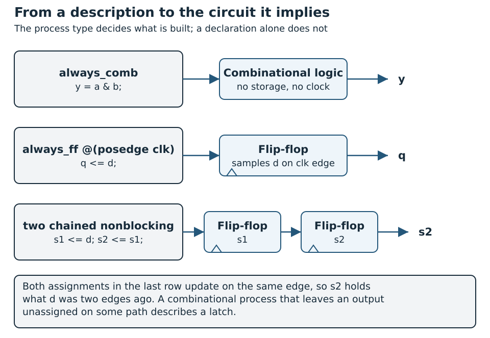
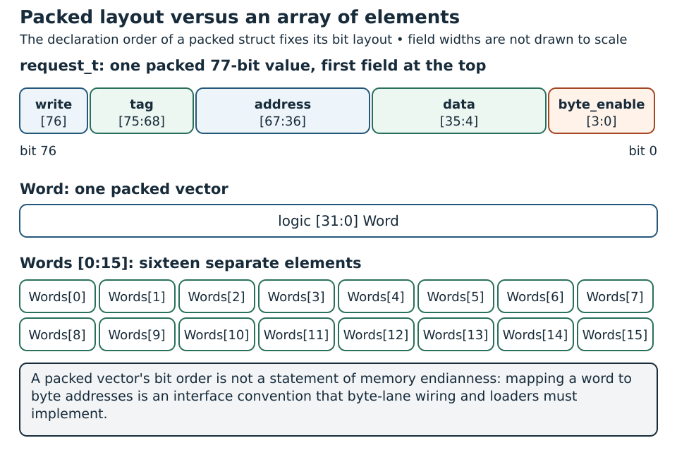

# SystemVerilog for Hardware Design {#sec-systemverilog}

Many of the first bugs in SystemVerilog are not syntax errors: a latch where a wire was meant, a width that silently truncates, a register that never resets. This chapter teaches the part of the language that describes hardware predictably, and how to read the circuit that a description implies.

The small modules in it, a word selector, an enabled sample pipeline, a request controller, an elastic slice and an instruction decoder, are exercised by `python labs/run.py run foundations` in the [laboratory package](../../appendices/reproducible-labs.qmd).

## Concepts

[]{#ref-systemverilog-concepts .reference-destination}

This chapter follows the hardware-design topics in Chapter 4 of *RISC-V System-on-Chip Design* [@harrisRiscvSoc]. The explanations and examples below are written for this book. The [Wally coding-style appendix](../../appendices/wally-style.qmd) summarizes Section 4.3 of the supplied edition; the [keyword cheat sheet](../../appendices/systemverilog-cheatsheet.qmd) provides a quick reference.

### From Verilog to SystemVerilog

Verilog began as a language for modeling and simulating digital circuits and became a widely used input to logic synthesis. Classic Verilog already describes modules, continuous assignments, clocked processes, hierarchy, and parameterized hardware. Later revisions improved practical RTL coding with features such as ANSI-style port declarations, automatic combinational sensitivity lists, and generate constructs.

SystemVerilog builds on that foundation and keeps its hardware model. Newer constructs express intent more clearly and support stronger checks. Following Wally's design conventions, this book uses `logic` for ordinary RTL signals. The declaration says nothing about storage; the process decides: `always_comb` describes combinational behavior, while `always_ff` describes sequential behavior. Resolved bidirectional IO connections use `tri` where required.

@fig-sv-description-hardware shows three descriptions and the circuit each one implies.

{#fig-sv-description-hardware width=100% fig-alt="An always_comb block drawn as combinational logic, an always_ff block as a flip-flop and two chained assignments as two flip-flops"}

Classic Verilog's `wire` and `reg` declarations often confused beginners because their names suggested physical hardware while their language semantics distinguished nets from procedural variables. A `wire` represents a connection whose value is determined by its drivers; a `reg` holds a procedural value in simulation, but can synthesize into combinational logic, a latch, or a flip-flop depending on how it is assigned. Thus, `reg` does not necessarily mean a hardware register, and neither declaration alone determines the circuit. SystemVerilog still supports both for compatibility: `reg` has not been removed and denotes the same four-state data type as `logic`. For new ordinary single-driver RTL, this book follows Wally's convention of declaring signals as `logic`, using `always_comb` with complete assignments for combinational logic and `always_ff` for clocked registers. The alternative to an actual hardware register is therefore not a different storage type: it is a `logic` signal driven by a clocked process. Resolved connections with multiple drivers still require an appropriate net declaration, such as `tri` for bidirectional IO; a bare `logic` variable does not replace that resolution behavior. The terminology and continued compatibility are discussed in the [Accellera SystemVerilog committee archive](https://www.accellera.org/images/eda/sv-bc/1868.html).

| Classic Verilog pattern | SystemVerilog approach | Practical benefit |
| --- | --- | --- |
| `always @*` | `always_comb` | Declares combinational intent, evaluates initially, and enables additional tool checks |
| `always @(posedge clk)` | `always_ff @(posedge clk)` | Declares sequential intent and constrains how the written variables are driven |
| Numeric state constants | `typedef enum` | Named states and a defined state type |
| Related declarations repeated across files | `package`, `import`, `struct` | Shared types and structured configuration |
| Procedural testbench checks | Assertions and temporal properties | Checks can express behavior across clock cycles |

: Classic Verilog constructs and their SystemVerilog counterparts {#tbl-systemverilog-classic-verilog-constructs-systemverilog}

SystemVerilog also adds classes, constrained randomization, coverage, and other verification facilities. Those features are what make test environments productive, but a synthesizable processor datapath is normally written in the plainer RTL subset. File extensions such as `.sv` select language mode in many tools, so it pays to confirm which frontend and language subset you are really using before relying on a feature.

### Think in hardware before writing code

An HDL description contains concurrent processes and connected components. The ordering of statements inside one process matters, but different modules and processes operate concurrently. A procedural `for` loop with a static bound commonly describes repeated hardware work; it does not automatically mean one operation per clock cycle. A multicycle algorithm needs explicit state and sequencing.

Start from a block diagram, interface contract, and clock/reset plan. Identify combinational transformations, registers, memories, and control state. Decompose the design hierarchically, reuse verified components, and keep changes under version control. Simulation checks modeled behavior; synthesis maps supported RTL into a target technology. Neither step alone proves that the physical circuit meets its timing constraints.

### Modules, hierarchy, and parameters

A `module` defines a component with ports and internal logic. Instantiating it creates an instance of that component, rather than calling a software subroutine. Inputs and outputs describe signal direction; an `inout` models a bidirectional connection and normally belongs at an external IO boundary.

`parameter` values configure an instance during elaboration. `localparam` names a constant that cannot be overridden by an instantiation. Width and depth parameters change the generated hardware; they are not runtime control registers. Require legal values before using them in ranges or replication counts.

Named connections such as `.Data(DataE)` make port mapping explicit. The shorthand `.clk` means `.clk(clk)`. Positional connections are concise but depend on declaration order. Wildcard `.*` connects matching names implicitly and can make large interfaces harder to trace.

### Types, widths, and four-state simulation

`logic` represents `0`, `1`, `x`, and `z`. An `x` represents an unknown simulation value, often from uninitialized state; `z` represents high impedance. Neither is an extra binary state stored by an ordinary flip-flop. Investigate unexpected unknowns instead of relying on them as a universal error-detection mechanism.

`bit` is a two-state type. Converting an unknown to a two-state value can hide an initialization error. Use it deliberately, especially in memory models and testbenches. A variable declared `logic` is appropriate for ordinary single-driver RTL; use a net such as `tri` when modeling a resolved, multiply driven IO connection. The data type alone does not decide whether hardware is combinational or sequential.

```systemverilog
logic [15:0] Word;          // One packed 16-bit vector
logic [15:0] Bank [0:7];   // Eight unpacked entries, each 16 bits
logic signed [15:0] Offset;
```

Dimensions before the identifier are packed; dimensions after it describe an unpacked array. Signedness affects arithmetic, extension, comparisons, and right shifts. Explicitly size constants and review mixed signed/unsigned expressions.

| Expression | Meaning |
| --- | --- |
| `12'hA35` | A 12-bit hexadecimal value |
| `8'd19` | An 8-bit decimal value |
| `'0`, `'1` | Fill the destination context with zeros or ones |
| `Word[7:0]` | Select the low byte |
| `Word[ByteIndex*8 +: 8]` | Select eight bits starting at a variable bit position |
| `{Upper, Lower}` | Concatenate two vectors |
| `{{8{Offset[7]}}, Offset[7:0]}` | Sign-extend an 8-bit slice to 16 bits |

: Common SystemVerilog expressions and their meaning {#tbl-systemverilog-common-systemverilog-expressions-meaning}

Bitwise operators (`&`, `\|`, `^`, `~`) operate on individual bits. Logical operators (`&&`, `\|\|`, `!`) evaluate truth values. A unary reduction such as `\|Word` reduces a vector to one bit. In a four-state simulator, `==` can return unknown, whereas `===` compares unknown and high-impedance values explicitly; case equality is useful in testbench checks.

### Expression width and signedness are part of the circuit

Binary arithmetic has finite width, and a tool warning is a poor way to find out which carry bits you needed. Say it in the code: extend the operands explicitly when an addition requires an extra result bit:

```systemverilog
logic [15:0] Left, Right;
logic [16:0] WideSum;
assign WideSum = {1'b0, Left} + {1'b0, Right};
```

The extra bits express an unsigned 17-bit addition. Assigning to a narrower destination discards upper bits; that is appropriate for architectural modular arithmetic but wrong if a counter overflow must be detected. Document which behavior each block requires.

Signed declarations and casts affect comparisons and arithmetic shifts. `$signed(Data)` changes interpretation without increasing width. For sign extension, replicate the sign bit or assign a deliberately signed value to an appropriately sized signed destination. Part-selects and concatenations can lose the signed interpretation expected by the author.

```systemverilog
logic [31:0] Data;
logic [4:0] Shift;
logic [31:0] LogicalRight, ArithmeticRight;
assign LogicalRight    = Data >> Shift;
assign ArithmeticRight = $signed(Data) >>> Shift;
```

For `Data = 32'h80000000` and `Shift = 1`, the results are `32'h40000000` and `32'hc0000000`. The RISC-V ALU must distinguish these operations; the register declaration alone cannot determine which instruction is executing.

Use sized literals where bit width is meaningful. `'0` fills the destination with zeros, whereas `32'h0` is explicitly 32 bits. An unsized integer literal participates in expression sizing and signedness rules; avoid using a convenient unsized `1` when a parameterized bit vector requires an unambiguous width. This is especially relevant for masks and shifts near the highest bit.

| Intended operation | Review question |
|---|---|
| Addition with carry | Are operands extended before the operation? |
| Architectural addition | Is truncation to `XLEN` intentional? |
| Signed comparison | Are both compared operands signed at the comparison? |
| Arithmetic shift | Is the left operand signed before `>>>`? |
| Parameterized mask | Can width or shift reach an invalid range? |
| Byte extraction | Are bit index and byte-address interpretation consistent? |

: Review questions for width and signedness {#tbl-systemverilog-review-questions-width-signedness}

@fig-sv-width-and-shift shows the two examples of this section.

{#fig-sv-width-and-shift width=100% fig-alt="An addition with extended operands and three versions of a right shift"}

### Packed fields, arrays and endianness

Packed dimensions describe one bit-vector representation. Unpacked dimensions describe an array of elements. These declarations have different roles:

```systemverilog
logic [31:0] Word;
logic [31:0] Words [0:15];
typedef struct packed {
  logic write;
  logic [7:0] tag;
  logic [31:0] address;
  logic [31:0] data;
  logic [3:0] byte_enable;
} request_t;
request_t PendingRequest;
```

`Words` is an array of sixteen words. `PendingRequest` is one packed item whose declaration order determines its bit layout. A struct is useful for retaining metadata together, but the external protocol still defines the meaning of its fields.

A packed vector's bit order is not a statement of memory endianness. Mapping a word to four byte addresses is an interface convention. The foundation ISA example assumes little-endian storage; byte-lane wiring and image loaders must implement that convention explicitly.

Indexed part-selects such as `Data[8*lane +: 8]` select eight increasing bit positions from a base index. The width is fixed; the base may vary. Prove that the index stays in range. An out-of-range selection does not implement address wrapping or an architectural misalignment handler.

@fig-sv-packed-struct-and-arrays contrasts a packed struct with an array of words.

{#fig-sv-packed-struct-and-arrays width=100% fig-alt="A struct of five fields, a single vector and an array of sixteen elements"}

### Legal parameters and elaboration

`$clog2(DEPTH)` is useful for an address width, but `$clog2(1)` is zero. A range based on that result needs either a documented minimum depth or a guarded width. A FIFO supporting arbitrary depths also needs pointer wrapping; unused binary pointer encodings do not disappear merely because the array is smaller.

```systemverilog
localparam int AddressWidth = (DEPTH < 2) ? 1 : $clog2(DEPTH);
```

This avoids a zero-width address declaration. It does not make `DEPTH=0` legal or prove every pointer value maps to an element. Specify legal parameter ranges and test their boundaries.

Generate conditions select hardware at elaboration. A runtime input selects behavior in existing hardware. A disabled optional unit must leave every required output with a defined driver; otherwise one configuration can appear healthy while another contains undriven control signals.

For Wally, typed configuration fields, packages and compilation order are important. Record the frontend that simulation and synthesis actually use. The native Yosys `read_verilog -sv` frontend supports a subset of SystemVerilog, and the full design may need other frontends or preprocessing flows [@yosysDocumentation]. A small example that compiles with a simpler command is a good sign, but the project's tested frontend is the one that counts.

### Combinational logic

Use `assign` for a continuously driven expression and `always_comb` for procedural decisions or several related calculations. Both describe logic whose outputs depend on current inputs, without storage.

Within `always_comb`, use blocking assignments (`=`), set defaults, and cover all paths. An omitted assignment can imply a latch even when the block is labeled combinational; lint and synthesis should flag that mismatch. `if` chains express priority. `case` selects among patterns; `casez` supports wildcard matching, which requires care because it can hide unexpected input values. `unique` adds an exclusivity/completeness expectation, but does not remove the need to define intended behavior.

### Registers, reset, and assignment scheduling

Use `always_ff @(posedge clk)` to describe rising-edge storage and nonblocking assignments (`<=`) to update it. Right-hand sides are evaluated when the process runs; updates occur later in the simulation time step. Thus, two chained nonblocking assignments can preserve two distinct pipeline stages.

A synchronous reset is tested inside a clock-only process. An asynchronous reset also appears as an event in the sensitivity list. Reset polarity, assertion, release, and priority relative to enable or clear are part of the interface contract. An omitted clocked assignment retains state; an omitted combinational assignment can infer unwanted storage.

A latch is level-sensitive, not edge-triggered. `always_latch` documents intentional latch behavior, but the synchronous design discipline used here normally avoids latches outside carefully reviewed special circuits.

### Finite-state machines and memories

An FSM combines a state register, next-state logic, and outputs. Moore outputs depend on registered state; Mealy outputs also depend on current inputs. Enumerated states, combinational defaults, and a defined response to invalid encodings make the controller easier to inspect. Recovery behavior must follow the specification rather than silently masking faults.

A memory declaration describes an array, not a guarantee of a particular RAM resource. Define synchronous or asynchronous read timing, write ports, byte enables, chip enable, and same-address read/write behavior. A synchronous read is commonly written `ReadData <= Memory[Address]` in a clocked process; an asynchronous read commonly uses `assign`. Multiported arrays may require a register-based implementation or a suitable macro. FPGA and ASIC memory libraries impose different constraints.

### Configurable hardware and verification boundaries

An elaboration-time `if` selects which hardware exists. A generate `for` with a `genvar` creates instances or structures; a procedural loop inside a process describes that process's behavior. Neither loop is an implicit cycle counter.

Packages share types and constants. A packed configuration structure can carry many parameters through a hierarchy, allowing separate core instances to use different configurations. Wally uses a structure named `P`, with fields such as `P.XLEN`, rather than relying entirely on global text macros.

Preprocessor directives such as backtick `include` and `define` act on source text. They are distinct from typed parameters and package imports. Preserve stable interfaces across configurations and drive disabled-feature outputs to defined values.

Assertions check assumptions and behavior; specify their sampling and reset conditions. Delay controls such as `#5` schedule simulation events and belong in testbenches here. They are not physical timing constraints. Classes, randomized stimulus, reporting tasks, and coverage belong to verification; synthesis support for initialization and memory-loading constructs is target dependent.

### Reusable interfaces

Reusable RTL describes hardware with an explicit contract: interface widths, legal parameter values, reset behavior, latency, and rules for accepting transactions. Parameterization is useful when it exposes architectural choices; it becomes costly when every combination creates a different, unverified design.

Use `always_ff` for registers and nonblocking assignments for their updates. Use `always_comb` and blocking assignments for combinational calculations, assigning every output on every path to avoid accidental latches. Enumerated states make control logic easier to review. Keep the datapath (storage, arithmetic, and multiplexers) distinct from control (state transitions, enables, and counters).

A ready/valid channel transfers an item when both signals are high at the sampling clock edge. The producer owns data and valid; the consumer owns ready. Once valid is asserted, the producer must retain valid and the payload until acceptance. Backpressure changes when a transaction completes, not its contents.

### Verification contract for RTL semantics

Use @sec-verification-methodology to turn each RTL example into explicit obligations: widths/signedness, combinational completeness, clock-edge state updates, reset priority and enable behavior. Elaborate a second legal parameter value, then test boundary operands and simultaneous controls against an independently derived result. A synthesizable module and a successful compile are distinct from a verified behavior. Include four-state/reset checks where unknown initialization matters; choosing `logic` does not eliminate X/Z semantics.


## Implementation

### A parameterized combinational block

```systemverilog
module word_select #(parameter int WIDTH = 16)(
  input  logic [WIDTH-1:0] Left, Right,
  input  logic            UseRight,
  output logic [WIDTH-1:0] Selected);

  always_comb begin
    Selected = Left;
    if (UseRight) Selected = Right;
  end
endmodule
```

Every path assigns `Selected`, so this describes a multiplexer without a latch. In a parent module, `word_select #(.WIDTH(32)) choice(.Left(A), .Right(B), .UseRight(Sel), .Selected(Y));` creates a 32-bit instance. `A`, `B`, `Sel`, and `Y` must be declared in that parent.

### An enabled register and a two-stage pipeline

```systemverilog
module sample_pipeline #(parameter int WIDTH = 16)(
  input  logic             clk, reset, Enable,
  input  logic [WIDTH-1:0]  Sample,
  output logic [WIDTH-1:0]  StageOne, StageTwo);

  always_ff @(posedge clk) begin
    if (reset) begin
      StageOne <= '0;
      StageTwo <= '0;
    end else if (Enable) begin
      StageOne <= Sample;
      StageTwo <= StageOne;
    end
  end
endmodule
```

When enabled, `StageTwo` receives the previous `StageOne`, not the newly sampled input. This example uses synchronous active-high reset and gives reset priority over enable. When enable is low, both stages hold. Replacing the assignments with blocking assignments changes the sequential behavior described by the process.

### An enumerated controller

```systemverilog
module request_control(input logic clk, reset, Start, Complete,
                       output logic Busy);
  typedef enum logic {Idle, Active} state_t;
  state_t State, NextState;

  always_ff @(posedge clk)
    if (reset) State <= Idle;
    else       State <= NextState;

  always_comb begin
    NextState = State;
    case (State)
      Idle:    if (Start) NextState = Active;
      Active:  if (Complete) NextState = Idle;
      default: NextState = Idle;
    endcase
  end

  assign Busy = (State == Active);
endmodule
```

`Busy` is a Moore output. `Start` while active is ignored in this contract, and reset returns the controller to idle. These decisions belong in its tests.

### A ready/valid elastic buffer {#a-readyvalid-elastic-buffer}

Consider a one-entry elastic buffer, `rv_slice`. It stores a payload and a valid bit:

```systemverilog
module rv_slice #(
  parameter int DATA_WIDTH = 32
) (
  input  logic clk, rst_n,
  input  logic in_valid,
  output logic in_ready,
  input  logic [DATA_WIDTH-1:0] in_data,
  output logic out_valid,
  input  logic out_ready,
  output logic [DATA_WIDTH-1:0] out_data
);
  logic full_q;
  logic [DATA_WIDTH-1:0] data_q;

  assign in_ready = rst_n && (!full_q || out_ready);
  assign out_valid = rst_n && full_q;
  assign out_data = data_q;

  always_ff @(posedge clk or negedge rst_n) begin
    if (!rst_n) begin
      full_q <= 1'b0;
      data_q <= '0;
    end else if (in_ready) begin
      full_q <= in_valid;
      if (in_valid) data_q <= in_data;
    end
  end
endmodule
```

When empty, the buffer accepts input even if the consumer is stalled. When full and the consumer is ready, it can deliver the old item and capture a replacement on the same edge. When full and stalled, both registers retain their values. The resulting registered forward path has one-cycle latency and can sustain one transfer per cycle after filling.

This design still has a combinational path from `out_ready` to `in_ready`; it does not isolate the backward timing path. The reset gate suppresses visible handshakes while reset is asserted. Reset is asynchronously asserted and active low; system integration must provide safe release. The transport-pipeline chapter develops deeper buffers and timing isolation.

### A decoder with explicit scope and safe defaults

An instruction decoder turns validated instruction fields into control intent. This complete teaching module recognizes only `ADD`, `ADDI`, `LW`, `SW`, `BEQ` and `LUI` in an uncompressed RV32 stream. It is **not a complete RV32I decoder**. Other selectors produce `legal=0` and no side-effect requests. Save it as `foundation_decode.sv`.

```systemverilog
module foundation_decode (
  input  logic [31:0] instruction,
  output logic legal,
  output logic uses_rs1, uses_rs2,
  output logic writes_rd,
  output logic load_word, store_word, branch_equal,
  output logic [2:0] immediate_kind
);
  always_comb begin
    legal = 1'b0;
    uses_rs1 = 1'b0;
    uses_rs2 = 1'b0;
    writes_rd = 1'b0;
    load_word = 1'b0;
    store_word = 1'b0;
    branch_equal = 1'b0;
    immediate_kind = 3'd0;
    case (instruction[6:0])
      7'b0110011: begin
        if (instruction[14:12] == 3'b000 &&
            instruction[31:25] == 7'b0000000) begin
          legal = 1'b1;
          uses_rs1 = 1'b1; uses_rs2 = 1'b1; writes_rd = 1'b1;
        end
      end
      7'b0010011: begin
        if (instruction[14:12] == 3'b000) begin
          legal = 1'b1; uses_rs1 = 1'b1; writes_rd = 1'b1;
        end
      end
      7'b0000011: begin
        if (instruction[14:12] == 3'b010) begin
          legal = 1'b1; uses_rs1 = 1'b1; writes_rd = 1'b1;
          load_word = 1'b1;
        end
      end
      7'b0100011: begin
        if (instruction[14:12] == 3'b010) begin
          legal = 1'b1; uses_rs1 = 1'b1; uses_rs2 = 1'b1;
          store_word = 1'b1; immediate_kind = 3'd1;
        end
      end
      7'b1100011: begin
        if (instruction[14:12] == 3'b000) begin
          legal = 1'b1; uses_rs1 = 1'b1; uses_rs2 = 1'b1;
          branch_equal = 1'b1; immediate_kind = 3'd2;
        end
      end
      7'b0110111: begin
        legal = 1'b1; writes_rd = 1'b1; immediate_kind = 3'd3;
      end
      default: begin end
    endcase
  end
endmodule
```

The immediate selector matches `rv32_immediate` in the ISA chapter. `writes_rd` expresses an instruction's result intent; the register file separately suppresses writes to `x0`. Loads still access memory even with destination zero. Register source fields are extracted elsewhere from fixed bit positions.

These small units are not a complete processor and cannot execute the ISA chapter's whole demonstration by themselves. That program also uses instructions outside this decoder's scope, including byte loads and additional control/address operations. The full Wally configuration and simulation harness supply the complete execution path.

The module says whether a recognised encoding belongs to its limited scope. It does not check memory alignment, privilege, target accessibility or all exceptions. A controller must qualify side effects with instruction validity and successful checks. It also needs an explicit path for unsupported instructions in a complete core.

`case` matching is deliberately exact. Avoid `casex` as a way to make unknown instruction bits act like wildcards: it can hide initialization and transport faults that you would rather see. `unique` and `priority` state your intent, but correct defaults and legality checking still do the real work.

### Verification code is not datapath hardware

Testbench clocks, randomized stimulus and reference models are simulation infrastructure. An `initial` block that toggles a clock with `#5` is only a simulation device; an FPGA or ASIC needs a real clock source. In the same way, a testbench that reads an ELF is not evidence that the synthesized hardware contains a loader.

Assertions are sampled observations of a contract. For example, a retained payload property needs an output-valid condition, its associated ready condition and a reset policy. A check on every cycle without those qualifiers can compare unspecified payload bits and report false failures.

Four-state simulation can expose uninitialized inputs, while a two-state simulation flow can require explicit initialization checks. Neither style makes the verification plan unnecessary. Confirm sampling phases: driving and checking at exactly the active edge in separate procedural processes can create races.

Coverage also needs intent. Executing every `case` branch is useful code coverage, but it cannot tell you whether every instruction aliasing pattern, signed boundary, invalid encoding or stalled transfer was checked. The later simulation chapters turn these requirements into executable tests.

## Hardware Generators and Modern HDL Toolchains {#sec-hardware-generators}

SystemVerilog remains the implementation language used throughout this book. Understanding generators also helps when reading BOOM and XiangShan: their Scala/Chisel source constructs a hardware description before downstream tools implement it. Chisel is a Scala library and compiler plugin; modern Chisel uses CIRCT's `firtool` backend [@chiselInstallation; @chiselVersioning].

| Route | What executes during elaboration? | What implementation tools receive |
| --- | --- | --- |
| Direct SystemVerilog | HDL parameters, constant functions and `generate` constructs specialize modules | Elaborated RTL derived from the written `.sv` |
| Chisel → FIRRTL/CIRCT → SystemVerilog | Scala constructs a circuit using Chisel; the hardware compiler lowers it | Generated `.sv`, then the usual RTL frontend and synthesis flow |
| Parameterized generation | Scripts/templates or generators emit configured RTL; HDL elaboration specializes parameters and `generate` branches | One concrete configuration, with its generated files and parameter manifest |

: Execution routes of hardware generators and what each implements {#tbl-systemverilog-execution-routes-hardware-generators}

These routes overlap: SystemVerilog already supports parameterized hardware, and a Chisel program is itself a generator. A Python/template generator can emit SystemVerilog without introducing FIRRTL. A Scala `if` selects which hardware to construct; Chisel `when` constructs conditional hardware behavior. A static loop may instantiate many adders. Neither implies that one software instruction runs inside the eventual FPGA on each clock edge.

### What the intermediate levels represent

Elaboration produces an early FIRRTL circuit, often called CHIRRTL: modules, typed connections, operations, registers and memories, with source information. It can retain inferred widths and higher-level memory constructs. It describes hardware rather than a sequence of Scala instructions or a placed gate netlist. FIRRTL also names the hardware IR and its lowering semantics; it should not be confused with only the historical Scala FIRRTL compiler.

CIRCT is compiler infrastructure based on MLIR. Its FIRRTL dialect represents that hardware inside the compiler. Lowering can resolve widths, expand aggregate connections, simplify constants and remove unused logic. The `hw`, `comb` and `seq` dialects express modules/connections, combinational operations and sequential elements; SystemVerilog-specific constructs use the `sv` dialect. The emitter then writes SystemVerilog [@circtFirrtl; @circtPasses; @circtVerilog]. Generated SystemVerilog still needs frontend elaboration, synthesis, technology mapping and physical implementation. Timing closure is a separate question that only the implementation flow can answer.

### A small executable comparison

[Advanced · C2 build / C1 run](../../learning-paths.qmd#sec-path-labels){#act-generator-comparison .learning-activity}

[Lab 19](../../labs/19-hardware-generators/README.md) generates an unsigned accumulator with Chisel 6.5.0 and `firtool` 1.62.0, a documented version pairing. It retains the early `.fir`, lowered MLIR and emitted `.sv`. The key arithmetic operation is `sum +& Operand`, which preserves the carry bit; truncating the sum and observing carry are separate decisions. Width is an elaboration parameter, not a runtime register.

The contract is synchronous active-high reset, then clear priority, enabled modular accumulation, a one-cycle `Valid` indication and a non-sticky carry indication. Tests check generated RTL and directly written parameterized SystemVerilog independently against a Python integer reference at widths 8, 16 and 32. At width 16, they also instantiate the unchanged accumulator from the Verilator chapter. Directed boundaries and seeded random traffic include reset during activity, clear together with enable, disabled cycles and overflow.

A deliberately faulty generator gives enable priority over clear. The same test must reject its generated RTL on a directed simultaneous-clear/enable case. Successful compilation, similar RTL text or equal generic synthesis cell counts would not establish equivalence. Passing these sampled traces establishes the stated simulation evidence; a formal equivalence claim requires a separate proof with explicit input, reset and initial-state correspondence, as discussed in @sec-formal-verification.

Backend emission options also matter: this example disables automatic local variables to accommodate the tested Icarus frontend. Valid generated SystemVerilog can still exceed a particular tool's supported subset; record compatibility options alongside the generator parameters.

In the preserved [execution report](../../labs/19-hardware-generators/reference/report.json), all three widths pass 552 sampled cycles each, and the [faulty variant](../../labs/19-hardware-generators/reference/fault-w16-simulation.txt) fails at cycle index 1. Direct/generated generic cell counts are respectively 61/63, 130/132 and 271/273. Read these counts as a statement about the recorded Yosys flow: they say nothing about physical area, and they do not show a behavioral difference.

### Traceability through implementation

Retain the generator revision, parameters, Scala/plugin/backend versions, compiler flags and dependencies, followed by hashes of every IR and emitted RTL file. Join these to verification commands, synthesis inputs, constraints and implementation reports. Source locations and emitted comments help navigate the chain, but one generator expression can become many hardware objects, while optimization can merge or remove others. A signal name alone is not a stable identifier across configurations or compiler releases.

The practice records generic synthesis statistics for both descriptions. They make a useful structural comparison, but they cannot be converted into FPGA LUTs, ASIC area, frequency or power. To extend the experiment physically, feed the preserved emitted RTL into the same target and constraints as the direct version and retain that new implementation evidence.

## Hands-on Experiments

### Fundamentals exercises

1. [Preparation · P0 · C1](../../learning-paths.qmd#sec-path-labels){#act-systemverilog-01 .learning-activity} — Draw the hardware implied by `word_select`, then test both select values and boundary payloads.
2. [Preparation · P0 · C1](../../learning-paths.qmd#sec-path-labels){#act-systemverilog-02 .learning-activity} — Simulate `sample_pipeline` with distinct samples. Check reset priority, disabled cycles, and the two successive register captures. Compare blocking and nonblocking versions as an intentionally incorrect experiment.
3. [Preparation · P0 · C1](../../learning-paths.qmd#sec-path-labels){#act-systemverilog-03 .learning-activity} — Test `request_control` against a transition table, including start while busy and reset while active.
4. [Preparation · P0 · C1](../../learning-paths.qmd#sec-path-labels){#act-systemverilog-04 .learning-activity} — Describe a small RAM with synchronous read and byte writes. Define the collision policy before writing a scoreboard; inspect whether the target tool infers memory or registers.
5. [Preparation · P0 · C1](../../learning-paths.qmd#sec-path-labels){#act-systemverilog-05 .learning-activity} — Elaborate two widths and one disabled optional feature. Confirm interface stability and absence of undriven outputs.

### Ready/valid experiment

[Core · P3 · C1](../../learning-paths.qmd#sec-path-labels){#act-systemverilog-06 .learning-activity}

1. Save the listing as `rv_slice.sv` and lint it with `verilator --lint-only -Wall rv_slice.sv`.
2. Simulate reset, one transfer, several stalled cycles, and simultaneous output consumption/input replacement.
3. Count accepted input and output transactions at each rising edge. A scoreboard should compare output data with the oldest queued input.
4. Repeat with data widths of 8 and 32. Reject nonpositive widths in the integration specification.
5. Extend the block into a FIFO and document whether a full FIFO can accept a write when a read occurs on the same edge.

Record commands, tool versions, waveforms for failures, and an explicit pass/fail result.

### Decoder and arithmetic integration experiment

[Core option · P1 · C1](../../learning-paths.qmd#sec-path-labels){#act-systemverilog-07 .learning-activity}

Connect `foundation_decode` to `rv32_immediate`. Check six supported instruction families and unsupported instructions with the same major opcodes, including `SUB`, non-word loads, other branch comparisons and immediate shifts. Verify no unsupported instruction requests a memory side effect.

Test valid loads with `rd=x0` and confirm decode still requests a load. Connect the register file from the microarchitecture chapter and verify that register zero remains unchanged. This separates operand/result intent from actual storage updates.

Create a matrix of language feature, simulator frontend and synthesis frontend for the small modules and the full Wally project. Include packages, typed configuration, packed structs, assertions and memory loading. Record what each tool is observed to accept, since the tools do not all take the same source subset.

### Connection to the rest of the book

The ISA chapter defines instruction effects; microarchitecture assembles them into datapath/control; this chapter supplies the RTL language used to describe both. Clocking establishes physical timing obligations. Wally then provides a concrete processor, the simulation part supplies checking tools, and SoC architecture extends the same contracts to memory and peripheral traffic. FPGA and ASIC flows turn supported RTL into technology-specific implementations.

<!-- chapter-review:systemverilog -->

## Key ideas {#review-systemverilog-ideas .unnumbered .unlisted}

- RTL describes concurrent hardware, with explicit combinational and sequential behavior.
- Types, widths, signedness and assignment semantics affect the circuit and its verification.

## What you should now be able to explain {#review-systemverilog-explain .unnumbered .unlisted}

Explain why a declared variable does not determine storage, and trace old versus next values across a clock edge.

## Common mistakes {#review-systemverilog-mistakes .unnumbered .unlisted}

Three habits cause most early surprises. Assuming `logic` means a flip-flop, when the process type decides. Leaving a combinational output unassigned on some path, which infers a latch. And relying on implicit width conversions, which silently change the arithmetic.

## Try it yourself {#review-systemverilog-try .unnumbered .unlisted}

[Preparation · C1](../../learning-paths.qmd#sec-path-labels){#act-systemverilog-review .learning-activity}

Annotate the register and next-state logic in a supplied foundations module. Predict its output before running the existing test.

## Where this appears in Wally {#review-systemverilog-wally .unnumbered .unlisted}

::: {.callout-note title="Wally Connection" icon=false}
Compare the teaching style with [src/generic/flop/flopenr.sv](https://github.com/antoniofloresgil/cvw/blob/3b30ba6b6519bd2c26c1437e6d61f632a35cef6c/src/generic/flop/flopenr.sv) and [src/ieu/controller.sv](https://github.com/antoniofloresgil/cvw/blob/3b30ba6b6519bd2c26c1437e6d61f632a35cef6c/src/ieu/controller.sv). Identify the clocked state, enables and combinational controls.
:::

## Further reading {#review-systemverilog-reading .unnumbered .unlisted}

Review @sec-clocking-timing and the [Wally style appendix](../../appendices/wally-style.qmd). Follow the chapter sources [@harrisRiscvSoc; @yosysDocumentation].
