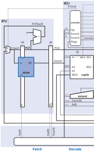
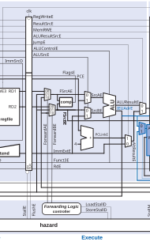
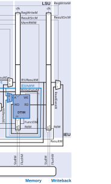
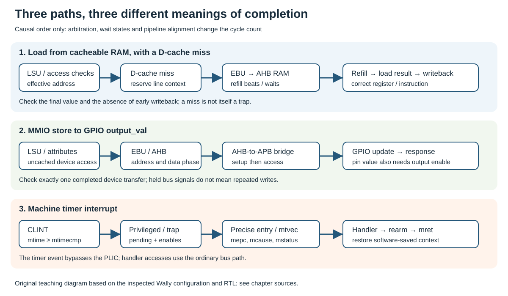

# CORE-V Wally: From a Pipelined Core to a SoC {#sec-core-v-wally}

CORE-V Wally is a configurable, five-stage RISC-V processor written in SystemVerilog. It is a useful teaching and research core because the RTL makes the connection between an ISA instruction and its datapath/control implementation visible. This chapter follows the simplified pipelined processor developed in Chapter 7 of *RISC-V System-on-Chip Design* [@harrisRiscvSoc].

The first part deliberately studies a simplified processor. It implements the ordinary instruction path and the improvements required by synchronous memories, but it **does not include interrupt handling, traps, exceptions, CSR control, virtual memory, or privileged modes**. The second part connects that model to a concrete, fuller Wally SoC configuration. It introduces the missing blocks through three end-to-end journeys before the following chapters develop their protocols and implementations in detail. The omissions belong to the teaching model, not to the configurable Wally project.

## From a Single-Cycle Datapath to a Pipeline

A single-cycle processor completes fetch, decode, register read, ALU operation, memory access and register writeback in one clock period. Its simplicity is attractive, but the period must accommodate the slowest instruction: instruction memory, register file, ALU, data memory and writeback. Most instructions leave part of that long period unused.

Pipelining divides the work into stages separated by registers. Once filled, the pipeline can retire approximately one instruction per cycle even though each instruction takes several cycles to traverse the machine. The latency of an instruction and the throughput of the processor are therefore different quantities.

| Stage | Main responsibility | Typical outputs stored in a pipeline register |
|---|---|---|
| Fetch (F) | Read instruction and form sequential PC | instruction, PC, predicted/next PC |
| Decode (D) | Decode opcode, read registers, form immediate | operands, immediate, control signals |
| Execute (E) | ALU operation, branch comparison, target address | ALU result, store data, destination/control |
| Memory (M) | Load/store transaction | loaded data, ALU result, writeback controls |
| Writeback (W) | Select and write architectural result | register-file write enable, destination, data |

Pipeline registers preserve both data and its meaning. For example, a load instruction carries its destination-register number and `result-from-memory` control from Decode to Writeback. Losing a control bit is as serious as losing an operand: the correct value could be written to the wrong register or at the wrong time.

## The Simplified Wally Pipeline

The following improved pipeline is reproduced from Figure 7.13 of *RISC-V System-on-Chip Design*, Chapter 7. It illustrates the datapath after adapting the simple pipeline to synchronous instruction and data memories.

{#fig-wally-pipeline-synchronous fig-alt="Improved five-stage Wally-style pipeline with synchronous instruction and data memories"}

The complete datapath is an orientation view. For signal names in print, use the following three overlapping enlargements, read from left to right. A wire crossing a crop edge continues in the neighboring view; the crops do not introduce new circuit boundaries. The [original vector figure](../../figures/wally-figure-7-13-editable.svg) remains available for unrestricted zoom.

{#fig-wally-pipeline-left width=100%}

{#fig-wally-pipeline-center width=100%}

{#fig-wally-pipeline-right width=100%}

The picture should be read as a timing contract. An instruction enters Fetch with a PC. It crosses each vertical stage boundary only when the corresponding pipeline register enables it. Values displayed in later stages belong to older instructions; several instructions are active at once. In a waveform, always identify an instruction by its pipeline register and program counter rather than by a signal name alone.

### Fetch and synchronous instruction memory

An idealized combinational instruction memory returns `Instr` immediately from `PC`. FPGA block RAMs and practical synchronous memories normally register the read address and return data in a later cycle. The improved pipeline accounts for that latency by carrying the PC/address through a fetch register and aligning the returned instruction with its PC.

This change has architectural consequences. Branch targets, sequential PC generation, instruction validity and flush behavior must all use the PC associated with the returned instruction, not merely the current fetch address. A synchronous-memory implementation that treats RAM as combinational can appear correct in a simplistic simulation but fetch the wrong instruction after synthesis.

### Decode and operand preparation

Decode extracts `rs1`, `rs2`, `rd`, opcode/funct fields and immediate format. The register file produces source values, and control logic classifies the instruction: ALU operation, branch, load, store, register write and result source. In the simplified chapter model, illegal instructions and privileged instructions are outside the scope; supported encodings must nevertheless have unambiguous control values.

The immediate generator is an important boundary. I-, S-, B-, U- and J-type encodings distribute immediate bits differently. Construct the immediate once in Decode, sign-extend it to XLEN and pipeline the result. Recreating different immediate forms later in the pipeline makes forwarding and verification harder.

### Execute

Execute selects register or immediate operands and performs integer arithmetic, comparisons and address generation. For a load/store, the ALU result is the effective address. For a conditional branch, it produces the comparison result and target address. The control path chooses whether the next fetch should continue sequentially or redirect to the target.

The main pipeline hazard at this point is a data dependence. If instruction `i+1` needs the value written by instruction `i`, waiting until Writeback would insert unnecessary bubbles. Forwarding paths return an ALU or writeback result directly to later Execute operands. The forwarding logic must prefer the youngest matching producer and must never forward a value for register `x0`.

### Memory and synchronous data memory

The memory stage sends the effective address, write data, byte enables and read/write control to the data memory. A store has a visible side effect; it must be issued exactly once even if the pipeline stalls. A load must return data aligned with its destination register and writeback control.

Synchronous data memory adds a read latency, just as instruction memory does. The improved datapath carries the load destination/control into a register that waits for the memory response. This is one reason a load-use dependence cannot always be solved by ordinary ALU forwarding: the value may not exist until a later cycle. Hazard control inserts a bubble or holds earlier stages until the load data is available.

## Hazard Management

Pipelining creates hazards because stages overlap.

| Hazard | Example | Simplified Wally response |
|---|---|---|
| Data hazard | `add x5,...` then `sub x6,x5,...` | Forward result or stall if unavailable |
| Load-use hazard | `lw x5,0(x1)` then use `x5` | Stall until synchronous-memory data is valid |
| Control hazard | Conditional branch changes PC | Flush wrong-path instruction(s), redirect Fetch |
| Structural hazard | One memory port serves fetch and load/store | Separate memories/ports or explicit arbitration |

A stall holds selected pipeline registers and prevents side effects from being duplicated. A flush replaces an instruction with a benign bubble by clearing its controls. These two actions are different: holding a wrong-path instruction preserves the bug, while flushing a valid load response loses data. Define enables and clears per pipeline register and verify them with short instruction sequences before running large programs.

## What the Simplified Version Omits

The privileged state, Sv32 translation and precise page faults omitted here are developed in @sec-privileged-mmu. Its executable example requires a full core/reference model with the selected privileged capabilities.

The full CORE-V Wally project contains many optional and privileged capabilities. This pedagogical core excludes them intentionally:

- **Interrupts and traps:** no asynchronous interrupt sampling, trap vector, `mepc`/`mcause` state or return instruction.
- **Exceptions:** no misaligned-access, page-fault, illegal-instruction or access-fault trap path.
- **Privileged architecture:** no machine/supervisor/user modes, CSRs, PMP, MMU, page-table walker or delegation.
- **Complex memory system:** no cache coherence, external-bus retries, virtual addressing or DMA policy.

The absence of these features does not mean they are unimportant. It means that the pipeline can first be understood through ordinary integer instructions and synchronous-memory timing. Adding a trap path later is a controlled extension: it must stop younger instructions, preserve the faulting PC/cause, redirect Fetch to a vector and guarantee precise architectural state.

## Implementation Guide for the Simplified Pipeline

Implement the simplified design as small modules with explicit interfaces: `ifu`, `decoder`, `regfile`, `alu`, `hazard`, instruction memory and data memory. Keep the stage registers in the top-level pipeline or in named stage modules so waveforms retain architectural meaning.

For FPGA targets, infer synchronous block RAM deliberately. Initialize instruction memory from a reproducible file and register addresses/read data according to the selected RAM template. Use a single clock enable policy; do not gate the clock with LUT logic. The clocking-and-timing chapter explains why register enables are safer and easier to analyze.

Test in this order:

1. ALU and immediate operations with no dependencies.
2. Register dependencies that exercise every forwarding path.
3. Load-use and store-data dependencies with synchronous RAM latency.
4. Taken and not-taken branches, including a branch after an ALU operation.
5. Long mixed instruction streams against a simple architectural reference model.

Record cycle-by-cycle expectations for at least one short program. A correct final register value can hide a transient duplicated store or an incorrectly flushed instruction that happens not to alter the selected test result.

## From the Simplified Pipeline to a Complete Wally SoC

The simplified pipeline answers how ordinary instructions overlap. A complete SoC must also explain how instructions reach physical storage, how devices produce effects, how events interrupt execution and how firmware establishes an execution environment. The core still has a pipeline, but correctness now spans several independently stateful blocks.

This section is an orientation map rather than another bus or cache tutorial. Its main textbook references are Section 2.8, Figure 2.13 and the privileged, memory and peripheral discussions in Chapters 8–13 and 20 [@harrisRiscvSoc]. The [memory chapter](../04-soc-architecture/memories-caches.qmd), [bus and interrupt chapter](../04-soc-architecture/buses-interrupts.qmd) and [peripheral chapter](../04-soc-architecture/peripherals.qmd) provide the detailed follow-up.

### Fix one configuration before following signals

Use `config/rv32gc/config.vh` from the inspected CVW revision `3b30ba6b6519bd2c26c1437e6d61f632a35cef6c` as the reading baseline [@cvwBridgeConfig]. It is available in the fork used for the open FPGA work, but this configuration is **not** the reduced Nexys Video board configuration. The examples below use its simulation-style SoC organization, with firmware initially running in machine mode.

The configuration name is a directory label, not a complete manifest of every optional extension. Read its fields and derived parameters. At this revision the relevant choices are:

| Choice | Selected value | Consequence for this section |
|---|---|---|
| Integer width | `XLEN=32` | Integer registers and ordinary word accesses are 32 bits |
| Control instructions | `ZICSR_SUPPORTED=1`, `ZIFENCEI_SUPPORTED=1` | Firmware can configure applicable CSRs and instruction visibility |
| Execution options | Integer multiply/divide, atomics, compressed and floating-point support enabled | The full core contains units absent from the simple model |
| Privilege | `S_SUPPORTED=1`, `U_SUPPORTED=1` | Machine, supervisor and user execution can be supported |
| Translation | `SV32_SUPPORTED=1` | Translation hardware exists; enabling it is a separate software action |
| Protection | `PMP_ENTRIES=16` | A physical-access policy can be configured |
| Core memory paths | I-cache, D-cache and bus enabled; IROM/DTIM disabled | Ordinary accesses can use caches and the uncore |
| Cache geometry | Four ways, 4096 bytes per way, 512-bit lines | Each cache has 16 KiB capacity and 64-byte lines |
| Bus width | `AHBW=32` | A 64-byte refill requires sixteen 32-bit data beats |
| Reset PC | `0x80000000` | The first instruction is fetched from the RAM region |
| Uncore targets | RAM, boot ROM, CLINT, PLIC, UART, GPIO and other peripherals enabled | Both transaction and interrupt paths are present |

`config/shared/config-shared.vh` derives additional fields, including the physical-address width. RV32 has a 32-bit integer width but this Wally configuration derives a 34-bit physical-address width. Do not truncate all internal addresses merely because the program uses 32-bit registers.

This baseline permits following cache misses, MMIO and interrupts in one configuration. It does not prove that a particular FPGA has sufficient resources or that an operating-system image boots without further platform work. The [FPGA SoC chapter](../05-fpga-implementation/fpga-soc.qmd) selects a different wrapper, memory implementation and configuration for its target.

### Read the hierarchy as a functional map

@fig-wally-module-hierarchy adds a containment view to the transaction view below. Start at the SoC top, identify the module that owns a function, then follow its interface into the core or uncore. Configuration-dependent subtrees are grouped rather than expanded into every generated instance.

![Original module ownership map for the pinned rv32gc reading baseline. Solid blue arrows show selected requests; the dashed orange arrow returns interrupt events. Names follow the inspected Wally RTL [@cvwBridgeSoc; @cvwBridgeCore].](../../figures/architecture-wally-hierarchy.svg){#fig-wally-module-hierarchy fig-alt="Nested Wally SoC, core and uncore blocks with IFU, IEU, LSU, arithmetic, privileged and hazard logic, EBU, memories and peripherals" width=100%}

{#fig-wally-soc-overview fig-alt="Wally IFU, execution units, LSU and privileged control connect through EBU and AHB to RAM and APB peripherals; separate interrupt paths return from CLINT and PLIC"}

The repository diagram provides a complementary stage-oriented view [@cvwRepositoryDiagram]. The new SVG reorganizes those functions for system integration. In particular, it separates outward requests from inward events: a peripheral write and an interrupt are not two directions of one bus transaction.

| RTL location at the selected revision | Responsibility | First question to ask |
|---|---|---|
| `src/wally/wallypipelinedsoc.sv` | Instantiate core, uncore, reset synchronization and interrupt wiring | Which system interfaces are exposed? |
| `src/wally/wallypipelinedcore.sv` | Connect IFU, IEU, LSU, execution units, hazard and privileged logic | Which configuration conditions instantiate each unit? |
| `src/ifu/ifu.sv` | Fetch, prediction, instruction access and alignment | Which PC belongs to returned instruction bits? |
| `src/ieu/` | Integer register/control/datapath functions | Where is an operand selected and a result committed? |
| `src/lsu/lsu.sv` | Data accesses, translation/protection and cache/bus interaction | Is this access cacheable, permitted and complete? |
| `src/ebu/ebu.sv` | Combine IFU and LSU bus requests | Which requester owns address and data phases? |
| `src/uncore/uncore.sv` | Decode target regions, bridge to APB and select responses | Which target is selected for this physical address? |
| `src/privileged/` | CSR, privilege, exception and interrupt control | Which event can redirect execution at a safe boundary? |

The top module connects `MTimerInt`, `MSwInt`, `MExtInt` and `SExtInt` from the uncore to the core. The uncore is conditionally instantiated when `P.BUS_SUPPORTED` is true [@cvwBridgeSoc; @cvwBridgeCore]. These structural facts explain why changing a configuration can remove a whole path, not merely alter its performance.

The diagram does not prescribe where every block sits in the five pipeline stages. Some units span stages, while cache refill and bus state evolve across many clock edges. Follow instruction-valid and completion signals in addition to stage suffixes.

### The physical map is shared by hardware and firmware

For this baseline, the main decoded regions include:

| Target | Base | Encoded range or extent | Reading implication |
|---|---:|---:|---|
| Boot ROM | `0x00001000` | 4 KiB | Available target, but not selected by the reset PC here |
| CLINT | `0x02000000` | 64 KiB region | Timer/software interrupt registers |
| PLIC | `0x0c000000` | 64 MiB region | Priority, enable, threshold and claim/complete registers |
| UART | `0x10000000` | 8-byte region | Serial register window |
| PWM | `0x10020000` | 256-byte region | Additional peripheral in the inspected fork |
| SPI | `0x10040000` | 4 KiB region | Serial controller registers |
| GPIO | `0x10060000` | 256-byte region | Input, output and event registers |
| Uncore RAM | `0x80000000` | 128 MiB decoded region | Program and data storage in this model |

The configuration encodes ranges as base-plus-range masks. The decoded region is not a claim that the eventual FPGA contains 128 MiB of on-chip SRAM, nor that every byte of a peripheral window corresponds to an implemented register. Storage resources and register offsets require separate inspection.

The loader, linker script and RTL must agree. A firmware binary linked at `0x80000000` needs initialized instruction bytes there when reset is released. An enabled boot ROM at `0x1000` does not automatically become the reset destination. Also, this baseline disables automatic RAM/ROM preload flags; the chosen harness must supply the image through its supported loading mechanism.

### Reset and the first instructions

Begin with a controlled execution environment: one hart, machine-mode startup, no speculative software assumptions about initial general registers, and a known image in the selected RAM. Virtual-memory hardware can exist without translating these machine-mode instruction fetches.

The sequence to observe is:

1. The wrapper supplies a clock and asserts external reset. `wallypipelinedsoc` synchronizes reset to the core clock; a board wrapper may add further clock/reset requirements.
2. Reset establishes the pipeline and control state and the configured initial PC.
3. After safe release, IFU attempts to fetch from `0x80000000`. In the cache-enabled baseline, instruction availability can involve the I-cache and bus; do not assume immediate data merely because the address is known.
4. Returned instruction bits remain associated with their fetch PC and enter the ordinary decode/execute path.
5. Startup firmware initializes the stack, any required global-pointer setup, data/BSS state and trap handling according to its actual software runtime.
6. Firmware enables the devices and interrupts needed by the application only after their contracts are established.

A hand-written assembly program can omit a stack if it never needs one. A C application or an interrupt handler generally cannot inherit that assumption. General registers are not automatically saved on trap entry, and an uninitialized stack can make the first interrupt fail while ordinary arithmetic appears correct.

Record four different milestones: reset release, first valid instruction, first committed instruction and first visible software signature. A UART message is a useful fifth milestone, but requires working firmware, bus, UART configuration and board IO. Missing output does not uniquely identify a processor failure.

### Journey 1: a RAM load that misses in the D-cache

Consider a machine-mode `lw x5, 0(x10)` with `x10=0x80002000`, a valid aligned address in RAM. Assume the relevant D-cache line is absent, the memory image contains known data, and no protection policy forbids the access. This address is illustrative; place test data there deliberately.

**Instruction ownership.** Decode reads the base operand and reconstructs the displacement. Execute computes the effective byte address. The load keeps its destination register and instruction context while the memory system works. A request with no saved destination/validity context cannot produce a trustworthy writeback.

**Access checking.** LSU determines the effective privilege and applies the applicable translation, protection and physical-attribute rules. In the ordinary machine-mode case with `MPRV` clear, address translation is not invoked merely because `SV32_SUPPORTED=1`. Effective privilege and PMP configuration still need review. For a later supervisor-mode experiment, a TLB miss and page-table walk form another path before the physical request.

**Cache lookup.** The D-cache checks the indexed set's tags and valid state. With the selected geometry, six low bits choose a byte within a 64-byte line and the next six choose one of 64 sets. Four ways are compared. No valid matching way means a miss; a miss by itself is not an architectural exception.

**Replacement and refill.** The controller selects a victim. A dirty victim can require writeback before replacement; use a clean or invalid victim for the first experiment. The pending load must remain attached to its context throughout both operations. A 64-byte refill across the 32-bit bus involves sixteen data beats, but not necessarily sixteen elapsed cycles: arbitration, address/data overlap and wait states change elapsed time.

**Bus service.** The cache's bus-side request reaches EBU, which arbitrates instruction and load/store traffic. The selected request crosses the AHB interface to uncore address decoding and RAM response selection. Save/restore logic and data-phase ownership prevent an IFU request from receiving an LSU response. The bus chapter develops these details [@cvwEbu; @cvwUncore].

**Completion.** Returned data populate the line under the cache controller's validity rules. The requested word is selected and returned to the load path. Only the associated valid instruction can write `x5`. A dependent instruction waits or uses an eligible forwarding path; it cannot consume a guessed value during refill.

| Observation | What it establishes | What it does not establish |
|---|---|---|
| Miss detected | Required line was not a valid hit | A trap occurred |
| AHB beat completed | One part of external service progressed | Entire line or instruction completed |
| Refill completed | Cache has the requested line under its contract | Correct destination register was updated |
| Load result accepted | LSU can finish the request | Every later instruction is safe to commit |
| Architectural writeback | `x5` receives the requested value | Physical timing is met on a board |

This distinction makes waveforms interpretable. A bus address visible for several cycles is not necessarily several accesses, and a stalled pipeline is not necessarily deadlocked. Count completed transfers and follow retained ownership.

### Journey 2: an MMIO write to GPIO

Now consider a word store to GPIO `output_val`, at base plus offset `0x0c`: address `0x1006000c`. This access reaches a device register rather than a cached RAM copy. Configure the GPIO output-enable register at offset `0x08` before expecting output pins to drive. The peripheral chapter describes additional XOR/function and board-level behavior [@cvwGpio].

**Address and attributes.** LSU computes the address and identifies the target as a device region. The applicable attribute policy routes the access through the uncached/device path; ordinary write-back cache allocation would hide or delay the intended peripheral effect. A store that merely changes a cache line is not a completed GPIO operation.

**AHB ownership.** EBU selects the transaction. The AHB address phase carries the target and operation, while the matching write data belong to its data phase. Uncore recognizes the GPIO region and directs it to the AHB-to-APB bridge. The bridge preserves the transaction while the downstream interface completes [@cvwAhbApb].

**APB ownership.** The bridge performs setup, then access. GPIO applies the selected enabled-byte updates at a completed write transfer. If the access waits, control and payload remain associated with the same operation; they must not cause a new side effect on every waiting clock.

**Return and visibility.** The target response returns through the bridge and AHB response selection. GPIO's stored output value changes, but physical output also depends on enables, alternate functions, reset state and wrapper pin wiring. Trace the register update and `GPIOOUT`/`GPIOEN` separately before diagnosing a dark LED.

For a clean first exercise, use word-aligned writes, keep alternate GPIO functions and XOR disabled, and set one output bit. Observe the completed APB write, stored register value and resulting output together. Then stall the upstream path and verify that the device sees exactly one completed transfer.

The store has no integer destination, but it has a real architectural/device effect. An interrupt cannot be treated as permission to repeat the store on return. Likewise, cancelling a later instruction does not undo an already applied GPIO write.

### Journey 3: a timer event becomes a machine-mode interrupt

A timer event uses a different path. Firmware configures the CLINT through ordinary MMIO, but the resulting `MTimerInt` is a separate signal into privileged control. The timer does not send a special load/store instruction to the pipeline and does not pass through the PLIC.

For hart zero, the conventional offsets in this implementation place `mtimecmp` at `0x02004000` and `mtime` at `0x0200bff8`. Both are 64-bit quantities even though this core's word accesses are 32 bits. The bus/interrupt chapter gives safe split-access procedures: read a changing timer coherently and update compare halves without introducing an unintended intermediate deadline.

**Establish firmware context first.** Set up a valid stack and a machine trap entry. Select direct `mtvec` mode for the first exercise so both exceptions and interrupts arrive at one base entry. Start with interrupts globally disabled, establish a future timer deadline, then enable the machine timer source and global machine interrupt handling. For this example, arrange delegation and execution mode so the event is serviced in machine mode.

**Pending is different from enabled.** When `mtime` reaches or exceeds `mtimecmp`, the timer request becomes pending. The machine timer enable is `mie.MTIE`, bit 7; global machine interrupt enable is `mstatus.MIE`, bit 3 for the chosen machine-mode scenario. A pending event with those enables clear is not automatically taken [@riscvPrivilegedSpec].

**Take the event at a safe boundary.** Wally's privileged/trap logic qualifies interrupt requests together with valid instruction and memory-progress conditions. It must avoid abandoning partially completed work in a way that repeats a side effect. Look at `src/privileged/trap.sv`, including its committed-operation and instruction-valid conditions, rather than assuming that the interrupt immediately redirects the very cycle its source rises [@cvwTrap].

**Enter the handler precisely.** Machine trap state identifies the return PC and cause. For a machine timer interrupt on RV32, the interrupt flag and cause 7 give `mcause=0x80000007`. Trap entry saves the prior interrupt-enable state in `MPIE`, clears `MIE` and records the prior privilege in `MPP`. Fetch redirects to the trap entry. The return PC is the architectural resume point chosen by the trap logic, not an arbitrary currently visible fetch PC.

**Save software context and service the source.** Hardware does not push all integer registers onto a stack. The entry code or an established interrupt ABI must preserve every value needed to resume the interrupted program. A C handler called through an ordinary function convention requires an appropriate assembly entry/exit wrapper or compiler interrupt convention. Count the event, perform the intended work and move `mtimecmp` to a future deadline.

**Return.** Restore the saved software context and execute `mret`. It restores privilege/interrupt state according to the architecture and resumes at `mepc`. Do not unconditionally add four to `mepc`: this is an asynchronous interrupt, and compressed instruction support also makes a universal four-byte assumption unsafe. If the timer remains pending, another interrupt may follow as soon as the restored enables permit it.

| Firmware or RTL event | Observation to record |
|---|---|
| Future deadline programmed | Full 64-bit compare value and coherent current time |
| Source becomes pending | `MTimerInt`, independently of whether a trap occurs |
| Interrupt qualified | Applicable enables, privilege and valid/safe execution conditions |
| Trap entered | `mcause`, `mepc`, `mstatus` and handler PC |
| Handler services source | New deadline and absence of unintended repeated MMIO effects |
| `mret` resumes | Restored software state and next committed foreground instruction |

Interrupt latency includes source generation, qualification, pipeline/memory constraints, handler instruction access and software context save. It is not simply the number of flip-flops between CLINT and the core. A cache miss in handler fetch can contribute to the measured latency.

### External events: what changes with the PLIC?

For a UART or GPIO event, the peripheral's interrupt output feeds a PLIC source. Firmware configures source priority, context enable and threshold. PLIC then asserts an external interrupt signal such as `MExtInt`, while the core separately applies its machine external interrupt enable and privilege rules [@cvwPlic].

The handler reads the claim register to identify a source, services the device and writes completion. Claiming is not equivalent to clearing the device condition; completing without servicing a persistent condition can lead to repeated interrupts. Keep the returned claim ID rather than assuming that every machine external interrupt comes from the UART.

This contrasts with the timer path: a timer handler reprograms CLINT compare state and does not issue a PLIC claim/complete transaction. The common part is precise trap entry, software context handling and architectural return. The peripheral-specific part is how the pending condition is serviced.

### Compare the three paths side by side

{#fig-wally-soc-three-paths fig-alt="RAM refill ends in load writeback, GPIO MMIO ends in a device register update, and a timer event ends in trap service and architectural return"}

A RAM load consumes a returned value. A device write commits a side effect. An interrupt preserves foreground execution while transferring control to service code. All three can stall or require bus activity, but their correctness conditions differ.

When integrating a new peripheral, write both its transaction contract and its event contract. When changing a cache, verify both data correspondence and the impact on instruction/handler service time. When changing privilege logic, verify architectural state as well as request conservation.

### Reading the source without losing the configuration

Follow one path at a time. First read configuration fields, then the top-level connection, then the instantiated modules. Record instance names at the pinned revision instead of hard-coding an internal waveform path copied from another build.

For the RAM experiment, follow LSU into its cache and bus interfaces, then EBU and the uncore RAM response. For GPIO, follow address selection through the bridge to the APB target. For interrupts, begin with the source and top-level interrupt wire, then follow privileged qualification, trap state and fetch redirect.

A useful trace table contains instruction PC, instruction validity, request acceptance, target selection, completion, side effect and retirement/trap event. Some entries belong to different clock edges. Trying to force them all into one row labelled Memory stage hides the system behavior this section is intended to expose.

The repository's declared RTL license is Solderpad Hardware License 2.1, with the stated Apache 2.0 option [@cvwLicense]. That declaration is not a license for the publisher's PDF. The new overview is an original vector layout with its technical sources identified in the caption and SVG metadata; it is not presented as a newly relicensed extraction of a textbook page.

## Hands-on Experiments

1. [Core option · P3 · C1](../../learning-paths.qmd#sec-path-labels){#act-core-v-wally-01 .learning-activity} — Run a five-instruction dependency chain and annotate which forwarding path supplies each operand.
2. [Advanced · C1](../../learning-paths.qmd#sec-path-labels){#act-core-v-wally-02 .learning-activity} — Change the data-memory model from combinational to synchronous. Observe the failing load-use sequence, then add the required stall/control alignment.
3. [Advanced · C3](../../learning-paths.qmd#sec-path-labels){#act-core-v-wally-03 .learning-activity} — Measure the clock period of a single-cycle datapath and the maximum frequency of the pipelined datapath after FPGA synthesis. Distinguish latency from throughput.
4. [Advanced · C2](../../learning-paths.qmd#sec-path-labels){#act-core-v-wally-04 .learning-activity} — Add a simple branch predictor only after branch flush behavior is fully verified; use the PMU counters to measure branch and misprediction effects.

### Full-SoC integration experiments

1. [Core · P3 · C0](../../learning-paths.qmd#sec-path-labels){#act-core-v-wally-05 .learning-activity} — **Configuration audit.** Compare the pinned `rv32i` and `rv32gc` fields. Explain which paths disappear, which ISA/compiler options change and why cache parameters in a disabled cache do not imply a physically instantiated cache. List reset PC and image-loading assumptions.
2. [Advanced · C2](../../learning-paths.qmd#sec-path-labels){#act-core-v-wally-06 .learning-activity} — **Cold versus warm RAM load.** Place a known word at `0x80002000`. Observe a cold miss and a later hit without relying on a fixed cycle count. Check the refill geometry, `x5` result and dependence handling. Record how IFU traffic affects bus service.
3. [Core option · P3 · C2](../../learning-paths.qmd#sec-path-labels){#act-core-v-wally-07 .learning-activity} — **Exactly-once GPIO write.** Configure output enable, write output value and correlate the completed APB transfer with register/pin state. Introduce wait states where the harness supports them. Verify that one architectural store does not become several device transfers.
4. [Core option · P3 · C2](../../learning-paths.qmd#sec-path-labels){#act-core-v-wally-08 .learning-activity} — **Timer interrupt and resumption.** Use an established trap-entry wrapper, a foreground signature loop and a handler that advances the deadline. Compare pending-with-enables-clear against enabled service. Record entry cause, return PC and preservation of foreground state; separately measure handler latency.
5. [Advanced · C2](../../learning-paths.qmd#sec-path-labels){#act-core-v-wally-09 .learning-activity} — **PLIC contrast.** Enable one documented device source, then two. Verify claim IDs, device service and completion rather than identifying sources only from `mcause`. Explain the differences from the CLINT timer exercise.

Each report should include the RTL revision, selected configuration, loader/firmware convention, minimal disassembly, annotated waveforms and pass/fail criteria. These are integration exercises; reading the diagrams alone does not validate a board or operating-system configuration.

The simplified pipeline establishes instruction timing and hazards. The complete-SoC view adds memory ownership, device effects and privileged redirection. The following chapters develop these contracts with simulation tools and detailed subsystem implementations.

## Verification scope of this teaching core

Use @sec-verification-methodology to separate pipeline control, numerical/ISA behavior and full privileged-SoC claims. For the simplified core here, test hazards, forwarding, synchronous-memory latency, stalled requests, redirects and suppression of wrong-path stores against the implemented ISA subset. Interrupt/trap/privileged machinery is deliberately omitted, so a passing teaching-core test cannot establish those features. The separate executable project's real Wally firmware platform verifies its specific AXI/DMA/interrupt scenarios; neither experiment is a complete architectural or microarchitectural qualification of every Wally configuration. A retirement comparator and broader feature/coverage plan remain explicit integration work.

<!-- chapter-review:core-v-wally -->

## Key ideas {#review-core-v-wally-ideas .unnumbered .unlisted}

- Pipeline state and hazard control must preserve architectural behavior.
- The improved teaching pipeline remains simpler than the complete configurable SoC.

## What you should now be able to explain {#review-core-v-wally-explain .unnumbered .unlisted}

Explain a load-use stall and a redirected fetch, including how synchronous-memory latency changes control timing.

## Common mistakes {#review-core-v-wally-mistakes .unnumbered .unlisted}

Treating the simplified diagram as the complete privileged core; confusing a stall with discarding an instruction.

## Try it yourself {#review-core-v-wally-try .unnumbered .unlisted}

[Preparation · C0](../../learning-paths.qmd#sec-path-labels){#act-core-v-wally-review .learning-activity}

Trace a load followed by a dependent add on the chapter diagram. Mark forwarding, held registers and discarded instructions for a taken branch.

## Where this appears in Wally {#review-core-v-wally-wally .unnumbered .unlisted}

::: {.callout-note title="Wally Connection" icon=false}
Locate fetch, integer execution and load/store integration through [src/wally/wallypipelinedcore.sv](https://github.com/antoniofloresgil/cvw/blob/3b30ba6b6519bd2c26c1437e6d61f632a35cef6c/src/wally/wallypipelinedcore.sv); compare its control boundaries with [src/hazard/hazard.sv](https://github.com/antoniofloresgil/cvw/blob/3b30ba6b6519bd2c26c1437e6d61f632a35cef6c/src/hazard/hazard.sv).
:::

## Further reading {#review-core-v-wally-reading .unnumbered .unlisted}

Continue with @sec-transport-pipelines and @sec-privileged-mmu. Follow the chapter sources [@harrisRiscvSoc; @cvwBridgeConfig].
