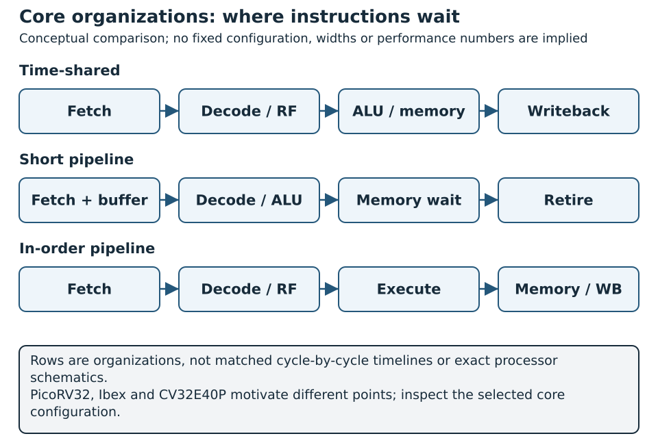

# Other Open-Source RISC-V Architectures {#sec-other-riscv-architectures}

Real open-source RISC-V projects make different choices. Some minimize logic and accept several cycles per instruction; others add caches and virtual memory to run a rich operating system; research cores pursue multiple instructions per cycle and out-of-order execution. The ISA lets them run compatible programs where their implemented extensions and platform services overlap. It does not require the same pipeline, memory interface or performance.

This chapter studies six useful reference points: PicoRV32, Ibex, CORE-V CV32E40P, CVA6, BOOM and XiangShan. The last is a high-performance processor project developed in China and written in Chisel. The simplified five-stage Wally pipeline of the previous chapter remains the comparison baseline throughout. The objective is to learn how to read and select a core, not to rank unrelated implementations by an isolated frequency or benchmark score.

## Concepts: What Is Being Compared?

### ISA, microarchitecture and platform

The **instruction set architecture** specifies programmer-visible instructions and state. The **microarchitecture** determines how instructions are fetched, issued, executed and retired. The **platform** supplies memory, interrupts, debug, boot firmware and peripherals. These layers affect different questions:

| Question | Layer to inspect | Example |
|---|---|---|
| Can this binary execute? | ISA and ABI | RV32IMC code requires `M` and `C` |
| How many cycles will it take? | Core and memory microarchitecture | Branch penalty, cache miss, divider latency |
| Can it run Linux? | Core **and** platform | Privilege modes, MMU, interrupts, memory and boot |
| Can it fit this FPGA? | RTL plus target implementation | LUT, BRAM, DSP, clocking, routing |
| Can it be integrated with our SoC? | Interfaces and system contracts | Reset, bus, interrupt, debug, address map |

Even `RV32IMC` is insufficient as a whole-system description. A board needs a reset vector, executable memory, a console path and usually timers and interrupt wiring. A core that handles traps in its own unconventional way may execute simple programs but need extra work to support a conventional software stack. Conversely, a core can implement a rich privileged ISA while a reduced demonstration configuration omits the surrounding platform.

The Wally datapath in the preceding chapter is explicitly pedagogical: it omits traps and privileged modes. The full CORE-V Wally repository is a configurable processor with substantially more features. This chapter names which of those two objects is being compared. The five-stage **teaching pipeline** is useful for datapath reasoning; a **full Wally configuration** is required for system-level feature comparisons [@cvwRepository].

### The axes that matter

Before selecting a core, define a comparison sheet with the same fields for every candidate:

| Axis | Questions to answer |
|---|---|
| Execution | Multicycle or pipelined? Issue width? In order or out of order? |
| ISA | RV32/RV64? Which standard and nonstandard extensions? |
| Memory | Harvard or unified? Cache/TLB? Memory latency and request protocol? |
| Privilege | Modes, CSRs, traps, interrupts, protection, virtual memory? |
| Integration | Interface protocol, clock/reset, debug, verification hooks? |
| Implementation | Source language, generator, dependencies, timing and area? |
| Evidence | Version, tested configurations, tests, workload, silicon/FPGA status? |

These axes are connected. A two-stage core can have a high clock frequency yet execute a load in several cycles. A wider out-of-order machine can retire more than one instruction per cycle but use much more logic and power. A core with a superb front end will still stall if its memory system cannot supply instructions. The useful performance quantity for a fixed program is approximately

$$
T = \frac{N_{\mathrm{inst}}\times \mathrm{CPI}}{f_{\mathrm{clock}}},
$$
where the instruction count, CPI and achievable clock frequency all depend on configuration, compiler, workload and platform. An FPGA resource comparison adds constraints: the same design may map differently to LUTs, BRAM and DSP blocks on different families.

### A map of the examples

{#fig-core-organizations width=100%}

In @fig-core-organizations, locate where an instruction waits for operands or memory before comparing frequency. The OoO organization in @fig-ooo-window adds readiness-based issue and ordered retirement; it is not another row with directly comparable stage latency.

The following table gives **design intent**, not a benchmark result. Exact supported features depend on the selected commit and configuration.

| Core | Main design intent | Execution style | RTL description | What it teaches |
|---|---|---|---|---|
| PicoRV32 | Small control CPU | Compact multicycle sequencing | Verilog | Area versus CPI trade-off |
| Ibex | Small configurable embedded core | Two stages by default; optional third stage | SystemVerilog | Short pipeline and system integration |
| CV32E40P | Embedded DSP/control | Four-stage in-order pipeline | SystemVerilog | Pipeline and specialized instructions |
| Wally | Configurable teaching/application core | Five-stage in-order teaching view | SystemVerilog | Straightforward stage-by-stage reasoning |
| CVA6 | Application-oriented core | Single issue, in-order issue/commit | SystemVerilog | Long-latency units and privileged software |
| BOOM | Research/academic high performance | Superscalar out-of-order | Chisel | Rename, issue queues and reorder buffer |
| XiangShan | High-performance open processor | Wide out-of-order | Chisel | Industrial-scale generator and verification |

Do not read “more stages” as “better.” Pipeline depth, issue width, target frequency and memory organization answer different bottlenecks. A small controller for a UART and GPIO can be more appropriate than a wide out-of-order core even if the latter runs a benchmark faster.

## PicoRV32: Spend Cycles to Save Hardware

PicoRV32 is a small RISC-V CPU designed for area-sensitive applications. Its project describes a simple memory interface with `mem_valid`, `mem_ready`, address, write data and byte enables, with at most one transfer active at a time. Variants expose AXI4-Lite or Wishbone adapters, and a coprocessor interface called PCPI can implement operations such as multiply/divide outside the basic datapath [@picoRv32].

### A multicycle control path

Instead of maintaining five overlapped architectural stages, a compact implementation reuses hardware across cycles. An operation waits while fetch, decode, operand selection, ALU work and memory access complete. The same hardware need not support an instruction in each stage at once. PicoRV32 therefore makes a helpful contrast with the Wally teaching pipeline:

```text
PicoRV32:  instruction A [fetch][decode/execute][memory][writeback]
           instruction B                               [fetch]...

Wally:     instruction A [F][D][E][M][W]
           instruction B    [F][D][E][M][W]
           instruction C       [F][D][E][M][W]
```

This diagram is conceptual; exact cycle counts vary by PicoRV32 option, instruction and memory response. The official project explicitly optimizes for size and clock frequency rather than minimum CPI, and reports several cycles per instruction for many operations [@picoRv32]. A high `fmax` alone does not tell you that a program finishes sooner than on a pipelined Wally configuration, because the cycles per instruction matter just as much.

### Memory handshake as a teaching example

The native port illustrates a complete request/response contract. The core asserts `mem_valid` and holds address and write controls stable until the environment asserts `mem_ready`. For a load, `mem_rdata` must then be valid according to that handshake. A memory wrapper that briefly pulses `mem_ready` at the wrong time can pass simple tests yet fail with wait states.

Compare this with a Wally pipeline using synchronous instruction and data memories. In Wally, hazard control aligns each returned instruction or load value with the corresponding PC, destination and valid bits. In PicoRV32, the sequencing waits for the memory response before moving on. Both solve the same architectural requirement: the instruction must receive the correct data, exactly once. They pay different costs in state and throughput.

### Configurable arithmetic and register file

PicoRV32 can trade register-file ports, shifter implementation, multiply/divide hardware and compressed instruction support against area and cycles. A single-port register file can save resources but forces additional operand-read cycles. A barrel shifter finishes shifts quickly but costs more combinational logic than an iterative shifter. The designer should evaluate the *workload*: software with many shifts may justify a barrel shifter even in a small controller.

An optional PCPI operation demonstrates another architecture choice. Rather than extending the main ALU with every costly operation, the core presents operands and a request to a separate unit and waits for completion. This is similar in spirit to the multicycle functional unit discussed in the accelerators chapter, though the actual protocols are project-specific.

### A bounded use case

Imagine a small FPGA peripheral controller that periodically reads a sensor, configures registers and sends a UART status message. Memory is local and program size is modest. PicoRV32 may be attractive because its resource cost leaves room for the peripheral datapath. If the controller must run a high-rate filtering loop, the cycles spent per arithmetic instruction can dominate. The correct response might be a dedicated accelerator rather than replacing the control CPU with a much larger core.

For a fair educational exercise, synthesize a PicoRV32 configuration and a **compatible small Wally configuration** with the same ISA subset and the same memory latency. Record the core-only resource estimate and, separately, the complete SoC cost. A core-only comparison that ignores Wally's cache or PicoRV32's missing peripherals answers a narrower question than a board selection.

## Ibex: A Short Pipeline for Embedded Systems

Ibex is a configurable open-source RISC-V core used in embedded contexts. The documented default pipeline has two stages: instruction fetch (IF) and combined decode/execute (ID/EX). An optional third writeback stage changes the timing/behavior of some configurations [@ibexPipeline; @ibexConfiguration].

### Fetch buffering and ID/EX

Ibex fetches through a prefetch buffer. Fetch and execution can overlap, but a multicycle instruction holds ID/EX and prevents the next instruction from proceeding. In the default two-stage organization, register reads, ALU operation and register writeback are closely coupled. This short pipeline avoids much of the interstage bookkeeping in the five-stage teaching Wally, while the fetch buffer helps the instruction side supply work.

The theoretical maximum throughput of a simple two-stage scalar pipeline is one instruction per cycle when stages can advance continuously. The actual CPI depends on instruction type, branch effects and memory response. Stating only the number of stages misses the importance of the load/store interface and the multiplier/divider configuration.

### Security and configurability

Ibex offers configuration choices for features such as a branch predictor, instruction cache, PMP and integrity/security measures in relevant integration profiles. These options change both hardware cost and the platform software contract. A security-oriented implementation might spend area on error detection and control-flow robustness rather than maximize benchmark throughput. Read the exact selected configuration when comparing Ibex with Wally: “Ibex” is a family of elaborated designs, not one fixed netlist.

The distinction between a **core** and a **secure SoC** is especially important here. A core can support PMP, but system security also requires bus access control, memory protection for other masters, debug policy and a trusted boot chain. In the same way, a core's integrity checks stop at the core: external memory and peripherals need their own protection.

### Experiment: memory wait states

[Advanced · C2](../../learning-paths.qmd#sec-path-labels){#act-other-memory-waits .learning-activity}

Run the same RV32I loop with a one-cycle instruction/data memory and then with a fixed additional wait. Record cycles, retired instructions and throughput. The question is not which core has the shorter pipeline; it is how much of each program's time is exposed to the memory response. For a valid comparison, make both test systems use equivalent memory timing and count setup/boot separately.

## CV32E40P: An Embedded Four-Stage Pipeline

CORE-V CV32E40P is a 32-bit in-order RISC-V core with four main stages: instruction fetch, decode, execute and writeback. Its documented instruction and data ports use the Open Bus Interface (OBI). The core includes additional instruction features aimed at embedded and signal-processing workloads, so binaries using these features are not automatically portable to a plain RV32I Wally configuration [@cv32e40pIntro; @cv32e40pPipeline].

### What changes relative to Wally

Both CV32E40P and the simplified Wally are in-order pipelines, but their boundaries differ. CV32E40P's fetch stage uses an aligning prefetch buffer and handles compressed instructions; jumps can redirect early from decode, while conditional branches are resolved later in execute. Loads, stores and multicycle arithmetic affect stage availability. The Wally teaching pipeline explicitly separates a memory stage and carries controls into writeback.

The exact point at which a branch is resolved determines how many younger instructions may be in flight and therefore the flush cost. A branch resolved in decode can avoid some wrong-path work but may lengthen decode or need earlier operand availability. A branch resolved in execute simplifies some timing but may discard more fetched instructions. This is a concrete architectural trade-off, and short assembly tests will show it far better than saying one pipeline is “deeper.”

### Extensions for data processing

CV32E40P documents operations beyond the standard base ISA, including hardware loops, post-incrementing loads/stores and packed SIMD-style operations in supported configurations [@cv32e40pIntro]. These can reduce loop-control and address-update instructions in a DSP kernel. Yet an accelerated instruction must be compared against the appropriate compiler and memory baseline. If a loop already stalls on memory, reducing ALU instruction count might have little effect.

Hardware loops make a particularly good teaching case. The processor stores loop start/end/count state and performs repeated control flow with less explicit branch overhead. That improves small kernels only when the implementation's restrictions are satisfied. An assembly experiment should record both dynamic instruction count and elapsed cycles; the two can move differently.

### Interface and integration

A core with OBI ports still needs an SoC adapter when the rest of a design uses another bus. Address translation, byte enables, outstanding requests, errors and reset behavior must be preserved. This is analogous to the AHB-to-Wishbone boundary discussed for Wally's open FPGA flow: the processor name alone tells you little about the system integration cost.

Debug, interrupt and trap support should be compared with a **full** Wally configuration, not the deliberately simplified datapath. The objective of this section is to contrast pipeline and embedded integration choices; a fuller comparison must identify exact revisions and feature options.

## CVA6: A Core for Richer Software

CVA6 is a configurable application-oriented RISC-V core. One documented configuration uses a six-stage organization with in-order instruction issue, independently operating execution units, results that may return in a different order, and an in-order commit path [@cva6Issue; @cva6Design]. This is a useful middle step between Wally's simple in-order teaching pipeline and a wide out-of-order design.

### Issue order is not completion order

Suppose a load issues, then an independent integer add issues. If the load waits on memory and the add completes quickly, the add result may reach the scoreboard first. The architectural machine must still make state appear in correct program order and preserve precise exceptions. CVA6 tracks in-flight work and associates results with the right instructions.

This does **not** make CVA6 a general out-of-order-issue core. Issue remains in order in the documented design, so a blocked older instruction can prevent a younger ready instruction from issuing even if another functional unit is free. Distinguish three concepts:

| Property | Meaning |
|---|---|
| In-order issue | Instructions enter execution according to program order |
| Out-of-order completion | Functional units return results at different times |
| In-order commit | Architectural effects become visible in program order |

This separation helps explain why scoreboards and commit logic exist before introducing register renaming and issue queues. A core can accept long-latency units without being a superscalar out-of-order processor.

### Privilege and memory system

An application-oriented core is chosen in part for its software environment: supervisor operation, address translation and caches as provided by a selected configuration, plus integration with an SoC memory system. A complete OS boot also needs external components: RAM, interrupt controllers, timers, firmware and devices. The comparison must state whether a result refers to the core, a generated subsystem or a full board image.

Virtual memory changes the meaning of a load's “address.” It begins with a virtual address, may involve a TLB lookup and page-table walk, then accesses physical memory through caches and interconnect. A simple RV32 bare-metal benchmark and a Linux application therefore exercise very different paths even when both report `mcycle` and `minstret`.

### What CVA6 contributes pedagogically

CVA6 introduces a scoreboard and ordered retirement without requiring the reader to understand a full rename map, free list and reorder buffer at once. Trace a dependent load/add chain and then an independent add in a waveform or design document. Identify issue, result return and commit separately. This prepares the transition to BOOM and XiangShan.

## BOOM: A Generator for Out-of-Order Execution {#boom-a-generator-for-out-of-order-execution}

BOOM (Berkeley Out-of-Order Machine) is a RISC-V core generator written in Chisel. It uses the Rocket Chip ecosystem for parts of its SoC environment, including memory-system structures. Its documentation describes fetch, decode, rename, dispatch, issue, register read, execution, memory, writeback and commit concepts, though physical pipeline registers may combine conceptual stages [@boomOverview; @boomPipeline].

### Why issue out of order?

An in-order issue machine may stop when an old instruction waits for a cache miss, even if a younger independent add is ready. Out-of-order issue keeps several instructions in a window and selects those whose inputs are ready. This can hide some latency and exploit instruction-level parallelism. It also requires mechanisms that a simple pipeline avoids:

- **Register renaming** maps architectural registers to physical result locations and removes false name dependencies.
- **Issue queues** hold operations until operands and a functional unit are ready.
- **A reorder buffer** tracks program order so completion can differ from retirement.
- **Branch checkpoints/recovery** discard work from a mispredicted path.
- **Load/store ordering machinery** keeps memory operations architecturally correct.

The key benefit is conditional: a program must offer independent work and a memory system capable of feeding it. A pointer-chasing workload may expose little parallelism. Widening decode and execution without improving front-end supply, cache behavior or branch prediction may yield limited speedup.

### One instruction through the window

{#fig-ooo-window fig-alt="Fetch, rename, dispatch, issue, physical register file, execution, reorder buffer and in-order commit with recovery feedback" width=100%}

In @fig-ooo-window, distinguish the result path from the retirement path. Writing a physical register can wake a dependent instruction while the producer still waits in the ROB. A misprediction or exception must discard younger work and recover the appropriate rename state; completion is not yet permission for an architectural side effect; that comes at retirement.

Consider `mul x5,x1,x2`, followed by `add x6,x3,x4`, then `sub x7,x5,x6`. The multiply and add can execute independently. The subtract waits for both results. Renaming assigns separate physical destinations, the issue logic schedules ready operations, and the reorder buffer retires them in program order. If an older instruction faults, younger results cannot become architectural state, even if the arithmetic finished.

This example distinguishes *executed* from *retired*. PMU `instret` counts retirement, not the speculative instructions later squashed. A performance comparison that counts every executed micro-operation as an instruction overstates work completed.

### Chisel as a generator language

The short section @sec-hardware-generators explains the Chisel/FIRRTL/CIRCT route and provides an executable accumulator comparison before approaching a full processor generator.

Chisel programs elaborate into hardware. A parameter may change widths, queue entries or generated modules before Verilog is emitted. The generated RTL is a build artifact for a specific configuration, not the full design intent. A reproducible result therefore records source commit, generator parameters, Scala/Chisel tool versions and the emitted RTL alongside normal synthesis inputs.

BOOM is best used here as an architectural reference and a research experiment in its documented ecosystem. It is not a drop-in replacement for Wally's board wrapper or a realistic first target for the Nexys Video open XC7 flow without separate feasibility work.

## XiangShan: A Chinese Chisel Processor Project

XiangShan (香山) is an open-source, high-performance RISC-V processor project initiated in China. The project repository identifies the Institute of Computing Technology of the Chinese Academy of Sciences and the Beijing Institute of Open Source Chip among its contributors. Its hardware is developed primarily with Chisel/Scala and generates RTL for implementation [@xiangshanRepository]. The project is particularly useful for studying how a large research-oriented core organizes design, verification and documentation.

### Select a documented generation

XiangShan is an evolving project with generations and revisions. Its user guide describes the Kunminghu V2R2 microarchitecture; mixing descriptions from another revision would describe a core that does not exist [@xiangshanUserGuide]. For this chapter, references to issue queues, rename, reorder buffer and cache organization mean the **documented Kunminghu V2R2 generation**. The examples explain the architecture and say nothing about the performance of a newer branch.

The documented core is wide and out of order. It includes instruction fetch/decode, register renaming, dispatch and issue queues, integer/floating-point/vector execution units, a load/store subsystem, a reorder buffer, MMU and cache hierarchy [@xiangshanUserGuide]. Its goal differs radically from PicoRV32's: exploit parallelism and memory-level concurrency in demanding applications rather than minimize the smallest FPGA footprint.

### Front end and branch prediction

The front end must supply enough instructions to the back end. A wide issue machine loses its advantage if fetch repeatedly stalls or predicts the wrong path. XiangShan's organization therefore gives significant attention to fetch bandwidth, branch prediction, instruction buffering and decode. Each prediction is speculative: a later resolution may flush many younger operations and restore prior rename/queue state.

This gives a useful thought experiment. Increase issue width while holding branch prediction and instruction-cache behavior fixed. At first, more independent instructions execute per cycle; eventually the front end becomes the limiter. The gain depends on workload branch frequency, instruction cache locality and recovery cost. This is why a wide core is an integrated system of predictors, caches, scheduler and execution units rather than a set of extra ALUs.

### Rename, issue and retirement

Renaming removes false dependencies caused by reusing architectural register names. An issue queue then chooses ready operations from the window. XiangShan documents separate scheduling and execution structures for classes of operations; the reorder buffer restores program-order retirement and enables precise traps [@xiangshanIssueQueue; @xiangshanUserGuide].

Compare an in-order Wally example with an out-of-order XiangShan example:

```text
Program order:   load A; add independent B; multiply independent C; use A
Wally teaching pipeline: a load-use dependence may stall younger work
XiangShan concept:      B and C can proceed while A waits, subject to resources
Retirement in both:      architectural order is preserved
```

The sentence is a conceptual comparison. Actual behavior depends on the selected core, memory request state, issue rules and speculation. It does not assert that every independent instruction bypasses every stalled load.

### Memory-level parallelism

Out-of-order execution is most valuable when the memory system can sustain concurrent misses and the workload has independent references. Nonblocking caches, load/store queues, TLBs and coherent interconnect matter as much as arithmetic width. A simple blocking memory attached to a large processor can erase much of the expected speedup.

The load/store subsystem must also obey dependencies. A younger load may execute before an older store's address is known; if the addresses later conflict, the machine must recover. Stores usually become externally visible only when safe to commit. These rules make memory verification substantially harder than the single-outstanding-request examples in the earlier SoC chapters.

### Chisel workflow and generated RTL

For XiangShan, the source of truth is its generator and documented configuration. An investigator typically selects a generation/revision, obtains submodules, elaborates Chisel and then uses generated Verilog for simulation, synthesis or physical implementation. The build includes Scala/Chisel and often additional verification infrastructure. Reading a generated `always` block without tracing its generator parameter can be misleading: the generator may produce a different structure for another configuration.

Chisel does not exempt the design from hardware constraints. After elaboration, the emitted RTL still needs lint, simulation, logic synthesis, timing constraints, place-and-route and physical verification. The FPGA/ASIC flow chapters apply to generated RTL as well, though a large XiangShan configuration may exceed the resources or tool coverage of the book's Nexys Video example.

### Verification at scale

A wide speculative core has many corner cases: branch recovery, exceptions among in-flight instructions, replay after memory conflicts, TLB/page-walk faults, vector state and interrupt boundaries. XiangShan's project ecosystem uses differential testing and related simulation tools to compare architectural outcomes with a reference model [@xiangshanRepository]. A reference ISA model checks *what* retires; specialized assertions and microarchitecture tests check *how* the machine reaches that state safely.

The most useful lesson for a student project is a method, not “build XiangShan on a small board.” Choose one mechanism, such as an issue queue or branch recovery, inspect its contract and write a reduced test that demonstrates it. Save full-core integration for an environment with sufficient compute, memory, verification tooling and target technology.

### Where gem5 fits

The architecture-exploration chapter discusses gem5 as a way to search a larger configuration space before committing to slow RTL/FPGA iterations. A gem5 model inspired by XiangShan is useful only to the extent that its pipeline, predictor and memory parameters correspond to a specified XiangShan revision and are validated against RTL or measured results. It is an architectural model, not the Chisel design compiled into a faster form.

## Comparing the Designs Without Misleading Numbers

### Memory is often the actual differentiator

The most visible core diagram usually emphasizes ALUs and pipeline stages, but the memory interface can dominate the result. A small in-order core attached to single-cycle on-chip RAM sees a very different machine from the same core attached to external DDR through a shared bus. An out-of-order core may hide some independent cache misses, yet a slow or blocking cache still limits it. For each candidate, inspect these questions in order:

1. How does fetch request an instruction, and can a request be outstanding while another is pending?
2. Is instruction memory separate from data memory, or do they arbitrate for one port?
3. Does a load stall the whole core or only dependent instructions?
4. Are caches optional, blocking or nonblocking, and how many misses can be in flight?
5. Where does address translation occur, and what happens on a TLB miss?
6. What is the bus response rule for an error, retry or long wait?

These questions create a progression from PicoRV32's simple handshake, through Wally's aligned synchronous memories and Ibex/CV32E40P's embedded interfaces, to CVA6's cache/translation system and XiangShan's more concurrent memory hierarchy. The answers should come from the selected RTL revision or its documentation. A family name by itself does not specify them.

Consider two loads followed by an independent add. On a single-outstanding, blocking-memory core, the second load waits for the first response and the add may not start. A nonblocking cache and instruction window can permit useful work while data is pending. But if both loads miss in the same narrow downstream port, overlap may still be limited. This is why counting “execution units” cannot substitute for measuring memory-level parallelism.

### Traps and precise architectural state

The simplified Wally chapter omitted exceptions so that its hazard/forwarding path could be studied first. Real cores must report illegal instructions, access faults, misaligned operations, page faults and interrupts according to their implemented privileged architecture. The difficulty grows with the amount of in-flight work.

In a compact multicycle core, an instruction often completes before another can produce a visible effect; a trap can stop the sequence and record the current PC. In a five-stage in-order pipeline, several younger instructions may have entered fetch/decode and must be flushed when an older instruction faults. In an out-of-order core, younger operations may already have executed or produced speculative results. A reorder/commit mechanism ensures that none of those younger effects becomes architectural state before the faulting instruction is resolved.

This gives a concrete criterion when reviewing an unfamiliar core: find the *retirement point*. Identify which register write or store makes an instruction architecturally visible, how a trap prevents later instructions from crossing that point, and which structure holds its PC and cause. A correct ALU result is not enough if the design cannot undo wrong-path or post-fault effects.

### Interfaces and integration effort

The same ISA program can be embedded behind very different hardware interfaces. PicoRV32 offers a compact valid/ready style port; Ibex and CV32E40P have documented fetch/data interfaces; Wally configurations have SoC-specific AHB paths; CVA6 and generator ecosystems include richer cache/interconnect integration. An adapter may need to convert ordering, byte strobes, response errors and outstanding transactions—not only wire widths.

Suppose a bus allows one master to issue multiple reads before receiving a response, but a small core expects one response at a time. A trivial adapter can serialize requests. The reverse direction is harder: if a sophisticated core can have several outstanding requests and the target bus cannot label or reorder responses, the adapter must queue and associate them correctly or apply backpressure. This can erase the expected benefit of a wider core.

For a fair integration estimate, account for reset synchronization, the reset vector, clock generation, program-memory initialization, debug access, interrupt controller, timer, UART and test firmware. A published “core area” almost never includes every item required for a working board.

### From RTL source to a built configuration

The source language changes the workflow, not the hardware physics. Verilog/SystemVerilog cores typically compile a chosen parameter set directly. Chisel-based Rocket/BOOM/XiangShan projects first elaborate a generator and emit RTL. Both approaches can create many variants, but the artifact identity differs:

```text
SystemVerilog source + parameters -> elaborated design -> mapped hardware
Chisel/Scala source + generator config -> emitted RTL -> mapped hardware
```

For reproducibility, store the emitted RTL hash for a Chisel design as well as the source revision and generator options. The output can change when compiler, Chisel or submodule versions change. For a SystemVerilog design, save include paths, defines, parameters and file order; a different `config.vh` can silently create another processor. Neither approach excuses missing simulation tests or unconstrained clocks.

### Verification evidence is configuration-specific

An open repository may contain ISA tests, differential testing, random instruction generation, formal properties and FPGA or silicon demonstrations. Each proves something narrower than “the architecture works.” ISA tests cover architectural outcomes for selected combinations. Differential testing compares retirement against a reference but may miss timing, deadlock or a defect shared by the reference model. Formal properties prove specified invariants under stated assumptions. FPGA bring-up proves a particular SoC and toolchain reached observable milestones.

A useful comparison report therefore records the **exact tested configuration** and its evidence. A claim belongs to the configuration that earned it: what holds for an Ibex security configuration may not hold for the smallest two-stage build, nor for another XiangShan Kunminghu revision. A full Wally Linux demonstration likewise says nothing about the privileged machinery that the simplified pedagogical pipeline omits.

### Build two comparison groups

One universal benchmark matrix would be unfair. PicoRV32, Ibex and CV32E40P can be configured around a common RV32 base subset for a small bare-metal comparison. A documented Wally RV32 configuration can join that group. CVA6, BOOM and XiangShan have richer system and workload targets; compare them separately under a common RV64 software stack only where matching configurations and platforms actually exist.

| Group | Useful common workload | Main outcome | Major caveat |
|---|---|---|---|
| Embedded RV32 | RV32I bare-metal arithmetic, branch, memory kernels | Cycles, memory stalls, synthesis cost | Different bus/memory wrappers |
| Application RV64 | Common user-space workloads and OS image | IPC/CPI, misses, throughput | Large platform and compiler differences |
| Microarchitecture lesson | Hand-constructed dependency sequences | Stage/window behavior | Explains mechanism, not application speed |

Use the lowest shared ISA subset when the objective is to compare core execution. If the purpose is to evaluate a core's extension, add a second, clearly labeled run using its optimized binary. Mixing standard and custom binaries in one performance ranking attributes compiler and ISA differences to the pipeline.

### A controlled RV32 experiment

[Advanced · C2 run / C3 build](../../learning-paths.qmd#sec-path-labels){#act-other-rv32 .learning-activity}

Define a tiny software suite with no system-call dependency: an integer reduction over a fixed array, a branch-heavy search, a pointer chain and a copy loop. Compile all for the same RV32I ABI and optimization level. Provide the same initialization, memory image and terminating memory-mapped register to each SoC wrapper.

For every core, log: source revision, parameter set, compiler, linker script, memory latency, reset vector, program hash, cycles, retired instructions (if available), reported terminal result and halt reason. If a core lacks a standard architectural counter, use a wrapper cycle timer with a common start/stop signal; identify this different method in the report. Verify that all runs compute the same result before comparing performance.

Then synthesize **core plus the minimum required memory interface wrapper** to a common FPGA family with identical synthesis and timing constraints. Report achieved frequency, LUTs, flip-flops, BRAM and any failed place-and-route. This measures an implementation under one toolchain, not a universal property of the core. A design that does not close the chosen clock target remains a failed point in the comparison.

### A worked interpretation

Suppose a compact core needs 3,000 cycles for a kernel but reaches 100 MHz, while a pipelined core needs 1,400 cycles but reaches only 40 MHz on the selected board. Their times are 30 and 35 microseconds respectively. The compact core wins this particular measured case despite its higher CPI. Change memory latency or workload and the conclusion may reverse.

The numbers are illustrative, not measurements of any named core. They show why the report must contain both cycles and achieved clock frequency. The same example also explains why core-only LUT counts cannot answer a system question: adding cache, bus bridges and peripheral control may change the resource ranking.

### Four workloads expose different bottlenecks

One benchmark can reward an architectural accident. A more informative suite deliberately separates bottlenecks:

| Workload | Dominant pressure | Signal to examine |
|---|---|---|
| Register-only reduction | Arithmetic throughput and pipeline dependencies | CPI, multiplier/divider latency |
| Branch-heavy parser | Predictor and recovery | Taken branches, mispredictions, flush cycles |
| Pointer chase | Dependent memory latency | Load-to-use delay, miss service time |
| Independent array streams | Memory bandwidth/concurrency | Outstanding requests, cache misses, bytes/cycle |

If PicoRV32 and Wally differ strongly in the register-only test but little in pointer chasing, memory latency may dominate the latter. If BOOM or XiangShan gains on independent streams but not pointer chasing, the larger window is probably finding parallel memory operations where the program permits them. Such interpretations are hypotheses until the relevant counters or traces support them.

For RV32 small-core experiments, disable unsupported custom instructions, hold memory latency fixed and separate cold-start from steady-state measurements. For an RV64 application comparison, choose a common userspace binary and identical input but also report whether OS, cache sizes, TLB configuration and DRAM model genuinely match. If they do not, present a case study of each system; a ranking of the cores would not be fair.

### A reproducible manifest

A machine-readable row makes it harder to forget a parameter when comparing runs. The following YAML is a template; its values are examples, not a known-good build for every project:

```yaml
experiment: rv32-integer-reduction
core: ibex
core_revision: <commit>
configuration: small
isa: rv32imc
compiler: <toolchain-version>
optimization: -O2
memory:
  instruction_latency_cycles: 1
  data_latency_cycles: 1
  cache: disabled
workload:
  source_revision: <commit>
  binary_sha256: <hash>
  iterations: 10000
implementation:
  fpga_part: xc7a200tsbg484-1
  clock_constraint_mhz: 40
results:
  correct: true
  cycles: <measured>
  retired_instructions: <measured-or-unavailable>
  achieved_mhz: <measured>
  lut: <measured>
```

The manifest belongs beside logs and generated reports. If the synthesis tool changes, create a new row rather than overwriting an old result. If a target fails routing or an ISA test, preserve the failed point and state why it cannot participate in a performance conclusion.

### Results table template

| Core/config | ISA | Workload | Correct? | Cycles | Achieved MHz | Time | LUT/BRAM | Notes |
|---|---|---|---|---:|---:|---:|---|---|
| Candidate A | RV32I | array reduction | yes/no | measured | measured | computed | measured | Memory latency stated |
| Candidate B | RV32I | same binary | yes/no | measured | measured | computed | measured | Same constraints |

When a measurement is missing, leave the gap visible instead of filling it with a marketing number from another FPGA, process or workload. A published benchmark is a good source of hypotheses, but the comparative conclusion has to come from the controlled experiment.

## Choosing a Core for a Project

### A decision sequence

1. Define the minimum software contract: ISA, privilege, memory size, interrupts, debug and operating system.
2. State the real performance objective: response deadline, throughput or energy budget.
3. Identify target technology and integration constraints: FPGA part, clock, bus, RAM, IO, tool support.
4. Select the smallest set of candidate cores that plausibly satisfies the contract.
5. Reproduce each candidate's documented baseline before changing parameters.
6. Run a common functional workload, then collect implementation evidence.
7. Choose the design that meets requirements with adequate margin and manageable verification cost.

For a simple programmable peripheral, PicoRV32 or a compact Ibex configuration may be enough. For embedded control with specialized arithmetic, CV32E40P is worth studying. For richer protected software, compare a full Wally configuration with CVA6 according to the required ISA/platform. For research on renaming, issue width and speculative execution, BOOM and XiangShan provide more appropriate material. These are starting hypotheses, not product recommendations: the chosen commit, configuration and integration can change the result.

### Cost that does not appear in LUT count

Engineering time is a real constraint. A small core with an unusual interrupt scheme may require extra firmware work; a generator can need a large build environment; an out-of-order design demands significantly more verification capacity. Documentation, automated tests, debugging support and maintenance activity influence how quickly a project reaches a working SoC. List these costs explicitly in a selection report, because a single “complexity” label hides them.

License and provenance also matter for reuse. Record the exact repository and license of the selected revision, plus the licenses of generated IP and dependencies. This is especially relevant for a generated SoC that pulls in several libraries. The technical lesson is straightforward: the processor file alone is rarely the whole deliverable.

## Comparing verification maturity across cores

Use @sec-verification-methodology to compare evidence as well as architecture. Identify the exact generated/elaborated configuration, available unit/ISA/system regressions, retirement comparison, coverage and physical validation. An open source tree or a booting operating system is not, by itself, the same qualification on every core. Chisel generation adds a representation boundary: preserve generator inputs and emitted RTL identity, then check the resulting hardware contract. Out-of-order cores require commit-aligned checking, wrong-path side-effect suppression, dependency recovery and ordered memory effects; the reduced Wally project's single-outstanding DMA tests never exercise those mechanisms.

## Hands-on Experiments

### Experiment 1: compact versus pipelined

[Advanced · C1 local / C2 system](../../learning-paths.qmd#sec-path-labels){#act-other-architectures-01 .learning-activity}

Build one PicoRV32 configuration and one RV32 Wally teaching/full configuration that share a supported ISA subset. Run a dependency chain and a branch-heavy loop from equal-latency memory. Draw a cycle timeline for five instructions. Explain which cycles are instruction overlap, memory wait, data hazard and branch recovery. Verify the same final registers and memory.

### Experiment 2: two versus four stages

[Advanced · C0](../../learning-paths.qmd#sec-path-labels){#act-other-architectures-02 .learning-activity}

Read the [Ibex pipeline documentation](https://ibex-core.readthedocs.io/en/latest/03_reference/pipeline_details.html) and [CV32E40P pipeline documentation](https://docs.openhwgroup.org/projects/cv32e40p-user-manual/en/cv32e40p_v1.8.0/pipeline.html). For a load-use pair and a taken branch, predict the stage/control response before looking at traces. State which part of the prediction depends on memory latency or configuration.

### Experiment 3: issue, completion and commit

[Advanced · C0](../../learning-paths.qmd#sec-path-labels){#act-other-architectures-03 .learning-activity}

Using the [CVA6 issue-stage documentation](https://docs.openhwgroup.org/projects/cva6-user-manual/03_cva6_design/issue_stage.html), trace a slow load followed by an independent integer add. Record issue order, return order and commit order. Explain why seeing an add result before a load result is not yet general out-of-order issue.

### Experiment 4: rename and recovery

[Advanced · C0](../../learning-paths.qmd#sec-path-labels){#act-other-architectures-04 .learning-activity}

Construct a paper model of a four-instruction window for BOOM or XiangShan. Assign architectural and physical destination registers, mark ready operands, and simulate a branch misprediction. List which operations executed, which retired and which results must be discarded. Then find the corresponding rename, issue and reorder structures in the project's official design documentation.

### Experiment 5: decision report

[Advanced · C0 review / C2 run](../../learning-paths.qmd#sec-path-labels){#act-other-architectures-05 .learning-activity}

Select a real objective—UART controller, DSP-oriented embedded SoC or Linux-capable prototype. Build a one-page requirements table and a two-page evidence summary for two plausible cores. Include a valid software test, achieved implementation metrics if available, integration effort and unresolved risks. Conclude with a justified selection and name the measurement that could most readily overturn it.

Across all experiments, preserve the exact configuration, tool versions, commands, input images, expected outputs and observed results. This turns a survey of architectures into a repeatable engineering comparison.

<!-- chapter-review:other-architectures -->

## Key ideas {#review-other-architectures-ideas .unnumbered .unlisted}

- Core comparisons require matched configurations, workloads and evidence.
- Issue, completion and retirement describe different ordering decisions.

## What you should now be able to explain {#review-other-architectures-explain .unnumbered .unlisted}

Explain why an independent result completing early does not alone establish out-of-order issue, and justify a core choice for a stated objective.

## Common mistakes {#review-other-architectures-mistakes .unnumbered .unlisted}

Two shortcuts mislead comparisons. Ranking cores by headline frequency without matching configuration and workload compares numbers that mean different things. And an open repository or a Linux boot looks like verification maturity, but it does not tell you how thoroughly each core was verified.

## Try it yourself {#review-other-architectures-try .unnumbered .unlisted}

[Advanced · C0](../../learning-paths.qmd#sec-path-labels){#act-other-architectures-review .learning-activity}

Use the chapter comparison template for Wally and one alternative. Identify the missing measurement most likely to change your choice.

## Where this appears in Wally {#review-other-architectures-wally .unnumbered .unlisted}

::: {.callout-note title="Wally Connection" icon=false}
Use [config/rv32gc/config.vh](https://github.com/antoniofloresgil/cvw/blob/3b30ba6b6519bd2c26c1437e6d61f632a35cef6c/config/rv32gc/config.vh) and [src/wally/wallypipelinedcore.sv](https://github.com/antoniofloresgil/cvw/blob/3b30ba6b6519bd2c26c1437e6d61f632a35cef6c/src/wally/wallypipelinedcore.sv) to define the Wally side of the comparison. Other cores need their own pinned evidence.
:::

## Further reading {#review-other-architectures-reading .unnumbered .unlisted}

Review @sec-architecture-exploration and @sec-verification-methodology. Follow the chapter sources [@cvwRepository; @picoRv32].
