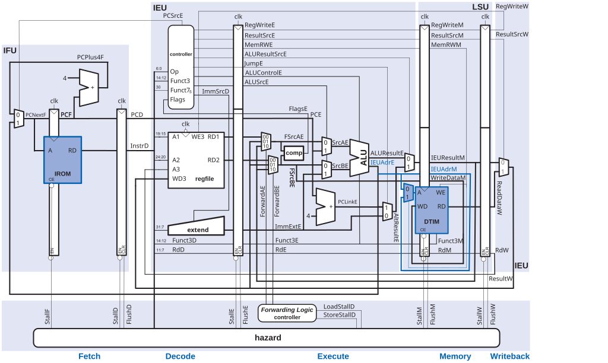

# CORE-V Wally: A Pipelined RISC-V Core

CORE-V Wally is a configurable, five-stage RISC-V processor written in SystemVerilog. It is a useful teaching and research core because the RTL makes the connection between an ISA instruction and its datapath/control implementation visible. This chapter follows the simplified pipelined processor developed in Chapter 7 of *RISC-V System-on-Chip Design* [@harrisRiscvSoc].

The design studied here deliberately stops before a complete application processor. It implements the ordinary instruction path and the improvements required by synchronous memories, but it **does not include interrupt handling, traps, exceptions, CSR control, virtual memory, or privileged modes**. Those mechanisms are necessary in a full Wally configuration and are introduced later in the book; omitting them here keeps the pipeline contract understandable.

## From a Single-Cycle Datapath to a Pipeline

A single-cycle processor completes fetch, decode, register read, ALU operation, memory access and register writeback in one clock period. Its simplicity is attractive, but the period must accommodate the slowest instruction: instruction memory, register file, ALU, data memory and writeback. Most instructions leave part of that long period unused.

Pipelining divides the work into stages separated by registers. Once filled, the pipeline can retire approximately one instruction per cycle even though each instruction takes several cycles to traverse the machine. The latency of an instruction and the throughput of the processor are therefore different quantities.

| Stage | Main responsibility | Typical outputs stored in a pipeline register |
|---|---|---|
| Fetch (F) | Read instruction and form sequential PC | instruction, PC, predicted/next PC |
| Decode (D) | Decode opcode, read registers, form immediate | operands, immediate, control signals |
| Execute (E) | ALU operation, branch comparison, target address | ALU result, store data, destination/control |
| Memory (M) | Load/store transaction | loaded data, ALU result, writeback controls |
| Writeback (W) | Select and write architectural result | register-file write enable, destination, data |

Pipeline registers preserve both data and its meaning. For example, a load instruction carries its destination-register number and `result-from-memory` control from Decode to Writeback. Losing a control bit is as serious as losing an operand: the correct value could be written to the wrong register or at the wrong time.

## The Simplified Wally Pipeline

The following improved pipeline is reproduced from Figure 7.13 of *RISC-V System-on-Chip Design*, Chapter 7, supplied by the author as an editable SVG. It illustrates the datapath after adapting the simple pipeline to synchronous instruction and data memories.

{#fig-wally-pipeline-synchronous fig-alt="Improved five-stage Wally-style pipeline with synchronous instruction and data memories"}

The picture should be read as a timing contract. An instruction enters Fetch with a PC. It crosses each vertical stage boundary only when the corresponding pipeline register enables it. Values displayed in later stages belong to older instructions; several instructions are active at once. In a waveform, always identify an instruction by its pipeline register and program counter rather than by a signal name alone.

### Fetch and synchronous instruction memory

An idealized combinational instruction memory returns `Instr` immediately from `PC`. FPGA block RAMs and practical synchronous memories normally register the read address and return data in a later cycle. The improved pipeline accounts for that latency by carrying the PC/address through a fetch register and aligning the returned instruction with its PC.

This change has architectural consequences. Branch targets, sequential PC generation, instruction validity and flush behavior must all use the PC associated with the returned instruction, not merely the current fetch address. A synchronous-memory implementation that treats RAM as combinational can appear correct in a simplistic simulation but fetch the wrong instruction after synthesis.

### Decode and operand preparation

Decode extracts `rs1`, `rs2`, `rd`, opcode/funct fields and immediate format. The register file produces source values, and control logic classifies the instruction: ALU operation, branch, load, store, register write and result source. In the simplified chapter model, illegal instructions and privileged instructions are outside the scope; supported encodings must nevertheless have unambiguous control values.

The immediate generator is an important boundary. I-, S-, B-, U- and J-type encodings distribute immediate bits differently. Construct the immediate once in Decode, sign-extend it to XLEN and pipeline the result. Recreating different immediate forms later in the pipeline makes forwarding and verification harder.

### Execute

Execute selects register or immediate operands and performs integer arithmetic, comparisons and address generation. For a load/store, the ALU result is the effective address. For a conditional branch, it produces the comparison result and target address. The control path chooses whether the next fetch should continue sequentially or redirect to the target.

The main pipeline hazard at this point is a data dependence. If instruction `i+1` needs the value written by instruction `i`, waiting until Writeback would insert unnecessary bubbles. Forwarding paths return an ALU or writeback result directly to later Execute operands. The forwarding logic must prefer the youngest matching producer and must never forward a value for register `x0`.

### Memory and synchronous data memory

The memory stage sends the effective address, write data, byte enables and read/write control to the data memory. A store has a visible side effect; it must be issued exactly once even if the pipeline stalls. A load must return data aligned with its destination register and writeback control.

Synchronous data memory adds a read latency, just as instruction memory does. The improved datapath carries the load destination/control into a register that waits for the memory response. This is one reason a load-use dependence cannot always be solved by ordinary ALU forwarding: the value may not exist until a later cycle. Hazard control inserts a bubble or holds earlier stages until the load data is available.

## Hazard Management

Pipelining creates hazards because stages overlap.

| Hazard | Example | Simplified Wally response |
|---|---|---|
| Data hazard | `add x5,...` then `sub x6,x5,...` | Forward result or stall if unavailable |
| Load-use hazard | `lw x5,0(x1)` then use `x5` | Stall until synchronous-memory data is valid |
| Control hazard | Conditional branch changes PC | Flush wrong-path instruction(s), redirect Fetch |
| Structural hazard | One memory port serves fetch and load/store | Separate memories/ports or explicit arbitration |

A stall holds selected pipeline registers and prevents side effects from being duplicated. A flush replaces an instruction with a benign bubble by clearing its controls. These two actions are different: holding a wrong-path instruction preserves the bug, while flushing a valid load response loses data. Define enables and clears per pipeline register and verify them with short instruction sequences before running large programs.

## What This Version Omits

The full CORE-V Wally project contains many optional and privileged capabilities. This pedagogical core excludes them intentionally:

- **Interrupts and traps:** no asynchronous interrupt sampling, trap vector, `mepc`/`mcause` state or return instruction.
- **Exceptions:** no misaligned-access, page-fault, illegal-instruction or access-fault trap path.
- **Privileged architecture:** no machine/supervisor/user modes, CSRs, PMP, MMU, page-table walker or delegation.
- **Complex memory system:** no cache coherence, external-bus retries, virtual addressing or DMA policy.

The absence of these features does not mean they are unimportant. It means that the pipeline can first be understood through ordinary integer instructions and synchronous-memory timing. Adding a trap path later is a controlled extension: it must stop younger instructions, preserve the faulting PC/cause, redirect Fetch to a vector and guarantee precise architectural state.

## Implementation Guide

Implement the simplified design as small modules with explicit interfaces: `ifu`, `decoder`, `regfile`, `alu`, `hazard`, instruction memory and data memory. Keep the stage registers in the top-level pipeline or in named stage modules so waveforms retain architectural meaning.

For FPGA targets, infer synchronous block RAM deliberately. Initialize instruction memory from a reproducible file and register addresses/read data according to the selected RAM template. Use a single clock enable policy; do not gate the clock with LUT logic. The clocking-and-timing chapter explains why register enables are safer and easier to analyze.

Test in this order:

1. ALU and immediate operations with no dependencies.
2. Register dependencies that exercise every forwarding path.
3. Load-use and store-data dependencies with synchronous RAM latency.
4. Taken and not-taken branches, including a branch after an ALU operation.
5. Long mixed instruction streams against a simple architectural reference model.

Record cycle-by-cycle expectations for at least one short program. A correct final register value can hide a transient duplicated store or an incorrectly flushed instruction that happens not to alter the selected test result.

## Hands-on Experiments

1. Run a five-instruction dependency chain and annotate which forwarding path supplies each operand.
2. Change the data-memory model from combinational to synchronous. Observe the failing load-use sequence, then add the required stall/control alignment.
3. Measure the clock period of a single-cycle datapath and the maximum frequency of the pipelined datapath after FPGA synthesis. Distinguish latency from throughput.
4. Add a simple branch predictor only after branch flush behavior is fully verified; use the PMU counters to measure branch and misprediction effects.

The simplified Wally pipeline is the foundation for the configurable full core. Its value is not that it contains every RISC-V system feature, but that it makes the timing, state and hazard contracts behind those future features explicit.
