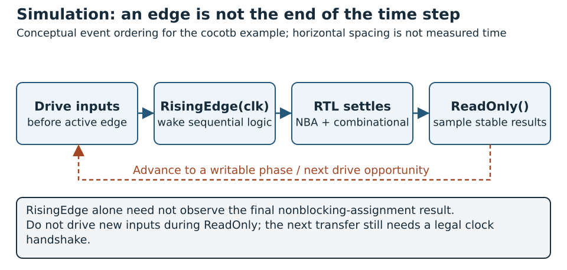

# Verification with cocotb

## Concepts

### What cocotb is

cocotb is an open-source framework for verifying HDL designs with Python. The circuit remains in SystemVerilog or VHDL, and an HDL simulator executes it. Python coroutines drive inputs, wait for simulation events, and check outputs through a simulator interface. cocotb supplies the testbench infrastructure, not a replacement for the RTL simulator. See the [official introduction](https://docs.cocotb.org/en/v2.0.1/index.html).

An `async def` test can suspend on a trigger with `await`. Other tasks and the simulator continue until that trigger occurs. A DUT handle provides access to signals using `.value`. The `@cocotb.test()` decorator identifies a test; a failed Python assertion records a failure. The [quickstart](https://docs.cocotb.org/en/v2.0.1/quickstart.html) introduces this workflow.

### Advantages and boundaries

Using Python makes it straightforward to express a reference calculation, generate transactions, and analyze results. For example, the accumulator test below uses ordinary integer arithmetic and a local pseudo-random generator. Python's libraries can also help build models for packet formats, numerical algorithms, or file-based datasets.

Separating tests from RTL lets one design be checked without adding a hardware test wrapper. Drivers and monitors can become reusable Python components. A simulator-independent test can also be run on another supported backend, provided the design and interface features are supported there.

Tests produce automatic pass/fail results and machine-readable reports suitable for regression workflows. Python familiarity can lower the barrier to writing a self-checking environment, but hardware knowledge is still required: clock edges, signal scheduling, reset, unknown values, and protocol rules remain essential.

cocotb is a testbench framework: it drives and checks a design that something else synthesizes, and a passing test is evidence, not proof. Random stimulus works best with a coverage plan, a reproducible seed and bounded execution. Calls between Python and the simulator also have a cost, so measure the actual workload before deciding which testbench language is faster. See the [supported simulators](https://docs.cocotb.org/en/v2.0.1/simulator_support.html) before selecting a backend.

### Read signals at the correct simulation phase

{#fig-cocotb-sampling-phases width=100%}

In @fig-cocotb-sampling-phases, the edge wait and stable observation are distinct. Resume in a writable phase before changing inputs; the annotation does not add a hardware cycle or replace the ready/valid contract.

A rising-edge event indicates that the clock changed; in an event-driven simulator, the triggered clocked RTL may not yet have updated its outputs. The test below waits for `RisingEdge` and then `ReadOnly` before comparing results. The latter reaches the end of the time step, when settled outputs can be read.

Inputs are driven on the falling edge, leaving them stable before the next rising edge. After checking in the read-only phase, the test waits for the next falling edge before writing again. This avoids attempts to modify signals in a phase that forbids writes. These rules follow the [cocotb timing model](https://docs.cocotb.org/en/v2.0.1/timing_model.html).

### Drivers, monitors and evidence

Apply @sec-verification-methodology by separating the task that drives a request from the monitor that observes its actual acceptance and the scoreboard that checks completion. Model from the written contract rather than copying RTL branches. Preserve the existing edge/read-only sampling discipline, then add bounded stalls, reset/error scenarios and requirement-defined coverage. Python assertions and a nonzero exit status are the functional evidence; a generated XML file by itself cannot tell you whether any test was skipped. Record seed, simulator, cocotb version and configuration with each result.


## Implementation

**Recipe status:** the supplied accumulator test is a **checked recipe** with cocotb 2.0.1 and Icarus 12.0. Its standalone Python minimum is 3.9; the laboratory runner requires 3.10+. Other simulator/install choices are **adaptation templates**. Preserve the example tree and run Make from `examples/cocotb/` with its environment active.


### Download the example files

- [test_accumulator.py](../../examples/cocotb/test_accumulator.py): Python testbench.
- [Makefile](../../examples/cocotb/Makefile): simulator build configuration.
- [requirements.txt](../../examples/cocotb/requirements.txt): Python dependency version.
- [accumulator.sv](../../examples/verilator/accumulator.sv): shared SystemVerilog design.

Use **Save link as** if the browser displays the source. Preserve this directory layout because the Makefile refers to the RTL using a relative path:

```text
examples/
  cocotb/
    test_accumulator.py
    Makefile
    requirements.txt
  verilator/
    accumulator.sv
```

For standalone downloads, run the setup and test commands from `examples/cocotb/` in your downloaded directory tree.

### Install Python, cocotb, and a simulator

This example pins **cocotb 2.0.1** and uses Icarus Verilog. It requires Python 3.9 or later and Icarus 11 or later. In an Ubuntu/Debian environment:

```sh
sudo apt-get update
sudo apt-get install -y make python3 python3-pip python3-venv libpython3-dev iverilog
```

On Windows, run the walkthrough in Ubuntu under WSL2 or a Linux container. The official [installation guide](https://docs.cocotb.org/en/v2.0.1/install.html) also describes native Windows options.

From the repository root:

```bash
cd examples/cocotb
python3 -m venv .venv
source .venv/bin/activate
python -m pip install -r requirements.txt
cocotb-config --version
iverilog -V
```

The requirements file contains `cocotb==2.0.1`. Keep the environment active when running Make so that its Python and cocotb tools agree.

### Reuse the accumulator RTL

The DUT is `examples/verilator/accumulator.sv`, introduced in the Verilator chapter. The same circuit is now checked from Python rather than from the C++ harness.

At each rising edge, reset or clear sets the sum and reporting flags to zero. Otherwise, enable adds an unsigned 16-bit operand modulo 65536, asserts valid, and reports carry as overflow. A disabled cycle retains the sum and clears both flags. The test uses this contract to compute expected outputs.

This shared RTL makes the two approaches easy to compare. It does not require running the C++ executable or modifying the accumulator for cocotb.

### Write the Python test

Save the following as `test_accumulator.py`; it is included in `examples/cocotb/`:

```python
import random

import cocotb
from cocotb.clock import Clock
from cocotb.triggers import FallingEdge, ReadOnly, RisingEdge


@cocotb.test(timeout_time=20, timeout_unit="us")
async def accumulator_matches_reference(dut):
    dut.clk.value = 0
    dut.reset.value = 1
    dut.Clear.value = 0
    dut.Enable.value = 0
    dut.Operand.value = 0
    cocotb.start_soon(Clock(dut.clk, 10, unit="ns").start())

    # reset, clear, enable, operand
    vectors = [
        (1, 0, 0, 0),
        (1, 0, 1, 99),
        (0, 0, 1, 5),
        (0, 0, 1, 9),
        (0, 0, 0, 12345),
        (0, 1, 1, 100),
        (0, 0, 1, 60000),
        (0, 0, 1, 10000),
        (0, 0, 0, 7),
        (0, 0, 1, 65535),
        (0, 1, 0, 0),
        (0, 0, 1, 65535),
        (0, 0, 1, 1),
        (1, 0, 1, 3),
    ]
    rng = random.Random(2026)
    for _ in range(100):
        vectors.append(
            (int(rng.random() < 0.05), int(rng.random() < 0.1),
             rng.randrange(2), rng.randrange(65536))
        )

    expected_sum = 0
    for cycle, (reset, clear, enable, operand) in enumerate(vectors):
        await FallingEdge(dut.clk)
        dut.reset.value = reset
        dut.Clear.value = clear
        dut.Enable.value = enable
        dut.Operand.value = operand

        if reset or clear:
            expected_sum, expected_valid, expected_overflow = 0, 0, 0
        elif enable:
            total = expected_sum + operand
            expected_sum = total % 65536
            expected_valid = 1
            expected_overflow = int(total >= 65536)
        else:
            expected_valid, expected_overflow = 0, 0

        await RisingEdge(dut.clk)
        await ReadOnly()  # Wait until clocked updates and combinational logic settle.
        actual = (
            int(dut.Sum.value), int(dut.Valid.value), int(dut.Overflow.value)
        )
        expected = (expected_sum, expected_valid, expected_overflow)
        assert actual == expected, (
            f"cycle={cycle}, stimulus={(reset, clear, enable, operand)}, "
            f"actual={actual}, expected={expected}"
        )

    dut._log.info("PASS: %d cycles checked (seed=2026)", len(vectors))
```

The 14 directed vectors exercise reset priority, clear priority, holding state, the maximum value, wraparound, and clearing a previous overflow pulse. A further 100 vectors use the fixed seed 2026. The independent reference model calculates a wide Python sum and then explicitly applies the hardware's 16-bit limit.

The comparison includes sum, valid, and overflow on every tested cycle. A wrong result prints the cycle, stimulus, and actual/expected tuples. Conversion with `int()` also fails on unresolved values rather than silently accepting an unknown output. The 20 microsecond simulation timeout bounds a missing-clock or stalled test.

### Configure the build

The accompanying `Makefile` is:

```makefile
SIM ?= icarus
TOPLEVEL_LANG = verilog
VERILOG_SOURCES = $(abspath ../verilator/accumulator.sv)
COCOTB_TOPLEVEL = accumulator
COCOTB_TEST_MODULES = test_accumulator
COCOTB_HDL_TIMEUNIT = 1ns
COCOTB_HDL_TIMEPRECISION = 1ps

ifeq ($(SIM),icarus)
COMPILE_ARGS += -g2012
endif

include $(shell cocotb-config --makefiles)/Makefile.sim
```

It selects the HDL source, top module, Python test module, and simulator. The timing defaults provide a 1 ns unit and 1 ps precision for the RTL without adding delay controls to its source. The included cocotb rules compile the HDL and launch the Python test in the simulator. See the [Makefile build reference](https://docs.cocotb.org/en/v2.0.1/building.html).

## Hands-on Experiments

### Run the test

[Core option · P2 · C1](../../learning-paths.qmd#sec-path-labels){#act-cocotb-baseline .learning-activity}

With the virtual environment active, from `examples/cocotb/`:

```sh
make SIM=icarus
```

Expected results include:

```text
PASS: 114 cycles checked (seed=2026)
TESTS=1 PASS=1 FAIL=0 SKIP=0
```

This example was executed successfully with Python 3.12, cocotb 2.0.1, and Icarus 12.0 in a Linux container. The tested sequence finishes after 1140 ns of simulation. Actual wall-clock runtime depends on the machine.

The build produces `sim_build/` and a `results.xml` test report. These, the virtual environment, and Python cache files are excluded by the example's local `.gitignore`. Run `make SIM=icarus WAVES=1` to enable waveform output with this backend.

cocotb can also use Verilator, but version compatibility matters: cocotb 2.0.1 requires Verilator 5.036 or later. The 5.020 installation used for the earlier standalone C++ experiment is therefore insufficient for this cocotb backend. After installing a compatible version, try `make SIM=verilator`; that variant has not been validated here. See the [backend requirements](https://docs.cocotb.org/en/v2.0.1/simulator_support.html).

### Break the design on purpose

The same faults the [Verilator chapter](verilator.qmd) injects can be run against this test, which lets you compare the two environments. Start with overflow that also fires at the exact maximum. In `examples/verilator/accumulator.sv`, replace the overflow assignment with:

```systemverilog
Overflow <= Enable && (ExtendedSum >= 17'd65535);
```

Rerun `make SIM=icarus`. The assertion message carries everything needed to find the problem:

```text
AssertionError: cycle=11, stimulus=(0, 0, 1, 65535), actual=(65535, 1, 1), expected=(65535, 1, 0)
```

The stimulus tuple is `(reset, clear, enable, operand)` and the two result tuples are `(sum, valid, overflow)`, so the line says that on the twelfth vector the sum and `Valid` agree with the reference and `Overflow` is raised when it should not be. That is why the scoreboard builds its message from the stimulus and both tuples: a failure that names its own inputs can be reproduced without opening the waveform. Restore the original line and the test is back to `PASS: 114 cycles checked (seed=2026)`.

### Random stimulus catches some faults and misses others

This test differs from the Verilator harness in one important way: after the 14 directed vectors it appends 100 pseudo-random ones from a seeded generator. Two further faults show what that buys. First, overflow that ignores `Enable`:

```systemverilog
Overflow <= ExtendedSum[16];
```

The Verilator harness passed this fault, because none of its fixed vectors had a disabled cycle with a carrying operand. Here the random part finds it within a few cycles:

```text
AssertionError: cycle=17, stimulus=(0, 0, 0, 58937), actual=(64343, 0, 1), expected=(64343, 0, 0)
```

Second, `Valid` that also requires a nonzero operand:

```systemverilog
Valid    <= Enable && (Operand != 0);
```

This one passes. The fault only shows when `Enable` is high and the operand is exactly zero, one value out of 65,536, and a hundred random vectors will almost never draw it. Add three directed vectors before the final reset vector, the same three the Verilator chapter adds:

```python
        (0, 0, 1, 40000),
        (0, 0, 0, 40000),
        (0, 0, 1, 0),
```

The unmodified RTL still passes, now with `PASS: 117 cycles checked (seed=2026)`, and the fault is caught on the last of the three:

```text
AssertionError: cycle=15, stimulus=(0, 0, 1, 0), actual=(40000, 0, 0), expected=(40000, 1, 0)
```

Random and directed stimulus therefore complement each other. Random vectors reach combinations nobody listed, and directed vectors reach the rare boundary values that random draws almost never hit. A seed makes the random part repeatable, which is why it is recorded with every failure.

The last fault, `Clear` ignored, shows how the tools differ. Verilator refused to build it, because `-Wall` reports an unused signal. Icarus has no such check, so the fault runs, and the scoreboard catches it on the directed vector that exercises `Clear` over `Enable`:

```text
AssertionError: cycle=5, stimulus=(0, 1, 1, 100), actual=(114, 1, 0), expected=(0, 0, 0)
```

| Fault introduced | Supplied test (14 directed + 100 random) | With three added vectors |
| --- | --- | --- |
| Overflow also at exactly 65535 | fails | fails |
| Overflow never clears | fails | fails |
| Overflow ignores `Enable` | fails | fails |
| `Valid` requires a nonzero operand | **passes** | fails |
| `Clear` ignored | fails | fails |

This table is a **checked recipe**. `python labs/run.py run cocotb` builds every variant from [cocotb_mutation_check.py](../../labs/05-verification/cocotb_mutation_check.py), runs both versions of the test with the same fault list as the Verilator check, and fails if any outcome differs from the table.

### Extend verification

1. [Core option · P2 · C1](../../learning-paths.qmd#sec-path-labels){#act-cocotb-01 .learning-activity} — Deliberately make overflow sticky in the RTL. Rerun the test and confirm a disabled cycle detects the error.
2. [Core option · P2 · C1](../../learning-paths.qmd#sec-path-labels){#act-cocotb-02 .learning-activity} — Add consecutive reset and clear cases while enable is active, documenting their priority.
3. [Core option · P2 · C1](../../learning-paths.qmd#sec-path-labels){#act-cocotb-03 .learning-activity} — Add directed vectors that produce exactly 65535, 65536, and the maximum possible sum of two operands.
4. [Core option · P2 · C1](../../learning-paths.qmd#sec-path-labels){#act-cocotb-04 .learning-activity} — Change the local seed and record it with any failure; retain a minimized directed case for the regression.
5. [Core option · P2 · C1](../../learning-paths.qmd#sec-path-labels){#act-cocotb-05 .learning-activity} — Split stimulus driving and output monitoring into concurrent tasks. Preserve the falling-edge drive and settled-output sampling rules.

A useful deliverable includes the RTL revision, dependency versions, test seed, simulator command, report, and a description of checked requirements. Combine these tests with assertions and architectural checks when integrating the block into a larger SoC.

<!-- chapter-review:cocotb -->

## Key ideas {#review-cocotb-ideas .unnumbered .unlisted}

- Python stimulus and scoreboards still need a precise RTL timing contract.
- Transactions should be checked at acceptance/completion boundaries.
- Random stimulus reaches combinations nobody listed, and directed vectors reach the rare boundary values it almost never draws.

## What you should now be able to explain {#review-cocotb-explain .unnumbered .unlisted}

Explain why waiting for a clock event and sampling settled values are separate scheduling decisions, and name one fault that random stimulus alone is likely to miss.

## Common mistakes {#review-cocotb-mistakes .unnumbered .unlisted}

Two habits make Python testbenches flaky. Arbitrary delays work until timing shifts, whereas protocol events keep working. And a timeout or a missing tool can look like a quiet run, so check that the test actually executed and passed.

## Try it yourself {#review-cocotb-try .unnumbered .unlisted}

[Preparation · C1](../../learning-paths.qmd#sec-path-labels){#act-cocotb-review .learning-activity}

Run the existing accumulator test. Identify its reset sequence, accepted update and scoreboard sample, then inspect the matching simulator log.

## Where this appears in Wally {#review-cocotb-wally .unnumbered .unlisted}

::: {.callout-note title="Wally Connection" icon=false}
A Wally-facing test can observe the core/SoC boundaries in [src/wally/wallypipelinedsoc.sv](https://github.com/antoniofloresgil/cvw/blob/3b30ba6b6519bd2c26c1437e6d61f632a35cef6c/src/wally/wallypipelinedsoc.sv). The supplied cocotb accumulator is a unit example, not a complete Wally verification environment.
:::

## Further reading {#review-cocotb-reading .unnumbered .unlisted}

Use @sec-verification-methodology and the [reproduction appendix](../../appendices/reproducible-labs.qmd).
