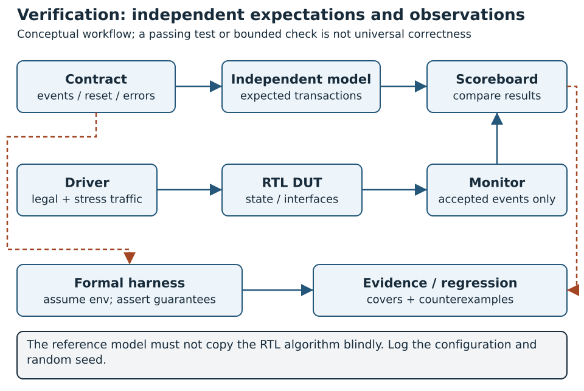

# Verification Methodology Across the Design Hierarchy {#sec-verification-methodology}

## Concepts

{#fig-verification-evidence-flow width=100%}

Follow @fig-verification-evidence-flow from the contract to both the scoreboard and formal harness. A mismatch must retain the configuration and stimulus that produced it; a passing bounded task does not establish an arbitrary execution horizon.

A hardware verification result is a claim about a particular requirement, representation, configuration and environment. It becomes useful engineering evidence when another person can identify what was exercised, how correctness was checked and which assumptions limit the conclusion. A program printing PASS, a solver finding no counterexample, and a clean layout report answer different questions.

This chapter develops a common methodology for Hardware System Design. Its functional foundation is Harris et al., *RISC-V System-on-Chip Design*, Chapter 5, particularly the verification plan, self-checking testbenches, lock-step comparison, assertions, coverage and Wally regression in Sections 5.1–5.11. The system's performance also needs the separate checks discussed in Chapter 21 [@harrisRiscvSoc]. The hierarchy of behavioral, RTL, gate and circuit representations, implementation flows and the distinction between logic verification, silicon debugging and manufacturing test follow Weste and Harris, *CMOS VLSI Design*, fourth edition, Sections 14.4 and 15.1–15.7 [@westeCmosVlsi]. This chapter adapts those ideas to the open tools and executable project provided here; it does not imply that every check described below has already been run on Wally or on a fabricated chip.

### Start with the question, then select the technique

Functional verification asks whether a design implements its specified behavior. Implementation verification asks whether a transformation preserves that behavior and whether the result meets physical constraints. Product validation asks whether an implemented system satisfies its use cases and operating requirements. Manufacturing test screens individual physical devices for defects. Debugging locates the causes of failures found by any of these activities.

| Boundary | Main question | Suitable evidence | Important limit |
| --- | --- | --- | --- |
| Specification and model | Is the required behavior complete and internally consistent? | Reviewed requirements, numerical examples, executable independent model | A correct model can describe the wrong product |
| RTL unit | Does the block implement its contract? | Self-checking simulation, assertions, bounded/unbounded formal results | Finite tests and properties cover defined obligations |
| Subsystem and SoC | Do blocks, memory, firmware and interrupts interact correctly? | Protocol monitors, end-to-end scoreboards, real CPU tests | Unit passes do not establish integration correctness |
| Processor architecture | Are visible instruction effects correct? | Architectural tests and aligned retirement/reference comparison | Does not establish cycle timing or all microarchitectural behavior |
| Logical transformation | Did synthesis, scan insertion or an ECO change functional behavior? | Equivalence against an identified reference, targeted netlist tests | The reference and models may share a wrong assumption |
| Timing and domains | Does the implementation meet timing and crossing contracts? | STA, CDC/RDC review, electrical constraints | Digital functional simulation does not quantify metastability |
| Physical design | Does geometry/connectivity/electrical behavior meet the release rules? | DRC, LVS, extraction, timing and power-integrity checks | Scope depends on decks, corners, modes and checked views |
| FPGA or first silicon | Does the actual platform operate in the intended environment? | Board tests, bring-up, characterization, measured limits | One device or one operating point is a sample |
| Manufactured devices | Which individual parts satisfy the production test specification? | Scan/ATPG, memory test, electrical tests and binning | Fault coverage is not functional-specification coverage |

These boundaries form a chain of contracts. Passing a downstream check does not repair a missing upstream obligation: LVS can match the wrong netlist, and a booting FPGA can contain an arithmetic corner-case defect. Conversely, a functional PASS does not establish timing, legal geometry or adequate test access.

### Write a verification plan before expanding the RTL

Harris's design verification plan connects each feature to its specification, stimulus, checker and coverage obligation. Keep that structure at the IP and platform levels. Begin with observable requirements, not a list of installed tools.

For the dot-product project, separate numerical behavior from transport and policy. “Compute the right result” leaves signed interpretation, ignored upper bits, accumulation width, buffer bounds, completion timing and partial writes unspecified. Give those obligations separate identifiers and checkers. A useful plan entry contains:

1. Requirement ID, source and precise statement, including legal configurations.
2. Verification level, environment and trust/reset assumptions.
3. Stimulus or symbolic setup, including a boundary/failure case.
4. Checker/oracle, observation point and expected outcome.
5. Coverage obligation, result status and immutable evidence references.

Review the plan for omitted features as well as omitted tests. Ask another reader to derive the required outputs for three examples. A checker that disagrees with the specification is a verification defect, even when every regression is green.

| Example ID | Requirement | Stimulus | Checker and observation |
| --- | --- | --- | --- |
| DP-NUM | Low 16-bit signed samples accumulate exactly into 64 bits | Signed extremes, mixed signs, noisy upper bits, every supported length | Independent Python model; both result words after successful completion |
| DP-CTRL | Independent AW/W arrivals and retained responses | Address first, data first, delayed response consumption | Handshake-aware monitor and register readback |
| DP-POLICY | Invalid descriptors produce no DMA traffic | Length, alignment, full-range, wrap and overlap boundaries | ERROR_CODE plus unchanged accepted AR/AW counts |
| DP-DONE | Success follows both successful result write responses | Independent AW/W stalls and second-write fault | Response scoreboard, DONE assertion and firmware acceptance rule |
| DP-SYS | Wally controls and receives completion from the IP | Real firmware polling and machine-external interrupt job | CPU result comparison, trap acknowledgement and finish mailbox |

The supplied plan under `labs/verification/` also lists unexecuted equivalence, CDC/RDC, FPGA, physical and manufacturing obligations. An unexecuted row remains visible; a plan is not a certificate of completion.

### Choose useful abstraction and observation points

An arithmetic model should specify numbers and results without copying the DUT's multiply state machine. A transport model should track accepted transactions without predicting them from internal state names. A processor reference should describe architectural state without requiring the RTL pipeline to advance at the reference model's speed.

For a ready/valid channel, acceptance occurs at `valid && ready` at the agreed clock edge. A scoreboard enqueues on acceptance, not on the driver's intention to send. It dequeues on response acceptance. For AXI writes, address and data acceptance are separate events. When multiple transactions are allowed, ordering and ID rules determine which expectation a response consumes.

Choose comparisons appropriate to the representation. An ISA reference comparison observes architectural events. A cycle-accurate interface checker observes timing and retained payloads. A post-route timing analysis observes path constraints and parasitics. Replacing a detailed block with a functional model speeds integration tests only when the replacement preserves the contract being tested; test that correspondence separately, as Weste and Harris's hierarchy discussion recommends.

### Verification independence and common-mode errors

Independent verification uses a different derivation, not merely another programming language. Copying the RTL's width truncation into a Python helper can reproduce the same bug. For the project, decode the low 16-bit signed sample explicitly and accumulate in Python's unrestricted integer representation; apply the specified 64-bit representation only to the final result comparison.

The expected model needs its own small tests. Check negative times positive, minimum signed operands, a positive sum crossing 32 bits, ignored upper bits and a descriptor at the window boundary. Review model/test data and checker source separately from the DUT. Introduce a deliberate fault into an isolated RTL copy and confirm that an unchanged checker rejects it. Mutation detection demonstrates sensitivity to that particular defect; it is not a numerical measure of complete verification.

## Implementation

For a complete local progression from assertions and assumptions to BMC, induction, useful-traffic witnesses, a real counterexample, repair/regression and sequential equivalence, use @sec-formal-verification. Its two-entry FIFO is an executable preparation exercise for P4. The broader hierarchy and project obligations below remain separate: proving that FIFO does not close accelerator equivalence or whole-core correctness.

@sec-complete-case applies this hierarchy to the same dot-product RTL through Wally firmware and both physical targets. Its common manifest and collector prevent mixing source revisions or stale stage artifacts; its actual results also show why successful tests, positive setup, layout stream-out and product acceptance are separate conclusions.

### Level 1: static analysis, elaboration and RTL semantics

Run inexpensive checks early. Elaborate each supported configuration, inspect port/assignment widths and signedness, find unintended storage or combinational loops, and review undriven/unused signals. Compile both the module and its actual wrapper. A legal parameter value that changes a bus width can expose a connection bug absent from the default configuration.

Lint warnings need a disposition. Repair a real defect; otherwise record a narrow waiver with source context and justification. Disabling warnings globally to obtain a clean transcript hides new defects. A command containing `-Wno-fatal` allows warnings to remain: the Wally integration fixture uses that option for the vendor build, so its simulation PASS is not a claim of warning-free lint.

Test reset priority, clock enables, simultaneous control events and state retention. In an event-driven four-state simulation, distinguish an unknown result from the expected integer; avoid a comparison that silently treats X as harmless. `logic` does not change a signal into a two-state type. Verilator's initialization/X handling also requires review: its runtime documentation describes options that can trade reset-bug detection for speed [@verificationVerilator]. Use an appropriate complementary four-state test when the obligation concerns uninitialized state, reset release or X propagation.

### Level 2: self-checking unit testbenches

A unit testbench separates stimulus generation, legal driving, passive monitoring, the reference model and the scoreboard. Those responsibilities may be functions in a short SystemVerilog/C++/Python program; they do not require a large class framework. The important distinction is that a monitor records what the DUT accepted, independently of the driver.

Harris also identifies UVM as an industrial SystemVerilog verification approach. Its reusable drivers, monitors, sequences, agents and scoreboards organize these responsibilities for larger environments [@harrisRiscvSoc, Section 5.4 and Table 5.1]. In this course, learn those roles using the compact C++/Python/SystemVerilog benches first. A later UVM environment can reuse the contract and verification plan; adopting its class structure does not supply an independent oracle or missing coverage automatically.

Drive inputs before the sampling edge and compare outputs after updates have settled. A C++ Verilator harness explicitly evaluates clock phases. In cocotb, `RisingEdge` and `ReadOnly` are distinct synchronization points; the timing-model documentation explains why an edge wake-up alone can precede downstream updates [@verificationCocotbTiming]. Do not repair a scheduler race with a delay that is accidentally dependent on one clock period or simulator.

Make the checker terminate with a failure on mismatch, invalid protocol state or timeout. A waveform supports diagnosis but does not replace an automatic comparison. Include a watchdog so a missing response produces a finite failure. Keep transaction traces small enough to identify the first discrepancy: seed, requirement ID, accepted transaction number, expected value, actual value and relevant status.

The initial suite should contain directed normal and boundary cases, reset/enable interactions, simultaneous events, error responses and recovery. Add seeded constrained-random traffic to vary data, independent channel delays and legal interleavings. Constraints should reflect the environment contract, not prevent the DUT from encountering difficult but legal behavior. A permanently stalled peer is useful for a safety check even when completion cannot be expected.

### Level 3: assertions and formal contracts

Assertions localize violations near their cause. For a valid/ready source, retained-valid/payload checking detects the violation when it occurs, rather than after the final numerical result happens to be wrong. Conservation properties can check accepted, outstanding and completed transactions. State-dependent properties can prohibit descriptor modification while a job is active or success before the terminal write responses.

Distinguish an environment assumption from a DUT guarantee. If the DMA is the source of AW, stable AW under stall is its assertion. If a formal harness assumes stable AW from an external CPU master, it is constraining the environment. Never assume the very DUT behavior the proof is intended to establish. Record assumptions about target responses, clocks, reset, IDs, transaction counts and valid configuration.

Safety says that a bad event never occurs. Liveness says that a desired event eventually occurs. A DMA master cannot guarantee completion when the target can hold READY low forever. An eventual-completion property needs explicit fairness or bounded-response assumptions. Test robustness under stalls separately from any claim about progress under a responsive environment.

Bounded model checking examines behavior to a stated depth. An unbounded proof needs a sound method and its stated initialization/induction assumptions. A reachability/cover result finds a permitted trace; it does not prove every trace correct. SymbiYosys separates these task modes in its reference documentation [@hsdFormalTasks]. Unknown, timeout and unproven obligations remain unresolved.

The project's Yosys SAT checks constrain reset in the first step and zero initialization. They disable assertions across reset boundaries. The control configuration has maximum length 16 and a 20-cycle bound; the separate engine configuration fixes a valid one-pair descriptor and checks 24 cycles. These conditions belong in the evidence, not only in the script. Reset-based claims require that relevant state is actually initialized by the reset contract; zero initialization is not a model of arbitrary physical power-up.

Inspect reachability to avoid vacuity. A DONE implication can pass because DONE never occurs. The project saves a reachable engine DONE trace, then requires an early-DONE mutation to generate a counterexample. This checks meaningful completion behavior within that engine scope; it does not establish that every antecedent in the control proof is reachable or that the full accelerator completes at every length under formal analysis. Add witnesses for the specific antecedents of new properties.

### Level 4: functional and structural coverage

Coverage measures a defined observation space. It cannot establish that the specification itself is complete. Keep three measures separate:

| Measure | What is counted | Useful interpretation |
| --- | --- | --- |
| Code/structural coverage | Executed statements/branches, toggles or states, as supported by the tool | Locate implementation behavior that the tests did not exercise |
| Functional coverage | Contract-defined scenarios and selected crosses | Determine which specified behaviors were reached |
| Fault coverage | Detected faults in a declared manufacturing fault model | Assess sensitivity of production-test patterns |

For the project, functional bins include supported lengths, operand sign classes, address/data arrival order, response stalls, descriptor rejection classes, DMA read/write errors, reset during activity, IRQ acknowledgement and the second reusable configuration. Useful crosses include terminal outcome × interrupt enable, channel order × stall, and descriptor class × traffic suppression. Do not generate every cross indiscriminately: review which combinations are meaningful and reachable.

A bin should be credited when its scenario occurred and its checker ran, not merely because a test was scheduled. Detect a broken scoreboard or skipped sequence. The project's existing checks and transaction counts provide directed evidence; they do not currently export a full machine-readable functional cross-coverage database. A manifest listing covered cases is not a measured 100% coverage report.

Verilator provides coverage instrumentation, whose available forms depend on the installed version [@verificationVerilator]. Record the instrumentation and collection configuration with the merged database. The teaching baseline is Verilator 5.020; do not assume every feature documented for a later release exists there. Merge only compatible design/configuration runs, and preserve which seeds contributed. A branch missing because an extension is disabled needs a configuration-specific exclusion, not an unexplained permanent waiver.

Review uncovered behavior as a design question: is stimulus missing, is a checker absent, is the feature disabled, or is the state unreachable? An exclusion records a reason and evidence. Reachability in one elaborated configuration does not settle another. Even full code coverage would not detect a feature omitted from the RTL; Harris's plan therefore also requires functional coverage.

### Level 5: architectural and microarchitectural processor verification

Architectural tests exercise instruction/CSR/trap semantics. A memory signature compares selected visible results at the end of a program. It can miss an incorrect intermediate state, an unrecorded flag or a side effect later overwritten. Lock-step comparison narrows that gap by comparing visible state at architectural events, following Harris's Section 5.6. Spike/Sail examples in this book introduce executable references; running them does not itself connect a checker to Wally RTL.

Before differential comparison, agree on XLEN, extensions, privilege modes, memory map, reset state, endianness, access permissions and permitted implementation choices. Align instruction retirement or trap events, not wall-clock or pipeline cycles. Capture PC, instruction encoding, destination/result, relevant CSR updates, trap information and memory side effects according to the selected trace contract. A speculative instruction later flushed must not be compared as a committed instruction.

Handle nondeterminism deliberately. Cycle counters, interrupt arrival times, devices, uninitialized memory and implementation-permitted values may differ. Synchronize input events or use a documented comparison policy; broad masking can hide the bug being sought. A Wally/reference mismatch is first evidence of a disagreement among DUT, adapter, environment and oracle, not immediate proof that the processor is wrong.

ISA agreement does not establish correct forwarding, no lost requests, cache coherence, branch-predictor performance or deadlock freedom. Add local microarchitectural assertions and subsystem scoreboards. Follow a stall/flush through the relevant stages and require that wrong-path stores never become visible. Cache checking should observe data returned, eviction/writeback contents and ownership transitions, not only the hit count.

Verify performance observables separately, following Harris's Chapter 21. Define event semantics, warm-up, measurement start/stop and termination, then use a short predictable workload to validate counters before a benchmark campaign. A cache-miss count and a retired-load count need different expectations. Compare identical workloads/configurations and document repetitions and variability where relevant. Distinguish simulated hardware cycles, simulator wall time and achieved physical clock frequency. A functionally correct faster model can still predict the wrong stall rate or rank two microarchitectures incorrectly.

The supplied dot-product platform demonstrates actual Wally execution, five polling jobs, an interrupt handler and descriptor rejection. It has no per-instruction Spike/Sail retirement comparator and does not constitute full Wally ISA qualification. The simplified pipeline chapter also deliberately excludes privileged/trap machinery; its verification claim must remain correspondingly limited.

### Level 6: subsystem, firmware and SoC scenarios

At integration, test address decoding, memory attributes, arbitration, backpressure, ordering, reset dependencies and interrupt wiring. Successful unit tests can miss two slaves decoding the same address or an adapter capturing AHB write data in the address phase. The project's adapter test explicitly poisons that phase and checks the subsequent data-phase value, error response and recovery.

Create an end-to-end scenario with a visible ownership sequence: CPU prepares buffers; orders initialization; starts the IP; transfers ownership; receives completion; orders result access; then compares. DMA protection is a distinct obligation from CPU PMP. Verify rejected descriptors before traffic and legal transactions at the window edges. A memory model must explain latency, collision behavior and persistence across reset.

Test interruption and failure as system events. A read error stops further work; a second result-write failure may leave a partial value. Software must not accept it as success. Coordinated reset clears protocol state while preserving already committed memory writes under the project contract. Independent subsystem reset, unresponsive peers and cached buffers need additional specified recovery/ownership mechanisms.

The teaching fixture directly routes the IP level interrupt to Wally's machine-external input. Its handler verifies this route, not PLIC priority/claim/complete behavior. Test a full interrupt controller separately before claiming full-SoC integration. Likewise, a shared simulation array does not verify a physical arbiter under conflicting accesses.

Security evaluation specifies assets, actors, trusted configuration and access paths. Include invalid addressing, aliasing, untrusted descriptor writes, debug/test access and reset/recovery paths. Distinguish access-control properties from availability, information-flow and timing-leakage claims. Passing buffer-range tests is evidence for that policy only. Fault injection against selected failures does not quantify lifetime reliability or certify resilience against every physical attacker.

### Level 7: synthesis, equivalence and gate-level checks

After synthesis, compare the identified RTL reference with the implemented netlist under appropriate cell/memory models and configuration. Formal equivalence checks whether the representations agree; it does not validate the specification. Yosys provides equivalence passes including `equiv_make`, `equiv_simple` and `equiv_status`; requiring the final status prevents unresolved comparison cells from being counted as success [@verificationYosysEquiv].

The supplied generic synthesis runs check elaboration/storage and produce netlists, but do not currently execute an RTL-to-netlist equivalence flow. Preserve that gap in the plan. An equivalence experiment must identify mapping, reset/initial-state relationships, matched outputs/state, black boxes and any unproven partitions. Sequential retiming, different latency or scan-mode controls require a corresponding comparison relation; output equality at arbitrary cycles may be the wrong contract.

Gate-level simulation adds selected obligations: reset/initialization, library behavior, scan/test mode and, where supported, annotated-delay scenarios. Identify the exact netlist, cell models and SDF annotation coverage. A zero-delay netlist simulation does not check routing timing. Full software boot may be too expensive here; reuse minimized critical scenarios at this level and retain wider functional tests at RTL, as the books' hierarchical strategy suggests.

### Level 8: clocks, CDC/RDC and static timing

Review clocks and resets as architectural inputs. List every domain, generated/gated clock, crossing, reset dependency and mode. CDC analysis examines synchronization structures and transfer protocols; reset-domain crossing review examines interactions between independently reset state. A two-flop synchronizer is appropriate for some single-bit controls, not automatically for a changing multi-bit descriptor.

Verify the digital crossing protocol under differing clock ratios/phases, pulses, backpressure and reset sequences. Structural review and placement/timing constraints complement those tests. Digital simulation cannot reproduce the analog metastability distribution or demonstrate a desired MTBF. The probability/reliability calculation needs device and frequency assumptions; no finite collection of clean waveforms replaces it.

STA checks paths against declared clocks, modes, min/max delays, uncertainty, cell/RC corners and justified exceptions. Review unconstrained paths, hold as well as setup, recovery/removal, gating and electrical limits. Audit false/multicycle paths by endpoint and reason. Closing a design with a removed obligation is not the same as meeting it. The project's illustrative SDC is an input budget, not a report of achieved 100 MHz timing.

### Level 9: FPGA and ASIC physical implementation

For FPGA, inspect the placed/routed design's clocks, resource use, timing, I/O constraints and generated bitstream identity. Board-level tests add actual oscillator/reset, programming, communication and memory-controller behavior. A design running at one selected clock or temperature does not qualify it at every rated condition. On-board observability changes can affect resource/timing results; retain both configurations.

For ASIC, inspect consistent technology/library/macro views, DRC, LVS, antenna/density checks, RC extraction and corner/mode timing. Tie reports to the final checked GDS/netlist/constraints, not an earlier iteration. Verify top-cell identity and macro exclusions. A zero-violation empty or wrong-top run provides no useful release claim.

Power integrity and reliability add current/activity, package/source, voltage and lifetime assumptions. Characterized cell circuits and custom blocks need circuit-level/PVT validation; SPICE scenarios for a critical cell complement the digital hierarchy. Their models and corner definitions must match the intended technology. The open RTL/physical tools in this book do not automatically perform every foundry-qualified electrical or lifetime check.

Read @sec-physical-validation for actual physical report review, DFT and fabrication preparation. Re-run affected equivalence, timing and physical checks after an ECO, scan insertion, antenna repair or fill change according to the flow dependency. Matching input hashes are necessary for evidence freshness, but hashes alone do not establish that a checker chose the correct top, model or corner.

### Level 10: silicon validation and production test

First-silicon bring-up uses a staged test plan: supplies/current limits, clock/reset, accessible interfaces, identification, simple memory paths, architectural workloads and application scenarios. Record device/board/package revision and operating conditions. Debug access improves observability but also creates a security boundary; define its permitted lifecycle state.

Characterization varies relevant voltage, temperature, frequency and workloads to locate operating margins. Investigate discrepant measurements against implementation predictions. A passing production part may still contain a design defect that its test patterns did not exercise; this is why Weste and Harris distinguish silicon debug from manufacturing test.

Manufacturing test uses declared fault models and access mechanisms such as scan, ATPG and memory BIST. Keep detected, undetected, untestable and excluded faults visible with the denominator and model. At-speed delay tests, static stuck-at tests and memory tests measure different defects. Fault simulation assesses the patterns; simply shifting a scan chain successfully does not establish their coverage. Tester limits, power, test duration and false rejection also matter. The project's DFT review is coursework evidence; no scan insertion or production qualification is supplied.

### Close the loop with regression and release review

Maintain a working baseline while adding features in small steps, following Harris's always-working strategy. Use a fast local tier for elaboration and unit checks, a change-level tier for affected configurations/formal obligations, a periodic tier for larger seed/configuration/system campaigns, and a release tier for physical/DFT/platform evidence. These are execution policies for identified checks, not four definitions of correctness.

A failing test is first minimized to the earliest incorrect event. Determine whether stimulus, checker, model, configuration or DUT is responsible. Preserve the defect-specific regression after repair. CI captures command/log/artifact identities and must reject missing evidence or timeouts. The project's broader workflow runs nine automatic entries, deliberate defect checks and the separately pinned Wally integration. Per-commit checks do not establish board or manufacturing qualification.

For a complete accelerator example, @sec-hardware-ci connects lint, elaboration, independent simulation, bounded formal checks, synthesis and report acceptance in one executable chain. Its four actual RTL mutations challenge the interface contract, arithmetic checker, assertion engine and generic-cell budget separately. A manually dispatched physical regression has a distinct extracted timing/electrical acceptance gate; previous physical results are never inherited by a changed RTL candidate.

Use separate result statuses: **pass**, **fail**, **not_run**, **unknown** and **not_applicable**. Attach a rationale to the latter three; require review before accepting an exclusion. Closure is a review of the plan's applicable obligations, uncovered bins, unresolved results, waivers and current evidence. A single green dashboard is not the closure argument.

## Hands-on Experiments

### Experiment 1: write and challenge the plan

[Core · P2 · C0](../../learning-paths.qmd#sec-path-labels){#act-verification-methodology-01 .learning-activity}

Copy `labs/verification/project-plan.json` into a student work area. Add one requirement for the proposed extension, its assumptions, observation point, checker and measured coverage obligation. Have another student derive expected behavior independently. Find one ambiguous requirement and resolve it before changing RTL. Use the plan template when the final project uses a different IP.

### Experiment 2: demonstrate checker sensitivity and explain a witness

[Core · P4 · C1](../../learning-paths.qmd#sec-path-labels){#act-verification-methodology-02 .learning-activity}

Run `dotproduct`, then the separate deliberate-defect script documented in @sec-executable-project. Explain the first arithmetic mismatch and the early-DONE counterexample. Inspect `done-witness.vcd` and list the read/write response events preceding DONE. State which proof antecedents have witnesses and which remain a reachability task. Extend one property without adding an assumption that removes its failing trace.

### Experiment 3: compare evidence at different boundaries

[Core option · P5 · C2](../../learning-paths.qmd#sec-path-labels){#act-verification-methodology-03 .learning-activity}

Run `dotproduct-wally` with the pinned clone. Select one polling job and the interrupt job. Explain the CPU/bus/DMA ownership sequence and source of the expected result. Compare the firmware result checker with a hypothetical retirement comparator: which faults can each observe? List two SoC scenarios excluded by the teaching fixture and design a test for each.

### Experiment 4: assemble an honest evidence dossier

[Core · P5 · C1](../../learning-paths.qmd#sec-path-labels){#act-verification-methodology-04 .learning-activity}

After generating the test reports, run:

```bash
python labs/verification/evidence.py \
  --unit-report labs/build/report.json \
  --system-report labs/build/wally-platform/report.json \
  --output labs/build/verification-evidence.json
```

In PowerShell, put the command on one line or use its backtick continuation. The tool maps the supplied plan to actual runner records, verifies source/artifact hashes and writes scoped requirement statuses. It leaves physical, equivalence and manufacturing obligations unexecuted. A missing/stale required record fails the command; it cannot create new verification evidence by relabelling an unrun check. Its report-level mapping does not replace measured functional coverage.

For P4/P5, add separately produced equivalence or physical records to a reviewed plan/evidence package; do not edit generated statuses to invent passes. Submit a summary of completed, failed and unresolved obligations, one reproducible failure or counterexample, and the proposed release decision. Explain what evidence would change that decision.

<!-- chapter-review:verification-methodology -->

## Key ideas {#review-verification-methodology-ideas .unnumbered .unlisted}

- Requirements determine checkers, observations and acceptance evidence.
- Functional, formal, implementation and physical results have distinct scopes.

## What you should now be able to explain {#review-verification-methodology-explain .unnumbered .unlisted}

Explain what an independent oracle checks, how assumptions limit a proof, and why positive witnesses help detect vacuity.

## Common mistakes {#review-verification-methodology-mistakes .unnumbered .unlisted}

Reporting tool completion as requirement coverage; weakening a checker until an incorrect design passes.

## Try it yourself {#review-verification-methodology-try .unnumbered .unlisted}

[Preparation · C0](../../learning-paths.qmd#sec-path-labels){#act-verification-methodology-review .learning-activity}

Select one project requirement and follow it through the existing verification plan, checker, report and unresolved integration obligations.

## Where this appears in Wally {#review-verification-methodology-wally .unnumbered .unlisted}

::: {.callout-note title="Wally Connection" icon=false}
The core boundary in [src/wally/wallypipelinedcore.sv](https://github.com/antoniofloresgil/cvw/blob/3b30ba6b6519bd2c26c1437e6d61f632a35cef6c/src/wally/wallypipelinedcore.sv) anchors architectural/system observations. The course accelerator harness supplies additional checks; its coverage is not stock Wally qualification.
:::

## Further reading {#review-verification-methodology-reading .unnumbered .unlisted}

Use @sec-final-review and the [executable project appendix](../../appendices/executable-project.qmd). Follow the chapter sources [@harrisRiscvSoc; @westeCmosVlsi].
