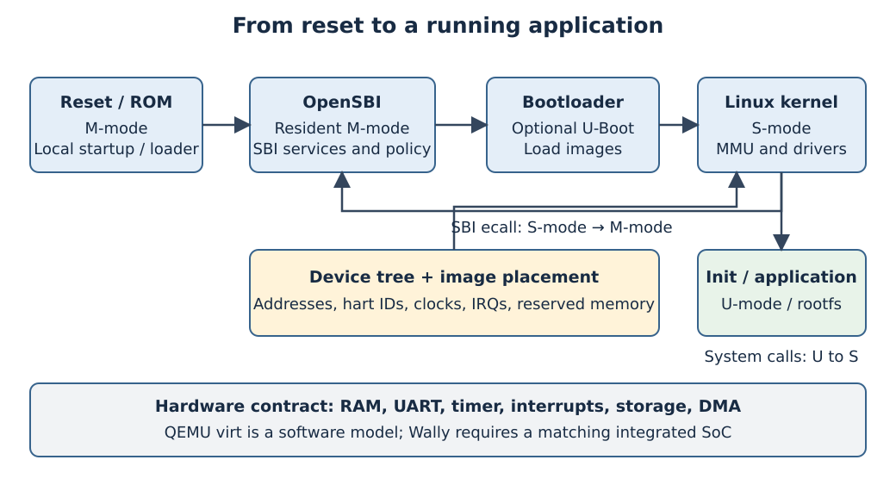
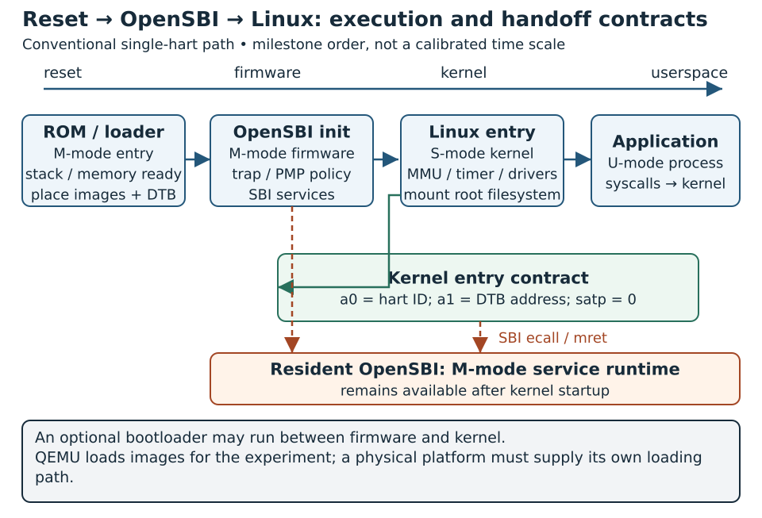

# Booting a RISC-V SoC: From Reset Vector to Linux {#sec-boot-stack}

A processor that executes a test program is not yet a platform that can boot an operating system. Someone must establish usable memory, place images, choose privilege boundaries, describe peripherals and transfer control with the expected register state. The work crosses RTL, firmware, operating systems and integration: a linker address is useful only if the decoder and memory controller implement it.

This chapter closes the gap between @sec-privileged-mmu and physical implementation. It follows the chain **reset → ROM → platform firmware → SBI → bootloader/kernel → device tree and drivers → application**. Treat the order as a useful model and not as a mandatory list of separate binaries: a platform can combine stages or omit a bootloader. Readers should finish able to specify a boot contract, inspect an image layout, explain an SBI call and locate the earliest failing stage in a silent boot.

The normative references are the RISC-V privileged and SBI specifications, the Linux boot contract and the Devicetree Specification. QEMU and OpenSBI provide the concrete software platform [@riscvPrivilegedSpec; @bootSbiAbi; @bootLinuxContract; @bootDeviceTree]. The practical baseline deliberately uses QEMU's `virt` platform; it does not assert that the same binaries boot the book's FPGA Wally platform unchanged.

## Concepts

### From bare-metal bring-up to Linux

Bare-metal bring-up and Linux expose different platform requirements. The small supervisor payload below is an intermediate diagnostic step toward Linux, not a second operating-system case study.

| Environment | Typical entry and runtime | Platform work to supply | Evidence of success |
|---|---|---|---|
| Bare-metal firmware | M-mode startup and application; optionally a lower-mode payload | Stack, sections, trap vectors, drivers and reset behavior | Application signature and controlled interrupt/error tests |
| Conventional Linux with OpenSBI | M-mode resident firmware enters an S-mode kernel, which starts U-mode processes | Linux-compatible CPU configuration, memory, SBI services, hardware description and root filesystem | Kernel boot, PID 1, application output and device tests |

: Bare-metal and Linux entry, platform work and evidence of success {#tbl-boot-software-stack-bare-metal-linux-entry}

For the Linux path, firmware first establishes machine policy, then enters the supervisor kernel. `Spike → Linux` is not a universal command: a particular machine model, firmware and peripheral environment must be selected. The executable reference uses QEMU so that those platform inputs can be stated together.

This separation is pedagogically useful. Start with a tiny image and known UART, introduce a supervisor handoff, then add memory management and an OS. When every component is introduced at once, a bad linker address can look like a page-table error and a missing console driver can look like a dead processor.

### Reset is a hardware/software interface

The reset vector is the physical address from which the hart begins instruction execution after reset. It is a platform choice, not an ISA-wide address. At that point the stack, the ordinary registers and the writable RAM hold no useful software state. Startup must establish the state required by its own calling convention before entering compiled C.

For an RTL system, specify which clocks and resets release first, whether the fetch address is stable, what memory answers the first request, and what happens while that memory is unavailable. A ROM on an internal bus may answer immediately; a DDR controller can require calibration. Releasing a hart into unavailable DRAM can prevent even the first diagnostic instruction from executing.

A practical boot contract lists the reset address, initial privilege, executable storage, memory readiness condition and supported instruction extensions. Verify it at the fetch interface: the first accepted request, returned instruction and next PC are more decisive than merely seeing reset deassert in a waveform.

{#fig-riscv-boot-stack width=100%}

Use @fig-riscv-boot-stack to distinguish the optional loader from resident firmware, and compare its software layers with the explicit handoff sequence in @fig-boot-handoff-timeline.

### ROM, SRAM and DRAM have different jobs

{#fig-boot-handoff-timeline fig-alt="ROM loader enters OpenSBI in M-mode, firmware hands hart ID and DTB to Linux in S-mode, and Linux starts U-mode applications while resident firmware handles SBI calls" width=100%}

Use @fig-boot-handoff-timeline to locate the earliest missing milestone. An OpenSBI banner tells you firmware is running, and a Linux banner tells you the next handoff happened; a working root filesystem or userspace driver is still ahead. Keep the kernel-entry register contract separate from the argument convention used by later SBI calls.

A small ROM can contain immutable startup code, a diagnostic loop or a loader. SRAM provides writable state before external memory is available. DRAM usually provides the capacity needed by an OS, but a controller and a working physical interface must already exist before code executes there. Linux does not initialize an unusable instruction memory on behalf of the reset program.

An FPGA development image may preload an ELF into simulated RAM or initialize block RAM while creating the bitstream. That is a valid development arrangement, but its loading mechanism must be recorded. A production device cannot rely on a simulator to deposit bytes. It needs an actual path such as ROM loading from flash, a host download protocol, or a first-stage loader using local SRAM.

A hardware memory region says where bytes can live and nothing about who owns them. RAM can simultaneously hold OpenSBI, a kernel, a DTB, an initramfs, DMA buffers and stacks, and those regions must stay disjoint even when every address decodes successfully.

### Image placement and linker scripts

The linker places sections and resolves symbols; the loader puts their contents into memory. An ELF contains entry and load-segment information, whereas a raw binary relies on an externally specified load address. Renaming `kernel.elf` to `Image` changes neither its format nor its boot protocol.

The executable practice uses an RV64 supervisor ELF linked at `0x80200000`. Its linker script reserves a 1 MiB payload window and a 16 KiB stack. OpenSBI occupies a different region beginning at the QEMU DRAM base. These addresses belong to the selected QEMU configuration, not to every RISC-V SoC.

```ld
OUTPUT_ARCH(riscv)
ENTRY(_start)
MEMORY { payload (rwx) : ORIGIN = 0x80200000, LENGTH = 1M }
```

The complete [linker script](../../labs/12-boot/link.ld) includes text, read-only data, initialized data, BSS and stack sections. `NOLOAD` reserves address space without storing an initialized byte sequence in the image. Startup explicitly clears BSS; the stack must remain outside that loop. If code runs from ROM but initialized data belongs in SRAM, the script must express separate load and execution addresses and startup must copy the data. The practice runs its loaded code/data in RAM and does not need that ROM-to-SRAM copy.

@fig-boot-memory-plan shows the placement of the checked practice and the owners that must stay disjoint.

{#fig-boot-memory-plan width=100% fig-alt="RAM regions for OpenSBI, a one-mebibyte supervisor payload window with its sections and stack, and boxes for the DTB and other buffers"}

For each image, record physical load address, entry address, footprint including zero-filled memory, privilege at entry, ISA/ABI and permitted overlap. A build map alone cannot detect overlap with a separately loaded DTB or initramfs. Check the combined placement plan, including alignment and temporary decompression buffers.

### Startup before C

The practice's entry code preserves `a0` and `a1`, disables supervisor interrupt sources, initializes `gp` and `sp`, clears BSS and calls C. Linker relaxation is disabled around `gp` initialization, because the instruction sequence cannot rely on a global pointer that is not yet valid. The stack obeys the selected ABI's alignment.

That is enough for this one-hart supervisor payload. A reusable startup also defines trap handling, section-copy behavior, TLS if used and a policy for additional harts. Allocating the same stack to multiple harts or clearing BSS while another hart uses it produces failures that can appear only after concurrency starts. The checked practice fixes `-smp 1` instead of pretending to solve those issues.

## Implementation

### Machine firmware and the supervisor handoff {#machine-firmware-and-the-supervisor-handoff}

OpenSBI is an implementation of the Supervisor Binary Interface. In the ordinary native configuration it remains resident in M-mode, initializes platform state and services requests from S-mode. The SBI is the interface; OpenSBI is one implementation. A bootloader has a different role: finding images, loading them and selecting what to boot.

OpenSBI supports three useful packaging styles [@bootOpenSbiFirmware]:

| Firmware type | Where next-stage information comes from | Integration implication |
|---|---|---|
| `FW_DYNAMIC` | Information supplied by the preceding loader | Loader supplies the next entry/mode information at runtime |
| `FW_JUMP` | Build-time configured next-stage address | Another agent must already have loaded that stage |
| `FW_PAYLOAD` | Next-stage binary embedded with firmware | Convenient combined image, with explicit placement and size constraints |

: OpenSBI firmware types and where the next-stage information comes from {#tbl-boot-software-stack-opensbi-firmware-types-where}

@fig-boot-firmware-packaging shows who supplies the next-stage information in each of the three styles.

{#fig-boot-firmware-packaging width=100% fig-alt="Three rows linking a provider of next-stage information to a firmware type and the next stage"}

For dynamic firmware, the preceding loader supplies a pointer to its dynamic-information structure in `a2`; hart ID and DTB address use `a0` and `a1`. These arguments belong to firmware entry, and the later SBI `ecall` argument convention is a different one.

The checked experiment passes an explicit Ubuntu-packaged `fw_dynamic.bin` to QEMU, avoiding ambiguity about which default firmware was selected. QEMU supplies the initial platform state and image loading. A real Wally boot ROM would have to provide the corresponding services itself, or adopt a different firmware packaging style.

The M-to-S handoff also establishes a protection policy. Firmware must keep machine traps on a valid resident stack, delegate the intended supervisor exceptions/interrupts, allow the lower mode to reach its RAM and devices, and preserve its own state. PMP entries and memory reservations have different purposes: PMP can enforce hardware access restrictions, whereas a DT reservation tells the OS allocator which region is already owned. A reservation is guidance for the allocator and does not by itself stop a malicious load or DMA transaction; enforcement comes from mechanisms such as PMP.

Similarly, trap delegation alone does not make a timer usable. A timer event must arrive through the chosen hardware/firmware path, the supervisor must enable the relevant interrupt, and its handler must program the next deadline. The SBI TIME interface allows software to request this service without hard-coding a machine timer register. Where supported, supervisor timer facilities such as Sstc can change the underlying mechanism; software must discover and use a coherent platform configuration.

### SBI calls cross a privilege boundary

An ordinary C function call remains within one privilege context. An SBI call uses `ecall` to request a service from the supervisor execution environment. In the nonvirtualized OpenSBI case this is a transfer from S-mode into M-mode firmware, followed by a return to the caller.

The modern SBI ABI places extension ID in `a7`, function ID in `a6`, and arguments in `a0`–`a5`. It returns an error in `a0` and a value in `a1`. On an error, the returned value is generally not meaningful. The ABI preserves registers other than those two outputs [@bootSbiAbi]. The practice's [C source](../../labs/12-boot/main.c) binds the C operands to these architectural registers and uses a compiler memory clobber at the call boundary. That compiler constraint is separate from any device-specific hardware ordering rule, which still applies.

| Service | EID | Representative operation | Why the kernel needs it |
|---|---|---|---|
| BASE | `0x10` | Query version; probe an extension | Discover the implemented interface |
| TIME | `0x54494D45` | Set an absolute timer deadline | Schedule supervisor timer events |
| IPI | `0x735049` | Send interprocessor interrupts | Notify other harts |
| RFENCE | `0x52464E43` | Request remote instruction/TLB fences | Coordinate executable code or translations across harts |
| HSM | `0x48534D` | Start or stop a hart | Manage additional execution contexts |
| SRST | `0x53525354` | Shutdown or reboot | Platform lifecycle control |
| DBCN | `0x4442434E` | Debug-console operations, when implemented | Firmware console access without a private UART driver |

: SBI services, extension IDs and why the kernel needs each {#tbl-boot-software-stack-sbi-services-extension-ids}

SRST defines reset types and successful nonreturning shutdown behavior; DBCN is the modern debug-console extension, distinct from legacy console calls [@bootSbiReset; @bootSbiConsole].

Probe optional extensions instead of inferring them from an OpenSBI banner. The BASE extension returns an encoded specification version and an implementation ID; those are different from the OpenSBI software release [@bootSbiBase]. The practice probes TIME and SRST before using them, and checks that an unsupported EID produces `SBI_ERR_NOT_SUPPORTED` (`-2`).

TIME accepts an absolute timer value; it is not a relative delay or a CPU-cycle count. The checked payload requests the maximum deadline to clear the pending timer condition. It does not enable supervisor interrupts or claim to test delivery. An RV32 implementation splits a 64-bit time value across argument registers; copying this RV64 wrapper unchanged into RV32 would be incorrect [@bootSbiTime].

@fig-boot-sbi-boundaries separates the two uses of ecall.

{#fig-boot-sbi-boundaries width=100% fig-alt="An application, a kernel and resident firmware with ecall arrows between them and the register convention of an SBI call"}

Finally, an application system call and an SBI call are distinct even though both can use `ecall`. A U-mode application requests a kernel service according to the OS ABI. The S-mode kernel requests a platform service according to SBI. Forwarding arbitrary user requests into firmware would collapse that trust boundary.

### Hart IDs, timers and interrupt controllers

A hart is an architectural execution context. Hart IDs identify contexts, and they need not form a dense zero-based array or map directly to interrupt-context indexes. A platform description and firmware discovery establish those mappings. The Linux ordered-boot approach enters on one boot hart and starts others through HSM. The HSM start contract supplies a hart ID and an opaque argument, enters with translation disabled and requires the caller to provide a valid physical entry point [@bootSbiHsm].

The timer/software-interrupt path and the device-interrupt path serve different purposes:

| Component | Role in the boot stack | Integration check |
|---|---|---|
| CLINT | Common platform block providing machine timer and software interrupts | Register width, timebase frequency and hart mapping |
| ACLINT | A modular alternative for local interrupt/timer functions | Match actual blocks and bindings; do not rename a CLINT node blindly |
| PLIC | External interrupt prioritization and claim/complete | Source number, trigger behavior and M/S context mapping |
| APLIC with IMSIC in an AIA system | Alternative external-interrupt architecture using direct delivery or message-signalled paths | CPU extensions, topology, firmware and OS drivers must agree |

: Interrupt and timer components of the boot stack and their integration checks {#tbl-boot-software-stack-interrupt-timer-components-boot}

These devices were introduced in the buses chapter. Here the question is whether firmware and the kernel can operate the exact instance present in the SoC. Declaring a device in a DTB cannot create missing hardware. Likewise, substituting APLIC for PLIC requires more than changing a base address [@bootInterruptBindings].

For early bring-up, use one hart, one UART and a known timer source. Add SMP only after the single-hart handoff is stable. Coherent memory, per-hart stacks, startup synchronization, IPIs and remote fences then become explicit acceptance criteria, instead of side effects of increasing `-smp`.

### Device tree is the platform description {#device-tree-is-the-platform-description}

A device tree describes hardware that software cannot discover automatically. A textual DTS is compiled into a binary DTB. It describes CPU/hart information, usable RAM, bus address translation, clocks, interrupt connections, device compatibility and chosen boot settings. It does not contain the device driver implementation [@bootDeviceTree].

The important relationships are often more useful than a list of base addresses. `reg` is decoded using the parent's address/size cell counts; `ranges` describes bus translation; `interrupt-parent` and `interrupts` refer to the binding of the actual controller. An interrupt specifier is therefore not always a universal integer IRQ number.

```dts
/* Adaptation fragment: insert under a correctly described bus. */
accelerator@40000000 {
    compatible = "example,hsd-dotproduct-v1";
    reg = <0x0 0x40000000 0x0 0x1000>;
    status = "disabled";
};
```

This fragment assumes a parent with two address cells and two size cells. The address and compatibility string are illustrative; they are not a published Wally binding. To enable a real instance, provide its actual address, interrupt, clock/reset requirements and a matching driver/binding. Add interrupt properties only after verifying the controller's cell format and source mapping. A `dma-coherent` property is justified only by the implemented interconnect/cache behavior, not by a desire to avoid cache maintenance.

`/chosen` identifies boot arguments and the selected console; `/reserved-memory` can exclude resident firmware and other owned buffers from the OS allocator. OpenSBI's resident memory lies inside the DRAM aperture and still belongs to the firmware, so the OS has to leave it alone. Reserve the actual firmware extents and verify the kernel's interpretation [@bootLinuxContract].

QEMU `virt` generates a DTB for its selected RAM and CPU/device configuration. The practice exports and decompiles it as `virt.dtb` and `virt.dts`. Inspect those artifacts instead of treating the diagram's addresses as authoritative. The payload checks DTB alignment and magic only: it deliberately does not implement a complete parser or dynamically discover the UART [@bootQemuVirt].

### Early console and regular drivers

Before interrupts, allocation and device-model initialization work, a polling UART can provide the first trace. An OpenSBI banner shows that firmware reached a console path, while Linux may still choose a different driver or console name.

The practice directly polls byte-wide NS16550 registers at QEMU `virt`'s UART base. It waits for the transmitter-holding register to become empty before writing a byte. This compact code relies on QEMU's selected UART access model and firmware permissions. A physical UART additionally requires a known input clock, divisor, reset state, pin assignment and electrical connection. A familiar base address is insufficient.

Linux distinguishes an early console from the normal console. The former can expose startup before the complete serial driver is ready; the latter supplies the OS device such as `ttyS0`. Both need compatible configuration. The Linux template later uses a polling `earlycon` and a regular serial console; the corresponding support has to be built into the kernel, since a module cannot be loaded that early [@bootLinuxConsole].

A platform driver matches the device description, maps the MMIO region, configures interrupts and exposes an interface to software. Binding success should be tested separately from successful data movement [@bootLinuxPlatformDrivers]. For the course's AXI/DMA accelerator, the driver must also arbitrate ownership, validate commands and recover from device errors. Linux DMA addresses come from the DMA API; they are not arbitrary userspace pointers or automatically identical to CPU physical addresses [@bootLinuxDma].

The same accelerator can therefore have a bare-metal driver and a Linux driver with shared register semantics but different responsibilities. The former can use a fixed test buffer; the latter must integrate with memory ownership, cache synchronization, process isolation and interrupt lifetimes. Reusing the firmware's register offsets is sensible. Reusing its assumptions about unrestricted address ownership is not.

### Optional U-Boot and kernel entry

U-Boot is useful when the device must select among images, load from storage or network, amend a DTB, support recovery, or present an interactive boot environment. It is optional when a known kernel image is already in memory and firmware can enter it directly. U-Boot's RISC-V support distinguishes M-mode and S-mode execution; an S-mode U-Boot uses SBI for services beneath it [@bootUBoot].

For a conventional direct S-mode Linux handoff, ensure that `a0` contains the boot hart ID, `a1` points to the DTB, and `satp` is zero. The kernel's placement must satisfy its architecture-specific alignment requirements: 2 MiB for RV64 and 4 MiB for RV32 in the documented boot contract. Its early setup establishes mappings before the ordinary kernel environment exists [@bootLinuxContract].

Treat the transition as an interface test. Record the kernel entry PC, privilege, argument registers, reservation map and image hashes immediately before control transfers. If the kernel fails, that checkpoint separates loading defects from failures inside the kernel. An address that is legal for QEMU's loader is not automatically a valid Linux entry point.

### Kernel, root filesystem and application

The kernel initializes memory management, interrupt handling and devices, then starts the first userspace process. A kernel boot log is useful evidence, but a runnable system also needs executable userspace and a root filesystem. A missing interpreter or shared library can prevent a correct ELF program from executing.

For first bring-up, use a minimal initramfs containing a static `/init`. A `newc` cpio archive supplies files directly in memory and removes disk-controller dependencies. This differs from the older block-device initrd mechanism. The QEMU `-initrd` option can supply the archive without making its internal format a block filesystem [@bootEarlyUserspace; @bootInitrd].

The small Linux exercise below mounts `/proc` and `/sys`, prints a marker and remains alive as PID 1. It is enough to demonstrate U-mode execution. A useful interactive system can instead contain BusyBox, device nodes or devtmpfs setup and a shell. Buildroot can generate a coordinated toolchain, kernel and root filesystem; keep its configuration and version so the image is never unexplained [@bootBuildroot].

## Hands-on Experiments

### Experiment 1: checked QEMU → OpenSBI → supervisor payload

[Advanced · C2 build / C1 run](../../learning-paths.qmd#sec-path-labels){#act-boot-software-stack-01 .learning-activity}

The [boot practice](../../labs/12-boot/README.md) contains complete sources, a separate optional container and an evidence collector. It is included in the downloadable practice ZIP. Run from the repository or extracted-package root on Linux/WSL:

```sh
docker build --platform linux/amd64 -f labs/12-boot/Dockerfile \
  -t from-concept-boot:2026.10 .
docker run --rm --platform linux/amd64 --network none \
  --user "$(id -u):$(id -g)" --env HOME=/tmp \
  --mount "type=bind,source=$PWD,target=/work" from-concept-boot:2026.10
```

For a native Windows checkout, use PowerShell with Docker Desktop in Linux-container mode:

```powershell
docker build --platform linux/amd64 -f labs/12-boot/Dockerfile `
  -t from-concept-boot:2026.10 .
docker run --rm --platform linux/amd64 --network none --env HOME=/tmp `
  --mount "type=bind,source=${PWD},target=/work" from-concept-boot:2026.10
```

Building needs network access. Running the payload is offline. Linux UID/GID matching prevents the root-owned build artifacts discussed in the reproduction appendix. This optional image installs QEMU, OpenSBI, Clang/LLD and `dtc`; it leaves the existing nine automatic unit labs unchanged.

The script performs five steps:

1. Record the compiler, emulator, DT compiler and Ubuntu package versions, plus the explicit firmware hash.
2. Compile the startup and C program to an RV64 freestanding ELF and retain the linker map.
3. Ask the same QEMU configuration to export its DTB, then decompile it.
4. Boot the ELF through OpenSBI, capture UART output and enforce a timeout.
5. Require successful handoff/SBI markers and normal QEMU shutdown, then write source and artifact hashes to `report.json`.

The equivalent compile/run sequence inside that environment is:

```sh
mkdir -p labs/build/boot
clang --target=riscv64-unknown-elf -march=rv64imac_zicsr -mabi=lp64 \
  -mcmodel=medany -O2 -ffreestanding -fno-stack-protector -fno-pic \
  -nostdlib -fuse-ld=lld -Wl,--no-relax -Wl,-T,labs/12-boot/link.ld \
  labs/12-boot/start.S labs/12-boot/main.c -o labs/build/boot/payload.elf
qemu-system-riscv64 -machine virt -m 128M -smp 1 -nographic -no-reboot \
  -bios /usr/lib/riscv64-linux-gnu/opensbi/generic/fw_dynamic.bin \
  -kernel labs/build/boot/payload.elf
```

QEMU's `-kernel` accepts this executable payload; it does not make the program a Linux kernel. The firmware banner should identify an S-mode next stage. The application then emits these stable markers, interspersed with actual hart, DTB and SBI-version values:

```text
HSD supervisor payload
PASS handoff: satp=0, aligned FDT magic
PASS SBI base: OpenSBI implementation
PASS TIME: timer disarmed
PASS unsupported extension: -2
BOOT_PASS
```

SRST requests a normal shutdown after the last marker. A timeout, nonzero emulator exit, missing marker or `FAIL` message makes the script fail. The report makes no claim about Linux boot, DTB-wide semantic validation, timer interrupt delivery, SMP or physical UART operation; those need their own evidence. Preserve the image with `docker save` alongside the report: the base image is pinned, but Ubuntu package repositories can update between builds.

Inspect `labs/build/boot/uart.log`, `payload.map`, `virt.dts`, `packages.txt` and `report.json`. Explain which agent supplied each artifact. Identify the DRAM aperture, UART, timer and interrupt-controller nodes in the generated tree. Compare their widths and interrupt bindings before attempting a port.

### Experiment 2: a complete Linux userspace boot

[Advanced · C2](../../learning-paths.qmd#sec-path-labels){#act-boot-software-stack-02 .learning-activity}

This experiment extends the same chain with a real Linux kernel and static PID 1. The optional boot container includes both toolchains. Acquire the checksum-pinned Linux 6.12 source with network access, then compile and boot offline. The Linux source and build products are external/generated inputs and stay outside the practice ZIP.

```sh
docker run --rm --platform linux/amd64 \
  --user "$(id -u):$(id -g)" --env HOME=/tmp \
  --mount "type=bind,source=$PWD,target=/work" from-concept-boot:2026.10 \
  python3 labs/12-boot/linux.py --download
docker run --rm --platform linux/amd64 --network none \
  --user "$(id -u):$(id -g)" --env HOME=/tmp \
  --mount "type=bind,source=$PWD,target=/work" from-concept-boot:2026.10 \
  python3 labs/12-boot/linux.py --jobs 4
```

For PowerShell, use the mount and `HOME` options from Experiment 1, omit the POSIX UID/GID expression and append the same `python3` arguments to the image name. Only the acquisition command needs network; the second command enforces offline execution. Download once into a new workspace. The acquisition command refuses to replace an existing extracted source tree; keep the reference tree unchanged and place variants elsewhere.

The script verifies the Linux archive against the checksum published by kernel.org, builds the RV64 `defconfig` kernel, compiles the static `/init` and constructs the archive with the kernel's `gen_init_cpio`. It observes the userspace marker, then stops QEMU because this PID 1 deliberately remains alive. The report records this harness termination; it is not an SBI guest shutdown test. Logs, `.config`, the kernel, root archive and image/input identities are retained under `labs/build/boot-linux/`.

The following manual commands explain the same steps for a native Linux/WSL environment. They are an **adaptation template**, outside the existing publication gate, and use a separate Git source directory from the script's downloaded archive.

For Ubuntu 24.04, install the host tools and RV64 GNU cross-toolchain:

```sh
sudo apt-get update
sudo apt-get install build-essential git bc bison flex libssl-dev libelf-dev \
  gcc-riscv64-linux-gnu binutils-riscv64-linux-gnu libc6-dev-riscv64-cross gzip \
  qemu-system-misc opensbi device-tree-compiler
mkdir -p labs/work/boot-linux
git clone --depth 1 --branch v6.12 https://github.com/torvalds/linux.git \
  labs/work/boot-linux/linux
git -C labs/work/boot-linux/linux rev-parse HEAD
make -C labs/work/boot-linux/linux ARCH=riscv CROSS_COMPILE=riscv64-linux-gnu- defconfig
```

The tag provides a teaching baseline. Archive the resolved commit, `.config`, host package versions and built artifacts; changing to another kernel release creates a new experiment. Check or enable `CONFIG_BLK_DEV_INITRD`, `CONFIG_RD_GZIP`, `CONFIG_BINFMT_ELF`, `CONFIG_SERIAL_8250`, `CONFIG_SERIAL_8250_CONSOLE`, `CONFIG_SERIAL_EARLYCON`, `CONFIG_PROC_FS` and `CONFIG_SYSFS`. For the ordinary QEMU CLINT/PLIC configuration, retain the RISC-V SBI/timer/interrupt support selected by `defconfig`. Use built-in drivers for the early path.

```sh
make -C labs/work/boot-linux/linux ARCH=riscv \
  CROSS_COMPILE=riscv64-linux-gnu- menuconfig
make -C labs/work/boot-linux/linux ARCH=riscv \
  CROSS_COMPILE=riscv64-linux-gnu- -j"$(nproc)" Image
mkdir -p labs/work/boot-linux/rootfs/proc labs/work/boot-linux/rootfs/sys
riscv64-linux-gnu-gcc -O2 -static labs/12-boot/linux-init.c \
  -o labs/work/boot-linux/rootfs/init
```

The provided [PID 1 source](../../labs/12-boot/linux-init.c) is a userspace program linked against the cross-toolchain's Linux C library. It is different from the freestanding supervisor payload. Create an archive and boot it, using paths relative to the repository root:

```sh
cat > labs/work/boot-linux/initramfs.list <<'EOF'
dir /dev 0755 0 0
nod /dev/console 0600 0 0 c 5 1
dir /proc 0755 0 0
dir /sys 0755 0 0
file /init labs/work/boot-linux/rootfs/init 0755 0 0
EOF
labs/work/boot-linux/linux/usr/gen_init_cpio \
  labs/work/boot-linux/initramfs.list \
  | gzip -n > labs/work/boot-linux/rootfs.cpio.gz
qemu-system-riscv64 -machine virt -m 256M -smp 1 -nographic \
  -bios /usr/lib/riscv64-linux-gnu/opensbi/generic/fw_dynamic.bin \
  -kernel labs/work/boot-linux/linux/arch/riscv/boot/Image \
  -initrd labs/work/boot-linux/rootfs.cpio.gz \
  -append "console=ttyS0 earlycon=uart8250,mmio,0x10000000 rdinit=/init"
```

The manifest creates `/dev/console` inside the archive, so the kernel can open standard streams before starting `/init`. It also supplies directory ownership and permissions without creating privileged host device nodes. Expect an OpenSBI banner, Linux initialization and finally `HSD_LINUX_USERSPACE_PASS`. PID 1 stays alive; exit interactive QEMU with `Ctrl-a`, then `x`. That marker demonstrates userspace entry and successful `/proc` and `/sys` mounts, not an accelerator driver test.

If no Linux output appears, verify the firmware handoff and kernel console configuration before changing the root filesystem. If the kernel reaches PID 1 but cannot execute it, check ELF architecture, executable permission and static linkage. A dynamic `/init` requires its interpreter and libraries inside the archive. If a filesystem operation fails, retain the error rather than emit a success marker.

| Last visible checkpoint | Next boundary to inspect | Useful evidence |
|---|---|---|
| No ROM/firmware output | First fetch, memory readiness, UART reset/clock | RTL PC/bus trace or debugger register snapshot |
| OpenSBI banner only | Next-stage load, entry address, privilege and console | Firmware next-stage fields, ELF map, kernel configuration |
| Linux early messages only | MMU setup, interrupt/timebase or normal-console takeover | Last PC/trap cause and early/regular console settings |
| Root filesystem/init failure | Archive, executable ABI, permissions and dependencies | Initramfs listing and ELF program/interpreter headers |
| Userspace works, accelerator fails | Binding, DMA mapping, interrupt ownership and error path | Driver logs, bus trace and known buffer contents |

: Last visible check, next boundary to inspect and useful evidence {#tbl-boot-software-stack-last-visible-check-next}

Keep each diagnostic tied to the last confirmed transition. Rebuilding the whole stack before preserving a failure log destroys useful evidence and can introduce a second defect.

### Experiment 3: Linux, a driver and the accelerator {#sec-linux-accelerator}

[Advanced · C2](../../learning-paths.qmd#sec-path-labels){#act-boot-software-stack-03 .learning-activity}

[Lab 18](../../labs/18-linux-accelerator/README.md) closes the software path with a separately built QEMU device, a real Linux platform driver and a userspace regression. It also supplies the advanced Wally RTL route described below. The two environments share the numerical/register contract and driver/application sources; their reports retain separate execution status. The supplied QEMU model is an addition to the emulator, not a device present in stock `virt`.

The path is **OpenSBI → Linux → Device Tree binding → `/dev/dotproduct` → ioctl → DMA → IRQ or polling → checked userspace result**. The main experiment uses the minimal initramfs from the previous section. Buildroot can package the same sources later; it is not necessary to introduce a full distribution to exercise the driver.

In this minimal image the application also serves as PID 1: it mounts `/dev`, `/proc` and `/sys`, runs the regression and requests shutdown. When moving to Buildroot, let its init system own mounts and shutdown, and split out the benchmark/ioctl portion as an ordinary application.

| Boundary | Concrete implementation |
| --- | --- |
| Device identity | `compatible = "hsd,dotproduct-v1"`, MMIO `0x10080000–0x1008001f`, PLIC source 20 |
| Numerical work | Signed low 16 bits of each 32-bit operand; exact signed 64-bit sum; lengths 1–256 |
| Kernel discovery | A built-in `platform_driver` matches the DT node and maps its register aperture |
| DMA ownership | A 16 KiB reserved pool `[0x88000000,0x88004000)` belongs to the accelerator |
| Driver allocation | DMA API, 32-bit mask, returned-address validation and one 4 KiB coherent buffer |
| User boundary | Fixed-width ioctl structure; arrays copied through the kernel, no user physical pointers |
| Completion | IRQ acknowledgement/completion or bounded polling; DONE follows both result writes |
| Failure | Invalid arguments, device DMA error, suppressed IRQ, timeout and quarantine |

: Boundaries of the Linux accelerator experiment and how each is implemented {#tbl-boot-software-stack-boundaries-linux-accelerator-experiment}

This is a **new Linux platform profile**. The tiny bare-metal DMA window lies near resident firmware and is not reused. The manifest locks the same accelerator RTL revision while declaring the changed DMA parameters, RV64 OS and PLIC route. The measured physical implementation and bare-metal cycle ratios in @sec-complete-case remain observations of their original profiles.

PLIC source 20 is a hardware interrupt ID. The driver's log prints the Linux IRQ number returned by `platform_get_irq()`; IRQ-domain allocation can give it a different value, such as 13 in the preserved QEMU run. Compare the DT source, domain mapping and driver binding before diagnosing a mismatch.

#### Buffers, barriers and ownership

The DT describes a `shared-dma-pool` with `no-map` and associates it through `memory-region`. The driver calls `of_reserved_mem_device_init()`, sets a 32-bit DMA mask and allocates using `dma_alloc_coherent()`. It verifies that the returned DMA address stays inside the trusted window before any launch. A 32-bit mask alone would not constrain allocations to a 16 KiB aperture. CPU virtual addresses, userspace pointers and DMA addresses are different interfaces, even when this particular model uses identity-mapped RAM [@bootLinuxDma].

The allocated page holds A, B and the two-word result at nonoverlapping offsets. `dma_wmb()` orders data stores before the launch, and `dma_rmb()` orders result consumption after completion. Coherent allocation addresses visibility; ordering remains an explicit obligation. The application supplies arrays through a fixed-width ioctl, and the driver supplies their DMA addresses. It does not allow a process to select arbitrary physical destinations.

One mutex serializes jobs. An IRQ handler verifies the pending bit, acknowledges the IP and completes the waiting request. A polling flag exercises the same numerical/ownership contract using bounded reads. The root-only device node and lack of user MMIO mapping make the exposed interface small enough to audit.

The IP has no software abort/reset register. Consequently, after a timeout the driver **retains the DMA buffers and quarantines the device until reboot**. Returning those pages to an allocator while DMA might still be active would create a memory-corruption risk. This teaching driver is built in and suppresses unbind; unload, hot removal and a production reset/recovery path are not implemented. A terminal, acknowledged DMA error is different from an unconfirmed timeout.

#### Tests and measured intervals

The runner checks the model directly with QEMU's qtest interface before booting Linux. A signed-extreme case checks ignored upper bits, the 64-bit result, asynchronous busy/DONE and acknowledgement. Six invalid descriptors check zero/excessive length, alignment, bounds, overlap and address wrap; the model must record zero DMA for each rejection. These are model tests; RTL address/protocol tests retain their own evidence.

The normal Linux application executes lengths 1, 8, 32, 128 and 256 using both IRQ and polling. An independent C integer reference checks every result. It also requires argument/ioctl/user-copy rejection. Two extra Linux boots inject a DMA error and suppress the interrupt, respectively. The latter must cause a timeout and reject a subsequent request through quarantine. Source/firmware/kernel/DTB/initramfs hashes and actual logs are retained, rather than counting a boot banner as accelerator success.

The timing table separates userspace software calculation, end-to-end ioctl and the interval inside the driver. In QEMU, the model schedules completion after a declared **10,000 virtual ns**, independently of vector length. Those measurements expose copies, system calls, scheduling and modeled completion; they are not a physical accelerator speedup or Wally cycle count. Replacing that timer constant with a guessed hardware latency would not validate the guess. A calibrated performance model or real implementation needs separate evidence.

`kernel_ns` starts immediately before the control-register launch, after filling the DMA buffer and programming the descriptors. It ends after waiting for completion and reading status, error and result, before `copy_to_user()`. The end-to-end ioctl also includes the argument copies, DMA preparation and return path. The driver interval therefore includes completion/software overhead; it is not the MAC's execution time alone.

The preserved author run completed all three Linux boots and seven direct model checks. The following are **single QEMU observations in microseconds**, not statistical benchmarks. The full ten rows, raw logs, software/model hashes and configuration are in the [reference report](../../labs/18-linux-accelerator/reference/qemu-report.json).

| Length | Software, IRQ run (µs) | IRQ ioctl (µs) | IRQ driver interval (µs) | Poll ioctl (µs) |
| ---: | ---: | ---: | ---: | ---: |
| 1 | 118.4 | 2715.9 | 2108.0 | 420.3 |
| 8 | 12.5 | 505.0 | 459.8 | 557.1 |
| 32 | 1.6 | 793.2 | 759.1 | 528.7 |
| 128 | 36.6 | 764.4 | 728.4 | 470.8 |
| 256 | 4.0 | 384.3 | 353.6 | 2267.5 |

: Single QEMU observations of the accelerator run, in microseconds {#tbl-boot-software-stack-single-qemu-observations-accelerator}

The irregular software column is useful evidence of emulator translation, warm-up and host scheduling effects. Increasing N does not give a smooth timing curve in this short run. Ask students which intervals include copies and system calls, why a 10 µs modeled device delay does not imply a 10 µs ioctl, and what repeated measurements and hardware evidence would be needed before selecting an implementation.

The fixed-size ioctl copies both complete operand arrays even for N = 1. The driver then copies the active elements into its DMA allocation. Improving only the MAC cannot remove these interface costs. A revised ABI or batching policy is a separate optimization that needs its own ownership, bounds and performance tests.

#### Reproduce and interpret the result

Follow Lab 18's Linux/WSL or PowerShell commands. Its separate Dockerfile verifies QEMU 8.2.2 and Linux 6.12 archive hashes, builds the added device and built-in driver, and packages a static PID 1/application. Compilation/acquisition needs network and more resources than the tiny supervisor exercise; subsequent tests run offline. The ordinary nine automatic laboratories remain unchanged.

The model implements software-visible word MMIO and data movement, not RTL or individual AXI channel timing. In particular, busy descriptor writes are ignored by the model; it does not expose an AXI SLVERR response to the guest. Its flat shared-RAM platform justifies `dma-coherent` for that model only. Migration, SMP, IOMMU behavior, byte-sized MMIO and full AXI protocol equivalence are outside the claim.

For P4/P5, distribute the prepared model/environment and ask students to complete one small driver change, explain a failure and interpret the measurements. Rebuilding QEMU, Linux and an RTL Linux platform is not an additional compulsory workload in the 6 ECTS course.

### Porting the boot contract to Wally

Lab 18 includes an executable **advanced** route: `wally.py prepare`, `compile`, then `run`. It instantiates the real pinned RV64 `wallypipelinedsoc`, the original accelerator RTL and the AHB control adapter. A lane selector connects the 64-bit CPU bus to 32-bit register accesses. Guarded patches in a private exported source copy add accelerator source 20 through the existing PLIC and an uncached PMA policy for the DMA pool; the external Wally checkout remains unchanged.

Its reset ROM at `0x1000` supplies the OpenSBI dynamic-firmware arguments. OpenSBI, the same kernel and initramfs, and a Wally-specific DTB are loaded at explicitly separated addresses. The real CLINT provides the 100 MHz simulation timebase. D-cache is enabled for ordinary RAM, while the PMA checker explicitly excludes the trusted 16 KiB DMA pool from caching. The pool is page/cache-line aligned and has `no-map` in DT; the driver's allocation uses that reserved pool. Barriers still order launch and completed-result reads. The RTL platform makes no `dma-coherent` claim, and the fixture does not provide a snooping interconnect.

Address-map review exposed a concrete integration defect: the upstream GPIO occupies `0x10060000–0x100600ff`. An earlier accelerator mapping at that address allowed two peripherals to answer one request. The accelerator's DMA result was correct, yet software received stale register values through the combined response. The Linux profile now places the accelerator at `0x10080000–0x1008001f` in both QEMU and Wally, preserving the native GPIO. Preparation checks that the entire 4 KiB page is free against the pinned Wally configuration and declared RAM override, preserving an auditable [address map](../../labs/18-linux-accelerator/reference/wally-address-map.json). A one-hot assertion checks every active AHB transfer. The earlier bare-metal and physical dossiers retain their recorded profiles. A correct arithmetic unit can still sit behind a wrong SoC connection.

The runner first executes a short CPU/MMIO/DMA ROM regression on the same compiled RTL. It writes and reads the native GPIO output-value register with output enables held at zero, checks both accelerator register lanes, descriptor readback, DONE/error and the signed-extreme DMA result, then verifies that GPIO state is intact. Its `WALLY_MMIO_SMOKE_PASS` marker belongs to that preflight. Linux then starts in a separate reset run with the actual firmware/kernel/rootfs and requires its own completion markers. This catches a broken control connection before paying for a full RTL Linux boot; GPIO register isolation does not qualify a Linux GPIO driver or external pins.

The control aperture needs its own device attributes too. The original external-memory region is cacheable; mapping registers there without a PMA override could retain descriptors or status in cache. This profile makes the 32-byte MMIO range uncached and non-idempotent and rejects instruction fetch and atomics there. DMA-buffer attributes and register attributes are separate decisions.

The simulation console uses 6,250,000 baud with a 100 MHz UART input (divisor 1), consistently described to firmware and Linux. This reduces serial waiting in RTL simulation; it is not a Nexys Video serial or frequency qualification.

The profile also disables the upstream RV64 configuration's optional Sv48/Sv57 modes and recomputes its derived VPN width, matching the DT's `riscv,sv39`. Keep the RTL parameter overrides and hardware description together; a firmware/kernel probe may otherwise select a translation mode beyond the one the DT declares.

Both environments use the manifest's `pty.legacy_count=0` kernel argument. The shared kernel retains support for 256 legacy PTYs; creating their unused device nodes adds substantial CPU work during RTL boot. Changing a boot argument is still a configuration change, so record it in both environments; otherwise the two startup workloads differ without anyone noticing.

The same manifest also supplies `initcall_blacklist=plist_test,debug_vm_pgtable`, omitting two boot-time kernel debug self-tests retained by the pinned configuration. This is an accelerator-integration workload, not a qualification of those kernel tests. The model, driver, arithmetic, interrupt, polling and error-path tests remain enabled. Their completion must still be observed before claiming success.

CPU and accelerator access a shared behavioral RAM array through separate simulated ports. This is a functional integration fixture, not a synthesized memory arbiter or DDR subsystem. The observer obtains UART characters from accepted writes of the real CPU. Preparation and a successful Verilator compilation are steps toward Linux execution and not the thing itself: the run stage requires OpenSBI, Linux, driver, userspace-result and final RTL markers. A wall-clock/cycle timeout preserves the last checkpoint and fails the test. Keep the generated advanced report's actual status when describing reproduction.

The advanced run uses the normal application, including IRQ, polling and invalid-argument checks. The extra DMA-error and suppressed-IRQ boots are QEMU model experiments; qualifying the RTL platform's fault recovery requires separate fault injection and evidence.

The preserved advanced run completed the short ROM preflight, booted OpenSBI/Linux, bound the driver and passed all ten numerical cases plus the userspace argument checks. The final RTL marker occurred at **99,362,109 cycles from reset**. This count includes firmware, kernel startup and the whole application, so it is far from the accelerator launch latency. The [Linux UART log](../../labs/18-linux-accelerator/reference/wally-uart.txt), [preflight log](../../labs/18-linux-accelerator/reference/wally-smoke.txt), [advanced report](../../labs/18-linux-accelerator/reference/wally-report.json) and [combined results](../../labs/18-linux-accelerator/reference/results.json) retain the actual evidence and identical software-bundle identities.

These are single **Wally CPU/RTL simulation observations in microseconds**, using the declared 100 MHz timebase:

| Length | Software, IRQ run (µs) | IRQ ioctl (µs) | IRQ driver interval (µs) | Poll ioctl (µs) |
| ---: | ---: | ---: | ---: | ---: |
| 1 | 3.03 | 93.70 | 39.23 | 60.31 |
| 8 | 3.59 | 95.39 | 37.21 | 55.42 |
| 32 | 7.71 | 89.64 | 33.11 | 59.04 |
| 128 | 24.61 | 145.78 | 72.89 | 158.59 |
| 256 | 47.00 | 165.78 | 73.17 | 176.05 |

: Single Wally CPU and RTL simulation observations, in microseconds {#tbl-boot-software-stack-single-wally-cpu-rtl}

The fixture's behavioral second RAM port supplies DMA without a synthesized arbiter or DDR timing. These intervals describe this simulated system. They cannot establish a physical-board speedup, a qualified 100 MHz implementation or energy per operation. Compare copies, cold/warm cache effects and interrupt/polling overhead before proposing a change to the accelerator.

Wally is configurable. A Linux-oriented build requires the selected privilege/translation support and instruction features, sufficient RAM, a timer and interrupt path, a console and appropriate memory permissions. An RV32 bare-metal accelerator configuration is not automatically an RV64 Linux configuration. Begin from the pinned source and the actual integrated platform used in the earlier chapters.

At revision `3b30ba6b6519bd2c26c1437e6d61f632a35cef6c`, `config/rv64gc/config.vh` selects reset at `0x80000000`, declares a boot-ROM aperture at `0x1000`, and places external memory at `0x80000000`, UART at `0x10000000`, CLINT at `0x02000000` and PLIC at `0x0C000000` [@cvwRepository]. Notice that declaring a ROM does not mean the reset PC points at it. Inspect the chosen overrides, preload mechanism, testbench and FPGA wrapper before drawing a boot diagram.

Some addresses resemble QEMU `virt`; that resemblance is no guarantee of binary compatibility. Check UART register spacing/access size, timer semantics, PLIC context layout, supported CSRs, PMP behavior, cache properties and DRAM initialization. A DTB copied from QEMU can describe devices that do not exist in the FPGA SoC.

| Porting step | Required implementation | Acceptance evidence |
|---|---|---|
| Fetch after reset | Reach executable initialized storage after memory is ready | First PC/instruction and accepted bus response |
| Local startup | Stack, BSS/data, trap diagnostics and known UART | Early firmware marker and controlled fault |
| Memory loading | Real image source and nonoverlapping load plan | Hashes, segment readback and RAM test |
| OpenSBI platform | Matching timer, IPI, console, reset and protection support | Firmware banner, extension probes and S-mode entry |
| Hardware description | DTB generated from actual address/interrupt/clock contracts | Binding checks and compared RTL/software map |
| Kernel bring-up | Compatible ISA, MMU, console and interrupt configuration | Linux progress checkpoints and no unexplained faults |
| Userspace | Root filesystem, executable ABI and libraries | PID 1 and application marker |
| Accelerator use | Driver, DMA ownership/coherency and interrupt handling | Correct results, rejection/error tests and cleanup |

: Steps for porting the boot contract to Wally and their acceptance evidence {#tbl-boot-software-stack-steps-porting-boot-contract}

Run software-oriented bring-up in QEMU first, then use RTL to verify Wally-specific behavior and FPGA to validate the implemented system. QEMU's functional execution cannot establish Wally timing, DDR training, pin correctness or a DMA coherency guarantee. RTL simulation exposes those logical interfaces but may be too slow for a full distribution boot. Select a minimal kernel/initramfs and retain staged checkpoints to keep failures local.

### Security, reliability and the boot evidence package

Boot code establishes who controls memory and privileged services before normal software protection exists. Define which image sources are trusted, who may replace firmware, how a failed load is reported and whether recovery can bypass the intended policy. Secure boot is a chain of authenticated stages rooted in an actual protected key or trust anchor; an SBI implementation or image checksum alone does not supply that chain.

For the final project, keep accidental-corruption detection and authenticity apart. Hashes identify the tested files; authenticated boot additionally verifies that the signer is trusted and applies rollback policy. A malicious DTB can misdescribe protected memory or device reachability, so it belongs to the trusted image set or must be independently validated.

Reliability also includes behavior when startup does not finish. Use bounded memory/controller waits, watchdog/reset policy and diagnostic checkpoints appropriate to the platform. A recovery route should leave DMA inactive and untrusted devices contained until the software owner has configured them. Test cold reset, warm reset and an interrupted accelerator job separately.

Submit a boot evidence package containing source/tool/image identities, combined memory map, firmware/DTB/kernel/rootfs hashes, a timestamped UART log and the expected privilege handoffs. Keep the checked QEMU report separate from a new Linux or Wally report. For defence, answer: Who loaded each byte? Which stage owns the timer? Who protects resident firmware? Where does the first user instruction execute? What would fail if the DTB named the wrong interrupt? Those questions connect an apparently simple boot message to system-level design.

<!-- chapter-review:boot-software-stack -->

## Key ideas {#review-boot-software-stack-ideas .unnumbered .unlisted}

- Boot is a sequence of image, privilege and platform-description handoffs.
- A functional Linux boot and authenticated boot establish different claims.

## What you should now be able to explain {#review-boot-software-stack-explain .unnumbered .unlisted}

Explain who loads each stage, how SBI differs from an OS system call, and how the DTB connects hardware to drivers.

## Common mistakes {#review-boot-software-stack-mistakes .unnumbered .unlisted}

Two assumptions fail on real hardware. QEMU `virt` binaries do not boot Wally unchanged, because addresses, devices and platform details differ. And an image checksum detects accidental corruption, but only a verified signature and a rollback policy form an authenticated root of trust.

## Try it yourself {#review-boot-software-stack-try .unnumbered .unlisted}

[Advanced · C0](../../learning-paths.qmd#sec-path-labels){#act-boot-software-stack-review .learning-activity}

Review the Linux UART logs. Identify firmware, kernel, driver and PID 1 checkpoints and link them to their recorded image/configuration identities. Explain why the timeout test retains DMA buffers and why QEMU timing cannot establish a physical speedup. For the advanced extension, compare the Wally-specific DT and RTL checkpoints with the QEMU report. Explain why correct DMA arithmetic does not establish correct MMIO responses, and why a memory barrier cannot repair overlapping peripheral address decodes.

## Where this appears in Wally {#review-boot-software-stack-wally .unnumbered .unlisted}

::: {.callout-note title="Wally Connection" icon=false}
Compare [src/uncore/rom_ahb.sv](https://github.com/antoniofloresgil/cvw/blob/3b30ba6b6519bd2c26c1437e6d61f632a35cef6c/src/uncore/rom_ahb.sv) and [config/rv64gc/config.vh](https://github.com/antoniofloresgil/cvw/blob/3b30ba6b6519bd2c26c1437e6d61f632a35cef6c/config/rv64gc/config.vh) with the boot contract. The configured reset vector and a declared ROM aperture need not be the same address.
:::

## Further reading {#review-boot-software-stack-reading .unnumbered .unlisted}

Revisit @sec-privileged-mmu and @sec-hardware-security. Follow the chapter sources [@riscvPrivilegedSpec; @bootSbiAbi].
