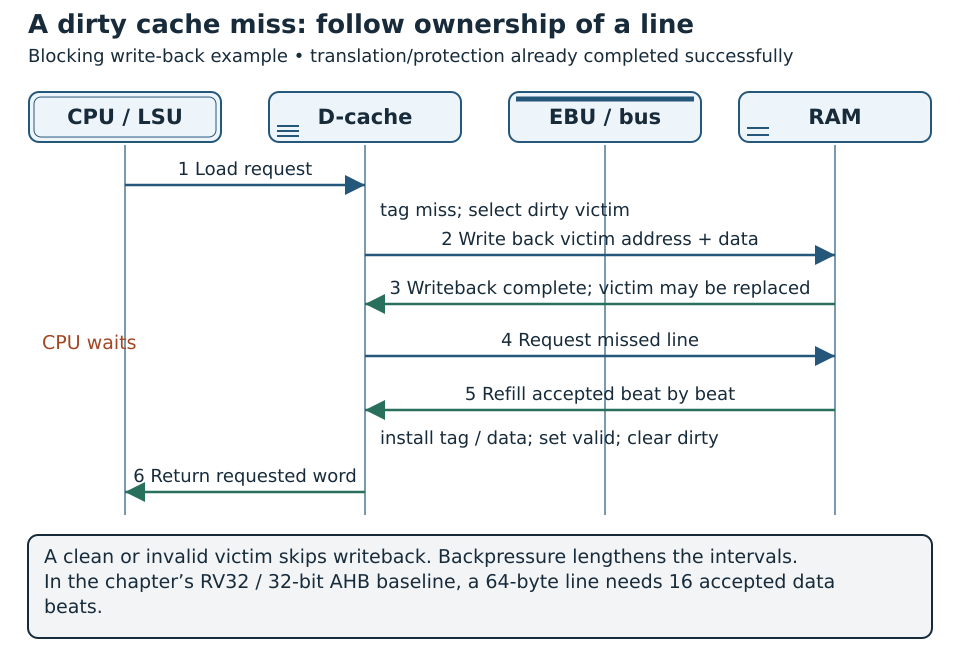

# Memories and Caches {#sec-memories-caches}

The Linux integration in @sec-linux-accelerator makes DMA ownership concrete: a reserved pool, DMA addresses, coherent allocation, ordering barriers and timeout quarantine. Its advanced Wally profile starts with D-cache disabled; enabling it requires a new verified cache/DMA contract.

Executable reference sources and tests are included in the [laboratory package](../../appendices/reproducible-labs.qmd). From its root, run `python labs/run.py run memory`. The appendix states dependencies, checked requirements and guided extensions.

A processor can execute an arithmetic operation quickly and still spend most of its time waiting for data. The memory system bridges the gap between a small, fast datapath and a much larger storage space. Its behavior depends on physical memories, cache organization, address translation, bus service and the instructions being executed. These layers must be understood separately before they can be integrated correctly.

This chapter develops a synchronous memory contract, explains cache organization and then follows instruction and data accesses through CORE-V Wally. It builds mainly on Chapter 10 of *RISC-V System-on-Chip Design*, with pipeline memory timing from Chapter 7, memory management from Chapter 11, LSU integration from Chapter 12 and instruction-cache integration from Section 13.3.1 [@harrisRiscvSoc].

Wally's caches are configurable implementations, not requirements of the RISC-V ISA. A small configuration can use tightly integrated memories without a cache; an application-oriented configuration can include instruction/data caches and virtual memory. The examples below distinguish a physical memory, a functional cache model and full Wally RTL. None is a substitute for the others' verification.

## Concepts

### Memory hierarchy and technology

Large memories are economical per bit but are not necessarily fast enough to supply every processor access. A hierarchy keeps frequently needed information near execution and moves less frequently used information to larger storage. An L1 instruction cache and an L1 data cache serve different traffic, even when they use similar storage cells.

```text
CPU registers
   |
   +-- instruction path -- IROM or L1 instruction cache --+
   |                                                     |
   +-- load/store path --- DTIM or L1 data cache ---------+-- bus -- main memory
   |                                                     |
   +-- device access ------- uncached path ---------------+-- peripheral registers
```

This diagram presents alternatives, not a mandatory sequence. A tightly integrated memory is directly addressed storage with predictable access timing; it is not a cache containing automatically selected copies of other memory. Main memory may be on-chip RAM, external DRAM or a simulation model. Additional cache levels are possible in other systems but should not be assumed to exist in a chosen Wally configuration.

| Storage | Useful role | Integration issue |
|---|---|---|
| Flip-flop/register array | Small state and unusual port structures | Area, routing and switching cost |
| FPGA distributed RAM | Small local memories | Device-specific read/write capabilities |
| FPGA block RAM | Larger synchronous arrays | Fixed primitive shapes, ports and collision modes |
| ASIC SRAM macro | Dense on-chip storage | Exact dimensions, timing and physical views |
| ROM/boot memory | Initial instructions or constants | Image generation and startup address |
| DRAM | Large main memory | Controller, refresh, calibration and variable service |

SRAM retains its contents while powered without DRAM-style refresh. DRAM provides greater density but needs a controller and refresh; row state and competing requests influence service time. Neither is accurately represented for performance purposes by assigning a single convenient combinational expression to a read-data signal.

Technology selection also affects the clock budget. A cache's hit path includes array access, tag comparison and data selection, not only SRAM access time. A larger cache can reduce misses yet lower achievable frequency. Evaluate program execution time and implementation cost together.

### A memory interface is a timing contract

Before writing RTL, specify the storage interface. The client must know which edge accepts an address, when data becomes meaningful and what happens during stalls. A memory's array syntax does not communicate all these facts.

| Property | Questions to resolve |
|---|---|
| Organization | Width, depth, address unit, legal ranges? |
| Ports | One read/write port, separate read/write ports, true dual port? |
| Read timing | Combinational, registered address, registered data, extra pipeline stages? |
| Write behavior | Which edge, byte/bit masks, write acknowledgement? |
| Collision | Same-address read/write; two writes to one location? |
| Enable | Does disabling access retain the address, data or both? |
| Reset | Clears interface state, array contents or neither? |
| Initialization | Boot image, software writes, unknown contents? |
| Error | Out-of-range access, parity/ECC failure, unsupported size? |

**Word address** and **byte address** are not interchangeable. A 256 × 32-bit memory holds 1 KiB. Its eight-bit word index selects one of 256 entries, while a byte-addressed system needs ten offset bits to describe all bytes. The low two byte-address bits select a lane inside a 32-bit word; passing the full byte address into the array index silently changes the mapping.

A synchronous read is not an arbitrary extra delay added to a combinational read. The accepted address must stay associated with its returned data. A stall after acceptance must not allow a newer address to replace the pending response. The processor must retain the load's destination and controls alongside that response.

### Read-during-write modes and port conflicts

A single read/write port cannot independently service two unrelated addresses on the same edge. Even a dual-port memory has defined restrictions when ports collide. Read-during-write behavior is particularly important for a store followed by a load or for a cache installing a line while another access reads its arrays.

| Mode | Read result during a permitted same-address write |
|---|---|
| Read-first | Value before the write |
| Write-first | Value after the write, respecting supported masks |
| No-change | Previous output retained |
| Undefined/unsupported | Client must avoid the collision |

A registered address followed by a combinational array output can behave differently from a registered data output. Simulation statements, inferred primitives and SRAM macro models must agree. A wrapper's name or comment is not enough evidence for a collision mode: inspect the actual assignments and the backend's specification.

Where the required behavior differs from a primitive, the wrapper may insert bypass logic, a read-modify-write sequence or an extra cycle. That adaptation changes latency or resource cost. Do not claim portable memory semantics while relying on an undocumented collision result.

Byte masks must also be explicit. In a little-endian 32-bit word `0x11223344`, increasing byte addresses contain `44`, `33`, `22`, `11`. A masked write of `0xAABBCCDD` with mask `0101` changes the word to `0x11BB33DD`. The mask is a lane enable, not the data value to be stored.

### Reset, initialization and validity

Clearing every array element on reset can prevent efficient FPGA RAM inference or require thousands of resettable registers. Most SRAM macros do not provide an instantaneous array-wide clear. Reset the interface state that needs a defined starting point and initialize contents through a supported image-loading or software mechanism.

For a cache, invalidating lines is usually sufficient to prevent use of stale array contents. Valid bits reset to zero; data and tags need not all contain zero. The lookup must qualify a tag match with validity. A coincidental match in an uninitialized tag is not a hit.

Simulation can hide initialization errors. A four-state `logic` array can reveal unknown values, while a two-state model or simulator may initialize them to zero. An executable boot image is another explicit initialization mechanism. None proves that a manufactured SRAM powers up with useful data.

`$readmemh` is useful for simulation and supported FPGA initialization flows, but is not a universal ASIC power-up operation. Keep the memory image, address convention and build process reproducible. An FPGA can store ROM content in its configuration; an ASIC may need a physical ROM, boot peripheral or software loader.

### Locality and cache lines

A cache holds copies of memory blocks. **Temporal locality** means recently used information is likely to be reused; **spatial locality** means nearby information is likely to be used. A short loop reuses instructions, while a sequential array traversal accesses neighboring words [@harrisRiscvSoc].

Transfers occur in **lines**, not only in the requested word. A 64-byte line contains sixteen 32-bit words. Fetching one line can supply the next fifteen sequential accesses without another refill. But a pointer chase might use one word from each line, wasting much of that transferred data.

Larger lines amortize request latency and exploit spatial locality, but consume more transfer time and can evict useful information. A larger line is not automatically a larger effective working set. Compare useful bytes, miss rate and refill bandwidth under the same workload.

A hit means the requested line is present and usable; a miss means it must be obtained or handled through another path. An uncached device access is neither an ordinary cache hit nor evidence of a broken cache: bypass is intentional for regions with unsuitable semantics.

### Capacity, sets, ways and address fields

Let $C$ be data capacity in bytes, $B$ line size in bytes, $A$ associativity and $S$ the number of sets. For the usual power-of-two organization,

$$
S = \frac{C}{AB}, \qquad
n_{\mathrm{offset}}=\log_2 B, \qquad
n_{\mathrm{index}}=\log_2 S.
$$

An address separates into tag, set index and line offset. The offset contains both byte-lane and word-within-line information. Tags identify which memory block occupies a selected location.

```text
Physical byte address:  |              tag              | set | offset |
                                                        chooses   chooses
                                                         row       byte
```

For a teaching 4 KiB, two-way cache with 64-byte lines, $S=32$, the offset is six bits and the index is five bits. With a 32-bit physical address, the tag is 21 bits:

| Address bits | Meaning |
|---|---|
| `[31:11]` | Tag |
| `[10:6]` | Set |
| `[5:0]` | Byte offset in line |
| `[5:2]` | 32-bit word position |
| `[1:0]` | Byte position within that word |

Addresses `0x80000000`, `0x80000800` and `0x80001000` map to the same set but different tags. Two can coexist in this two-way cache; repeatedly cycling through all three can cause conflict misses. The formula describes the teaching geometry, not an assertion that every Wally configuration has these dimensions.

Wally can use physical-address widths different from XLEN. A 34-bit physical address with the same geometry needs a 23-bit tag. Calculate tags from the implemented physical address, not from a guessed C pointer width.

Data capacity also excludes metadata. The 32-bit teaching cache has 64 lines. Adding 21 tag bits, one valid and one dirty bit per line requires 1,472 bits; a one-bit replacement state per two-way set adds 32 bits. That is 188 bytes of conceptual metadata beyond 4 KiB of data, before ECC, control registers, buffers and macro shape overhead.

### Direct-mapped and associative lookup

A direct-mapped cache has one way per set: each line has exactly one possible home. This makes lookup and replacement simple but creates conflicts between unrelated addresses that share an index. A set-associative cache provides several homes within each set, comparing their valid tags in parallel.

| Organization | Placement | Main trade-off |
|---|---|---|
| Direct mapped | One location | Simple lookup; more conflicts |
| Set associative | One of A ways in its set | Comparators, selection and replacement state |
| Fully associative | Any line | Expensive search for larger capacities |

For a set-associative hit, exactly one valid way should match. A duplicate-tag bug can make two ways return different copies of the same physical line. A hit vector should be one-hot or zero, and the read-data mux must select the corresponding way.

Increasing associativity at fixed capacity reduces the number of sets. It changes mapping as well as comparator count. A fair comparison records capacity, line size, ways and sets, then checks achieved frequency and resources. It cannot attribute every improvement to an isolated extra comparator.

### Miss classification and replacement

The standard three-C classification distinguishes **compulsory** misses on first use, **capacity** misses from a working set exceeding storage, and **conflict** misses from constrained placement. A fully associative reference of comparable capacity helps distinguish placement effects from capacity effects under a declared replacement policy [@harrisRiscvSoc].

A larger cache does not remove the first miss to a new block. Associativity cannot keep an arbitrarily large working set. A stream with no reuse may have a low hit benefit from added capacity, even though neighboring words still benefit from line fetching.

After finding no hit, prefer an invalid way. Only a full set needs replacement of a usable line. Replacement policies include random, FIFO, least recently used (LRU) and approximations. Exact LRU tracks complete recency information; tree pseudo-LRU uses fewer bits but may select a different victim.

For four ways, a binary tree uses three direction bits. Interpret each bit as pointing toward the subtree chosen for eviction. A hit updates the traversed bits to point away from the accessed way. This example assumes all ways valid:

| Most recent action | Root/left/right bits | Next pseudo-LRU victim |
|---|---|---:|
| Initial state | `000` | 0 |
| Access way 0 | `110` | 2 |
| Access way 2 | `011` | 1 |
| Access way 1 | `101` | 3 |
| Access way 3 | `000` | 0 |

The tree encodes a useful approximation, not the full history. Its state also needs forwarding when a recent update and a new lookup overlap. A replacement unit that selects the right victim in isolated tests can fail on back-to-back accesses if it reads stale state.

### Write policies and dirty ownership

Reads can leave a clean copy. Stores create another question: where does the newest value reside? In **write-through**, updates also travel toward the next memory level. A write buffer may absorb traffic, but it does not create unlimited bandwidth. In **write-back**, updates remain in the cache and mark the line dirty until eviction or maintenance.

The store-miss allocation choice is separate:

| Policy | Store hit | Store miss |
|---|---|---|
| Write-through, allocate | Update cache and next level | Fetch/install then update |
| Write-through, no allocate | Update cache and next level | Write next level without installing |
| Write-back, allocate | Update cache, set dirty | Fetch/install, merge store, set dirty |
| Write-back, no allocate | Update existing line, set dirty | Bypass miss according to design |

Write-back with write allocation is a useful model for Wally's data-cache path. A partial store miss first obtains the untouched bytes, then merges the selected bytes. Replacing the whole line with a repeated store value destroys neighboring memory contents.

A dirty victim must be written to its **old address**, reconstructed from its stored tag and set. Using the incoming request's tag writes the old data to the wrong block. Preserve victim identity until writeback completes; only then overwrite its storage with the refill.

RISC-V atomics add another requirement. An AMO must perform its read-modify-write with the required indivisibility; LR/SC uses reservation state and a conditional store outcome. Two ordinary accesses through a cache do not automatically satisfy those contracts. Multiple harts and DMA make the scope of atomicity especially important. The cache model later in this chapter deliberately excludes atomics, while full Wally configurations can add the corresponding LSU machinery [@harrisRiscvSoc].

```text
request -> lookup -> hit ---------------------------> complete
                  |
                  +-> miss -> choose victim
                               |
                               +-> dirty? -> write back old line
                               |
                               +-> fetch requested line -> install/merge -> complete
```

Do not mark a line valid while its refill is only partly received unless the design has additional per-beat validity machinery. A **blocking** cache retains the miss and prevents conflicting new accesses until service completes. A nonblocking cache can support multiple misses through miss-status entries, merging and response tracking; adding a request queue alone does not implement those features.

### Timing: a hit can still stall

A hit is a placement result, not a guarantee of zero extra cycles. Synchronous arrays, structural conflicts and pipeline dependencies still determine timing. In Wally's design, the address for a future lookup and the address of the current operation can coexist in different pipeline stages [@harrisRiscvSoc].

A store may use the data-array port when the following load wants to read another row. The younger operation then waits even if its tag would match. Separately, a load-use dependence waits for the loaded value before a dependent instruction can execute. These are different causes: storage-port contention versus an operand not yet available.

During a miss, hold request address, size, store data and byte mask. A stall must not trigger the same store repeatedly. A pipeline flush discards speculative work, while cache maintenance changes stored copies; these uses of the word flush must not be confused.

### Average memory access time and program performance

For a simple blocking cache, define hit lookup time $t_h$ and **additional** miss penalty $p$. Then

$$
\mathrm{AMAT}=t_h+m p,
$$

where $m$ is miss rate. A one-cycle hit and 5% misses with a 20-cycle additional penalty give two cycles per access on average. If the supplied miss latency already includes the lookup, subtract that component instead of counting it twice.

For a two-level teaching hierarchy, with additional lower-level times expressed in the same units,

$$
\mathrm{AMAT}=t_1+m_1(t_2+m_2t_{\mathrm{memory}}).
$$

Here $m_2$ is conditional on reaching L2. With $t_1=1$, $m_1=0.05$, $t_2=6$, $m_2=0.2$ and $t_{\mathrm{memory}}=50$, AMAT is 1.8 cycles. This mathematical example does not imply that Wally includes an L2 cache.

For a blocking in-order core, a simple CPI estimate separates instruction and data penalties:

$$
\mathrm{CPI}\approx\mathrm{CPI}_{\mathrm{hit}}
 +m_Ip_I+a_Dm_Dp_D,
$$

where $a_D$ is data accesses per instruction. For a hit-only CPI of 1.1, instruction miss rate 1%, data access fraction 30%, data miss rate 4% and 25-cycle penalties, the estimate is 1.65. It assumes the counted stalls add without overlap; shared-bus contention, dirty evictions and page walks may require a more detailed model.

Execution time is $N_{\mathrm{instructions}}\mathrm{CPI}/f$. Reducing misses is helpful only in context: a larger cache that reduces CPI but greatly lowers frequency may lose overall. Distinguish model predictions from cycle measurements and post-implementation frequency.

### Cache maintenance, instruction visibility and DMA

**Clean** writes modified data toward the required visibility point while retaining a usable copy. **Invalidate** removes a cached copy. A combined clean-and-invalidate operation does both. The book also uses *cache flush* for writing back dirty data; Wally signal names must be read in their own documented context [@harrisRiscvSoc].

Discarding a dirty line without preserving required data loses stores. Reset may intentionally discard volatile state, but a software maintenance operation cannot casually assume that data is expendable. Draining a cache also requires coordination with accesses that would otherwise modify lines during the traversal.

Instruction/data coherence is another issue. Stores can update code through the data path while the I-cache retains old instructions. `fence.i` provides local-hart instruction-fetch synchronization under Zifencei; it is not a general broadcast invalidation of every hart or a DMA cache-maintenance instruction. The book's Wally sequence includes data writeback and instruction invalidation [@harrisRiscvSoc; @riscvZifencei].

Zicbom supplies block-management instructions such as `cbo.clean`, `cbo.inval` and `cbo.flush`; Zicboz includes `cbo.zero`. Their availability, privilege controls and platform visibility requirements must be checked. An RTL input supporting an operation does not prove every configured program may execute the corresponding instruction [@riscvCacheManagement].

For noncoherent DMA, software gives a buffer to the device only after input data is visible under the platform's rules, and obtains output only after stale CPU copies are handled. Share ownership at cache-line granularity or avoid unrelated data in the same line. Otherwise a later dirty CPU writeback can overwrite device-produced bytes. An interrupt reports completion; it does not solve cache visibility.

### Address translation, PMA and PMP

A TLB caches address translations, while a data cache stores memory contents. A TLB miss does not necessarily mean a D-cache miss; page-table walking can itself hit or miss in the data cache. Page faults, access faults and cache misses are distinct outcomes.

Physical memory attributes (PMA) describe properties such as cacheability and permitted access types. Physical memory protection (PMP) controls access permissions. A cache hit must not bypass required protection checks. Ordinary MMIO should take a suitable uncached, nonspeculative path, as discussed in the buses chapter [@harrisRiscvSoc; @riscvPrivilegedSpec].

Wally overlaps array indexing with translation using low page-offset bits and compares physical tags afterward. For a straightforward virtually indexed, physically tagged (VIPT) cache with minimum page size $P$, requiring index plus offset to fit the page gives

$$
SB\leq P, \qquad \frac{C}{A}\leq P.
$$

The limit is per-way capacity, not necessarily total cache capacity. A 4 KiB, two-way cache has 2 KiB per way and fits a 4 KiB page-offset budget. Exceeding that geometry needs additional handling for aliasing/indexing; changing cache parameters beyond the implemented address slices is not a safe exploration point.

`sfence.vma` synchronizes translation-related state; it is not a substitute for instruction synchronization or ordinary dirty-data cleaning. This chapter introduces the MMU ideas needed to understand the cache path. @sec-privileged-mmu develops M/S/U modes, delegation, Sv32 page tables, protection and precise faults, with a complete executable supervisor example.

### Memory and cache verification obligations

Use @sec-verification-methodology to separate architectural data correctness from internal cache policy and performance. A byte-addressed independent memory oracle tracks committed writes and expected loads. Exercise line/set boundaries, masks, dirty eviction, refill errors, invalidation and backpressure; check writeback contents, not just hit/miss counts. Model uninitialized contents and reset persistence explicitly. For DMA integration, specify ownership/coherence or uncached buffers, then test visibility after completion. A functional cache model does not verify synchronous SRAM timing, CDC or a physical memory controller.


## Implementation

### A synchronous memory with retained responses

The following teaching wrapper accepts word-addressed requests and returns a retained response. WIDTH must be a positive multiple of eight; DEPTH must be a power of two of at least two. It uses one shared read/write address and inserts a bubble while its response slot is occupied. The interface is generic ready/valid, not a complete APB, AHB or AXI endpoint.

An accepted read samples a word on a rising edge and makes response data valid immediately afterward. An accepted write applies byte masks and also captures the old word as its response data. Thus the example defines read-first behavior; clients normally ignore the write's returned data. Reset clears response validity but preserves storage. Unwritten locations have no promised value.

```systemverilog
module sync_memory #(
  parameter int WIDTH = 32,
  parameter int DEPTH = 256,
  parameter int ADDR_W = $clog2(DEPTH)
) (
  input  logic              clk, reset,
  input  logic              ReqValid, ReqWrite,
  output logic              ReqReady,
  input  logic [ADDR_W-1:0]  ReqAddress,
  input  logic [WIDTH-1:0]   ReqData,
  input  logic [WIDTH/8-1:0] ReqMask,
  output logic              RespValid,
  input  logic              RespReady,
  output logic [WIDTH-1:0]   RespData
);
  logic [WIDTH-1:0] Memory [0:DEPTH-1];
  logic Accept;
  assign ReqReady = !reset && !RespValid;
  assign Accept = ReqValid && ReqReady;

  always_ff @(posedge clk) begin
    if (reset) RespValid <= 1'b0;
    else begin
      if (RespValid && RespReady) RespValid <= 1'b0;
      if (Accept) RespValid <= 1'b1;
    end
  end

  // No reset on the array or the memory read-data register.
  always_ff @(posedge clk) begin
    if (Accept) begin
      RespData <= Memory[ReqAddress];
      if (ReqWrite)
        for (int b = 0; b < WIDTH/8; b++)
          if (ReqMask[b])
            Memory[ReqAddress][8*b +: 8] <= ReqData[8*b +: 8];
    end
  end
endmodule
```

The nonblocking assignments evaluate the pre-edge word for RespData, while selected bytes change after the edge. No new request is accepted until the response is consumed. RespData then remains stable under response backpressure because no accepted request can overwrite it.

| Sampling edge | Action | State after edge |
|---:|---|---|
| 1 | Accept read at word A | RespValid=1, RespData=Memory[A] |
| 2 | RespReady=0 | Retain response; ReqReady=0 |
| 3 | RespReady=1 | Consume response; slot becomes empty |
| 4 | Accept next request | New response produced |

Changing ReqAddress after edge 1 cannot change the captured result. Reset during a waiting write response does not undo the already applied write; system-level reset policy must account for that distinction. RespData is irrelevant when RespValid is zero, including immediately after reset.

This RTL is an inference candidate, not a guarantee of a physical RAM mapping. Synthesize it and inspect the resulting cells. A backend that cannot implement the specified collision mode needs an adaptation or a revised contract; passing functional simulation alone is insufficient.

### FPGA inference and ASIC macro integration

For an FPGA, infer storage using a pattern supported by the selected synthesis flow. Report both payload bits and physical RAM resources. A small array may map to distributed RAM; a larger synchronous array can map to block RAM. Added asynchronous reads, resets or excessive ports can change that result substantially.

For an ASIC, a wrapper can select a characterized SRAM macro. Its externally visible timing must match the client contract. Check active-high/low enables, byte-versus-bit masks, clock edges and whether output data is valid during a write. Macro dimensions are fixed: banking and width adaptation may be needed for a desired cache geometry.

| Macro artifact | Why it is needed |
|---|---|
| Functional simulation model | Port and collision behavior |
| Liberty model | Timing, power and operating corners |
| LEF abstract | Outline, pins and routing obstructions |
| GDS/OASIS layout | Final physical geometry |
| Netlist/SPICE views, as required | Connectivity and physical verification |

An available simulation model does not prove the other views exist or agree. Match instance pins and dimensions across views. Account for macro placement, power connections and access to pins during floorplanning; a dense cache can become routing-limited even when the logical capacity fits.

Tag and data arrays need different widths. Padding a narrow tag into a wider macro wastes bits; splitting a line across banks increases instance count and mask logic. Valid/dirty metadata may be implemented in flip-flops rather than the same SRAM. Estimate the whole organization before claiming a memory area saving.

Parity and ECC add another contract. Partial writes can require updating protection bits through a read-modify-write sequence. Correction latency and uncorrectable-error behavior affect the cache/controller interface. The examples here do not implement ECC; adding a parity bit to the declaration does not create error handling.

### Reading Wally's memory-system RTL

Chapter 10 decomposes Wally's configurable cache into a top-level module, ways, a controller and replacement logic. Chapters 12 and 13 connect it to data and instruction paths [@harrisRiscvSoc]. Use the selected configuration and commit as the design identity.

| Source | Responsibility |
|---|---|
| `src/cache/cache.sv` | Ways, data selection, refill/store merging, bus address |
| `src/cache/cacheway.sv` | Tag/data arrays, valid/dirty state, hit comparison |
| `src/cache/cachefsm.sv` | Hit, writeback, refill and maintenance sequencing |
| `src/cache/cacheLRU.sv` | Victim selection and tree pseudo-LRU |
| `src/lsu/lsu.sv` | Loads/stores, masks, MMU, cache/TIM/bus selection |
| `src/ifu/ifu.sv` | Fetch, instruction cache and instruction spills |
| `src/ebu/ahbcacheinterface.sv` | Bus beats, line buffer and acknowledgements |
| `src/generic/mem/` | Generic arrays and selected memory implementations |

The inspected cache uses shared configurable RTL for I$ and D$. READ_ONLY_CACHE disables store-related paths for the instruction instance. The cache top level combines per-way hit/data outputs, forms line-wide byte masks, merges stores into fetched data and chooses refill versus victim addresses [@cvwCache].

Each cacheway contains tag/data storage and validity. Its hit qualifies the physical tag match with valid state. Data arrays are subdivided using CACHE_SRAMLEN, with masks for D$ writes; this is a storage organization parameter, not the architectural word length [@cvwCacheWay].

The inspected controller sequences ACCESS, WRITEBACK, FETCH, WRITE_LINE and ADDRESS_SETUP states, with additional maintenance states. The address-setup state handles array timing after operations rather than treating a refill as a combinational hit. CacheCommitted marks work that cannot be casually interrupted [@cvwCacheFsm].

Although named cacheLRU, the replacement unit implements tree pseudo-LRU and prefers invalid ways before a tree-selected victim when needed. Its forwarding path supplies recently updated replacement state to a following lookup. Do not describe it as exact LRU merely from the filename [@cvwCacheLru].

### Geometry and configuration units in Wally

Configuration names distinguish quantities that are easy to confuse. Inventory at least ICACHE_SUPPORTED/DCACHE_SUPPORTED, the corresponding NUMWAYS, WAYSIZEINBYTES and LINELENINBITS, plus AHBW, PA_BITS, CACHE_SRAMLEN and any selected SRAM backend.

For a waysize $W_{\mathrm{way}}$ in bytes and line length $L_{\mathrm{bits}}$,

$$
S = \frac{8W_{\mathrm{way}}}{L_{\mathrm{bits}}}, \qquad
C = A W_{\mathrm{way}}.
$$

WAYSIZEINBYTES is per way, not total cache capacity. LINELENINBITS must be divided by eight before comparing with an address's byte offset. The book describes a common 64-byte line, but actual values must come from the elaborated configuration [@harrisRiscvSoc].

A configuration with 2 KiB per way, two ways and a 512-bit line has 32 sets and 4 KiB data capacity. If CACHE_SRAMLEN is 128 bits, one line spans four such subarrays per way. A different backend can constrain supported depths or widths even when the arithmetic is valid.

Check indexing limits, divisibility, allowed way counts, required macro shapes and physical address width before synthesizing a sweep. Turning one constant into another does not verify that every slice, mux, replacement tree and memory backend supports the new point.

### Load hit, store hit and dirty miss

{#fig-cache-miss-journey fig-alt="CPU load stalls while D-cache writes back a dirty victim through the bus, requests a refill, installs the line and returns the word" width=100%}

Follow @fig-cache-miss-journey with a single load address. The writeback uses the **victim's** reconstructed address, whereas the refill uses the **requested** line address. The return path must retain the original load's destination and byte selection across every stalled beat. A nonblocking cache can overlap other work; this drawing deliberately follows one blocking miss.

On a data load, the LSU selects the current physical address, access width and path. A cache hit returns the selected word, after which LSU subword/endian logic forms the architectural result. The cache does not by itself implement the sign extension of every RISC-V load [@harrisRiscvSoc].

On a store hit, the way update uses a mask positioned inside the full line and marks the line dirty. A store's immediate architectural width can be smaller than the line or bus width. A following load may face an array-port conflict even when both addresses are cached.

On a dirty miss, the controller retains the requesting operation and selects a victim. Bus logic sends the old line to its reconstructed address. It then fetches the new line into a buffer, merges a pending store if needed, installs tag/data/state and completes the operation. The sequence must retain request and victim identities independently.

| Phase | Identity that must be preserved | Key correctness condition |
|---|---|---|
| Lookup | Current instruction/address | Correct set/tag and permissions |
| Victim selection | Old resident line | Dirty/valid and old tag retained |
| Writeback | Old memory block | No write to incoming block's address |
| Refill | Incoming memory block | Every required beat captured |
| Install | Requested line and store mask | No premature valid; untouched bytes retained |
| Return | Original load/store | No lost response or duplicate store |

The AHB cache interface tracks beats and provides a line-sized FetchBuffer and completion indication. A 64-byte line on a 32-bit bus needs sixteen beats; on a 64-bit bus it needs eight. Beat progress follows accepted bus transfers, not an assumed uninterrupted clock count [@cvwCacheBus].

A dirty eviction adds write traffic as well as read refill traffic. Measuring only the final fetch latency understates its cost. Conversely, returning the requested word from a refill buffer can avoid waiting for an extra array read; inspect the implemented return path before drawing a universal miss timeline.

### Tightly integrated and uncached paths

IROM/DTIM configurations provide direct storage rather than automatic replacement. Their predictable timing is useful for teaching and bounded-latency code. Programs still need enough capacity and a clear address map; a TIM is not unlimited main memory with all misses removed.

In a full cache-enabled LSU, cacheability and selected region determine whether an operation uses D$, a TIM or the external uncached path. The inspected LSU also coordinates translation/page walking, partial/misaligned accesses and performed-operation retention. These features depend on configuration; the simplified pipeline lacks some of them [@cvwLsu].

A device access must not be turned into a line refill that reads neighboring registers with side effects. Follow an MMIO address through PMA/path selection and verify its actual bus transaction count. Merely disabling cache updates after the device read does not prevent speculative extra reads.

While the processor is stalled, a refill or page walk may need to continue. Gating every memory component with the pipeline's stall signal can deadlock the operation needed to release that stall. Wally separates operation progress from permission to admit new processor work and tracks committed memory activity to avoid unsafe trap/reissue behavior [@harrisRiscvSoc].

### Instruction fetch and cache boundaries

The IFU instantiates the shared cache as read-only and connects invalidation to instruction synchronization. It does not need ordinary dirty-store writeback, but it still needs tags, valid state, refill service and handling of redirects [@cvwIfu].

RISC-V compressed instructions add a boundary case: a 32-bit instruction can begin at a halfword-aligned location near the end of a cache line, with its remaining half in the next line. Fetch must assemble the instruction from the right bytes and preserve its starting PC. A hit on the first line alone is insufficient.

A branch redirect during an outstanding instruction refill does not erase an accepted bus obligation. Control can discard the wrong-path instruction, while transport still completes or drains the operation safely. This is another reason instruction validity, memory ownership and current fetch address are distinct state.

### A functional write-back cache model

The following Python model provides a small executable reference for placement, masked stores and dirty eviction. It deliberately omits cycle timing, MMU, instruction fetch, bus stalls and coherence. It uses **exact LRU**, so it is not a cycle-level model of Wally's tree pseudo-LRU.

Addresses are aligned 32-bit-word byte addresses; line size is a power of two of at least four bytes. The backing dictionary maps addresses to initialized 32-bit words, with missing locations explicitly initialized to zero for this teaching model. This is not an assertion about SRAM power-up state.

```python
class CacheModel:
    def __init__(self, sets=4, ways=1, line_bytes=16, memory=None):
        assert sets > 0 and sets & (sets - 1) == 0
        assert ways > 0
        assert line_bytes >= 4 and line_bytes & (line_bytes - 1) == 0
        self.sets, self.ways, self.line_bytes = sets, ways, line_bytes
        self.words = line_bytes // 4
        self.memory = {} if memory is None else memory
        self.rows = [[dict(tag=None, dirty=False, age=0,
                           data=[0] * self.words)
                      for _ in range(ways)] for _ in range(sets)]
        self.clock = self.hits = self.misses = self.writebacks = 0

    def _writeback(self, index, line):
        if line['tag'] is None or not line['dirty']:
            return
        old_block = line['tag'] * self.sets + index
        base = old_block * self.line_bytes
        for word, value in enumerate(line['data']):
            self.memory[base + 4 * word] = value
        line['dirty'] = False
        self.writebacks += 1

    def access(self, address, value=None, mask=0xF):
        if address < 0 or address >= 2**32 or address % 4:
            raise ValueError('aligned 32-bit address required')
        if not 0 <= mask <= 0xF:
            raise ValueError('four byte strobes required')
        block = address // self.line_bytes
        index, tag = block % self.sets, block // self.sets
        row = self.rows[index]
        self.clock += 1
        line = next(
            (entry for entry in row if entry['tag'] == tag), None)
        if line is not None:
            self.hits += 1
        else:
            self.misses += 1
            line = next(
                (entry for entry in row if entry['tag'] is None), None)
            if line is None:
                line = min(row, key=lambda entry: entry['age'])
            self._writeback(index, line)
            base = block * self.line_bytes
            line.update(tag=tag, dirty=False,
                        data=[self.memory.get(base + 4*i, 0)
                              for i in range(self.words)])
        word = (address % self.line_bytes) // 4
        if value is not None and mask:
            bits = sum(0xFF << (8*b) for b in range(4) if mask & (1 << b))
            line['data'][word] = ((line['data'][word] & ~bits) |
                                  (value & bits)) & 0xFFFFFFFF
            line['dirty'] = True
        line['age'] = self.clock
        return line['data'][word]

    def clean(self):
        for index, row in enumerate(self.rows):
            for line in row:
                self._writeback(index, line)

    def invalidate(self):
        if any(line['dirty'] for row in self.rows for line in row):
            raise RuntimeError('clean dirty lines before invalidation')
        for row in self.rows:
            for line in row:
                line['tag'] = None


if __name__ == '__main__':
    for label, sets, ways in [('direct', 4, 1), ('two-way', 2, 2)]:
        cache = CacheModel(sets, ways)
        cache.access(0x100)
        cache.access(0x104)
        cache.access(0x100, 0xDEADBEEF)
        cache.access(0x140)
        assert cache.access(0x100) == 0xDEADBEEF
        print(label, cache.hits, cache.misses, cache.writebacks)
        cache.clean()
        assert cache.memory[0x100] == 0xDEADBEEF
        cache.invalidate()
```

Save as `cache_model.py` and run `python cache_model.py`. Both organizations have 64 bytes of data capacity and 16-byte lines. The printed columns are hits, misses and writebacks **before** final cleaning:

```text
direct 2 3 1
two-way 3 2 0
```

Addresses 0x100 and 0x140 conflict in the direct-mapped organization. A dirty eviction saves DEADBEEF before the later refill. With two ways they coexist, so no eviction writeback is needed during this trace; the final clean still exports dirty data. The total number of accesses is five in each case.

The model's writeback count includes both eviction and explicit clean operations. A timing estimator would need to distinguish their service, plus dirty versus clean misses. Returning a value directly from this Python function does not model a synchronous hit cycle or predict FPGA frequency.

## Hands-on Experiments

### Experiment 1: validate synchronous memory semantics

Save `sync_memory` as `sync_memory.sv` and create a testbench with an independent reference array. Initialize tested locations through writes before comparing read data. Check the first and last address, all byte masks, repeated reads and reset after initialization.

| Test | Expected property |
|---|---|
| Accepted read | Data corresponds to accepted word index |
| Request address changes while response stalls | Old response remains stable |
| Full then partial write | Unselected bytes retained |
| Write response to an initialized location | Old value returned by read-first contract |
| Reset after completed writes | Contents retained, response validity cleared |
| No accepted request | No storage modification |

Randomize addresses, masks and response waits. A scoreboard should update its reference once per accepted write and compare responses using their accepted request identity. Testing only final memory contents can miss an extra acknowledgement or a response belonging to another address.

Simulate with a four-state tool when investigating unwritten values, and compare with the two-state simulator used elsewhere. Document differences rather than assuming a zero returned by one environment proves initialization in hardware.

### Experiment 2: check physical memory inference

Synthesize the wrapper for a selected FPGA family. For the default 256 × 32-bit organization, payload storage is 8,192 bits. Inspect the synthesized primitives and read-during-write configuration, not only total logic cells. The frontend response slot and memory output register also contribute resources.

For a Xilinx 7 Series synthesis check, after saving the RTL in the current directory:

```bash
yosys -p '
  read_verilog -sv sync_memory.sv;
  synth_xilinx -family xc7 -top sync_memory;
  stat
'
```

With the default parameters, a check using Yosys 0.60 reported one `RAMB18E1` and surrounding interface logic. This is evidence of block-RAM inference for that tool/target combination, not a routed frequency measurement. Port timing and collision mode still need examination in the mapped implementation and validation for the final backend.

Repeat with a backend or experiment variant that forces ordinary register storage and compare resources/timing. Hold width, depth, masks and observable behavior fixed. If one implementation changes collision mode or read latency, describe it as a different contract rather than a fair interchangeable-backend comparison.

For an ASIC exercise, select an available macro and collect its required views. Build an adapter if the native mask polarity or output timing differs. Rerun interface tests against its functional model before treating Liberty/LEF-based implementation results as comparable. A black-box declaration with no timing model is not a completed macro integration.

### Experiment 3: geometry and adversarial traces

Use the Python model to create sequential, repeated, stride and conflicting traces. At fixed capacity, vary ways and adjust sets accordingly. At fixed ways/line size, vary capacity. At fixed capacity/ways, vary line size and recalculate sets.

| Trace | Mechanism exposed |
|---|---|
| Repeated words in one line | Temporal reuse |
| Sequential words over many lines | Spatial locality and compulsory fetches |
| A, B alternating in one direct-mapped set | Placement conflict |
| A, B, C cycling in a two-way set | Working set exceeds that set's ways |
| Partial store, dirty eviction, later reload | Mask merge and old-address writeback |
| Clean, invalidate, reload | Preservation and refill after maintenance |

Compare every returned load to an independent initialized-memory oracle. After cleaning, compare backing memory to all expected committed stores, including untouched bytes. Verify that a second clean without new writes adds no writebacks.

The three-address two-way conflict can occur even though the whole cache has ample unused space. Conversely, a sequential scan larger than capacity can still obtain most words from a line after its first miss. Use those observations to explain why allocation size alone does not determine miss behavior.

### Experiment 4: Wally hit and miss waveforms

Select a full Wally configuration with the desired I$/D$ support and preserve its commit hash and effective geometry. Start with translation disabled or a known bare-metal mapping, so page walks do not obscure basic cache traces. Use the revision's startup, linker and simulator arrangements.

Record physical address, set/tag, hit-way vector, valid/dirty state, victim, controller state, line-buffer beat count, bus completion and pipeline stall. Exercise a load hit, store hit, clean miss, dirty miss and uncached access. Trace one operation across boundaries rather than treating a control pulse as an entire transaction.

| Case | Observe explicitly |
|---|---|
| Load hit | Array timing and architectural load result |
| Store hit | Byte mask, dirty update and exactly-once effect |
| Clean miss | Refill beats and validity installation |
| Dirty miss | Victim address/data before refill |
| Uncached MMIO | Bypass and absence of unintended adjacent reads |
| Store followed by load | Structural hazard distinguished from cache miss |

Count misses on the design's event definition, not once per stalled cycle. The cache exports access/miss signals, but their sampled semantics and any available counter implementation must be checked for the chosen revision. Preserve trace-derived measurements if software-visible performance counters are unavailable.

### Experiment 5: a bare-metal conflict workload

For the earlier 4 KiB, two-way, 64-byte-line geometry, consecutive same-set blocks are 2 KiB apart. This GCC-oriented C fragment forces three volatile loads per iteration from such a pattern:

```c
#include <stdint.h>
static volatile uint32_t Probe[1025] __attribute__((aligned(2048)));

uint32_t conflict_probe(unsigned iterations) {
  uint32_t sum = 0;
  for (unsigned i = 0; i < iterations; i++)
    sum += Probe[0] + Probe[512] + Probe[1024];
  return sum;
}

void initialize_probe(void) {
  Probe[0] = 1;
  Probe[512] = 2;
  Probe[1024] = 3;
}
```

The volatile qualifier preserves the intended compiler-visible loads; cacheability still comes from the mapped RAM attributes. Check the emitted assembly and linker map. The example accesses three lines, not every byte of the 4,100-byte allocation. With 1,000 iterations its unsigned checksum is 6,000.

Initialization itself touches the cache. Establish a documented starting condition using supported maintenance, a controlled reset/reload or a declared warm-state procedure. If repeating a timed run, distinguish warmup, measured loop and result reporting. Do not include UART printing in the timed kernel.

Change the pattern to two same-set blocks, then compare associativity at fixed capacity. Recalculate mappings for each point. Record cycles, correct checksum, miss events, writebacks, bus traffic, hit latency and achieved implementation frequency. A functional cache model can predict placement effects; RTL simulation and implementation supply timing/resource evidence.

### Experiment 6: instruction visibility and precise side effects

In a supported bare-metal environment, modify instructions in writable executable RAM using a controlled routine, perform the required local instruction synchronization and execute the updated code. Use the toolchain/platform-supported mechanism and ensure Zifencei is present. Observe data-side preservation, instruction invalidation and refill. Do not describe a passing test without synchronization as an architectural guarantee.

Separately inject interrupts or pipeline stalls around a pending cache/bus store. Trace accepted side effects and confirm they occur exactly once. Exercise an instruction crossing a cache-line boundary if compressed instructions are enabled. Later, enable a known virtual-memory configuration and distinguish TLB misses/page walks from cache misses in the same traces.

### Deliverables and interpretation

Provide the memory contract, initialization procedure, geometry calculation, effective configuration, reference traces, waveform checks and synthesis reports. State whether results are functional, cycle-level or physically implemented, and keep correctness failures alongside performance data. This connects the physical storage contract to the processor behavior that depends on it.

<!-- chapter-review:memories-caches -->

## Key ideas {#review-memories-caches-ideas .unnumbered .unlisted}

- Latency, placement and write policy determine memory-system behavior.
- Coherency, permissions and correct data are separate obligations.

## What you should now be able to explain {#review-memories-caches-explain .unnumbered .unlisted}

Explain a dirty eviction/refill and why DMA completion does not by itself guarantee a CPU sees fresh cached data.

## Common mistakes {#review-memories-caches-mistakes .unnumbered .unlisted}

Treating a cache miss as a translation fault; comparing hit counts while ignoring memory contents and ownership.

## Try it yourself {#review-memories-caches-try .unnumbered .unlisted}

Trace one dirty replacement in the existing cache model. Account for writeback data, refill contents and the final observable value.

## Where this appears in Wally {#review-memories-caches-wally .unnumbered .unlisted}

::: {.callout-note title="Wally Connection" icon=false}
Start with [src/cache/cache.sv](https://github.com/antoniofloresgil/cvw/blob/3b30ba6b6519bd2c26c1437e6d61f632a35cef6c/src/cache/cache.sv) and [src/cache/cachefsm.sv](https://github.com/antoniofloresgil/cvw/blob/3b30ba6b6519bd2c26c1437e6d61f632a35cef6c/src/cache/cachefsm.sv); identify data/control ownership before following the LSU connection.
:::

## Further reading {#review-memories-caches-reading .unnumbered .unlisted}

Revisit @sec-privileged-mmu and @sec-transport-pipelines. Follow the chapter sources [@harrisRiscvSoc; @riscvZifencei].
