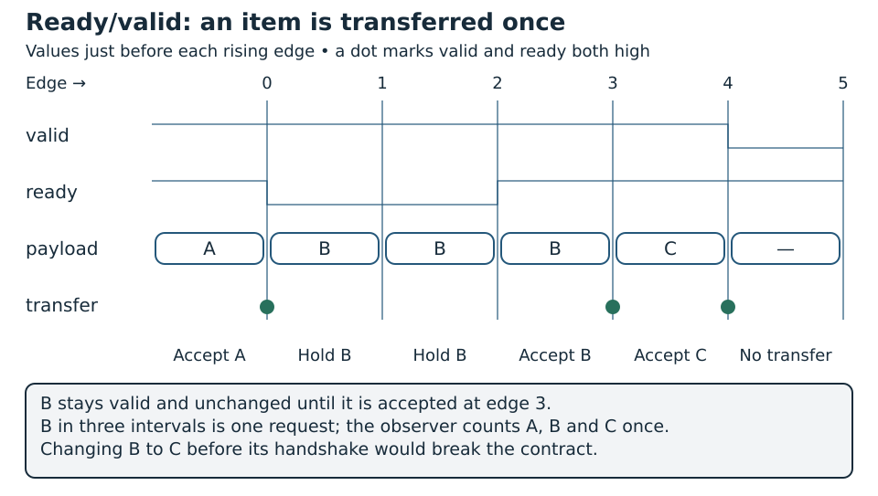

# Pipelines, Buffering and Backpressure {#sec-transport-pipelines}

A system-on-chip contains many pipelines besides the processor's instruction pipeline. Requests travel from a client to a memory or peripheral, responses travel back, and streams move between accelerators. These paths must preserve information even when one component runs out of space or takes longer than expected. Registers shorten timing paths; buffers allow components to work concurrently; a flow-control protocol determines when ownership of a transaction changes.

This chapter develops those transport mechanisms. The five-stage instruction pipeline, forwarding and instruction hazards belong to the CORE-V Wally chapter. Here, a pipeline carries transactions instead of instructions. A FIFO can preserve memory-request order without knowing anything about register dependencies, speculative execution or the RISC-V instruction set, and that independence is what makes it reusable.

The discussion connects synchronous-memory timing in Chapter 7 of *RISC-V System-on-Chip Design* with SoC interfaces studied later in the book [@harrisRiscvSoc]. The RTL below consists of original teaching designs. Their ready/valid interfaces are deliberately smaller than AXI; a handshake alone does not make a module AXI compliant.

The queues and the delayed-memory engine below are checked by `python labs/run.py run transport` in the [laboratory package](../../appendices/reproducible-labs.qmd), at queue depths 2, 3 and 8, with 500 memory operations and 5,000 FIFO cycles per configuration and a consumer that stays stopped until both queues fill.

## Concepts {#pipelines-concepts}

### Latency, initiation interval and throughput

**Latency** measures time between two specified events. For a read, these might be request acceptance and response acceptance. State whether the measurement includes waiting before request acceptance and waiting after response production. A memory can produce data promptly while its client delays consuming it.

The **initiation interval** is the minimum separation between starting successive operations. A four-cycle processing unit can have an initiation interval of one cycle if different operations occupy its internal stages concurrently. A four-cycle iterative unit that cannot accept another operation while busy has a lower maximum throughput.

**Throughput** measures completed useful operations per unit time. Peak throughput describes an ideal condition; sustained throughput includes stalls, arbitration, response congestion and idle sources. Counting the cycles with `valid` asserted overestimates throughput, because those cycles include the ones where `ready` was low.

For a balanced fixed-latency pipeline with $K$ stages, initiation interval one and no stalls, moving $N$ items takes $K+N-1$ clock intervals from the first input acceptance to the final output acceptance, using a convention in which one stage contributes one interval. The fill cost matters for short sequences and becomes less important for long streams.

| Quantity | Example | Interpretation |
|---|---|---|
| Clock frequency | 100 MHz | Each cycle lasts 10 ns |
| Empty-path latency | 4 cycles | First item takes 40 ns to cross the path |
| Initiation interval | 1 cycle | A new item can enter every 10 ns |
| Peak item throughput | 100 million/s | Requires available input and output capacity |
| Payload bandwidth | 400 MB/s for 32-bit items | Excludes protocol overhead |

: Latency, initiation interval and bandwidth in a worked example {#tbl-pipelines-latency-initiation-interval-bandwidth}

Breaking a long logic path into stages can increase frequency, but registers introduce clock-to-output delay, setup requirements and routing. An extra stage that raises frequency but increases initiation interval may reduce bandwidth. Evaluate frequency and completed operations together.

### Payload, metadata and ownership

A transaction is more than its data word. A memory request can include an address, operation type, write data, byte enables and an identifier. A response can include an identifier, read data and an error indication. All fields belonging to one item must move together.

```text
Request payload:  {operation, address, identifier, write_data, byte_enables}
Response payload: {identifier, read_data, status}
```

Registering data without its identifier can associate a correct value with the wrong requester. Registering an address without its write enable can modify the wrong location. Packing the payload into a structure or vector makes its ownership explicit.

Before a handshake, the source owns the item and preserves it according to the interface contract. After the handshake, the destination owns an accepted copy. The source may then present another item even if the original operation has not finished. Acceptance transfers responsibility, and the work may still be unfinished.

An end-to-end read contains four distinguishable events: the client submits a request, the service accepts it, the service produces a response, and the client consumes the response. Queues separate these events. The number of requests accepted by the client interface can therefore exceed the number already executed by memory.

### The ready/valid contract

All examples use one clock and transfers at its rising edge. The source drives `valid` and the payload. The destination drives `ready`. Exactly one item transfers when both signals are high at that edge:

```systemverilog
assign fire = valid && ready;
```

For the lossless transaction interfaces in this chapter, once a source presents a valid item it holds `valid` and every payload field until transfer. The receiver can pause without losing the item. After a transfer, the source may keep `valid` high and present the next item; consecutive transfers do not require a low pulse between them.

| `valid` | `ready` | Meaning at the edge |
|---:|---:|---|
| 0 | 0 | No item and no advertised capacity |
| 0 | 1 | Destination could accept, but no item is offered |
| 1 | 0 | Item waits; source retains it |
| 1 | 1 | One item transfers |

: Meaning of each valid and ready combination at the edge {#tbl-pipelines-meaning-valid-ready-combination}

The source decides to assert `valid` without waiting for `ready`; if it waited, a destination that waits for `valid` before advertising readiness would form a deadlock. Keeping `valid` asserted until transfer also prevents repeated short pulses from missing readiness. LaForest summarizes these handshake rules [@laforestHandshake]. For AXI channels, Arm specifies the corresponding requirements and dependencies [@armAxi4Spec]. Here they form a local transport contract; bus transaction assembly remains separate.

### Reading a waveform

Each row below shows interface values immediately before an active edge:

| Edge | `valid` | `ready` | Payload | Action |
|---:|---:|---:|---|---|
| 0 | 1 | 1 | A | Accept A |
| 1 | 1 | 0 | B | Hold B |
| 2 | 1 | 0 | B | Hold B |
| 3 | 1 | 1 | B | Accept B |
| 4 | 1 | 1 | C | Accept C |
| 5 | 0 | 1 | unspecified | No transfer |

: Ready/valid transfers over six edges {#tbl-pipelines-ready-valid-transfers-six}

The observer counts A once, B once and C once. B appearing in three rows is not three requests. Changing B to C before its handshake violates the contract even if the receiver later becomes ready.

Follow @fig-ready-valid along the rows of @tbl-pipelines-ready-valid-transfers-six: B is held for two intervals and transferred once.

{#fig-ready-valid width=100% fig-alt="Waveforms of valid, ready, payload and the transfer marker over edges 0 to 5"}

An item can remain valid indefinitely under indefinite backpressure without violating safety. Eventual completion needs additional progress assumptions: the receiver eventually has capacity, arbitration eventually grants service and any external memory eventually responds.

### Fixed and elastic pipelines

A fixed pipeline shifts every cycle. It suits a guaranteed input schedule and guaranteed downstream capacity. A stopped register chain still needs an agreement with its producer about input acceptance.

An **elastic pipeline** gives stages occupancy state and allows them to stop independently. Empty slots are transport bubbles, meaning the absence of an item and not a processor instruction inserted to resolve a dependency. A stage advances when its next stage has capacity, while upstream occupied stages can wait.

```text
                    data and valid move right
Producer --> [stage 0] --> [stage 1] --> [stage 2] --> Consumer
                    capacity information moves left
```

Elasticity keeps the design correct as readiness changes; it cannot provide unlimited storage or equal rates. A producer that consistently generates items faster than its consumer eventually fills every finite lossless buffer and must stop.

### The one-entry elastic register

A one-entry buffer contains a payload register and a valid bit. It accepts input when empty or when its current output will be consumed at the same edge:

```systemverilog
assign in_ready  = !full || out_ready;
assign out_valid = full;
assign out_payload = payload;

always_ff @(posedge clk) begin
  if (reset) begin
    full <= 1'b0;
  end else if (in_ready) begin
    full <= in_valid;
    if (in_valid) payload <= in_payload;
  end
end
```

This fragment illustrates the state update and is not a complete module. Transfers are ignored during reset. When full and the consumer stops, it retains its payload. When both input and output transfer, the old item leaves and a new item replaces it without an empty cycle.

Occupancy satisfies:

$$
q_{t+1}=q_t+push_t-pop_t, \qquad 0\leq q_t\leq 1.
$$

There is a combinational path from downstream `out_ready` to upstream `in_ready`. Chaining these stages creates a backward timing path even though payload paths are registered. This can be acceptable inside a small custom pipeline. At an AXI boundary it is not allowed, since AXI prohibits combinational paths between interface inputs and outputs, so put a suitable register slice there.

### FIFO depth and burst absorption

A FIFO stores items in acceptance order. Its occupancy separates temporary bursts from average service rate. If a producer delivers one item each cycle during a six-cycle consumer pause, six additional items need storage unless backpressure stops the producer earlier.

For depth $D$:

$$
q_{t+1}=q_t+push_t-pop_t, \qquad 0\leq q_t\leq D.
$$

When input and output transfer together, occupancy stays constant while stored identities change. Incrementing the count in one nonblocking assignment and decrementing it in another can accidentally give one operation priority. Derive the four push/pop cases explicitly.

The storage technology matters. A register-array FIFO can expose its head combinationally. A block-RAM FIFO generally requires a synchronous read path and additional output-valid management. Replacing an array declaration without adjusting its read contract can invalidate the control logic.

Some FIFOs pass input directly to output when empty. This reduces empty-path latency but adds a combinational payload path. Others accept input when full if a simultaneous pop frees space, improving recovery but potentially adding a readiness path. Neither property follows automatically from the word FIFO; document both.

### Skid buffers and registered backpressure

A timing register on `ready` delays notification that a receiver has stopped. During that delay, the upstream source can legally send another item. A lossless implementation reserves space for it; registering `ready` alone can overwrite data.

A two-entry skid buffer can retain the current output item and absorb an additional item while the stop condition travels upstream. Some architectures use a bypass; others register the output. The essential feature is preserving allowed transfers while breaking a timing path. LaForest provides a concrete two-entry registered implementation [@laforestSkid].

For a link that accepts at most $R$ items per cycle and reports a stop after $B$ cycles, conservatively reserve at least $R B$ entries for transfers permitted before the stop reaches its source, in addition to already occupied storage. Include items in forward pipeline registers. This capacity budget does not authorize registering arbitrary controls without deriving their protocol.

| Mechanism | Main purpose | Limitation |
|---|---|---|
| Plain pipeline register | Divide a guaranteed-rate datapath | Cannot independently absorb stalls |
| One-entry elastic register | Retain an item and allow replacement | May propagate `ready` combinationally |
| Two-entry registered buffer | Cut a backward timing path | Extra storage; possible full-state recovery bubble |
| Deeper FIFO | Absorb bursts and temporary mismatch | Finite capacity and implementation cost |
| Credit-controlled link | Account for remote capacity | Credit tracking and initialization |

: Buffering mechanisms, their purpose and limitation {#tbl-pipelines-buffering-mechanisms-purpose-limitation}

@fig-pipelines-skid-buffer follows one item through the stop delay.

{#fig-pipelines-skid-buffer width=100% fig-alt="Four snapshots of an output register and a skid register as the sink stops and resumes"}

A skid buffer solves local timing and elasticity. It cannot compensate for a permanently slower consumer. A deeper FIFO absorbs a larger transient mismatch but also eventually fills.

### Credit-based flow control

A long registered link makes combinational readiness propagation unattractive. A sender can instead count available receiver slots. Sending consumes a credit; release of storage eventually returns a credit.

Conservation includes in-flight transfers and returning credits. Return a credit when the agreed resource is freed, not merely when data reaches an intermediate register. Reset must establish consistent initial capacity at both ends. Duplicated credits permit overflow; lost credits reduce usable capacity.

Credit flow control does not eliminate buffers. It replaces immediate capacity signalling with explicit accounting. It is useful for long links and networks-on-chip; the local examples below retain ready/valid for simplicity.

### Memory requests and responses

A synchronous memory accepts an address at an edge and produces data later. Metadata must survive the interval: if a request has tag 9, its response must carry tag 9 even when the input already shows tag 10.

For a fixed-latency memory that cannot stall its output, accepting a read commits the system to accommodate the future response. Reserve output capacity or guarantee consumption on the prescribed cycle. An output FIFO that becomes full cannot retroactively stop a read issued several cycles earlier.

A variable-latency target can expose separate request and response handshakes:

```text
Client -- request valid/ready --> Service
Client <-- response valid/ready -- Service
```

The service accepts a request before producing its response and can retain a completed response while the client pauses. These directions require separate storage budgets. Response backpressure eventually restricts new requests, even when the request FIFO has space.

Define a write acknowledgement precisely. It can mean entry into a queue, application to local RAM, or downstream acceptance. These meanings have different ordering consequences. None automatically guarantees persistence or visibility to every other client.

### Outstanding operations and performance

An operation is **outstanding** from request acceptance until its terminal response or another explicitly defined completion. Counting both reads and acknowledged writes gives:

$$
O_{t+1}=O_t+request\_fire_t-response\_fire_t.
$$

In the ordered example below, this equals queued requests, a possible active operation and queued responses. A produced response not yet consumed still occupies outstanding capacity.

For a stable system, Little's law relates average occupancy, throughput and residence time measured at the same boundaries:

$$
\overline{O}=\lambda\,\overline{L}.
$$

If a target truly accepts one request each cycle and returns responses after an average twelve cycles, sustaining one completion per cycle needs about twelve in-flight operations on average. Variation can require more capacity. Twelve queue entries cannot create this throughput if the target accepts only one request every twelve cycles.

Distinguish **queueing** from **execution overlap**. A serial target can have many requests waiting while executing one. A pipelined target executes several independent operations concurrently. Both can use the same handshake and deliver different performance.

### Identifiers, ordering and completion

An ordered service returns responses in request order; it can carry tags to make correspondence explicit. A reordered service needs identifiers or another unambiguous mapping because the oldest request may not produce the next response.

| Scenario | Bookkeeping |
|---|---|
| One operation at a time | One saved request context |
| Multiple operations, ordered responses | Context/tag FIFO |
| Multiple operations, reordered responses | Outstanding table indexed by tag |
| Reordered results, ordered observation | Completion storage and ordering queue |

: Ordering scenarios and the bookkeeping each needs {#tbl-pipelines-ordering-scenarios-bookkeeping-needs}

A tag can be reused only once its earlier operation can no longer respond, or when a generation field tells the two apart. Identifier width bounds the encoding space and provides no storage for that many operations.

Ordering depends on semantics. Independent RAM reads can be reordered by a suitable system, but reading after writing the same location needs a visibility rule. Device reads can have side effects; repeated writes to a command register can trigger repeated actions. Transport optimization must respect these properties.

### AHB and AXI: different forms of overlap

AHB overlaps one transfer's address phase with a preceding transfer's data phase. Address/control and data-phase ownership must be tracked separately. Wait states stretch the active data phase and constrain address progression. `HREADY` is not an independent ready/valid pair for each signal group.

AXI separates read addresses, read responses, write addresses, write data and write responses into independently handshaken channels. Registering one channel does not register the others. Write addresses and data need not arrive together; an adapter retains each until it can assemble the transaction. The bus chapter develops these details [@armAxi4Spec].

For AXI4 bursts, count beats as well as transactions. One accepted read address can commit the target to several response beats. Reserving one result slot per address is not enough. Independent channels also leave the ordering rules in force, so AXI IDs still matter.

An arbitrary clocked delay in AHB address, readiness or response signals breaks the protocol, so use a phase-aware bridge. In the same spirit, use a complete AXI register slice, because shifting only `VALID` leaves its payload behind.

### Arbitration, forks and joins

When clients share a service, an arbiter chooses the next item. If its destination stops, the selected payload remains stable. Choosing a different client every cycle during a stall can violate the contract even when each client is correct.

The arbiter can lock its selection until transfer or buffer the chosen item. Fixed priority can starve low-priority clients. Round-robin gives a different fairness contract; update it on actual service and not merely on visible requests.

A fork delivers an item to several destinations. If they pause independently, it remembers which destinations already consumed that item. Repeatedly presenting it to a destination that already accepted creates duplicates. A join retains whichever related input arrives first until the other inputs are available.

Local handshake correctness does not rule out dependency cycles. A requester waiting for a response before releasing a resource the responder needs can deadlock. Draw a dependency graph including request queues, response queues, arbiter grants and completion-table entries.

### Reset, cancellation and clock domains

Reset empties protocol state: valid bits, FIFO counts, active-operation state and tracking tables. It need not clear RAM contents. Clearing every storage bit increases reset cost and can prevent memory inference. State whether accepted operations are abandoned and which effects already applied remain visible.

Cancellation is selective. A queued request may be removable before execution, but an executed device write cannot generally be undone. An old response can arrive after a local flush. Safe handling may require draining transactions, tagging generations or resetting the whole transaction domain under an agreed contract.

A processor branch flush should not turn into indiscriminate deletion of bus traffic. Requests may have to finish even when their results go unused, since stores and device accesses have architectural constraints that a transport identifier cannot express alone.

Ready/valid here assumes a shared clock. For different clocks, use an asynchronous FIFO or another verified crossing scheme. Synchronizing data bits individually can corrupt an item, and synchronizing `valid` and `ready` separately breaks the handshake.

### Verify acceptance, conservation and ordering

The transport methodology in @sec-verification-methodology observes accepted requests and consumed responses. Track outstanding work with an independent queue, check payload retention during stalls, and assert the applicable ordering/ID rules. Cross queue occupancy with simultaneous push/pop, downstream stalls and reset. Reset can cancel protocol state under the contract while already committed memory writes remain. A correct unit FIFO leaves the assembled arbiter, memory adapter and recovery policy unverified, so add an end-to-end transaction scoreboard at that boundary.


## Implementation {#pipelines-implementation}

### A FIFO without a backward readiness chain

This complete module uses a register array with a combinational head read. It requires `DEPTH >= 2` and `WIDTH >= 1`. Explicit pointer wrapping supports non-power-of-two depths. Input readiness depends on occupancy rather than directly on output readiness. A full FIFO refuses input on the first edge that pops an item, trading a recovery bubble for timing isolation.

Save the three complete modules below together as `transport.sv`. They use synchronous active-high reset. Reset empties protocol state; the FIFOs suppress external transfers while reset is asserted. The memory service clears its response-valid register at the reset edge.

```systemverilog
module transport_fifo #(
  parameter int WIDTH = 32,
  parameter int DEPTH = 4,
  localparam int PW = $clog2(DEPTH),
  localparam int CW = $clog2(DEPTH + 1)
) (
  input  logic clk, reset,
  input  logic in_valid,
  output logic in_ready,
  input  logic [WIDTH-1:0] in_data,
  output logic out_valid,
  input  logic out_ready,
  output logic [WIDTH-1:0] out_data
);
  logic [WIDTH-1:0] storage [0:DEPTH-1];
  logic [PW-1:0] head, tail;
  logic [CW-1:0] count;
  logic push, pop;

  assign in_ready  = !reset && (count < CW'(DEPTH));
  assign out_valid = !reset && (count != '0);
  assign out_data  = storage[head];
  assign push = in_valid && in_ready;
  assign pop  = out_valid && out_ready;

  always_ff @(posedge clk) begin
    if (reset) begin
      head  <= '0;
      tail  <= '0;
      count <= '0;
    end else begin
      if (push) begin
        storage[tail] <= in_data;
        tail <= (tail == PW'(DEPTH-1)) ? '0 : tail + 1'b1;
      end
      if (pop)
        head <= (head == PW'(DEPTH-1)) ? '0 : head + 1'b1;
      case ({push, pop})
        2'b10: count <= count + 1'b1;
        2'b01: count <= count - 1'b1;
        default: count <= count;
      endcase
    end
  end
endmodule
```

It is not a fall-through FIFO: an item accepted into an empty FIFO becomes available after that edge and can be consumed at the next edge. In a partially occupied steady state, input and output can transfer together each cycle. When completely full, its first pop creates capacity visible the following cycle.

For timing isolation, this tradeoff can be useful. Measure behavior under actual traffic, because buffers differ more than they look. For large depths, adapt the design to synchronous storage, since a combinational head does not map efficiently to block RAM.

`out_data` is unspecified when `out_valid` is low. Consumers cannot treat arbitrary stored words as transactions. Reset clears occupancy and pointers, leaving storage unchanged; the absence of valid data makes stale payload bits irrelevant.

### A variable-delay memory service

This word-addressed RAM executes requests in order, accepts one active operation, supports byte-enabled writes and produces one response per read or write. A write response carries zero data and acknowledges application to the local array.

Reads and byte writes occur at request acceptance. An address-dependent delay controls response production. This emulates variable service delay around a synchronous local access; it is not a DRAM controller or a DRAM scheduling model. Completed responses wait until consumed.

Parameters require `AW >= 2`, `IW >= 1`, and a positive `DW` divisible by eight. Addresses are **word indices**, not byte addresses. Every encoded address is legal; this example has no address decoder or error response.

```systemverilog
module delayed_memory #(
  parameter int AW = 6,
  parameter int DW = 32,
  parameter int IW = 8
) (
  input  logic clk, reset,
  input  logic req_valid,
  output logic req_ready,
  input  logic req_write,
  input  logic [AW-1:0] req_addr,
  input  logic [IW-1:0] req_id,
  input  logic [DW-1:0] req_data,
  input  logic [DW/8-1:0] req_strb,
  output logic rsp_valid,
  input  logic rsp_ready,
  output logic rsp_write,
  output logic [IW-1:0] rsp_id,
  output logic [DW-1:0] rsp_data
);
  logic [DW-1:0] memory [0:(1<<AW)-1];
  logic busy;
  logic [2:0] delay_left;

  assign req_ready = !reset && !busy && !rsp_valid;

  always_ff @(posedge clk) begin
    if (reset) begin
      busy       <= 1'b0;
      delay_left <= '0;
      rsp_valid  <= 1'b0;
      rsp_write  <= 1'b0;
      rsp_id     <= '0;
      rsp_data   <= '0;
    end else begin
      if (rsp_valid && rsp_ready) rsp_valid <= 1'b0;
      if (req_valid && req_ready) begin
        busy       <= 1'b1;
        delay_left <= {1'b0, req_addr[1:0]};
        rsp_write  <= req_write;
        rsp_id     <= req_id;
        if (req_write) begin
          rsp_data <= '0;
          for (int b = 0; b < DW/8; b++)
            if (req_strb[b])
              memory[req_addr][8*b +: 8] <= req_data[8*b +: 8];
        end else begin
          rsp_data <= memory[req_addr];
        end
      end else if (busy) begin
        if (delay_left == 0) begin
          busy      <= 1'b0;
          rsp_valid <= 1'b1;
        end else begin
          delay_left <= delay_left - 1'b1;
        end
      end
    end
  end
endmodule
```

If a request transfers at edge $t$, response valid is set after edge $t+1+a$, where $a$ is the value of the low two address bits. The earliest response handshake is edge $t+2+a$, assuming readiness. A newly assigned valid register cannot cause a transfer at the edge assigning it.

The engine waits for response transfer before accepting another request. Its initiation interval is therefore greater than one. Queues can accumulate bursts and decouple the client, but cannot convert its execution into a one-request-per-cycle memory.

The active state and retained response reserve capacity for the only operation in progress. No result overwrites an unconsumed response. A higher-throughput implementation needs reservations for every read in flight, which replaces this single-operation rule.

RAM contents are not initialized or reset. Write each location before reading when deterministic results are required. Reset can abandon queued responses, but a write applied to the array remains applied. Both the testbench and software contract need to reflect this distinction.

### Connecting request and response queues

The complete subsystem puts a request FIFO before the service and a response FIFO after it. The client can submit several requests while earlier ones wait or complete. Packed payloads keep metadata aligned across each boundary.

@fig-pipelines-queued-capacity shows a congested snapshot of the subsystem and why its capacity is 2D + 1.

{#fig-pipelines-queued-capacity width=100% fig-alt="A client, a request FIFO, a service and a response FIFO in a loop, with the number of items each holds and a total of 2D plus 1"}

```systemverilog
module queued_memory #(
  parameter int AW = 6,
  parameter int DW = 32,
  parameter int IW = 8,
  parameter int QDEPTH = 4,
  localparam int QW = 1 + AW + IW + DW + DW/8,
  localparam int RW = 1 + IW + DW
) (
  input  logic clk, reset,
  input  logic req_valid,
  output logic req_ready,
  input  logic req_write,
  input  logic [AW-1:0] req_addr,
  input  logic [IW-1:0] req_id,
  input  logic [DW-1:0] req_data,
  input  logic [DW/8-1:0] req_strb,
  output logic rsp_valid,
  input  logic rsp_ready,
  output logic rsp_write,
  output logic [IW-1:0] rsp_id,
  output logic [DW-1:0] rsp_data
);
  logic [QW-1:0] q_payload;
  logic q_valid, q_ready, m_write;
  logic [AW-1:0] m_addr;
  logic [IW-1:0] m_id;
  logic [DW-1:0] m_data;
  logic [DW/8-1:0] m_strb;
  logic m_rsp_valid, m_rsp_ready, m_rsp_write;
  logic [IW-1:0] m_rsp_id;
  logic [DW-1:0] m_rsp_data;
  logic [RW-1:0] r_payload;

  transport_fifo #(.WIDTH(QW), .DEPTH(QDEPTH)) requests (
    .clk, .reset, .in_valid(req_valid), .in_ready(req_ready),
    .in_data({req_write, req_addr, req_id, req_data, req_strb}),
    .out_valid(q_valid), .out_ready(q_ready), .out_data(q_payload)
  );
  assign {m_write, m_addr, m_id, m_data, m_strb} = q_payload;

  delayed_memory #(.AW(AW), .DW(DW), .IW(IW)) service (
    .clk, .reset,
    .req_valid(q_valid), .req_ready(q_ready), .req_write(m_write),
    .req_addr(m_addr), .req_id(m_id), .req_data(m_data),
    .req_strb(m_strb), .rsp_valid(m_rsp_valid),
    .rsp_ready(m_rsp_ready), .rsp_write(m_rsp_write),
    .rsp_id(m_rsp_id), .rsp_data(m_rsp_data)
  );

  transport_fifo #(.WIDTH(RW), .DEPTH(QDEPTH)) responses (
    .clk, .reset,
    .in_valid(m_rsp_valid), .in_ready(m_rsp_ready),
    .in_data({m_rsp_write, m_rsp_id, m_rsp_data}),
    .out_valid(rsp_valid), .out_ready(rsp_ready),
    .out_data(r_payload)
  );
  assign {rsp_write, rsp_id, rsp_data} = r_payload;
endmodule
```

The request FIFO accepts transactions independently of current service activity. The response FIFO can release the service's result register while the client pauses, if space remains. When it fills, `m_rsp_ready` drops, the service retains its result and stops accepting requests, and the request FIFO eventually fills. Backpressure travels through a chain of resources and not through a single combinational readiness path.

With depth $D$ on both sides, maximum outstanding capacity is $2D+1$: $D$ queued requests, one operation or retained result in the service, and $D$ queued responses. The service cannot hold an active operation and a separate valid response simultaneously. This bound counts external accepted requests until consumed responses; it does not describe simultaneous execution.

The service is ordered. A read following a write observes updated bytes, and writes to the same location execute in acceptance order. Tags are echoed back and do not reorder anything. The client still needs a tag-allocation policy; reuse can make diagnostics ambiguous even when this service is ordered.

### Walking through congestion

Suppose a depth-two response FIFO already holds two results and the client deasserts readiness. A third result remains in the service register. Space on the request side says nothing about the capacity to execute another operation.

| Event | Request FIFO | Service | Response FIFO |
|---|---|---|---|
| Consumer pauses | Can accept if not full | Finishes current operation | Retains two responses |
| Current result completes | Requests accumulate | Retains valid result | Still full |
| More requests arrive | Reaches its depth | Does not start another operation | Still full |
| Next input offered | Backpressures source | Retains result | Still full |
| Consumer resumes | Capacity returns over later edges | Eventually transfers result | Starts draining |

: Events during congestion in the queued subsystem {#tbl-pipelines-events-during-congestion-queued}

No item is deleted to recover space. The source retains its unaccepted request. Since the FIFO conservatively refuses input while full, the retained service response cannot transfer on the first edge popping a full response FIFO. Capacity becomes visible the next cycle. This documented tradeoff explains the recovery bubble.

### Extending to multiple active reads

For a genuinely pipelined service, separate request acceptance from result storage. Each accepted read receives context storage for its tag, metadata and reserved response capacity. A fixed-latency memory advances these contexts with the read-data pipeline.

Check both execution and completion capacity before accepting. If reads cannot stop once started, queued results plus reserved future results must not exceed completion storage. Release reservations according to an explicit ownership rule; never count the same slot twice.

For reordered service, use an outstanding table. A response tag selects its entry. If ordered observation is required, completed results wait for all earlier required results. This creates head-of-line blocking: an old slow operation can hold up younger completed results.

Starting multiple reads while retaining only one `rsp_id` register is incorrect. The returned data might be right while responses acquire the most recently accepted tag. Metadata storage belongs to the execution pipeline.

### Applying the questions to Wally

Wally's External Bus Unit combines instruction and load/store traffic for AHB. In the inspected implementation, LSU traffic has priority, and saved instruction address-phase context is restored when arbitration requires it [@cvwEbu]. These mechanisms preserve phase ownership under contention.

Ask who owns a pending instruction access, where its context is saved, and which readiness indication permits progress. Wally does not use the queued-memory example above. Its AHB signals and cache-bus controllers need their own protocol interpretation and cannot simply be relabelled as FIFO signals.

Inspect `src/ebu/ebu.sv` and its controller-input instances. Trace simultaneous instruction/data requests, identify the saved address/control fields, and record the save/restore conditions. Pin a repository revision in experiment reports because implementation details can change.

The textbook's synchronous-memory pipeline changes address availability of results to the processor [@harrisRiscvSoc]. This chapter supplies the complementary view of storage, ownership and completion across transport paths.

## Hands-on Experiments {#pipelines-hands-on-experiments}

### Preparing reproducible simulation

Use the Verilator or cocotb workflow from the simulation part. Save the three complete modules as `transport.sv`, and develop `tb_transport.sv`. Drive inputs away from active edges, sample handshakes at those edges and compare the values belonging to that edge, before nonblocking updates establish next-cycle state.

A typical command for a SystemVerilog testbench with procedural clock delays is:

```bash
verilator --binary --timing --assert -Wall -Wno-DECLFILENAME \
  --top-module tb_transport transport.sv tb_transport.sv
./obj_dir/Vtb_transport
```

This requires Verilator, a C++ compiler and build prerequisites. `-Wno-DECLFILENAME` permits the three module names to share `transport.sv`; other warnings should be investigated. On Windows, use the Linux environment introduced in the simulation chapter. Record tool versions, parameters, random seed and source revision. The testbench is developed in these exercises; it is not a fourth complete module provided above.

Hold reset through active edges and deassert away from them. Write every RAM word with full byte enables and consume all acknowledgements before testing reads. Deterministic initialization is part of a reproducible experiment.

### Experiment 1: FIFO conservation and ordering

[Core · P3 · C1](../../learning-paths.qmd#sec-path-labels){#act-pipelines-01 .learning-activity}

Test the FIFO independently at depths two, three and eight; three exercises non-power-of-two wraparound. Send numbered words and randomly pause the receiver. A stalled sender keeps its word and does not generate a new number every cycle.

Maintain a reference queue. Append on input handshake; compare with and remove the oldest entry on output handshake. Accepted inputs minus outputs must remain between zero and depth.

Directed cases include empty/full states, simultaneous transfers, a prolonged pause, pointer wrap and reset while occupied. Reset discards the reference queue because it discards buffered hardware items. Reset edges are not transfers, so leave them out of the count.

Explain the full-state recovery bubble. Then build a variant accepting full-plus-pop and compare timing and cycle counts. It must preserve the old head being consumed when the write and read address the same array entry.

### Experiment 2: End-to-end memory correspondence

[Core option · P3 · C1](../../learning-paths.qmd#sec-path-labels){#act-pipelines-02 .learning-activity}

Maintain a reference word array and expected-response queue. At every accepted client request, apply byte-enabled writes to the model or read its expected value, then append `{write, id, expected_data}`. This acceptance-order prediction matches the ordered hardware service.

At each external response handshake, compare all fields against the oldest expected entry. Writes expect zero response data, including writes with no byte enables. Randomize addresses, masks, source gaps and receiver pauses. Keep tags unique while outstanding, or track their generations explicitly.

Check retained outputs during stalled cycles too: changing a waiting response violates the contract even if it later changes back. Initialize all bytes before testing reads. End the simulation only after every submitted request receives its response; stopping at the last input hides lost tail results.

### Experiment 3: Response-path backpressure

[Core option · P3 · C1](../../learning-paths.qmd#sec-path-labels){#act-pipelines-03 .learning-activity}

Set both depths to two. Stop the consumer longer than the path's capacity while the source keeps offering requests. Track handshakes and internal occupancies.

The response FIFO fills, the service retains one result, the request FIFO fills and source readiness drops. Maximum external outstanding count is five. The source retains its next unaccepted item throughout the stop.

Resume consumption and drain all work. Responses appear once and in order. Apply a timeout only while the environment permits progress; a timeout during deliberately indefinite backpressure says nothing about an internal deadlock.

### Experiment 4: Measure latency and throughput

[Core option · P3 · C1](../../learning-paths.qmd#sec-path-labels){#act-pipelines-04 .learning-activity}

Timestamp request and response handshakes. Separately measure production latency if internal signals are visible. Report a distribution and maximum as well as mean latency.

Compare depths two, four and eight under short bursts, a continuous source and periodic consumer pauses. Keep the delay rule unchanged to isolate buffering effects.

| Measurement | Definition |
|---|---|
| Input acceptance rate | Accepted requests divided by cycles |
| Completion throughput | Accepted responses divided by cycles |
| End-to-end latency | Response acceptance time minus request acceptance time |
| Outstanding occupancy | Accepted requests minus accepted responses |
| Source backpressure | Cycles with `req_valid && !req_ready` |
| Consumer starvation | Cycles with `rsp_ready && !rsp_valid` |

: Measurements of the latency and throughput experiment {#tbl-pipelines-measurements-latency-throughput-experiment}

Larger queues reduce burst-source waiting without necessarily improving saturated execution rate. They can increase queueing latency. Explain results using the serial initiation interval; more entries do not always improve performance.

Include drain time or identify a steady-state window. During filling, input rate exceeds output rate because work accumulates. During draining, output rate can exceed input rate. Both obey conservation.

### Experiment 5: Reset and persistent side effects

[Core · P3 · C1](../../learning-paths.qmd#sec-path-labels){#act-pipelines-05 .learning-activity}

Reset an occupied FIFO and confirm that old items disappear. Next reset the subsystem after a write executes but before its acknowledgement reaches the client. Issue a fresh read after reset.

RAM preserves the applied write while its old acknowledgement can disappear. A missing acknowledgement therefore leaves open whether the write occurred. Retrying a device command after cancellation can repeat its side effect.

Repeat with a write only queued before reset, not yet accepted by the service. It is discarded without changing RAM. Observe the internal service handshake to tell these cases apart, as external timing alone would be a guess.

A production integration needs a reset policy across clients, transport and targets. Compare draining before reset, resetting a whole domain, and tracking old responses by epoch. Peripheral actions are not always reversible.

### Experiment 6: Build a pipelined target

[Advanced · C1](../../learning-paths.qmd#sec-path-labels){#act-pipelines-06 .learning-activity}

Replace the serial engine with a fixed-latency read pipeline. Start read-only, with known contents. Carry a tag through each stage and reserve completion space for every accepted read.

Let the target accept each cycle when reservations permit it. Pause the response consumer with several reads in flight. Every result already committed must fit before new acceptance stops.

Measure the outstanding capacity needed to sustain the chosen latency. Then introduce variable completion times and an outstanding table. Compare ordered observation with tag-directed reordered delivery. Add writes only after specifying their ordering and side-effect semantics.

The improvement comes from execution overlap, and request storage alone does not deliver it. New costs include context storage, reservations and stronger correspondence checking.

### Assertions and progress assumptions

Adapt these local safety templates to the module under test and an assertion-capable simulator:

```systemverilog
assert property (@(posedge clk) disable iff (reset)
  out_valid && !out_ready |=>
  out_valid && $stable(out_data));

assert property (@(posedge clk) disable iff (reset)
  rsp_valid && !rsp_ready |=>
  rsp_valid && $stable({rsp_write, rsp_id, rsp_data}));
```

The first belongs at the FIFO output; the second at the memory-subsystem response. Assert occupancy bounds and nonnegative outstanding counts too. In a formal harness, input-source stability is an environment assumption; output stability is a design obligation.

Completing every request eventually is a liveness property. It requires eventual consumption and service assumptions. Safety assertions alone cannot prove it, and randomized simulation cannot promise to cover every dependency cycle.

### Reviewing an integration

Before inserting a stage into a SoC interface, answer these questions with edge-level behavior or concrete bounds:

1. Which handshake transfers ownership, and which event means completion?
2. Which payload fields must stay aligned?
3. Can execution stop, or do accepted requests create unavoidable future results?
4. Where is capacity for those results reserved?
5. Is readiness combinational, buffered and registered, or credit controlled?
6. What ordering is required, and when may tags be reused?
7. Which side effects survive reset or cancellation?
8. Which environment assumptions guarantee progress?

This transport contract prepares the reader to analyze memory hierarchies, interconnects and peripheral accesses in the following chapters. Instruction pipelines add architectural dependencies and recovery requirements, developed separately in the Wally chapter.

<!-- chapter-review:pipelines -->

## Key ideas {#review-pipelines-ideas .unnumbered .unlisted}

- Buffers separate acceptance, ownership and completion.
- Backpressure must preserve data and transaction ordering.

## What you should now be able to explain {#review-pipelines-explain .unnumbered .unlisted}

Explain the difference between accepting a request and completing its side effect, including what remains owned during a stall.

## Common mistakes {#review-pipelines-mistakes .unnumbered .unlisted}

Three slips recur in transport logic. Requests counted before acceptance inflate every throughput figure. A payload that changes while `valid` waits corrupts the transfer. And reset cancels protocol state while a write that was already committed stays in memory.

## Try it yourself {#review-pipelines-try .unnumbered .unlisted}

[Preparation · C0](../../learning-paths.qmd#sec-path-labels){#act-pipelines-review .learning-activity}

Use a transport-lab stall trace to account for every accepted request and returned response. Check the conservation equation at the end.

## Where this appears in Wally {#review-pipelines-wally .unnumbered .unlisted}

::: {.callout-note title="Wally Connection" icon=false}
In [src/ebu/ahbinterface.sv](https://github.com/antoniofloresgil/cvw/blob/3b30ba6b6519bd2c26c1437e6d61f632a35cef6c/src/ebu/ahbinterface.sv) and [src/ebu/buscachefsm.sv](https://github.com/antoniofloresgil/cvw/blob/3b30ba6b6519bd2c26c1437e6d61f632a35cef6c/src/ebu/buscachefsm.sv), HREADY governs AHB progress. Map the generic acceptance/stability idea onto those phases rather than rename AHB as ready/valid.
:::

## Further reading {#review-pipelines-reading .unnumbered .unlisted}

Continue with @sec-buses-interrupts and @sec-memories-caches. Follow the chapter sources [@harrisRiscvSoc; @laforestHandshake].
