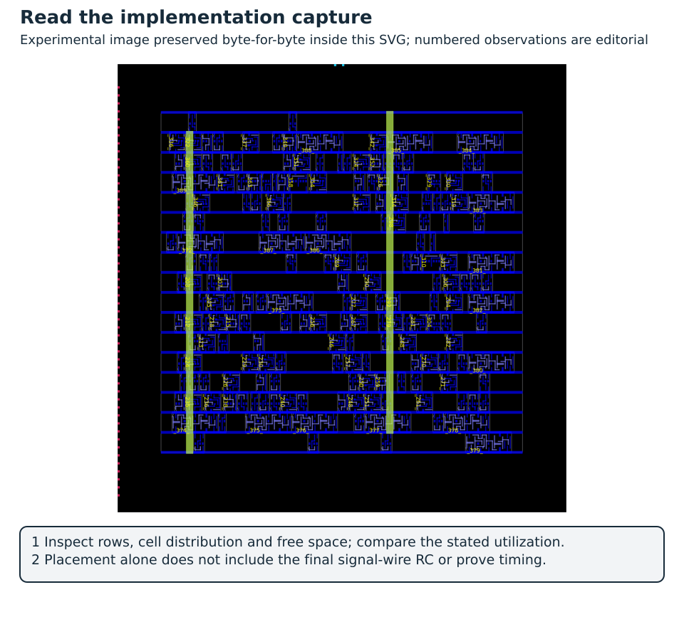
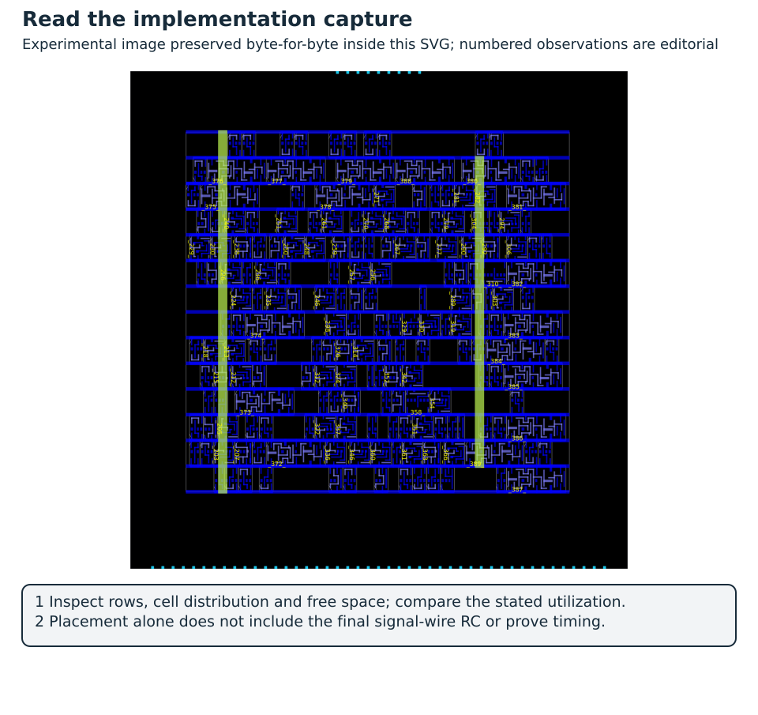
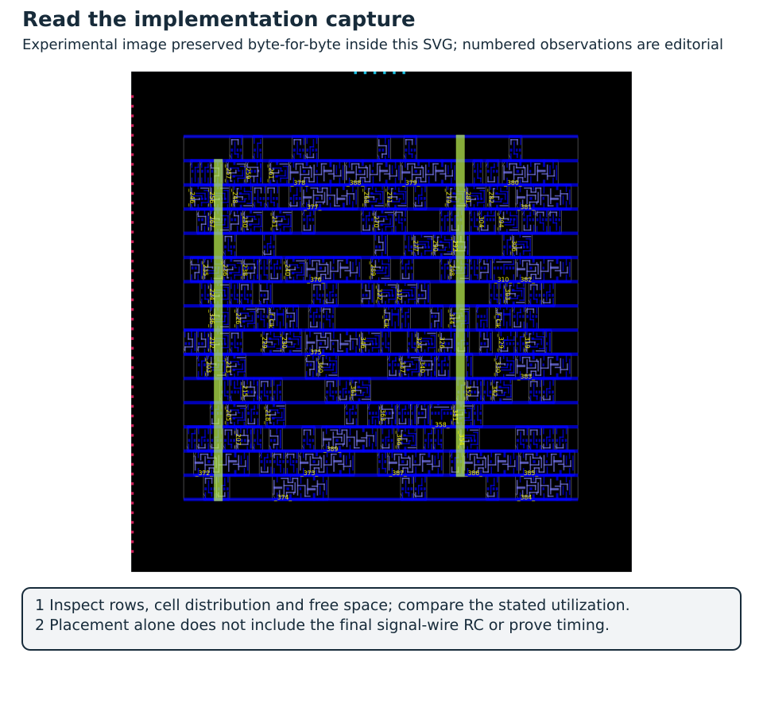
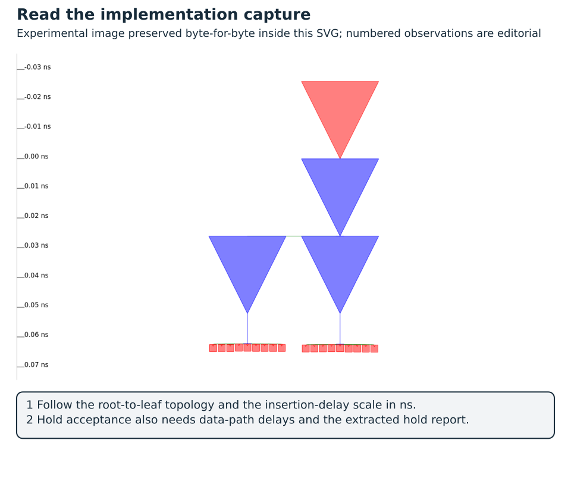
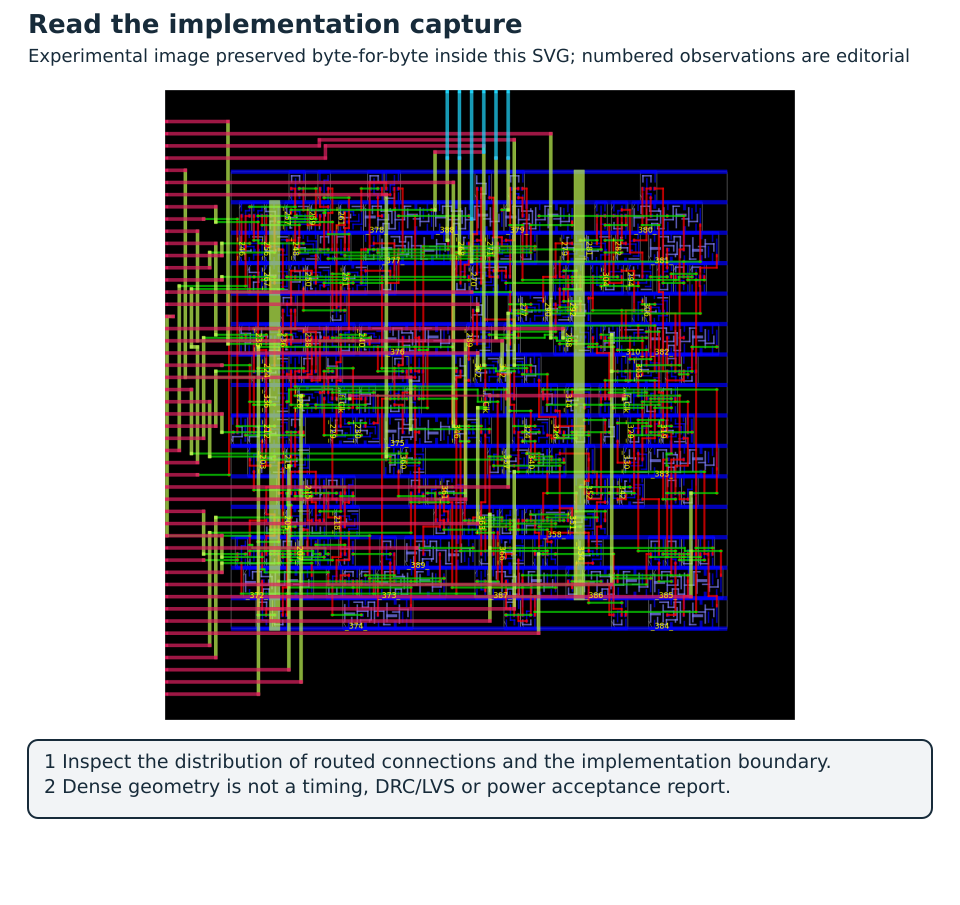
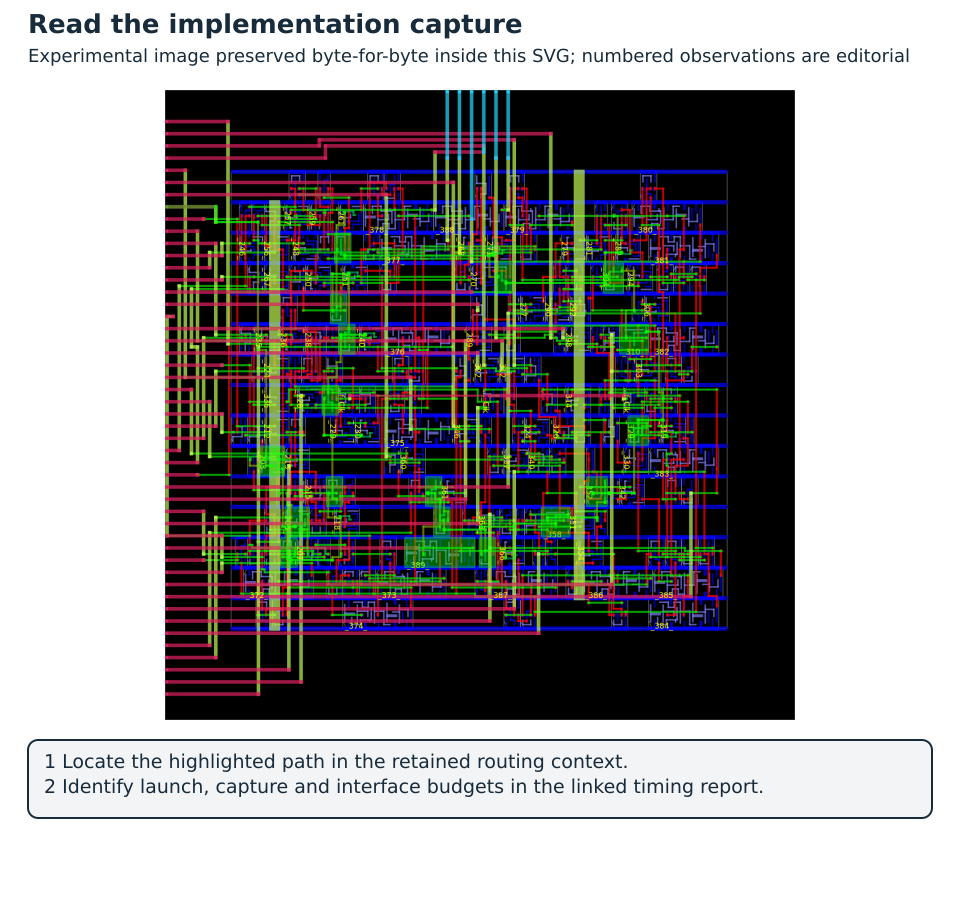

# A Measured OpenROAD Study: Frequency, Utilization and the Cost of Wires {#sec-openroad-study}

[Core · P5 · C0 review / C3 rerun](../../learning-paths.qmd#sec-path-labels){#act-physical-study-review .learning-activity}

This chapter continues @sec-openroad. The previous chapter walked through each physical-design decision on a small accumulator; here the same decisions are executed as a recorded campaign, and the results are read the way an implementation engineer reads them: stage by stage, with the failures kept in view. The chapter ends with the method for turning those failures into an accepted block.

The scripts and recorded reports in [Lab 16](../../labs/16-openroad-study/README.md) turn the preceding decisions into an executed experiment. They use the same 16-bit accumulator, one common Nangate45 mapped netlist, a fixed typical Liberty view, and direct OpenROAD Tcl. The ORFS image supplies the binaries and matching technology files; its Make-based flow does not orchestrate these runs. Nangate45 is an open teaching/reference technology, not a fabrication offer.

The recorded container digest is `openroad/orfs@sha256:fd3e27cf1788815be526e86fbe449310d1114bf256fd6c7af9dced6eaf12c699`. It contains OpenROAD `24Q3-11382-g61879bec53` and Yosys 0.60. The [reference manifest](../../labs/16-openroad-study/reference/manifest.json) records input, technology, extraction-rule, report and image hashes. The image contains no usable ORFS Git metadata, so the record uses its immutable image identity and individual technology-file hashes in place of an invented source revision.

## Experiment design and observation boundaries

The main sweep requests core utilizations of 45%, 65% and 80% at periods 0.85, 1.00 and 1.15 ns. These are requested frequencies of approximately 1176, 1000 and 870 MHz, not demonstrated silicon operating frequencies. Two 55% cases at 0.91 and 1.00 ns examine a small margin near a setup boundary. Both synthesis and all other settings remain fixed. Pin placement, the power grid, signal layers `metal2..metal6`, clock layers `metal4..metal6`, two tool threads and the density-selection rule are recorded in `flow.tcl`.

This experiment measures sensitivity of one mapped design. It deliberately omits setup/hold repair and frequency-driven remapping so that a failing case remains observable. Changing the period therefore principally changes the required time, while changing utilization changes geometry and routing. An optimizing flow could also resize cells, insert buffers or choose a different netlist as constraints change; that is a subsequent controlled experiment, and these measurements do not speak for it.

The study SDC uses 20 ps clock uncertainty, input delays of 100 ps maximum and 20 ps minimum, output delays of 100 ps maximum and 20 ps minimum, 20 ps input transition and 5 fF output loads. These are explicit block-level teaching budgets, not the earlier 10 ns illustrative SDC. The chosen Liberty uses fF; `set_load 5.0` specifies five femtofarads. Changing the SDC for this study does not overwrite the reference accumulator's original constraints.

| Checkpoint | Clock model | Interconnect model | Evidence retained |
| --- | --- | --- | --- |
| `placed` | Ideal | Placement estimate | Legal placement, setup/hold, constraint/electrical checks, ODB/SDC |
| `cts` | Propagated | Placement estimate | Three clock buffers, 18 sinks, clock-tree report and timing |
| `global` | Propagated | Global-route estimate | Routing guides, estimated setup/hold |
| `routed` | Propagated | Detailed-route OpenRCX extraction imported through SPEF | Detailed-route DRC report, extracted timing, SPEF, DEF, ODB |

: Checkpoints of the study with their clock model, interconnect model and retained evidence {#tbl-openroad-study-checkpoints-study-clock-model}

The extraction sequence is explicit:

```tcl
extract_parasitics -ext_model_file $platform/rcx_patterns.rules
write_spef $out/routed.spef
read_spef $out/routed.spef
```

Writing a SPEF without importing it into the timing analysis would leave an earlier estimated model in use in this recipe. The recorded post-route reports are produced after `read_spef`. OpenRCX and the supplied extraction rules model routed geometry, and a foundry-qualified multi-corner sign-off result needs more [@openroadStudyRcx].

## Placement: inspect geometry before interpreting the table

{#fig-openroad-four-checkpoints fig-alt="Four actual OpenROAD views show floorplan rows and pins, placed logic, inserted clock buffers and detailed routing for the 55 percent accumulator case" width=100%}

For @fig-openroad-four-checkpoints, open the original [floorplan](../../figures/architecture-floorplan.png), [placement](../../figures/openroad-study-placed.png), [CTS](../../figures/openroad-study-cts.png) and [routing](../../figures/openroad-study-routed.png) captures for unrestricted inspection. The [floorplan capture record](../../figures/architecture-floorplan.json) identifies the prefix replay; the later checkpoints retain the Lab 16 evidence. The panel annotations do not create a new timing run.

Read @fig-openroad-four-checkpoints as a sequence of newly introduced obligations. The floorplan fixes rows, pins and supply geometry; placement fixes cell locations; CTS introduces clock delay and skew; routing supplies wire geometry for extracted timing. The first panel is a new prefix replay using the same mapped netlist, constraints and pinned image as Lab 16. Its [capture provenance](../../figures/architecture-floorplan.json) records inputs and hashes. The other panels are the existing measured run, whose timing reports below remain authoritative. The overview does not introduce a new timing result or replace the larger diagnostic captures.

{#fig-openroad-study-low fig-alt="Actual Nangate45 accumulator placement at 45 percent target utilization" width=100%}

Use @fig-openroad-study-low with its numbered reading notes and the [original full-resolution capture](../../figures/openroad-study-u45-placed.png). The panel explains what to inspect; acceptance values remain in the accompanying implementation reports.

{#fig-openroad-study-dense fig-alt="Actual Nangate45 accumulator placement at 65 percent target utilization" width=100%}

Use @fig-openroad-study-dense with its numbered reading notes and the [original full-resolution capture](../../figures/openroad-study-u65-placed.png). The panel explains what to inspect; acceptance values remain in the accompanying implementation reports.

These images are GUI exports of the actual OpenDB checkpoints, generated with `images.tcl`; they are not illustrative cell arrangements. Compare core dimensions and whitespace before comparing apparent visual density: each image is fitted to its own die. The core areas are approximately 601.43 µm² at 45%, 478.80 µm² at 55%, and 409.64 µm² at 65%. The routed standard-cell area is reported separately from core area and includes the inserted clock cells.

Requested floorplan utilization, the global placer's effective movable-area ratio, and the final reported cell/core ratio are different quantities. Row/site snapping and the placer's area accounting matter especially for this small block. At 80%, the floorplan contains only 316.008 µm² of core area, while the placer reports 324.886 µm² of effective movable area and rejects the run at 102.809%. The three 80% cases stop at placement; there is no routed timing or DRC result to place in their missing cells. The [raw failure log](../../labs/16-openroad-study/reference/u80-p1.00/flow.txt) preserves `GPL-0301`.

## Read the measured sweep

The complete [CSV](../../labs/16-openroad-study/reference/summary.csv) and [JSON](../../labs/16-openroad-study/reference/summary.json) retain every case, including failed ones. Positive and negative entries below refer to worst setup slack; hold is discussed separately. All timing values are in picoseconds.

<!-- openroad-study-results -->
| Target utilization | Period (ns) | Core (µm²) | Placed setup (ps) | CTS setup (ps) | Routed setup (ps) | Routed hold (ps) |
| --- | ---: | ---: | ---: | ---: | ---: | ---: |
| 45% | 0.85 | 601.43 | −117.22 | −49.20 | −55.71 | −50.63 |
| 45% | 1.00 | 601.43 | +32.78 | +100.80 | +94.29 | −50.63 |
| 45% | 1.15 | 601.43 | +182.78 | +250.80 | +244.29 | −50.63 |
| 65% | 0.85 | 409.64 | −121.31 | −54.66 | −62.05 | −49.26 |
| 65% | 1.00 | 409.64 | +28.69 | +95.34 | +87.95 | −49.26 |
| 65% | 1.15 | 409.64 | +178.69 | +245.34 | +237.95 | −49.26 |
| 55% | 0.91 | 478.80 | −59.36 | +6.17 | **−1.46** | −48.10 |
| 55% | 1.00 | 478.80 | +30.64 | +96.17 | +88.54 | −48.10 |
| 80% | 0.85 / 1.00 / 1.15 | 316.01 | Placement rejected | — | — | — |

: Measured sweep over target utilization and clock period {#tbl-openroad-study-measured-sweep-target-utilization}

<!-- /openroad-study-results -->

At either feasible utilization, adding 150 ps to the period adds approximately 150 ps to setup slack. It leaves hold essentially unchanged because hold checks the same-edge minimum-delay relation. At a common period, the smaller 65% core is not automatically faster than the 45% core. The path, routing and loading determine the result; area reduction alone cannot establish a performance improvement. This is one fixed-netlist study, not a statistical conclusion across placement seeds, technologies or architectures.

## Clock-tree synthesis: setup improves while hold becomes worse {#clock-tree-synthesis-setup-improves-while-hold-becomes-worse}

{#fig-openroad-study-placed fig-alt="Actual pre-CTS placement at 55 percent utilization" width=100%}

Use @fig-openroad-study-placed with its numbered reading notes and the [original full-resolution capture](../../figures/openroad-study-placed.png). The panel explains what to inspect; acceptance values remain in the accompanying implementation reports.

{#fig-openroad-study-cts fig-alt="Actual post-CTS placement of the accumulator at 55 percent utilization" width=100%}

Use @fig-openroad-study-cts with its numbered reading notes and the [original full-resolution capture](../../figures/openroad-study-cts.png). The panel explains what to inspect; acceptance values remain in the accompanying implementation reports.

{#fig-openroad-study-clocktree fig-alt="OpenROAD clock-tree viewer export with three clock buffers and eighteen sinks" width=100%}

Use @fig-openroad-study-clocktree with its numbered reading notes and the [original full-resolution capture](../../figures/openroad-study-clocktree.png). The panel explains what to inspect; acceptance values remain in the accompanying implementation reports.

The [CTS report](../../labs/16-openroad-study/reference/u55-p0.91/cts-tree.rpt) reports one clock root, three inserted `CLKBUF_X3` buffers, three clock subnets and 18 sinks. These are the 16 sum bits plus `Valid` and `Overflow`. The topology image explains how the clock is distributed; the timing reports quantify arrival times at the sinks.

In the diagnostic case, the worst setup path starts at `A[1]`, timed relative to the external clock, and ends at `_389_/D`, whose Q output drives `Overflow`. Positive capture-clock insertion delay increases its available setup time. The same late capture clock reduces hold margin for a short input-to-register path. Thus CTS can make an input setup check look better while introducing a hold failure. For a register-to-register path, the launch-clock delay must also be included; the beneficial-input-path interpretation cannot be transferred to every path.

## A measured setup pass before routing becomes a failure after routing {#a-measured-setup-pass-before-routing-becomes-a-failure-after-routing}

{#fig-openroad-study-routing fig-alt="Actual detailed-route layout of the accumulator" width=100%}

Use @fig-openroad-study-routing with its numbered reading notes and the [original full-resolution capture](../../figures/openroad-study-routed.png). The panel explains what to inspect; acceptance values remain in the accompanying implementation reports.

{#fig-openroad-study-critical fig-alt="Worst accumulator setup path highlighted in the actual OpenROAD routed layout" width=100%}

Use @fig-openroad-study-critical with its numbered reading notes and the [original full-resolution capture](../../figures/openroad-study-critical-path.png). The panel explains what to inspect; acceptance values remain in the accompanying implementation reports.

Use the [post-CTS setup report](../../labs/16-openroad-study/reference/u55-p0.91/cts-setup.rpt) and [extracted post-route setup report](../../labs/16-openroad-study/reference/u55-p0.91/routed-setup.rpt) together. They identify the same `A[1]` to `Overflow` endpoint and expose both the data path and capture-clock path. The change is small enough that reporting only two decimal places in nanoseconds would conceal its sign.

<!-- openroad-study-path -->
| Quantity for the worst setup path | Post-CTS estimate | Post-route extraction | Change |
| --- | ---: | ---: | ---: |
| Input external maximum delay | 100.00 ps | 100.00 ps | 0.00 ps |
| Sum of 17 reported cell-arc increments, approximately | 808.34 ps | 815.12 ps | +6.78 ps |
| Sum of reported data-net increments, approximately | 1.06 ps | 2.09 ps | +1.03 ps |
| Data arrival at `_389_/D` | 909.43 ps | 917.20 ps | +7.77 ps |
| Capture required time after uncertainty/setup | 915.60 ps | 915.74 ps | +0.14 ps |
| Setup slack | **+6.17 ps** | **−1.46 ps** | **−7.63 ps** |

: Setup slack of the worked path after clock-tree synthesis and after routing {#tbl-openroad-study-setup-slack-worked-path}

The per-arc sums use the printed five-decimal-place nanosecond values and therefore have rounding error relative to the timer's accumulated arrival. The extracted budget is `915.74 − 917.20 = −1.46 ps`. The capture budget includes the 910 ps period, approximately 62.43 ps clock insertion, 20 ps uncertainty and 36.69 ps library setup time. The [path-pin list](../../labs/16-openroad-study/reference/u55-p0.91/critical-path-pins.txt) identifies the objects highlighted in the image.
<!-- /openroad-study-path -->

The route adds delay directly through interconnect and indirectly by changing the capacitance/slew seen by cell arcs. In this small case, most total data delay is in the 17 combinational cell arcs, and not in the reported pin-to-pin wire increments. It would be misleading to call the entire arrival-time change “wire delay” or to conclude that the bottleneck is a long wire solely from the picture. Trace the XOR/carry and AOI/OAI chain from the low input bit toward the overflow register; correlate cell names with the [mapped netlist](../../labs/16-openroad-study/reference/mapped.v).

The global-route estimate is also useful: it predicts a larger setup loss than the final extracted result. Detailed routing and extraction need not monotonically worsen an estimate. Keep the model label on every number and compare the same endpoint as well as the worst endpoint, which can change between stages.

The precise conclusion is **setup met at the post-CTS estimated checkpoint and failed after route/extraction**. It is not “all timing passed before routing”: hold was already negative after CTS. The [extracted hold report](../../labs/16-openroad-study/reference/u55-p0.91/routed-hold.rpt) identifies a short `Enable`-to-register path. The [electrical report](../../labs/16-openroad-study/reference/u55-p0.91/routed-limits.rpt) also retains a max-capacitance violation on `_199_/ZN`, the mapped `NOR2_X1` combining `Clear` and `Reset`. A slower clock does not repair either problem.

## Decide on the next change

The evidence supports several different experiments, each addressing a different mechanism:

| Observation | Candidate change | What must be checked again |
| --- | --- | --- |
| Long carry/logic chain on the setup path | Evaluate a carry-save/compressor structure or a different adder mapping, keeping arithmetic widths explicit | Functional/equivalence regression, mapped logic depth, all setup/hold and electrical checks after implementation |
| Insufficient setup margin with the current architecture | Relax the architectural clock if the system latency/throughput budget permits it | Workload time, interface budgets and unchanged hold/electrical obligations |
| A pre-add pipeline is architecturally acceptable | Register `A+B` and its validity before the feedback accumulation stage | Added latency, reset/clear flushing, enable gaps, sum/overflow alignment, cycle-aware checker and a new physical run |
| Short `Enable` path fails hold | Use a controlled hold-repair pass with legal delay cells/buffering and placement/routing updates | Every affected setup/hold endpoint; adding delay can consume setup margin |
| Shared reset/clear control exceeds capacitance | Buffer/resize or restructure the control fanout while preserving synchronous reset/clear priority | Slew, fanout/capacitance, setup/hold, logic correctness and added placement area |
| Requested 80% floorplan cannot place | Increase whitespace or reduce the cell demand, then inspect the new density and routing | First successful placement, routing completion and fresh extracted timing |

: Observations, candidate changes and what must be checked {#tbl-openroad-study-observations-candidate-changes-must}

A pipeline is a proposed architectural modification here, not an already measured repair. The accumulator contains feedback; inserting a register into that feedback without a new recurrence changes its result sequence. A safer candidate separates input pre-addition from accumulation and defines the additional latency explicitly. A carry-save accumulator also changes the stored representation and may require a final carry-propagate step; it needs a new contract if results are no longer visible every cycle. Check whether synthesis already performs the proposed compression before claiming that an RTL rewrite improves the hardware.

The study therefore diagnoses the physical behavior and leaves the fix unexecuted. To complete a repair exercise, rerun simulation/equivalence as applicable, map the revised RTL, retain a new source/netlist identity, and repeat placement through extracted timing. Keep the reference reports as they are, and never mix the old geometry with the new RTL.

## Reproduce, inspect and submit

[Advanced · C3](../../learning-paths.qmd#sec-path-labels){#act-openroad-reproduction .learning-activity}

The [Lab 16 guide](../../labs/16-openroad-study/README.md) gives digest-pinned Linux/WSL and PowerShell recipes, the small baseline option, the complete sweep, image export and report summarization. It needs the separate ORFS image, not the unit-lab container. The script refuses a nonempty output directory; select a new one for a new campaign. The full sweep exits nonzero when the deliberately tight 80% cases fail, while retaining their status and logs in `study.json`. A failed tool stage is never converted into a routed PASS.

Students without local physical-design resources can analyse the supplied report bundle and captures under the same P5 approach as @sec-hsd-coursework. They must still explain the source/constraint identities, compute the timing budget and identify unexecuted checks. No fabricated ASIC or FPGA board is needed to perform this reasoning.

Answer the following using particular report lines, cell/pin names and calculations:

1. Why does the 0.91 ns case have positive setup slack after CTS and negative setup slack after routing? Separate the change in data arrival from the change in capture required time.
2. Which part of the critical path is arithmetic logic, which is net delay, and which is clock distribution? Does the report justify calling the design congestion-limited?
3. Why do the same runs still fail hold at 1.15 ns? Derive the worst hold margin from the input arrival, clock arrival, uncertainty and library hold time.
4. Why does 80% requested utilization produce a placement rejection rather than an 80% final routed design? Which reported areas are being compared?
5. Propose one RTL modification for the setup bottleneck. State whether it preserves cycle-level behavior; define the regression or equivalence relation and the new timing measurement needed.
6. Would you first change utilization, clock budget, adder structure or hold repair? Give the expected benefit, the possible regression and the acceptance criterion for that experiment.

Submit the hypothesis, configuration/constraint inventory, complete per-stage reports, labelled placement/CTS/routing/path captures, the path-budget calculation and a one-change follow-up plan. The router's empty final DRC report is a result for its own rule checks; the study does not perform foundry DRC/LVS, multi-corner qualification, IR/EM closure, pad/package integration or manufacturing test. The remaining hold/electrical failures already prevent a timing-closure claim, irrespective of whether routing completes.

## From Timing Violations to a Qualified Implementation {#sec-physical-closure}

The next step after producing a routed block is to decide which requirements it actually satisfies, repair the failures, and repeat the checks that the repair can invalidate. This section gives the method. The dot-product continuation in @sec-complete-closure applies it to the implementation preserved in @sec-complete-case, and [Lab 21](../../labs/21-physical-closure/README.md) retains that baseline and records each new candidate separately.

Here, a **qualified implementation** means a candidate accepted against a named, limited set of checks. For the Nangate45 block, the acceptance gate requires extracted setup and hold slack of at least zero, no reported slew/capacitance/fanout violations, no unconstrained-path warnings, an empty final detailed-router DRC report, a successful mapped-to-repaired netlist equivalence check and GDS stream-out/readback. The result covers the supplied single typical corner and block interface budgets. Manufacturing DRC/LVS, multi-corner analysis, integration into Wally, pads and package remain separate open obligations. A report must state this boundary next to its acceptance decision.

### Read the failure before choosing the repair {#read-the-failure-before-choosing-the-repair}

A maximum-delay report answers whether data reaches its endpoint before the next relevant capture edge. A minimum-delay report answers whether data remains stable long enough around the relevant capture edge. Read the launch and capture clocks, clock insertion delays, external delays, uncertainty, cell arcs and net contributions before looking at the final slack. Check whether the path is register-to-register, input-to-register or register-to-output: a repair that helps one class can leave another untouched.

Use electrical reports together with timing reports. A cell operating beyond its characterized transition/load limits weakens the interpretation of an apparently attractive timing result. Repairing a maximum-capacitance violation may insert a buffer, change placement and alter both setup and hold. A new worst path after repair is useful evidence that the bottleneck has moved. The baseline diagnosis in @sec-complete-closure shows this reading on real reports, and why the ASIC and FPGA failures of the same IP call for different repairs.

### Repair the physical implementation in the right order

Each candidate repair changes a different contract. A lower clock changes the requirement and leaves a same-edge hold failure in place; an RTL change adds state and latency that must be re-verified; a physical repair adds cells and routing without changing architectural behavior. @sec-complete-closure compares the three on the same mapped netlist.

For the physical repair, follow the resizer's documented order: estimate parasitics and repair electrical limits after placement; after CTS, propagate clocks, repair setup and then hold; after global routing, repeat the repairs against routing-based estimates, then legalize and reroute. The installed release's `help` output remains authoritative for supported options, and the [official Gate Resizer documentation](https://openroad.readthedocs.io/en/latest/main/src/rsz/README.html) explains the underlying operations. Repair margins and buffer allowances are optimization targets and stopping conditions; final acceptance uses fresh reports after detailed routing and OpenRCX extraction. If extracted hold turns negative again, keep that failed candidate, choose a justified change and repeat routing and extraction.

### Keep the acceptance decision checkable

Physical buffering and resizing should preserve the digital function, and that still needs a check: a zero-delay equivalence between the original mapped netlist and the repaired routed netlist, using the same Liberty functional models. It says nothing about timing, layout connectivity or analog behavior, which have their own reports.

Close with an acceptance sentence that another engineer can check, for example: “This block meets the specified 100 MHz setup/hold and reported electrical checks at Nangate45 typical with the supplied interface budgets, and its repaired netlist passed functional equivalence.” Then list the open manufacturing and integration obligations. The executed candidates, their numbers and the continuation to actual GDS DRC/LVS checks are in @sec-complete-closure and @sec-layout-verification.

<!-- chapter-review:openroad-study -->

## Key ideas {#review-openroad-study-ideas .unnumbered .unlisted}

- Each physical stage adds obligations, so a result that passes before routing can fail after extraction.
- A repair is chosen from the diagnosed failure, and acceptance is stated against a named, limited set of checks.

## What you should now be able to explain {#review-openroad-study-explain .unnumbered .unlisted}

Explain why the 0.91 ns case passes setup after CTS and fails after routing, and which repair you would try first for that failure.

## Common mistakes {#review-openroad-study-mistakes .unnumbered .unlisted}

Two habits lead to wrong conclusions. Reading only the final slack hides whether the problem is the clock, the cells or the wires, so read the whole path report. And a longer clock period helps setup but leaves a same-edge hold failure exactly where it was.

## Try it yourself {#review-openroad-study-try .unnumbered .unlisted}

[Preparation · C0](../../learning-paths.qmd#sec-path-labels){#act-openroad-study-review .learning-activity}

Pick one failing case from the measured sweep. Name the failing check, the stage where it first appears and the single change you would test next, with its acceptance criterion.

## Where this appears in Wally {#review-openroad-study-wally .unnumbered .unlisted}

::: {.callout-note title="Wally Connection" icon=false}
The measured study and the closure method use the accumulator and the dot-product block, not Wally. Apply the same reading to [src/cache/cacheway.sv](https://github.com/antoniofloresgil/cvw/blob/3b30ba6b6519bd2c26c1437e6d61f632a35cef6c/src/cache/cacheway.sv) when you plan a block boundary that includes memory arrays.
:::

## Further reading {#review-openroad-study-reading .unnumbered .unlisted}

Continue with @sec-complete-closure and @sec-layout-verification. Follow the chapter sources [@openroadStudyRcx; @openroadApplication].
