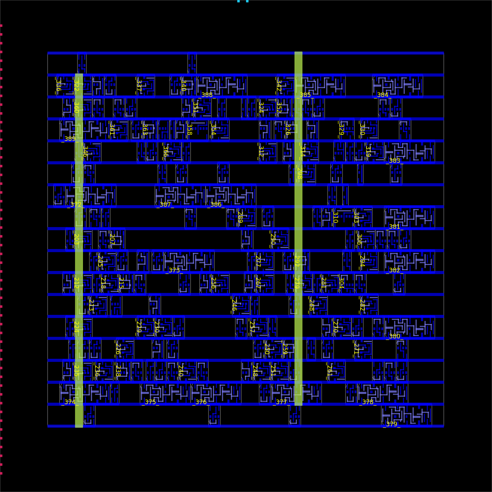
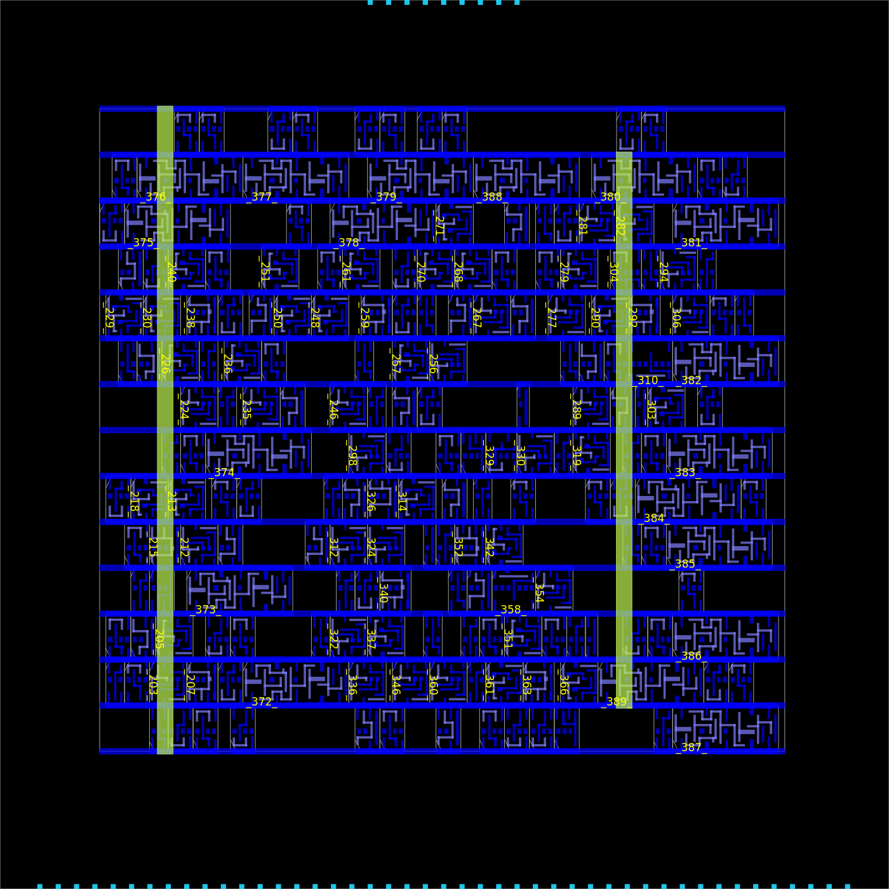
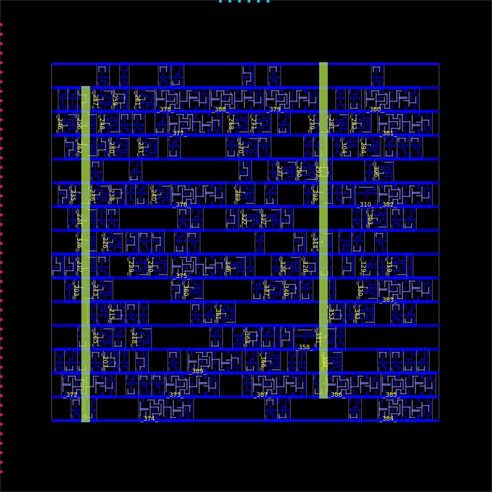
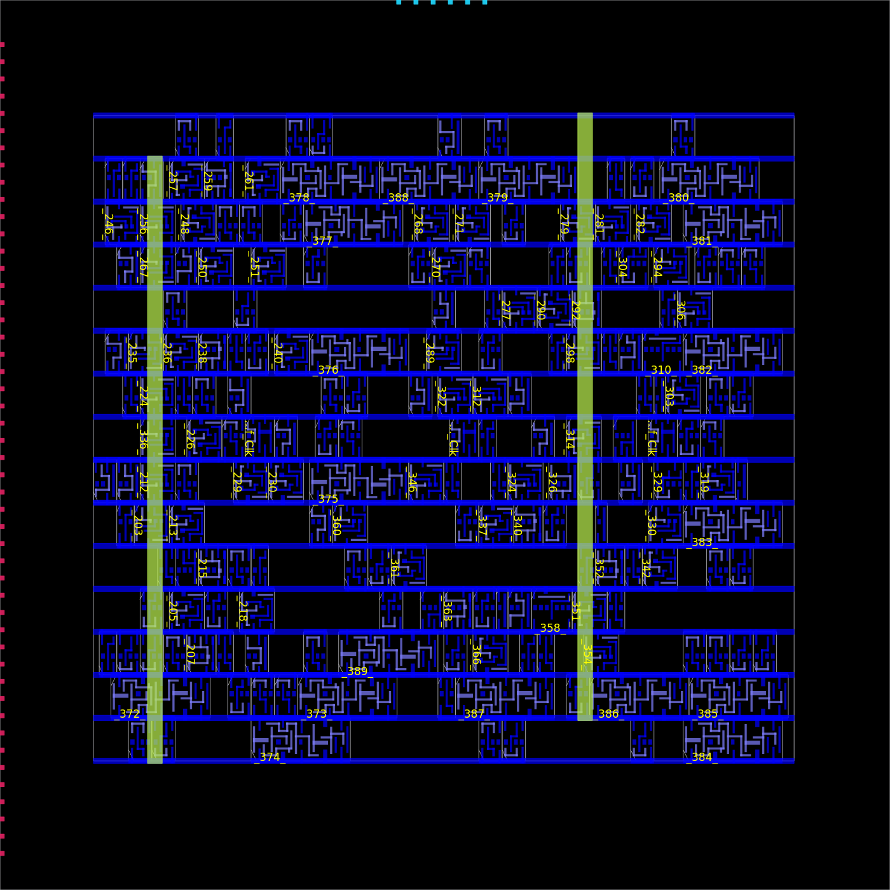
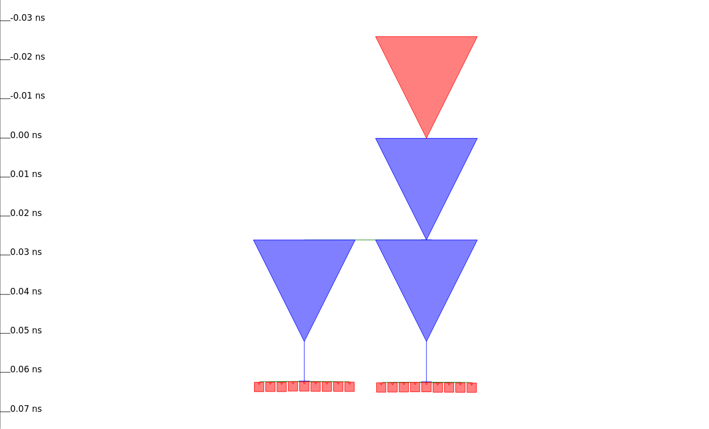
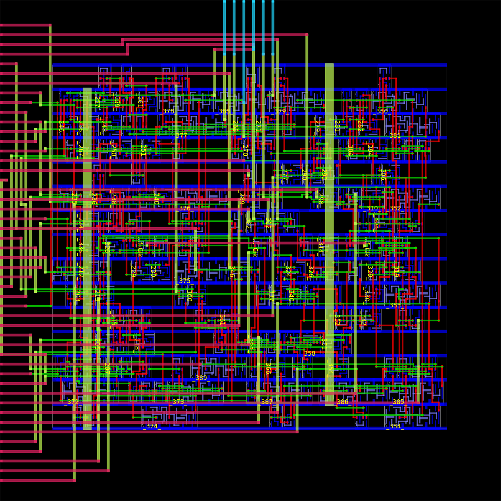
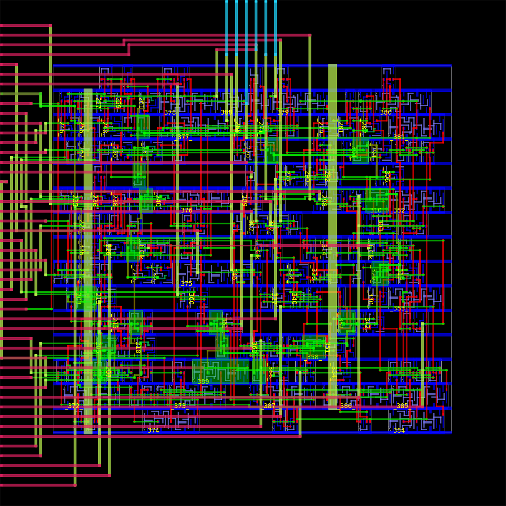

# Physical Design with OpenROAD {#sec-openroad}

## Concepts

OpenROAD is an open-source application for the physical implementation of digital integrated circuits. Its purpose is to take a synthesizable hardware design and the views supplied by a technology, then produce a placed and routed layout that can be checked for manufacturing. The project was launched in June 2018 within DARPA's IDEA programme; its name expands to *Foundations and Realization of Open, Accessible Design*. The original objective was ambitious: an autonomous, no-human-in-the-loop RTL-to-GDSII flow with a turnaround close to 24 hours [@openroadProject].

That goal explains an important design choice. OpenROAD is not simply a collection of shell commands. Its physical-design engines share one process and one OpenDB database, and users control them mainly with Tcl commands. A command modifies the same in-memory design that subsequent commands analyze. This avoids repeatedly exporting and importing incomplete representations of the design, and makes it possible to stop at any stage, inspect the database in the GUI, change one constraint, and continue [@openroadApplication].

This chapter uses OpenROAD **directly**. It does not use LibreLane, OpenLane, or another flow controller. That is valuable pedagogically: each Tcl command corresponds to a physical-design decision. It is also useful when a project needs a custom sequence, a research experiment, or integration into its own build system. For a production team, a higher-level flow can still be useful for configuration management and regression infrastructure; direct use does not remove the need for reproducibility or sign-off.

### Two ways to use the same implementation engines

There are two practical ways to harden a SystemVerilog block with this ecosystem. The direct path, developed in detail in this chapter, invokes OpenROAD and its Tcl commands explicitly. The managed path uses LibreLane to resolve a configuration, invoke the implementation tools in a tested order, and preserve a structured run directory. They are not competing physical algorithms: LibreLane uses OpenROAD for the physical implementation.

| Choice | Direct OpenROAD | LibreLane-managed flow |
| --- | --- | --- |
| Primary input | Tcl scripts, PDK paths and explicit commands | Project configuration plus RTL and constraints |
| Best fit | Learning, research, custom stages, debugger-like inspection | Repeatable project runs, team defaults and CI |
| Control | Every command, checkpoint and repair point is visible | Flow selects and sequences documented stages |
| Main risk | The author must maintain all technology details and stage ordering | Defaults can obscure a physical decision unless reports/configuration are reviewed |
| Common practice | Prototype a command sequence, then keep it in version control | Run the stabilized configuration in CI and compare QoR reports |

For a small block, direct OpenROAD is the best way to learn why a floorplan, PDN or clock tree is needed. For a larger design, the LibreLane option reduces accidental variation. A robust project can use both: develop and debug a Tcl experiment directly, then transfer the justified parameters into the managed configuration. The LibreLane chapter describes its project structure and commands; neither approach removes the need to check timing, routing and physical-verification reports.

{fig-alt="SystemVerilog RTL and a PDK enter a direct OpenROAD physical implementation flow and produce GDSII"}

### What OpenROAD does and does not provide

OpenROAD contains engines for the central digital back-end tasks:

| Activity | Representative OpenROAD capability | Engineering purpose |
| --- | --- | --- |
| Database and timing | OpenDB and OpenSTA | Keep layout, netlist, parasitics and timing constraints consistent |
| Floorplan | `initialize_floorplan`, pin placement, tap-cell insertion | Define die/core, rows, I/O access and well/substrate ties |
| Power | PDN generator and IR-drop analysis support | Create and assess the supply network |
| Placement | Global and detailed placement | Put standard cells into legal rows while controlling wire length and congestion |
| Timing repair | Resizer and STA | Fix transition, capacitance, fanout, setup and hold problems within legal limits |
| Clock tree | `clock_tree_synthesis` | Distribute clocks with controlled skew and insertion delay |
| Routing | Global routing and TritonRoute detailed routing | Connect nets with legal tracks, wires and vias |
| Finishing | Extraction, antenna checks, fill support and reports | Prepare physical data for final verification |

The application does not turn arbitrary RTL into a tapeout automatically. It needs a PDK, characterized cell libraries, realistic timing and I/O constraints, a power intent, and decisions about the die, pins, macros and packaging. In particular, OpenROAD does not replace a foundry's final DRC/LVS deck, pad-ring requirements, ESD rules, package co-design, or acceptance review. It is an implementation engine whose output must be validated in the context of the target technology.

### The views that join RTL to geometry

The same design appears in several forms during implementation. Understanding the forms makes OpenROAD reports much easier to interpret.

| File or view | Contains | Used primarily by |
| --- | --- | --- |
| SystemVerilog | Behavioral and structural RTL | Simulation, elaboration and synthesis |
| Gate-level Verilog | Instances of technology cells and net connectivity | STA, placement, CTS and equivalence checking |
| Liberty (`.lib`) | Cell functions, delays, power, limits and operating corners | Synthesis, timing analysis and optimization |
| Technology LEF | Routing layers, vias, sites and manufacturing grid | Floorplan and routing |
| Cell LEF | Abstract cell outlines, pins and obstructions | Placement and routing |
| DEF | Floorplan, instances, pins and routes | Physical-design interchange and snapshots |
| SDC | Clocks, I/O delays, uncertainties and timing exceptions | Static timing analysis |
| SPEF | Extracted resistance and capacitance | Post-route timing and power analysis |
| GDSII | Exact polygons for all relevant layers | Layout viewing, physical verification and tapeout handoff |

Liberty and LEF are complementary. A Liberty file can tell the timer that a NAND gate is fast enough, but it does not tell the placer how wide the gate is or where its pins are. A LEF can describe those pins and the routing blockages but says nothing about delay. Supplying mismatched Liberty, LEF and GDSII views is a frequent cause of apparently successful but invalid runs. Freeze their PDK and library revision together.

### A direct-flow mental model

The direct flow in this chapter follows this sequence:

```text
SystemVerilog + tests ──► synthesis ──► mapped netlist
                                      │
PDK: .lib + tech LEF + cell LEF ──────┼──► OpenROAD database
SDC constraints ──────────────────────┘
                                            │
 floorplan → I/O + PDN → placement → CTS → routing → extraction
                                            │
                              reports + DEF + SPEF + GDSII for sign-off
```

Do not treat this as a one-way conveyor belt. A failed endpoint after routing may call for a new RTL pipeline stage, a better constraint, a larger die, more whitespace, different cells, or a different pin location. The discipline is to modify one controlled input, retain the reports, and compare the result with the baseline.

## Installing OpenROAD

**Recipe status:** the technology-neutral installation and hardening listings below are adaptation templates. The separate measured Nangate45 study in this chapter supplies an executed direct flow through placement, CTS, detailed routing and OpenRCX/SPEF timing. It is an educational implementation experiment with explicit timing/electrical failures, not a qualified manufacturing flow.

The project currently recommends, in order, prebuilt binaries, Docker images, source builds using Bazel, and only then the legacy CMake build. CMake is deprecated for new installations. The following choices separate a quick learning environment from a development environment [@openroadInstall].

### Recommended environments

On Linux, use either an official prebuilt binary or a container. On Windows, use WSL2 with a Linux distribution or Docker Desktop with the repository mounted into the container. Native Windows is not the normal target of the build instructions. macOS can build the project, but library paths and developer tools require the platform-specific instructions in the official documentation.

For any method, record the output of `openroad -version`, the commit or image digest, the PDK revision and the standard-cell library. A timing number without this information cannot be reliably reproduced.

### Option A: prebuilt binary

Prebuilt releases are the fastest way to start. Download the binary package using the current official release instructions, unpack it outside the repository, and place its `bin` directory on `PATH`. Verify the result before trying a full design:

```bash
openroad -version
openroad -no_init -exit
```

The `-no_init` option prevents a personal `~/.openroad` Tcl file from silently changing a run. Use it in scripted, reproducible invocations. The second command starts the application without an input script and exits; it confirms that the executable and its run-time files are visible.

### Option B: Docker or WSL2

Containers are particularly useful for a book exercise because the host needs only Docker and the sources remain mounted in a known directory. OpenROAD documents Docker as a supported installation route and recommends allocating adequate CPU and memory to the virtual machine [@openroadInstall]. A minimal pattern is:

```bash
docker run --rm --user "$(id -u):$(id -g)" --env HOME=/tmp \
  --mount "type=bind,source=$PWD,target=/work" \
  -w /work \
  "$OPENROAD_IMAGE" \
  openroad -version
```

Set `OPENROAD_IMAGE` to the selected image/digest and review its entry point/PATH before using this **adaptation template**. It assumes a Bash shell and an image compatible with a numeric host user. For the inspected ORFS image, source `/OpenROAD-flow-scripts/env.sh` before calling OpenROAD. Windows PowerShell requires its own mount form; use the Linux UID recipe from WSL for a Linux checkout.

### Option C: build from source with Bazel

Use a source build when you need a particular commit, GUI support, debug symbols, or intend to modify OpenROAD. Clone recursively because OpenROAD includes submodules:

```bash
git clone --recursive https://github.com/The-OpenROAD-Project/OpenROAD.git
cd OpenROAD
```

The project recommends its `setup.sh` script from OpenROAD-flow-scripts to install the complete flow environment, or its dependency helper when building the application alone. Those scripts install packages and therefore should be inspected and run only with the required administrative permissions on the target system. With dependencies and Bazelisk available, the supported installation command is:

```bash
bazelisk run --//:platform=gui //:install
```

It installs `openroad` and its required runfiles under the repository's installation tree. A headless build can omit the GUI platform option if the current build documentation provides that variant. Add `--config=release` when a release version string is required in the binary [@openroadInstall].

After installation, confirm both the command and Tcl help:

```bash
openroad -version
openroad -no_init
% man initialize_floorplan
% man clock_tree_synthesis
% exit
```

The percent signs are interactive Tcl prompts, not characters to copy into a shell. The built-in `man` command is one advantage of the unified application: it documents the exact options supported by the installed version.

### The PDK is a separate installation

Installing OpenROAD does not install permission to fabricate, nor does it automatically provide a complete commercial PDK. For an open learning flow, SKY130 packages supply public technology information and standard-cell libraries; other technologies have their own installation and license terms. The project also includes test designs for the open Nangate45 reference technology, which is convenient for command experiments but is not a manufacturing PDK.

For a real target, set and record paths to at least these views:

```text
TECH_LEF    routing layers, sites and vias
CELL_LEF    physical abstracts of the selected standard-cell library
LIBERTY     timing/power characterization for the selected corner
GDS         standard-cell layouts, if the chosen stream-out flow needs them
```

Never combine a `sky130_fd_sc_hd` Liberty file with a LEF from another library variant merely because the names look similar. Use a PDK installation method that keeps the views versioned together.

## How OpenROAD runs

OpenROAD can execute one Tcl file and exit, or start interactively. The normal reproducible form is:

```bash
openroad -no_init -exit -threads max \
  -log results/openroad.log \
  scripts/harden.tcl
```

Tcl is the control language. `read_lef`, `read_liberty`, `read_verilog` and `link_design` create or complete the database. Later commands see precisely the design state left by earlier commands. Use `write_db` to save a binary OpenDB checkpoint and `write_def` to save a portable physical snapshot. The GUI can reopen an OpenDB checkpoint:

```bash
openroad -gui -db results/placed.odb
```

The command-line application supports a Tcl interface and limited Python support. Tcl is the correct choice for the full physical flow; Python support is primarily for database operations [@openroadApplication].

### Constraints are part of the design

A module named `clk` is not a clock until the timing model says so. The minimum useful SDC defines a clock and input/output assumptions. For a 10 ns clock with one nanosecond of uncertainty:

```tcl
create_clock -name core_clk -period 10.0 [get_ports Clk]
set_clock_uncertainty 1.0 [get_clocks core_clk]

set_input_delay  1.0 -clock core_clk [get_ports {Reset Enable Clear A* B*}]
set_output_delay 1.0 -clock core_clk [get_ports {Sum* Valid Overflow}]
```

In a real chip, input and output delays come from the external source, receiver, package and board budget; they are not arbitrary round numbers. Resets, asynchronous inputs, generated clocks, false paths and multi-cycle paths require equally explicit reasoning. An exception is a proof obligation: document the protocol that makes it safe.

### Timing before and after wires

Before placement, timing uses cell arcs plus estimated interconnect. After routing, extracted parasitics provide resistance and capacitance for actual wires and vias. Therefore, a design can meet timing before CTS and fail after detailed routing. The relevant reports include both setup and hold, all clocks, all corners, unconstrained paths, max transition, max capacitance and max fanout. A single positive worst slack is insufficient evidence.

## A complete direct example: hardening a SystemVerilog accumulator

This example uses the **implementation variant** of `accumulator`: `Clk`/`Reset`, two operands `A`/`B`, and registered/status outputs. The Verilator/cocotb variant instead has `clk`/`reset` and one `Operand`. They share a design pattern, not an interchangeable interface or testbench.

**Recipe status: adaptation template.** Create a separate workspace with the files below from the chapter listings and your selected technology inputs. `examples/openroad/` is an illustrative workspace name, not a bundled directory containing completed flow scripts:

```text
examples/openroad/
├── accumulator.sv
├── synth.tcl
├── constraints.sdc
├── config.tcl
└── harden.tcl
```

The listing below uses `Clk` and `Reset`; the earlier simulation example uses `clk` and `reset`. The laboratory package exports this exact implementation listing as `labs/07-implementation/rtl/accumulator.sv` and tests its behavior before synthesis. Match RTL port spelling with constraints and flow configuration; do not point an uppercase-clock configuration at the earlier lowercase-clock file.

### Step 0: verify the RTL before implementation

From the book/package root, run the **checked** `python labs/run.py run synthesis` recipe in the teaching environment. It uses `labs/07-implementation/tb_implementation.sv` against the two-operand RTL and checks elaboration before generic synthesis. The earlier cocotb Makefile tests the one-operand simulation variant; it is not a test for this physical-flow source without adaptation. Physical implementation does not replace that functional check.

The following RTL is a compact version of the example:

```systemverilog
module accumulator (
    input  logic        Clk,
    input  logic        Reset,
    input  logic        Enable,
    input  logic        Clear,
    input  logic [15:0] A,
    input  logic [15:0] B,
    output logic [15:0] Sum,
    output logic        Valid,
    output logic        Overflow
);
  logic [16:0] next_sum;
  always_comb next_sum = {1'b0, Sum} + {1'b0, A} + {1'b0, B};
  always_ff @(posedge Clk) begin
    if (Reset || Clear) begin
      Sum      <= '0;
      Valid    <= 1'b0;
      Overflow <= 1'b0;
    end else if (Enable) begin
      Sum      <= next_sum[15:0];
      Valid    <= 1'b1;
      Overflow <= next_sum[16];
    end else begin
      Valid    <= 1'b0;
      Overflow <= 1'b0;
    end
  end
endmodule
```

This module is only a core-level block. It has no pad cells, power ports or package. The implementation below therefore creates a core floorplan and signal pins; it is not an MPW submission top-level.

### Step 1: synthesize SystemVerilog to the target cells

Current OpenROAD releases include `sv_elaborate` and `synthesize`, which can elaborate SystemVerilog and map it into the OpenROAD database [@openroadSynthesis]. For portability across installed releases, this chapter uses Yosys as a separate synthesis step and OpenROAD directly for every physical stage. This remains a direct OpenROAD flow because no workflow orchestrator selects or hides the physical commands.

Create `synth.tcl`. This is a Tcl script executed with `yosys -c`, so `$::env(LIBERTY)` is evaluated by Tcl. Select the exact corner and library from the PDK. Mapping sequential cells requires `dfflibmap` as well as combinational mapping with `abc` [@yosysAsicCellMapping]:

```tcl
yosys read_verilog -sv accumulator.sv
yosys hierarchy -check -top accumulator
yosys proc
yosys opt
yosys memory
yosys opt
yosys techmap
yosys opt
yosys dfflibmap -liberty $::env(LIBERTY)
yosys abc -liberty $::env(LIBERTY)
yosys clean
yosys write_verilog -noattr results/accumulator_mapped.v
yosys stat -liberty $::env(LIBERTY)
```

Run it from the example directory:

```bash
mkdir -p results
set -o pipefail
LIBERTY=/absolute/path/to/selected_corner.lib yosys -c synth.tcl \
  | tee results/yosys.log
```

Read the statistics. If Yosys reports latches, unrecognized constructs, an unexpected top module, or zero sequential cells, stop before physical design. The resulting netlist should instantiate only cells present in both the chosen Liberty file and its matching LEF. Check that no generic sequential cells remain. The `yosys` prefix also avoids confusing the synthesis `proc` command with Tcl's procedure-definition command.

The corrected listing was checked with Yosys 0.60 in the local ORFS environment using `sky130_fd_sc_hd__tt_025C_1v80.lib`: the mapped design contained 147 library cells, including 18 `sky130_fd_sc_hd__dfxtp_1` flip-flops. This validates execution and sequential mapping for that environment, not placement, timing closure or sign-off. A project should also restrict mapping to its approved cell set, including any library-specific exclusions.

### Step 2: state the physical configuration

Make technology paths and cell choices explicit in `config.tcl`. The actual names vary by PDK. The values below are placeholders deliberately written as variables rather than pretending that one set of SKY130 names fits every library:

```tcl
set design_name accumulator
set tech_lef  $::env(TECH_LEF)
set cell_lef  $::env(CELL_LEF)
set liberty   $::env(LIBERTY)
set sdc_file  constraints.sdc
set netlist   results/accumulator_mapped.v

# These must exist in the selected standard-cell library.
set buffer_cell $::env(BUFFER_CELL)
set inv_cell    $::env(INVERTER_CELL)
set site_name   $::env(SITE_NAME)
```

For a SKY130 library, determine the site and legal buffer/inverter names from that library's LEF and Liberty files. Do not copy cell names from a different library family. A high-density, low-leakage or high-voltage library can differ in available cells and physical dimensions.

### Step 3: read the technology, netlist and constraints

The first section of `harden.tcl` loads the database. `read_lef -tech` loads the technology; the other LEF is the standard-cell library. Liberty must be read before linking the gate-level Verilog so timing arcs can be attached to cell instances.

```tcl
source config.tcl
file mkdir results

read_lef -tech $tech_lef
read_lef $cell_lef
read_liberty $liberty
read_verilog $netlist
link_design $design_name
read_sdc $sdc_file

report_units
check_setup
report_design_area
```

`check_setup` finds basic consistency issues such as unlinked cells or absent clocks. `report_units` matters because the first Liberty file establishes units for timing and capacitance. Save the output to a report file; otherwise a terminal scrollback buffer becomes the only record of a failure.

### Step 4: create the floorplan and place I/O pins

Floorplanning decides the available area and geometry. `initialize_floorplan` can receive explicit die/core coordinates or compute dimensions from utilization and aspect ratio. A low utilization leaves more whitespace for buffers and routing but increases die area; a high utilization saves area but risks congestion. The official command documentation gives the conceptual calculation:

$$
A_{core} = \frac{A_{cells}}{U/100}
$$
where $U$ is target utilization. For a small educational block, begin around 50--60%, not 80--90%.

```tcl
initialize_floorplan \
  -utilization 55 \
  -aspect_ratio 1.0 \
  -core_space 15 \
  -site $site_name

make_tracks
place_pins -random
write_def results/01_floorplan.def
write_db  results/01_floorplan.odb
```

The technology LEF normally supplies track pitch and offset, so the generic form is simply `make_tracks`; a custom flow may also call it once per layer while overriding pitch and offsets. The essential requirement is that routing tracks originate from technology rules, not guessed dimensions. Start with `place_pins -random` only to make the block routable. For an interface block, replace it with an intentional pin-placement strategy that groups related buses, keeps clocks clear of noisy signals, and minimizes long crossings.

Open the checkpoint and inspect rows, core boundary and pins:

```bash
openroad -gui -db results/01_floorplan.odb
```

### Step 5: establish power and ground

Power distribution must be created before ordinary signal placement and routing. At block level, the configuration defines power/ground nets and connects each standard cell's supply pins. The exact pin patterns and metal layers are PDK-specific. The following pattern illustrates the required decisions:

```tcl
add_global_connection -net VDD -pin_pattern {^VPWR$} -power
add_global_connection -net VSS -pin_pattern {^VGND$} -ground
set_voltage_domain -power VDD -ground VSS

define_pdn_grid -name Core
add_pdn_stripe -grid Core -followpins -layer met1
add_pdn_stripe -grid Core -layer met4 -width 1.6 -pitch 40 -offset 2
add_pdn_connect -grid Core -layers {met1 met4}
pdngen
write_def results/02_pdn.def
```

Here `VPWR`, `VGND`, `met1` and `met4` are examples, not universal names. Use the actual supply pins and routing layers from the selected library and PDK. The PDN generator lets the designer state a policy--layers, widths, spacing, pitch and connections--then creates the grid [@openroadPdn]. A real implementation must check voltage drop, current density, macro supplies and package/bumps; a small core-only demonstration cannot establish those properties.

Add tap cells and end caps according to the PDK's required insertion rules before placement. They maintain well/substrate ties and legal row boundaries. The appropriate command and master-cell names must be taken from the technology collateral; do not invent them.

### Step 6: global placement, legalization and pre-CTS repair

Global placement chooses approximate cell locations to reduce wire length and density overflow. It is not legal manufacturing placement. Detailed placement snaps cells to rows and resolves overlaps. The sequence below uses timing-aware global placement, then asks the resizer to repair electrically problematic nets within the cells permitted by the library.

```tcl
global_placement -density 0.55
detailed_placement
check_placement

estimate_parasitics -placement
repair_design -max_utilization 65
detailed_placement

tee -file results/03_area.rpt { report_design_area }
tee -file results/03_prects_setup.rpt { report_checks -path_delay max -fields {slew cap input_pins} }
tee -file results/03_prects_hold.rpt  { report_checks -path_delay min -fields {slew cap input_pins} }
write_db results/03_placed.odb
```

Do not interpret pre-CTS timing as final. It is useful for identifying an impossible clock target or a logic path that is already too deep. If congestion is high, reduce utilization, enlarge the core, reconsider pin positions, or examine macro placement. Increasing the clock period hides the symptom but does not explain its cause.

### Step 7: build and analyze the clock tree

The RTL clock port is a logical source. Clock-tree synthesis (CTS) inserts buffers and constructs branches that deliver the clock to all sequential sinks with controlled delay and skew. Select only legal buffer cells from the current library:

```tcl
set_wire_rc -signal -layer $::env(CLOCK_LAYER)
clock_tree_synthesis \
  -root_buf $buffer_cell \
  -buf_list [list $buffer_cell] \
  -clk_nets {Clk}

report_cts -out_file results/04_cts.rpt
set_propagated_clock [all_clocks]
estimate_parasitics -placement
repair_timing -setup
repair_timing -hold
detailed_placement
check_placement
write_db results/04_cts.odb
```

The CTS engine performs on-the-fly characterization, so it does not require a separately generated characterization table [@openroadCts]. The selected `buffer_cell` must have usable timing data and be appropriate for clock distribution. In a real design, choose a library-approved set of clock buffers/inverters and review the clock report: number of roots, sinks, inserted buffers, skew, latency, transition and clock-domain coverage.

### Step 8: route, extract and repair

Global routing reserves paths and produces guides. Detailed routing converts those guides into legal wires and vias, performing search and repair. OpenROAD's detailed router is TritonRoute; it includes pin access, track assignment, detailed route and a DRC engine [@openroadRouting].

```tcl
global_route -congestion_iterations 100
detailed_route \
  -output_drc results/05_route_drc.rpt \
  -output_maze results/05_route.maze

estimate_parasitics -global_routing
tee -file results/05_postroute_setup.rpt { report_checks -path_delay max -fields {slew cap input_pins} }
tee -file results/05_postroute_hold.rpt  { report_checks -path_delay min -fields {slew cap input_pins} }

repair_timing -setup
repair_timing -hold
detailed_placement
global_route -congestion_iterations 100
detailed_route -output_drc results/06_final_route_drc.rpt
write_def results/06_routed.def
write_db  results/06_routed.odb
```

`estimate_parasitics` is appropriate for a learning flow and early decisions. A sign-off flow uses the extraction settings and corners required by the PDK, commonly writes SPEF, and performs final timing with the foundry-qualified methodology. The route DRC report from the router is valuable feedback, but it is not automatically equivalent to the foundry sign-off DRC result.

### Step 9: inspect, report and export

Review the final database graphically and keep machine-readable reports:

```tcl
check_placement
tee -file results/07_area.rpt { report_design_area }
tee -file results/07_setup.rpt { report_checks -path_delay max -digits 4 }
tee -file results/07_hold.rpt { report_checks -path_delay min -digits 4 }
tee -file results/07_floating_nets.rpt { report_floating_nets }
write_verilog results/accumulator_physical.v
write_def     results/accumulator_final.def
write_db      results/accumulator_final.odb
```

Launch `openroad -gui -db results/accumulator_final.odb` and inspect the core boundary, supply stripes, clock routes, pin access, congestion and detailed-route DRC markers. Use the GUI to understand a report, not to make undocumented edits. All deliberate changes belong in Tcl or version-controlled inputs.

Producing GDSII requires a stream-out path that combines the routed design with the technology and cell GDS data, often through KLayout or Magic as prescribed by the PDK. Run the PDK/foundry DRC, LVS and density/fill procedure on that GDSII. The result is ready for a tapeout review only when the physical, timing, power, integration and documentation criteria for the chosen programme are satisfied.

## Measured study: frequency, utilization and the cost of wires {#sec-openroad-study}

[Core · P5 · C0 review / C3 rerun](../../learning-paths.qmd#sec-path-labels){#act-physical-study-review .learning-activity}

The scripts and recorded reports in [Lab 16](../../labs/16-openroad-study/README.md) turn the preceding decisions into an executed experiment. They use the same 16-bit accumulator, one common Nangate45 mapped netlist, a fixed typical Liberty view, and direct OpenROAD Tcl. The ORFS image supplies the binaries and matching technology files; its Make-based flow does not orchestrate these runs. Nangate45 is an open teaching/reference technology, not a fabrication offer.

The recorded container digest is `openroad/orfs@sha256:fd3e27cf1788815be526e86fbe449310d1114bf256fd6c7af9dced6eaf12c699`. It contains OpenROAD `24Q3-11382-g61879bec53` and Yosys 0.60. The [reference manifest](../../labs/16-openroad-study/reference/manifest.json) records input, technology, extraction-rule, report and image hashes. The image contains no usable ORFS Git metadata, so the record uses its immutable image identity and individual technology-file hashes rather than inventing a source revision.

### Experiment design and observation boundaries

The main sweep requests core utilizations of 45%, 65% and 80% at periods 0.85, 1.00 and 1.15 ns. These are requested frequencies of approximately 1176, 1000 and 870 MHz, not demonstrated silicon operating frequencies. Two 55% cases at 0.91 and 1.00 ns examine a small margin near a setup boundary. Both synthesis and all other settings remain fixed. Pin placement, the power grid, signal layers `metal2..metal6`, clock layers `metal4..metal6`, two tool threads and the density-selection rule are recorded in `flow.tcl`.

This experiment measures sensitivity of one mapped design. It deliberately omits setup/hold repair and frequency-driven remapping so that a failing case remains observable. Changing the period therefore principally changes the required time, while changing utilization changes geometry and routing. An optimizing flow could also resize cells, insert buffers or choose a different netlist as constraints change; that is a subsequent controlled experiment, not a claim about these measurements.

The study SDC uses 20 ps clock uncertainty, input delays of 100 ps maximum and 20 ps minimum, output delays of 100 ps maximum and 20 ps minimum, 20 ps input transition and 5 fF output loads. These are explicit block-level teaching budgets, not the earlier 10 ns illustrative SDC. The chosen Liberty uses fF; `set_load 5.0` specifies five femtofarads. Changing the SDC for this study does not overwrite the reference accumulator's original constraints.

| Checkpoint | Clock model | Interconnect model | Evidence retained |
| --- | --- | --- | --- |
| `placed` | Ideal | Placement estimate | Legal placement, setup/hold, constraint/electrical checks, ODB/SDC |
| `cts` | Propagated | Placement estimate | Three clock buffers, 18 sinks, clock-tree report and timing |
| `global` | Propagated | Global-route estimate | Routing guides, estimated setup/hold |
| `routed` | Propagated | Detailed-route OpenRCX extraction imported through SPEF | Detailed-route DRC report, extracted timing, SPEF, DEF, ODB |

The extraction sequence is explicit:

```tcl
extract_parasitics -ext_model_file $platform/rcx_patterns.rules
write_spef $out/routed.spef
read_spef $out/routed.spef
```

Writing a SPEF without importing it into the timing analysis would leave an earlier estimated model in use in this recipe. The recorded post-route reports are produced after `read_spef`. OpenRCX and the supplied extraction rules model routed geometry; they do not supply a foundry-qualified multi-corner sign-off result [@openroadStudyRcx].

### Placement: inspect geometry before interpreting the table

{#fig-openroad-four-checkpoints fig-alt="Four actual OpenROAD views show floorplan rows and pins, placed logic, inserted clock buffers and detailed routing for the 55 percent accumulator case" width=100%}

Read @fig-openroad-four-checkpoints as a sequence of newly introduced obligations. The floorplan fixes rows, pins and supply geometry; placement fixes cell locations; CTS introduces clock delay and skew; routing supplies wire geometry for extracted timing. The first panel is a new prefix replay using the same mapped netlist, constraints and pinned image as Lab 16. Its [capture provenance](../../figures/architecture-floorplan.json) records inputs and hashes. The other panels are the existing measured run, whose timing reports below remain authoritative. The overview does not introduce a new timing result or replace the larger diagnostic captures.

{#fig-openroad-study-low fig-alt="Actual Nangate45 accumulator placement at 45 percent target utilization" width=90%}

{#fig-openroad-study-dense fig-alt="Actual Nangate45 accumulator placement at 65 percent target utilization" width=90%}

These images are GUI exports of the actual OpenDB checkpoints, generated with `images.tcl`; they are not illustrative cell arrangements. Compare core dimensions and whitespace before comparing apparent visual density: each image is fitted to its own die. The core areas are approximately 601.43 µm² at 45%, 478.80 µm² at 55%, and 409.64 µm² at 65%. The routed standard-cell area is reported separately from core area and includes the inserted clock cells.

Requested floorplan utilization, the global placer's effective movable-area ratio, and the final reported cell/core ratio are different quantities. Row/site snapping and the placer's area accounting matter especially for this small block. At 80%, the floorplan contains only 316.008 µm² of core area, while the placer reports 324.886 µm² of effective movable area and rejects the run at 102.809%. The three 80% cases stop at placement; there is no routed timing or DRC result to place in their missing cells. The [raw failure log](../../labs/16-openroad-study/reference/u80-p1.00/flow.txt) preserves `GPL-0301`.

### Read the measured sweep

The complete [CSV](../../labs/16-openroad-study/reference/summary.csv) and [JSON](../../labs/16-openroad-study/reference/summary.json) retain every case, including failed ones. Positive and negative entries below refer to worst setup slack; hold is discussed separately. All timing values are in picoseconds.

<!-- openroad-study-results -->
| Target utilization | Period (ns) | Core (µm²) | Placed setup (ps) | CTS setup (ps) | Routed setup (ps) | Routed hold (ps) |
| --- | ---: | ---: | ---: | ---: | ---: | ---: |
| 45% | 0.85 | 601.43 | −117.22 | −49.20 | −55.71 | −50.63 |
| 45% | 1.00 | 601.43 | +32.78 | +100.80 | +94.29 | −50.63 |
| 45% | 1.15 | 601.43 | +182.78 | +250.80 | +244.29 | −50.63 |
| 65% | 0.85 | 409.64 | −121.31 | −54.66 | −62.05 | −49.26 |
| 65% | 1.00 | 409.64 | +28.69 | +95.34 | +87.95 | −49.26 |
| 65% | 1.15 | 409.64 | +178.69 | +245.34 | +237.95 | −49.26 |
| 55% | 0.91 | 478.80 | −59.36 | +6.17 | **−1.46** | −48.10 |
| 55% | 1.00 | 478.80 | +30.64 | +96.17 | +88.54 | −48.10 |
| 80% | 0.85 / 1.00 / 1.15 | 316.01 | Placement rejected | — | — | — |
<!-- /openroad-study-results -->

At either feasible utilization, adding 150 ps to the period adds approximately 150 ps to setup slack. It leaves hold essentially unchanged because hold checks the same-edge minimum-delay relation. At a common period, the smaller 65% core is not automatically faster than the 45% core. The path, routing and loading determine the result; area reduction alone cannot establish a performance improvement. This is one fixed-netlist study, not a statistical conclusion across placement seeds, technologies or architectures.

### Clock-tree synthesis: setup improves while hold becomes worse {#clock-tree-synthesis-setup-improves-while-hold-becomes-worse}

{#fig-openroad-study-placed fig-alt="Actual pre-CTS placement at 55 percent utilization" width=90%}

{#fig-openroad-study-cts fig-alt="Actual post-CTS placement of the accumulator at 55 percent utilization" width=90%}

{#fig-openroad-study-clocktree fig-alt="OpenROAD clock-tree viewer export with three clock buffers and eighteen sinks" width=95%}

The [CTS report](../../labs/16-openroad-study/reference/u55-p0.91/cts-tree.rpt) reports one clock root, three inserted `CLKBUF_X3` buffers, three clock subnets and 18 sinks. These are the 16 sum bits plus `Valid` and `Overflow`. The topology image explains how the clock is distributed; the timing reports quantify arrival times at the sinks.

In the diagnostic case, the worst setup path starts at `A[1]`, timed relative to the external clock, and ends at `_389_/D`, whose Q output drives `Overflow`. Positive capture-clock insertion delay increases its available setup time. The same late capture clock reduces hold margin for a short input-to-register path. Thus CTS can make an input setup check look better while introducing a hold failure. For a register-to-register path, the launch-clock delay must also be included; the beneficial-input-path interpretation cannot be transferred to every path.

### A measured setup pass before routing becomes a failure after routing {#a-measured-setup-pass-before-routing-becomes-a-failure-after-routing}

{#fig-openroad-study-routing fig-alt="Actual detailed-route layout of the accumulator" width=90%}

{#fig-openroad-study-critical fig-alt="Worst accumulator setup path highlighted in the actual OpenROAD routed layout" width=90%}

Use the [post-CTS setup report](../../labs/16-openroad-study/reference/u55-p0.91/cts-setup.rpt) and [extracted post-route setup report](../../labs/16-openroad-study/reference/u55-p0.91/routed-setup.rpt) together. They identify the same `A[1]` to `Overflow` endpoint and expose both the data path and capture-clock path. The change is small enough that reporting only two decimal places in nanoseconds would conceal its sign.

<!-- openroad-study-path -->
| Quantity for the worst setup path | Post-CTS estimate | Post-route extraction | Change |
| --- | ---: | ---: | ---: |
| Input external maximum delay | 100.00 ps | 100.00 ps | 0.00 ps |
| Sum of 17 reported cell-arc increments, approximately | 808.34 ps | 815.12 ps | +6.78 ps |
| Sum of reported data-net increments, approximately | 1.06 ps | 2.09 ps | +1.03 ps |
| Data arrival at `_389_/D` | 909.43 ps | 917.20 ps | +7.77 ps |
| Capture required time after uncertainty/setup | 915.60 ps | 915.74 ps | +0.14 ps |
| Setup slack | **+6.17 ps** | **−1.46 ps** | **−7.63 ps** |

The per-arc sums use the printed five-decimal-place nanosecond values and therefore have rounding error relative to the timer's accumulated arrival. The extracted budget is `915.74 − 917.20 = −1.46 ps`. The capture budget includes the 910 ps period, approximately 62.43 ps clock insertion, 20 ps uncertainty and 36.69 ps library setup time. The [path-pin list](../../labs/16-openroad-study/reference/u55-p0.91/critical-path-pins.txt) identifies the objects highlighted in the image.
<!-- /openroad-study-path -->

The route adds delay directly through interconnect and indirectly by changing the capacitance/slew seen by cell arcs. In this small case, most total data delay is in the 17 combinational cell arcs, rather than the reported pin-to-pin wire increments. It would be misleading to call the entire arrival-time change “wire delay” or to conclude that the bottleneck is a long wire solely from the picture. Trace the XOR/carry and AOI/OAI chain from the low input bit toward the overflow register; correlate cell names with the [mapped netlist](../../labs/16-openroad-study/reference/mapped.v).

The global-route estimate is also useful: it predicts a larger setup loss than the final extracted result. Detailed routing and extraction need not monotonically worsen an estimate. Keep the model label on every number and compare the same endpoint as well as the worst endpoint, which can change between stages.

The precise conclusion is **setup met at the post-CTS estimated checkpoint and failed after route/extraction**. It is not “all timing passed before routing”: hold was already negative after CTS. The [extracted hold report](../../labs/16-openroad-study/reference/u55-p0.91/routed-hold.rpt) identifies a short `Enable`-to-register path. The [electrical report](../../labs/16-openroad-study/reference/u55-p0.91/routed-limits.rpt) also retains a max-capacitance violation on `_199_/ZN`, the mapped `NOR2_X1` combining `Clear` and `Reset`. A slower clock does not repair either problem.

### Decide on the next change

The evidence supports several different experiments, each addressing a different mechanism:

| Observation | Candidate change | What must be checked again |
| --- | --- | --- |
| Long carry/logic chain on the setup path | Evaluate a carry-save/compressor structure or a different adder mapping, keeping arithmetic widths explicit | Functional/equivalence regression, mapped logic depth, all setup/hold and electrical checks after implementation |
| Insufficient setup margin with the current architecture | Relax the architectural clock if the system latency/throughput budget permits it | Workload time, interface budgets and unchanged hold/electrical obligations |
| A pre-add pipeline is architecturally acceptable | Register `A+B` and its validity before the feedback accumulation stage | Added latency, reset/clear flushing, enable gaps, sum/overflow alignment, cycle-aware checker and a new physical run |
| Short `Enable` path fails hold | Use a controlled hold-repair pass with legal delay cells/buffering and placement/routing updates | Every affected setup/hold endpoint; adding delay can consume setup margin |
| Shared reset/clear control exceeds capacitance | Buffer/resize or restructure the control fanout while preserving synchronous reset/clear priority | Slew, fanout/capacitance, setup/hold, logic correctness and added placement area |
| Requested 80% floorplan cannot place | Increase whitespace or reduce the cell demand, then inspect the new density and routing | First successful placement, routing completion and fresh extracted timing |

A pipeline is a proposed architectural modification here, not an already measured repair. The accumulator contains feedback; inserting a register into that feedback without a new recurrence changes its result sequence. A safer candidate separates input pre-addition from accumulation and defines the additional latency explicitly. A carry-save accumulator also changes the stored representation and may require a final carry-propagate step; it needs a new contract if results are no longer visible every cycle. Check whether synthesis already performs the proposed compression before claiming that an RTL rewrite improves the hardware.

The study therefore diagnoses the physical behavior without promising an unexecuted fix. To complete a repair exercise, rerun simulation/equivalence as applicable, map the revised RTL, retain a new source/netlist identity, and repeat placement through extracted timing. Do not change the reference reports or mix the old geometry with the new RTL.

### Reproduce, inspect and submit

[Advanced · C3](../../learning-paths.qmd#sec-path-labels){#act-openroad-reproduction .learning-activity}

The [Lab 16 guide](../../labs/16-openroad-study/README.md) gives digest-pinned Linux/WSL and PowerShell recipes, the small baseline option, the complete sweep, image export and report summarization. It needs the separate ORFS image, not the unit-lab container. The script refuses a nonempty output directory; select a new one for a new campaign. The full sweep exits nonzero when the deliberately tight 80% cases fail, while retaining their status and logs in `study.json`. A failed tool stage is never converted into a routed PASS.

Students without local physical-design resources can analyse the supplied report bundle and captures under the same P5 approach as @sec-hsd-coursework. They must still explain the source/constraint identities, compute the timing budget and identify unexecuted checks. No fabricated ASIC or FPGA board is needed to perform this reasoning.

Answer the following using particular report lines, cell/pin names and calculations:

1. Why does the 0.91 ns case have positive setup slack after CTS and negative setup slack after routing? Separate the change in data arrival from the change in capture required time.
2. Which part of the critical path is arithmetic logic, which is net delay, and which is clock distribution? Does the report justify calling the design congestion-limited?
3. Why do the same runs still fail hold at 1.15 ns? Derive the worst hold margin from the input arrival, clock arrival, uncertainty and library hold time.
4. Why does 80% requested utilization produce a placement rejection rather than an 80% final routed design? Which reported areas are being compared?
5. Propose one RTL modification for the setup bottleneck. State whether it preserves cycle-level behavior; define the regression or equivalence relation and the new timing measurement needed.
6. Would you first change utilization, clock budget, adder structure or hold repair? Give the expected benefit, the possible regression and the acceptance criterion for that experiment.

Submit the hypothesis, configuration/constraint inventory, complete per-stage reports, labelled placement/CTS/routing/path captures, the path-budget calculation and a one-change follow-up plan. The router's empty final DRC report is a result for its own rule checks; the study does not perform foundry DRC/LVS, multi-corner qualification, IR/EM closure, pad/package integration or manufacturing test. The remaining hold/electrical failures already prevent a timing-closure claim, irrespective of whether routing completes.

## Understanding every physical step

### Floorplan and utilization {#floorplan-and-utilization}

The floorplan determines the geometry in which every later optimization must work. Core area is not empty space; it must accommodate standard cells, clock buffers, tie cells, tap cells, decoupling, power straps, signal routes and margins. A block with 65% nominal cell utilization can still fail routing if wide buses, macro blockages or a dense pin region concentrate demand in one location.

Use a square aspect ratio only as a starting point. A memory macro or a wide streaming interface can favor a rectangular core. Reserve channels around macros and keep their pins accessible. For top-level chips, I/O placement, bump/pad assignment and the power grid are jointly determined; changing one late in the project can affect all three.

### Placement and routability

Global placement minimizes a mathematical cost involving wire length and density. It can make a path shorter while creating a local density peak that later prevents routing. Detailed placement legalizes the result on the standard-cell rows and placement grid. Check utilization, overflow, row legality, pin density and estimated wire length after each stage.

High fanout control signals deserve special attention. An enable or reset that reaches many flops may need buffering, but its semantics must remain valid. Asynchronous resets and cross-domain signals require architecture and verification treatment; placement tools cannot make an unsafe CDC safe.

### Clock-tree synthesis

[]{#ref-clock-tree-synthesis .reference-destination}

Clock trees have different objectives from data networks. They must reach every sink with low skew, controlled insertion delay, legal transitions and sufficient buffering. A clock tree can consume a meaningful fraction of total dynamic power. CTS therefore changes both timing and power, and is followed by setup/hold repair.

After CTS, verify that the intended clocks are propagated, that no unexpected clocks appeared, and that the clock root is where the integration plan expects it. A warning about a clock with zero sinks can reveal a naming mismatch, a failed synthesis inference, or an incorrect constraint.

### Routing, parasitics and antenna effects

Global routing selects broad paths through routing resources; detailed routing chooses exact tracks and vias. It must honor spacing, width, enclosure, via and pin-access rules. Long or crowded nets accrue resistance and capacitance, which slow signals and consume routing resources.

An antenna violation arises when a conductive region connected to a gate can accumulate charge during manufacturing. Repair may insert an antenna diode, change a route layer or alter the topology. Treat it as a physical-manufacturing issue, separate from a functional simulation failure.

### What to compare between experiments

Use the measured table in @sec-openroad-study and its raw CSV as the reporting model. For a new candidate, retain requested utilization/period, actual core and cell areas, per-stage setup and hold, parasitic/clock models, routed wire length, router DRC scope and any failed stage. Change one independent input at a time and preserve the baseline. Leave unavailable results empty with a reason rather than inserting an estimated PASS.

Do not claim a physical improvement solely because area decreases. A valid comparison keeps the PDK, cell library, RTL, constraints, tool version and relevant settings fixed.

## Failure diagnosis

Physical-design failures are information. The correct response is to locate the first stage where the design becomes invalid, then repair the relevant input.

| Symptom | Likely cause | First checks | Typical correction |
| --- | --- | --- | --- |
| Cells cannot be linked | Netlist and Liberty use different cell names or libraries | `check_setup`, synthesis log | Use matching Liberty/LEF/Verilog views |
| No clock or zero clock sinks | Port name or SDC does not match the netlist | `report_clocks`, `report_checks` | Correct SDC and verify flop clock pins |
| Overlapping or illegal cells | Incomplete rows, bad site, too little area | `check_placement`, floorplan view | Correct site/rows or enlarge the core |
| Routing overflow | Utilization/pin density too high or macro blockage | Global-route congestion report | Add whitespace, change floorplan/pins, reduce density |
| Setup failure after route | Wire delay, logic depth or CTS insertion delay | Compare pre/post-route paths | Pipeline RTL, resize/repair, change placement/floorplan |
| Hold failure after CTS | Fast data path relative to clock arrival | Minimum-delay report | Apply hold repair; never hide it with an unjustified exception |
| Repeated antenna/DRC markers | Routing/resource or rule issue | Detailed-route report and GUI markers | Use PDK-approved repair, change route/floorplan |
| Great reports but no fabrication path | Missing sign-off, pads, package, or accepted PDK flow | Tapeout checklist | Complete integration and foundry requirements |

## From Timing Violations to a Qualified Implementation {#sec-physical-closure}

The next step after producing a routed block is to decide which requirements it actually satisfies, repair the failures, and repeat the checks that the repair can invalidate. The dot-product continuation in @sec-complete-closure executes this process on the implementation already preserved in @sec-complete-case. Its original ASIC has positive setup slack, negative hold slack and electrical-limit violations. Its original ECP5 and Nexys Video implementations both miss 100 MHz. [Lab 21](../../labs/21-physical-closure/README.md) retains that baseline and records new candidates separately.

Here, a **qualified implementation** means a candidate accepted against a named, limited set of checks. For the Nangate45 block, the acceptance gate requires extracted setup and hold slack of at least zero, no reported slew/capacitance/fanout violations, no unconstrained-path warnings, an empty final detailed-router DRC report, a successful mapped-to-repaired netlist equivalence check and GDS stream-out/readback. The result covers the supplied single typical corner and block interface budgets. Manufacturing DRC/LVS, multi-corner analysis, integration into Wally, pads and package remain separate open obligations. A report must state this boundary next to its acceptance decision.

### Read the failure before choosing the repair {#read-the-failure-before-choosing-the-repair}

A maximum-delay report answers whether data reaches its endpoint before the next relevant capture edge. A minimum-delay report answers whether data remains stable long enough around the relevant capture edge. Read the launch and capture clocks, clock insertion delays, external delays, uncertainty, cell arcs and net contributions before looking at the final slack. Check whether the path is register-to-register, input-to-register or register-to-output: a repair that helps one class can leave another untouched.

The original ASIC's worst hold report starts at the `m_bvalid` input and ends at a clocked register. Its minimum input budget is 0.2 ns, while the propagated capture clock and hold uncertainty leave a small negative margin. Other short paths start at reset; the report shows reset driving 419 loads. The electrical report also includes an internal output transition of 3.41 ns against a 0.20 ns limit. These observations lead to two specific actions: build appropriate buffering for heavily loaded signals and add controlled delay to short data paths after CTS. They do not justify declaring reset or every input path false.

The FPGA diagnosis is different. The preserved critical paths cross the arithmetic network. In ECP5, the path includes the unregistered DSP multiplier followed by the accumulation carry chain; in Nexys Video, the chosen open flow maps multiplication into LUTs and carry logic. The target is therefore a long combinational calculation between state elements. Improving the ASIC clock tree would not repair that FPGA path.

Use electrical reports together with timing reports. A cell operating beyond its characterized transition/load limits weakens the interpretation of an apparently attractive timing result. Repairing a maximum-capacitance violation may insert a buffer, change placement and alter both setup and hold. A new worst path after repair is useful evidence that the bottleneck has moved.

### Three candidates, three different contracts

| Candidate | What changes | Expected benefit | Obligation introduced or retained |
| --- | --- | --- | --- |
| Lower frequency | 100 MHz becomes 75 MHz; original RTL, seed and implementation recipe remain fixed | More setup time without changing job cycle semantics | Slower wall-clock service; minimum-delay and electrical checks still apply |
| Register the product | Separate multiplication from accumulation; target remains 100 MHz | Remove multiplier-plus-adder from one cycle | Extra state/registers and one extra serial cycle per element; repeat arithmetic, protocol, error and reset tests |
| Physical repair | Original ASIC RTL and 100 MHz remain fixed; add electrical and timing repair | Fix load/slew and short data paths without changing architectural latency | Added cells/routing/power; repeat legalization, routing, extraction, timing and equivalence |

Lowering frequency is a valid engineering decision when the application permits it. It changes the requirement: a 75 MHz acceptance does not close the original 100 MHz requirement. It also does not generally fix a same-edge hold failure, because the period does not provide extra time between the data and clock edges involved in that check. Lab 21 reruns the ASIC at 75 MHz to make this distinction measurable rather than merely asserting it.

The RTL candidate registers a signed 32-bit product when the second operand response is accepted, enters `ACCUMULATE`, and updates the 64-bit accumulator on the following edge. It issues no new DMA request in between. The register map, signed arithmetic, transaction count, error responses and completion-after-write-response rule stay intact. It is a serial multicycle engine: this change adds latency and does not establish a one-element-per-cycle pipeline. A result at a higher clock must be evaluated against the extra cycles, memory latency and application workload.

Do not copy a known result from the original source revision into the candidate's evidence column. In this experiment the new engine passes the independent integer-oracle regression for lengths 1–256 at two seeds and the Nexys serial-boundary fixture. A negative control deliberately zero-extends a negative product and must fail that same scoreboard. These are candidate-specific simulation checks. They do not transfer the original bounded proof or real-Wally firmware cycle measurements to the modified engine, and they do not prove the two state machines cycle-equivalent.

### Repair the physical implementation in the right order

The executable [repair recipe](../../labs/21-physical-closure/repair.tcl) keeps the original synthesis, floorplan, utilization, clock and interface constraints. After placement, it estimates parasitics and calls `repair_design` with 20% slew and capacitance margins. After CTS, it propagates clocks, repairs setup, then repairs hold with a 0.03 ns target margin. After global routing, it repeats electrical/setup/hold repair against routing-based estimates, legalizes the cells, reroutes and updates the estimates. The margins are optimization targets; final acceptance uses fresh extracted reports.

This command sequence follows the resizer's documented distinction between electrical repair and timing repair. The installed release's `help` output remains authoritative for supported options; the [official Gate Resizer documentation](https://openroad.readthedocs.io/en/latest/main/src/rsz/README.html) explains the underlying operations. In particular, hold repair follows CTS with propagated clocks, and setup repair precedes hold repair.

The exploratory 0.10 ns hold-margin run exhausted its buffer allowance. Increasing an optimization target is therefore not free: it can consume cells and whitespace without addressing a release requirement. The retained candidate uses the smaller 0.03 ns margin and an explicit maximum hold-buffer percentage. A buffer allowance is a stopping condition for the optimizer, never a replacement for reading the resulting slack and area. The final repaired database must still be legalized and routed.

After detailed routing, OpenRCX extracts parasitics into SPEF. The flow reloads those parasitics and regenerates setup, hold, electrical-limit, constraint and power reports. A clean placement estimate or global-route report cannot satisfy this final gate. If extracted hold becomes negative again, preserve that failed candidate, choose a justified larger margin or local repair, reroute and repeat extraction. Avoid editing an already collected report or treating an intermediate checkpoint as the final layout.

### Recheck function and keep the acceptance gate executable

Physical buffering and resizing should preserve the digital function, but the result must be checked. Lab 21 reads the original mapped cell netlist and repaired routed cell netlist with the same Liberty functional models, flattens them and uses Yosys equivalence passes with an asserting completion check. This is a zero-delay sequential netlist equivalence obligation for the original RTL's physical repair. It does not establish timing correctness, layout-versus-schematic connectivity, analog behavior or equivalence to the separately pipelined engine.

The collector rejects incomplete commands, stale source hashes, altered raw artifacts and an equivalence record tied to a different netlist. It derives the published results from preserved reports, including failed candidates. Large ODB, SPEF, GDS and routed FPGA JSON files remain reproduction outputs with recorded hashes. Actual OpenROAD exports show the repaired layout, critical path and clock tree; they are associated with the routed database through a capture record.

For a review, write an acceptance sentence that another engineer can check: “This block meets the specified 100 MHz setup/hold and reported electrical checks at Nangate45 typical with the supplied interface budgets, and its repaired netlist passed functional equivalence.” Then state the open manufacturing and integration obligations. For FPGA, the corresponding claim is restricted to the routed clock model and target boundary, since the experiment supplies neither complete board I/O timing nor vendor timing/power signoff.

The numerical comparison and engineering decisions in @sec-complete-closure show why all three candidates are useful. A lower clock can release the original FPGA block under a revised requirement; a register can restore 100 MHz on one target while exposing a different bottleneck on another; physical optimization can close the ASIC's short paths and electrical limits without changing RTL. The choice follows the diagnosed failure and the application's constraints.

### Continue from timing closure to actual GDS verification

The next executed stage, @sec-layout-verification and [Lab 22](../../labs/22-layout-verification/README.md), checks the actual GDS with the available FreePDK45 DRC deck and a reviewed Nangate45 transistor-extraction adapter. It exposes a failure that the earlier digital equivalence proof cannot see: cells added by CTS and timing repair can have unconnected power terminals in OpenDB when global power connections were applied only before those cells existed. This block had **1,408** such POWER/GROUND terminals, despite its positive setup/hold reports.

The continuation reruns `global_connect` under the declared power-net rules, inserts physical well-contact/filler cells, checks all power-terminal connections and legal placement, and re-extracts timing. It then requires the actual GDS extraction to match the CDL, including body connections. No implicit/global power join is introduced into the LVS deck to bypass the missing geometry. A copy of the original GDS remains the failed LVS case; deliberate narrow-metal and supply-short defects test the checkers themselves. This extends the block's acceptance evidence to the implemented public reference checks. The reference PDK, its incomplete rule coverage and the absence of foundry qualification remain explicit.

## Hands-on Experiments

After the accumulator study, follow @sec-complete-case to implement the same dot-product IP used by the book's verification and Wally firmware activities. It has its own locked maximum-256 configuration, Nangate45 placement/CTS/routing, extracted timing/vectorless power and KLayout GDSII stream-out/readback. Use those actual block results to distinguish an implemented layout from timing/foundry qualification.

### Experiment 1: run and inspect the baseline

[Advanced · C3](../../learning-paths.qmd#sec-path-labels){#act-openroad-01 .learning-activity}

Set the four technology paths and legal cell names, synthesize the accumulator, and execute `harden.tcl`. Preserve every log and checkpoint. In the GUI, identify the clock input, a register, a clock buffer and the power rails. Relate the longest timing path to RTL arithmetic or control rather than merely copying the path report.

For a checked starting point, run the digest-pinned Nangate45 `--probe` recipe in [Lab 16](../../labs/16-openroad-study/README.md). If tools are unavailable, use its preserved reports and actual GUI captures for the analysis questions in @sec-openroad-study. The technology-neutral `harden.tcl` listing remains an adaptation exercise.

### Experiment 2: utilization sweep

[Advanced · C3](../../learning-paths.qmd#sec-path-labels){#act-openroad-02 .learning-activity}

Repeat with 45%, 55% and 65% target utilization. Keep the clock, PDK, cells and RTL unchanged. Record core dimensions, placed-cell count, estimated total wire length, congestion, setup/hold slack and detailed-route DRCs. Explain why lower utilization can improve routability yet increase area and wire length.

### Experiment 3: timing sweep

[Advanced · C3](../../learning-paths.qmd#sec-path-labels){#act-openroad-03 .learning-activity}

Return to the baseline floorplan and reduce the clock period in 1 ns steps. Identify the first failing endpoint. Compare its cell delay and wire delay before and after CTS/routing. Decide whether the educational accumulator should be pipelined, assigned a slower architectural clock, or optimized physically. State the evidence for the decision.

### Experiment 4: reproducible handoff

[Advanced · C3](../../learning-paths.qmd#sec-path-labels){#act-openroad-04 .learning-activity}

Make a `README` for the run containing the OpenROAD version, host/container identity, PDK commit, library/corner, RTL commit, complete SDC, command line, configuration variables and a report summary. A peer should be able to reproduce the same `DEF` and explain any remaining differences caused by tool nondeterminism or environment changes.

## Further reading

The official OpenROAD documentation is the command reference for the installed release. Its built-in `man` pages and online module pages should take priority over old blog posts and command snippets. The project documents examples from synthesizable RTL through detailed routing for Nangate45 and SKY130HD technologies, which are useful references when adapting a direct Tcl flow [@openroadApplication]. The next chapter returns to a managed flow and explains how LibreLane can package a similar sequence for repeated runs.

### A verification plan for the direct flow

Before each implementation stage, apply @sec-verification-methodology to identify its inputs and acceptance reports. The direct accumulator flow needs independently checked RTL, an identified synthesized netlist, reviewed constraints and current physical reports. Its generic logical checks do not automatically establish equivalence; routed timing does not establish all foundry physical/electrical checks. Inspect top/corner/mode coverage, unconstrained paths and black-box macros, and re-run affected checks after repair. Missing checks remain explicit in the dossier defined in @sec-physical-validation.

<!-- chapter-review:openroad -->

## Key ideas {#review-openroad-ideas .unnumbered .unlisted}

- Physical implementation must satisfy constraints across placement, clocks and routing.
- Direct tool scripting and a maintained flow provide different levels of orchestration.

## What you should now be able to explain {#review-openroad-explain .unnumbered .unlisted}

Explain the accumulator checkpoints and why setup, hold and electrical-limit repairs must be rechecked together.

## Common mistakes {#review-openroad-mistakes .unnumbered .unlisted}

Treating a completed script as timing closure; assuming the accumulator flow supplies Wally memory macros and SoC collateral.

## Try it yourself {#review-openroad-try .unnumbered .unlisted}

[Preparation · C0](../../learning-paths.qmd#sec-path-labels){#act-openroad-review .learning-activity}

Inspect the existing post-route accumulator report. Explain one path using its clock relation, cell arcs and route contribution.

## Where this appears in Wally {#review-openroad-wally .unnumbered .unlisted}

::: {.callout-note title="Wally Connection" icon=false}
Use [src/wally/wallypipelinedcore.sv](https://github.com/antoniofloresgil/cvw/blob/3b30ba6b6519bd2c26c1437e6d61f632a35cef6c/src/wally/wallypipelinedcore.sv) to define a proposed core boundary and [src/cache/cacheway.sv](https://github.com/antoniofloresgil/cvw/blob/3b30ba6b6519bd2c26c1437e6d61f632a35cef6c/src/cache/cacheway.sv) to identify memory obligations. The executed physical example remains the accumulator.
:::

## Further reading {#review-openroad-reading .unnumbered .unlisted}

Revisit the [VLSI fundamentals chapter](vlsi-design.qmd) and @sec-physical-validation. Follow the chapter sources [@openroadProject; @openroadApplication].
