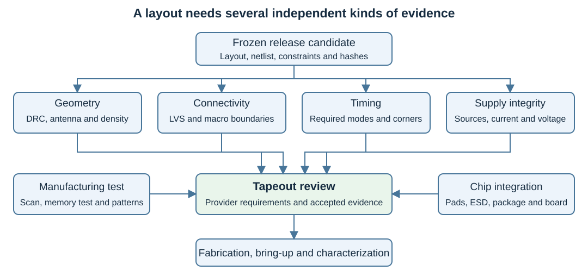
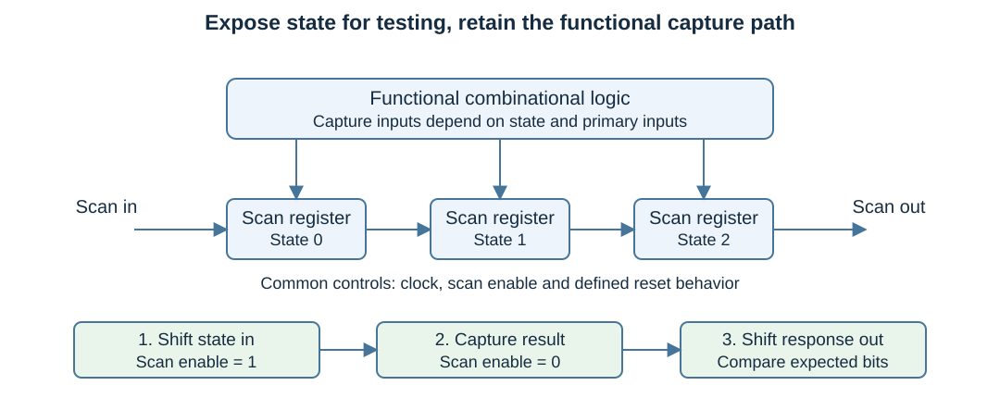

# Physical Validation, DFT and Preparation for Fabrication {#sec-physical-validation}

## Concepts

The OpenROAD and LibreLane chapters explain how a design acquires placement, clock distribution, routes and layout files. This chapter explains how to decide what those files demonstrate, how to make manufactured devices testable, and how to assemble a fabrication submission. The worked context is the same SystemVerilog accumulator, followed by the additional requirements of a Wally-based SoC.

The distinction between verification, silicon debugging and manufacturing test follows Weste and Harris, fourth edition, Chapter 15. Physical rules and manufacturing effects draw on Chapter 3; reliability on Chapter 7; pads, power distribution and packaging on Chapter 13; and design methodology on Chapter 14 [@westeCmosVlsi]. Current open-tool commands are taken from their own documentation. The examples below teach review and diagnosis; they do not assert that the repository's accumulator has passed a foundry-qualified tapeout flow.

### Four different questions about correctness

A design can fail at several boundaries. Functional verification asks whether its behavior satisfies the specification. Logical implementation checking asks whether synthesis and subsequent transformations preserve that behavior. Physical verification asks whether the layout has legal geometry and intended connectivity. Manufacturing test asks whether an individual fabricated device contains defects or fails electrical specifications.

| Activity | Object examined | Typical failure | What a pass does not establish |
| --- | --- | --- | --- |
| RTL simulation/assertions | Behavioral design under tested inputs | Wrong overflow, lost request, bad reset priority | Complete coverage or physical feasibility |
| Logical equivalence | Reference and transformed designs | Incorrect optimization or ECO | Manufacturing legality or operating frequency |
| STA | Constrained timing graph and parasitics | Setup, hold or electrical-limit violation | Protocol correctness or defect-free silicon |
| DRC | Layout geometry | Illegal width, spacing or enclosure | Correct connectivity and functionality |
| LVS | Extracted circuit versus reference | Open, short, missing or wrong device | Timing closure and full geometric legality |
| Manufacturing test | Each physical die | Stuck-at, delay, memory or interface defect | Exhaustive product validation |

Passing one row cannot substitute for the others. A booting RISC-V program proves a useful functional milestone but can leave an unexercised arithmetic fault undetected. A DRC-clean layout can implement the wrong netlist. A matching LVS result can describe a chip that fails hold or cannot be tested economically.

{#fig-asic-validation-evidence fig-alt="A release layout is checked for geometry, connectivity, timing and power, then reviewed with DFT, package and test information before fabrication and silicon bring-up"}

### DRC: manufacturing legality

Design-rule checking applies the technology's geometric constraints to the layout. Width and spacing checks are familiar starting points, but a usable deck also handles enclosure, via placement, well relationships and other requirements. The exact rule set depends on process options and the integration level. KLayout provides geometry-checking primitives and marker reports; the technology deck determines what is actually checked [@klayoutDrcGuide].

A violation report needs a rule identifier, cell or hierarchy context and coordinates. Diagnose a marker by opening the exact checked layout, locating the shapes and understanding the requirement. A minimum-spacing error can arise from routing, an incorrect macro obstruction, a mismatched library view or a stream-out layer mapping. The repair belongs in the source layout or implementation input that caused it.

Router DRC is valuable during detailed routing but usually works with the router's model and abstract views. Final layout checking sees the assembled GDS, including the detailed geometries of cells, macros and chip structures. Retain both sets of results and state their scope. A zero router violation count is not a claim that every manufacturing rule was tested.

### LVS: connectivity and devices

LVS extracts devices and connections from layout and compares them with a reference circuit. Depending on the flow and hierarchy, that comparison can use transistor-level extraction, recognized subcircuits or hierarchical macro models. Read the PDK's extraction and matching methodology before choosing the reference netlist [@klayoutLvsGuide].

An open disconnects an intended connection. A short connects nodes that should be distinct. Mismatches can also involve missing instances, device types, dimensions, pin order or power naming. Hierarchy and permitted equivalent device combinations affect how a checker matches circuits; they should be recorded rather than treated as arbitrary switches until the comparison passes.

Global power nets deserve particular attention. A cell's supply rails may exist in layout while the logical netlist omits explicit supply ports. The flow must apply the intended power connectivity consistently. Accidental aliases between supplies can conceal a real domain error. A black-boxed SRAM may allow a top-level match while leaving its internal circuit outside the checked boundary; document the macro's separate validation evidence.

### Extraction, antenna, density and electrical rules

Parasitic extraction produces the resistance and capacitance used to analyze the routed implementation. LVS extraction and RC extraction serve different purposes: a connectivity match does not imply that the timing parasitics were generated correctly. Record extraction corners, layer mappings and the relationship between the SPEF net names and the timing netlist.

During fabrication, a conductor can collect charge before its eventual final connections exist. An antenna rule limits the exposure of vulnerable gate structures. Repairs can involve a diode, a route change or a connection through another layer, depending on the PDK. Antenna is a manufacturing issue rather than a radio-frequency transmission problem. Recheck timing and connectivity after the repair.

Metal density rules support manufacturing steps such as planarization. Fill changes the neighborhood of signal wires and can affect parasitics. Follow the prescribed order of fill, extraction and final checks; do not assume timing computed on an earlier layout applies unchanged to a filled release layout. Where supported, XOR comparison helps detect discrepancies between independent stream-out results, but equal polygons do not prove that either result implements the right circuit.

Electrical-rule review adds checks that simple widths and spaces cannot express alone: supply connectivity, legal voltage-domain interfaces, floating wells, unsuitable device use and ESD relationships. The exact coverage depends on available decks. Mark unsupported checks as unresolved work instead of labelling them passed.

### Timing and power integrity as release evidence

The final STA report should identify analyzed clocks, modes, cell corners and RC corners. Review setup, hold, recovery/removal where applicable, clock-gating checks, transitions, capacitances and unconstrained paths. Apply justified exceptions to their intended endpoints only. A broad false path that removes a warning may remove a real design obligation.

Clock trees must be represented by propagated arrival times at the appropriate stage. Timing budgets need realistic input slews, loads, min/max interface delays and clock uncertainty. Treat macro interfaces as contracts shared by both sides. A core hardened with a 1 ns input delay cannot automatically tolerate a parent implementation that delivers its operand 4 ns late.

Power integrity adds an independent question: do cells receive adequate supply under the modelled load? Static IR-drop analysis is useful, but a static result does not establish dynamic droop, package resonance or lifetime reliability. OpenROAD's PDN analysis requires a placed design, power network and source/current assumptions [@openroadPowerIntegrity]. Record those assumptions with the result and evaluate any remaining package-level questions separately.

### Review reports, not only exit codes

Automation should parse the expected checker products and reject missing, incomplete or stale reports. Confirm that the selected top cell contains the expected instances and that checkers actually ran on the release files. An empty layout, a wrong top, an excluded macro or a stopped process can produce misleadingly small violation counts.

For every check, preserve the input hash, tool version, deck version, scope, status and report path. Use distinct statuses such as passed, failed, not run and not applicable. A waiver records a reviewed exception with its reason and the required acceptance authority. Waivers should not silently carry forward to a changed instance or layout.

### Link physical acceptance to the complete verification plan

The common hierarchy in @sec-verification-methodology makes this chapter's reports downstream evidence for identified requirements. Preserve the upstream functional/equivalence claims and explicitly mark any missing technology checks. Keep functional coverage, structural coverage and manufacturing fault coverage separate, with their models and denominators. Scan ordering alone is not ATPG effectiveness, first-silicon boot is not production screening, and router DRC is not the entire qualified layout rule set. Release review combines the applicable results and scoped waivers rather than replacing them with a single flow exit code.


## Implementation

### Build a validation record for the accumulator

Begin with the tested implementation RTL in `labs/07-implementation/rtl/accumulator.sv`. Run the automatic synthesis lab, then the guided physical flow. Keep the synthesis-only result separate from the routed result. The supplied container does not include the complete PDK-dependent validation stack; use the additional environment described in @sec-reproducible-labs.

Create a release-candidate directory containing a manifest and references to the exact layout, netlist, SDC, extracted parasitics, resolved configuration and reports. Freeze one candidate before checking it. Changing the GDS after DRC, or the netlist after LVS, invalidates the corresponding evidence until the checks are repeated.

| Check | Inputs to identify | Acceptance evidence |
| --- | --- | --- |
| Functional regression | RTL revision and tests | Correct results under the defined interface contract |
| Netlist correspondence | Reference and implemented netlists | Supported equivalence result or explicitly bounded checks |
| Final STA | Timing netlist, libraries, SDC and parasitics | Required corner/mode coverage and reviewed violations |
| DRC/antenna/density | Final GDS, top and rule decks | Complete checker summaries and marker databases |
| LVS | Final layout extraction and compatible reference | Matching result with stated hierarchical exclusions |
| Power integrity | PDN, sources and load assumptions | Reviewed connectivity, voltage drop and current evidence |

When using LibreLane, find these products in its run states, logs and reports rather than guessing an old output pathname. The Classic flow includes several physical checks, but its exact supported checks and configuration are release- and PDK-dependent [@librelaneClassic]. Installing another checker does not automatically make its deck approved for fabrication.

### Diagnose a physical failure

Use the earliest invalid stage to narrow the cause. For an LVS open on a supply, inspect whether the PDN was connected to cell pins and whether stream-out preserved the relevant layers. For an unexpected transistor mismatch, compare cell GDS, extracted device models and the netlist library revision. For a setup failure, correlate the path report with its cells and routes.

Make a controlled correction and rerun affected stages. A changed clock period affects STA and implementation objectives. A changed route affects parasitics and physical checks. A scan transformation changes the netlist, placement needs, test modes and possibly the clock structure. Record these dependencies rather than copying an earlier passing summary into a new candidate.

### DFT starts with controllability and observability

A manufacturing defect can be detected only if a test excites it and observes its effect. Controllability describes the ability to establish the required internal conditions; observability describes the ability to see the resulting difference. Deep state and inaccessible buses can make both difficult. DFT adds structures that expose state or stimulate otherwise hard-to-reach circuitry [@westeCmosVlsi, Sections 15.5–15.6].

Stuck-at faults model a node permanently at zero or one. Transition faults model a slow rise or fall. Bridging faults model unintended connections, and memory tests use models such as stuck cells, transition failures and coupling faults. These are abstractions used to design tests, not exhaustive descriptions of every physical defect.

Fault coverage is the fraction of faults detected under a defined model and classification. It differs from statement coverage, instruction coverage and passing application tests. Record detected, untestable and unresolved faults with the denominator convention. A reported percentage without its model, exclusions and pattern constraints cannot be interpreted reliably.

### Scan shift and capture

A scan register selects between functional data and serial test data. With scan enabled, registers form one or more shift chains. A test loads an internal state, switches to functional capture to exercise logic, and shifts the resulting state out. Scan makes a sequential block easier to test by exposing its state boundary.

{#fig-scan-shift-capture fig-alt="Three scan registers form a serial chain in shift mode and capture combinational results in functional mode; a test sequence loads state, captures and unloads the response"}

The following small model demonstrates serial ordering. It is not a replacement for a characterized scan cell or automatic DFT insertion. A four-bit chain enters through bit zero and exits through bit three. Functional reset affects capture; scan shift has priority so state can still be loaded during the teaching experiment.

```systemverilog
module scan_state_demo (
    input  logic       Clk,
    input  logic       Reset,
    input  logic       ScanEnable,
    input  logic       ScanIn,
    input  logic [3:0] FunctionalD,
    output logic [3:0] Q,
    output logic       ScanOut
);
  assign ScanOut = Q[3];
  always_ff @(posedge Clk) begin
    if (ScanEnable) Q <= {Q[2:0], ScanIn};
    else if (Reset) Q <= '0;
    else Q <= FunctionalD;
  end
endmodule
```

To load `Q=4'b1010`, apply serial bits 1, 0, 1, 0 on four rising edges. For a capture demonstration, present `FunctionalD=Q ^ 4'b0110`, disable scan for one edge, and expect `Q=4'b1100`. Before each of the next four shift edges, observe `ScanOut`; the expected sequence is 1, 1, 0, 0 when shifting zeros in. Sampling after an edge would observe the next chain state and shift the comparison by one bit.

Actual scan cells can differ in reset behavior, polarity and test controls. The implementation flow must use supported cells and DFT rules, then verify the resulting chains and functional mode. The pedagogical model illustrates the protocol without claiming the manufacturing properties of a library cell.

### Scan architecture for a SoC

For $N$ registers divided evenly across $K$ chains, the longest shift length is approximately $\lceil N/K\rceil$. With $P$ patterns, an idealized load/unload overlap gives a shift cost around $P\lceil N/K\rceil$ clocks, plus initial loading, final unloading and captures. Pin limits, chain imbalance and tester protocol change the actual duration.

More chains reduce shift time but require access resources or compression logic. Separate clock domains and edge types need a deliberate chain policy; lockup elements may be required to avoid shift hold problems between portions of a chain. Reset, gated clocks and power islands must be controllable in test mode. Capturing at functional speed also requires the intended launch/capture clock procedure.

Scan increases area and can change setup/hold behavior. The scan-enable network and shift activity consume power. Unrestricted simultaneous switching can exceed the functional power budget, so test patterns and clock rates need power-aware constraints. Do not assume the functional SDC also correctly constrains scan shift and at-speed capture.

### OpenROAD scan insertion as a guided extension

The OpenROAD DFT module supports scan-cell replacement and chain planning/stitching. Consult the installed version and verify that the library contains usable scan equivalents. The documented sequence puts replacement before placement and chain planning after placement [@openroadDft]. The following is a stage-order template for an already loaded design:

```tcl
set_dft_config -max_length 32 -clock_mixing no_mix
report_dft_config
scan_replace

# Run the technology-specific placement stages here.

report_dft_plan -verbose
execute_dft_plan
# Continue the documented physical flow and revalidate all modes.
```

The template omits platform setup, placement and verification. It is not a complete runnable hardening script. Review tool limitations and generated chain information, simulate shift/capture, and run test-mode timing. Scan insertion alone does not provide ATPG, a measured fault-coverage result or a complete production-test solution. Likewise, do not assume LibreLane's default flow inserts scan unless that specific configuration documents it.

### ATPG and fault simulation

ATPG seeks input and scan-state patterns that activate a target fault and propagate its effect to an observable output or scan register. Fault simulation then evaluates which modelled faults the selected patterns detect. The two tasks are complementary: generated patterns still need evaluation under the actual constraints and cell behavior.

Unknown values complicate both. Uninitialized SRAM outputs, analog interfaces or intentionally unconstrained state can mask scan responses. Methods such as X masking improve testability but can also reduce detection, so exclusions and coverage consequences must be explicit. False functional constraints can make real faults appear untestable.

For the accumulator, select an internal sum bit stuck at zero. Load a state and operand combination whose correct update produces a one at that bit, capture, and observe the response. A functional test may already detect it, but scan can avoid a long sequence to establish state. A different fault, such as a slow carry path, requires an appropriate timing test rather than only a static value comparison.

At-speed testing must distinguish launch-on-capture and other supported procedures, define the clock source and ensure test switching remains feasible. These are manufacturing-test design choices. The coursework can demonstrate fault activation in a small model; a production result needs the selected ATPG/fault simulator and qualified methodology.

### Memory BIST and repair

Large SRAMs are not efficiently tested by scanning every storage bit. MBIST drives addresses, writes patterns, reads expected values and reports discrepancies through a dedicated controller or test port. March algorithms organize reads and writes in increasing/decreasing address order to target defined memory-fault models.

For a teaching SRAM, a March C-minus style sequence is

$$
\{\updownarrow(w0);\ \uparrow(r0,w1);\ \uparrow(r1,w0);\
\downarrow(r0,w1);\ \downarrow(r1,w0);\ \updownarrow(r0)\}.
$$

Each parenthesized set executes at every address in the indicated direction. `r0` means read and compare with zero; `w1` means write one. For a word memory, specify backgrounds and intra-word coverage: using all-zero/all-one words alone is not a comprehensive test for every coupling mechanism. Multi-port memories add port interaction and collision cases.

A BIST controller must honor actual memory latency and masks and exclude concurrent functional accesses while it owns the port. Preserve a failure flag, failing address and expected/observed data as appropriate. ECC can detect or correct operational errors but does not replace a defined manufacturing-test plan. Spare rows/columns and repair require macro support and a way to persist repair information.

In Wally, MBIST integration concerns cache data/tag arrays, tightly integrated memories and any instantiated SRAM macros. Keep cache contents invalid until testing and initialization policy are complete. Provide a management path that remains usable even if the processor cannot boot because one of those memories is defective.

### Boundary scan, RISC-V debug and security

Boundary scan controls and observes chip I/O to help test package and board connections. Internal scan exposes logic state; RISC-V debug controls architectural execution and accesses registers or memory through its specified mechanisms. They can share transport infrastructure in a designed system, but implementing a JTAG Debug Transport Module does not automatically implement boundary scan or internal manufacturing scan.

For a Wally-based SoC, define which test modes are available at reset, how they are selected and which pins or controller provide access. Include clock bypass, reset control, SRAM test and readable identification where needed. An internal PLL or boot failure should not eliminate every means of observing the device.

Production access policy also matters. Scan can expose secrets and bypass ordinary privilege checks. Decide how development, manufacturing and deployed states control test/debug access, how locks are verified, and whether disabling a path affects serviceability. Link this review to the lifecycle discussion in @sec-riscv-debug; do not treat a test-mode pin as an undocumented back door.

### Pads, ESD and package integration

A hardened accumulator is a macro with signal pins, not a complete packaged chip. Top-level integration needs appropriate I/O and supply cells, ESD protection, legal supply-domain relationships and a pad/bump plan. A standard-cell output must not be connected directly to an external pad as though it were a board-rated driver.

I/O cells specify voltage tolerance, direction, output strength and other operating limits. Inputs also need a defined behavior during reset, power sequencing and partial power-off where applicable. Pull devices and termination choices affect external behavior. Use a provider-approved harness or pad library when required rather than inventing an ESD network.

Package parasitics influence signal timing and supply stability. Bond wires, bumps, substrate routes and pins add resistance, capacitance and inductance. Pad placement and board pinout should therefore be planned before final floorplanning. Heat removal and mechanical/package constraints belong to the same system plan [@westeCmosVlsi, Chapter 13].

For a small educational SoC, start with an external clock and accessible reset, a console or status interface, and a deterministic internal-memory boot. An optional PLL and external DRAM add valuable capability but also new ways for the first prototype to remain silent. Preserve a simpler test path to separate processor correctness from clock-generation and memory-interface bring-up.

### Tapeout manifest and review

Tapeout freezes the files accepted for mask preparation. The provider defines the exact requirements, process option, decks, integration harness and deliverable formats. Open PDK availability and an MPW announcement do not themselves establish current eligibility or fabrication acceptance. Obtain the applicable submission rules for the selected programme [@skywaterPdkDocs].

The following is a suggested evidence layout, not a universal foundry specification:

```text
release-candidate/
  manifest.json
  design/             # final layout and netlists
  constraints/        # functional and test-mode budgets
  reports/            # STA, DRC, LVS, antenna, density, PDN, DFT
  integration/        # pad/package mapping and macro inventory
  test/               # patterns, protocol and bring-up instructions
  checksums.sha256
```

The manifest records design/top identity, RTL revision, tool and PDK versions, library and macro revisions, required corners/modes, source provenance and check status. It also identifies licenses and redistribution restrictions for included IP. Test patterns and firmware must correspond to the same netlist and register map as the chip.

A review should ask whether the assembled top has been checked, whether any macro was excluded, whether the required operating conditions are covered, and whether known exceptions have an explicit disposition. Keep unresolved items visible. The acceptance of a waiver belongs to the project's and provider's process, not to a script that marks a report line ignored.

### Silicon bring-up and characterization

Before packaged devices arrive, prepare the board, power budget, pinout, clock source, programming/debug path and known-good test firmware. Validate what can be validated with an FPGA or mock target. Plan measurement access to supplies and critical signals and identify safe reset states.

On the first device, inspect power connections and package orientation, then use a controlled current-limited startup. Establish supply and reset behavior, a conservative external clock, identification/test access, memory tests and a minimal observable action. Increase complexity through ROM execution, internal RAM, interrupts, peripherals and finally representative workloads.

If the chip is silent, separate power, clock, reset, pad mapping, boot address and memory issues. A readable scan chain or identification register can provide evidence before normal firmware works. Compare observations with simulation at the same boundary rather than assuming that every startup failure is a processor instruction bug.

Characterization sweeps voltage, frequency and temperature within permitted conditions and records the resulting pass/fail boundary. A shmoo plot can reveal trends and marginal regions. Production limits still require the chosen reliability and test criteria; one fast sample at room temperature is not a guaranteed specification for all devices.

Archive die/package identity, board revision, instrument settings, firmware hash, measurements and errata. Physical results complete the learning cycle: use them to update constraints, models and the next design revision. Fabrication is a beginning for validation of real devices, not the final line of an implementation log.

## Hands-on Experiments

### Experiment 1: a validation dossier

Use one guided accumulator physical run and assemble the check table above. Include the top identity and file hashes. Mark a missing check as not run. Select one actual marker or failing path, document its cause, repair its input and show the new result. Deliver both candidates so the change is reviewable.

### Experiment 2: verify scan ordering

Simulate `scan_state_demo` with the load/capture/unload sequence. Add tests for reset, consecutive captures and changing scan mode only while the clock is inactive. Inject a stuck-at response bit in a separate faulty model and show which pattern detects it. This verifies a teaching protocol and fault example; it is not an ATPG coverage certificate.

### Experiment 3: evaluate a scan-enabled physical variant

If the installed OpenROAD/library combination supports the required cells, use the documented insertion sequence on a separate accumulator variant. Record chain lengths, test ports, added area and both functional/test timing. Compare with the baseline. If scan replacement is unsupported, report the missing cell or tool capability and retain the architectural plan.

### Experiment 4: memory-test ownership

Implement a small controller for the March sequence over the synchronous teaching memory. Include expected read latency and prohibit simultaneous functional ownership. In a separate memory model, inject one stuck cell and one transition failure. Record detection and failing address, then explain which additional backgrounds or fault models remain untested.

### Experiment 5: prepare a Wally prototype review

Choose a single-hart, internal-memory Wally configuration. Draft a pad/clock/reset plan, identify test access independent of firmware, inventory memories and macros, and prepare a first-power-on sequence. Connect each review item to evidence or missing work. An excellent report can expose an unresolved dependency; it should not hide it behind a generated GDS filename.

<!-- chapter-review:physical-validation-dft-tapeout -->

## Key ideas {#review-physical-validation-dft-tapeout-ideas .unnumbered .unlisted}

- Physical, structural-test and manufacturing evidence answer different questions.
- Release quality depends on consistent views, checked reports and explicit waivers.

## What you should now be able to explain {#review-physical-validation-dft-tapeout-explain .unnumbered .unlisted}

Explain the distinction between DRC/LVS, timing closure, test coverage and production screening.

## Common mistakes {#review-physical-validation-dft-tapeout-mistakes .unnumbered .unlisted}

Calling scan insertion ATPG effectiveness; treating routed layout or first boot as complete manufacturing qualification.

## Try it yourself {#review-physical-validation-dft-tapeout-try .unnumbered .unlisted}

Use the existing release checklist to classify one missing view/report. State which claim it prevents you from making.

## Where this appears in Wally {#review-physical-validation-dft-tapeout-wally .unnumbered .unlisted}

::: {.callout-note title="Wally Connection" icon=false}
The logical core boundary in [src/wally/wallypipelinedcore.sv](https://github.com/antoniofloresgil/cvw/blob/3b30ba6b6519bd2c26c1437e6d61f632a35cef6c/src/wally/wallypipelinedcore.sv) is only a starting point. Wally-specific DFT, macro views and qualified physical signoff are separate integration deliverables.
:::

## Further reading {#review-physical-validation-dft-tapeout-reading .unnumbered .unlisted}

Revisit @sec-hardware-security and @sec-final-review. Follow the chapter sources [@westeCmosVlsi; @klayoutDrcGuide].
