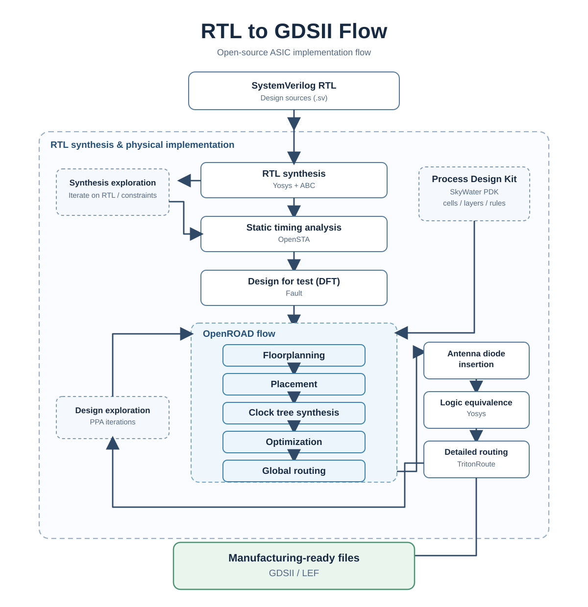

# From SystemVerilog RTL to GDSII {#sec-rtl-gdsii}

## Concepts

The circuit and technology foundations for this flow are developed in @sec-vlsi-design. After the implementation chapters, @sec-physical-validation explains the evidence required for physical validation, manufacturing test and preparation for fabrication.

An ASIC flow translates a verified hardware description into the geometric layers from which a foundry makes masks and wafers. The source is ordinary **SystemVerilog RTL**: modules, parameters, clock/reset contracts, assertions and a top-level interface. Unlike an FPGA implementation, it must be mapped to the transistors and interconnect layers of one specific manufacturing process.

{fig-alt="Flow from SystemVerilog RTL and the PDK to LibreLane, OpenROAD, physical verification and GDSII"}

The process design kit (PDK) is the contract between the designer and the foundry. It supplies design rules, layer definitions, transistor and parasitic models, standard-cell libraries, I/O cells, and technology views for each tool. Digital flows consume the same technology through several representations: Liberty (`.lib`) for timing and power, LEF for abstract physical geometry, Verilog models for simulation, and GDSII for the actual cell layouts. Constraints in SDC specify the clocks and the I/O timing environment; without credible constraints, a timing result has no engineering meaning.

The final GDSII is necessary but is not itself proof that a chip is ready. The tapeout decision also needs clean physical-verification results, a reviewed timing and power budget, the required package and pad-ring integration, and the foundry's current submission requirements. A successful run is therefore a reproducible evidence package rather than a single layout file.

| Stage | Main question | Typical result |
| --- | --- | --- |
| RTL and constraints | Does the intended synchronous design behave correctly? | SystemVerilog, tests and SDC |
| Logic synthesis | Which standard cells implement that RTL? | Gate-level netlist and early timing estimate |
| Floorplanning and PDN | Where do the die, I/O, macros and power network go? | Die/core area and power grid |
| Placement and CTS | Can cells and clocks meet the physical objectives? | Placed database and clock tree |
| Routing and extraction | Can all nets be connected with real wires and vias? | Routed DEF/GDS and SPEF parasitics |
| Sign-off | Is the result legal and electrically consistent? | DRC/LVS/antenna, STA and reports |

## The open ASIC stack

LibreLane provides the current orchestration layer: configuration, reproducible tool invocations, intermediate databases and reports. It joins tools such as Yosys for synthesis, OpenSTA for timing, OpenROAD for physical implementation, and Magic, KLayout or Netgen for physical checks. OpenROAD is the engine responsible for floorplanning, placement, clock-tree synthesis and routing. OpenLane is the earlier flow from which the ecosystem evolved; use LibreLane for a new workflow and consult its current documentation for its supported tools and configuration format.

Every stage has feedback. A slow path found after routing may require a different synthesis strategy, a less aggressive clock, pipeline changes in RTL, or a larger core area. Congestion may require new macro locations or a different floorplan. The correct response is to modify a controlled input, rerun the flow, and compare reports; editing the final layout by hand breaks reproducibility.

### Why SKY130 changed access to ASIC design

For decades, foundry PDKs were normally available only under a non-disclosure agreement. Google and SkyWater released the SKY130 process design kit as an open-source project under Apache 2.0. It includes documentation, rules, models and multiple digital standard-cell libraries for SkyWater's 130 nm process [@skywaterPdk]. This made it possible to distribute a complete design flow and let students, researchers and open-hardware projects inspect and reproduce the technology collateral.

Google also funded an open-source multi-project-wafer (MPW) initiative with SkyWater and Efabless. The original programme selected fully open designs for sponsored shared-wafer fabrication; the first announced shuttle carried 40 community designs [@googleSkywaterMpw]. That historical programme made the route from open RTL to manufactured silicon concrete, but it must not be confused with a permanent entitlement to free fabrication. Availability, eligibility, schedule, supported process and costs are programme-specific and change over time.

Fabrication remains accessible through commercial or institutional routes. In an MPW shuttle, several designs share a wafer and mask cost, making prototypes much cheaper than a dedicated run. SkyWater publishes MPW services and asks prospective customers to discuss the project and current schedule before submitting a design [@skywaterMpw]. A designer must obtain the current foundry or shuttle requirements, complete their pre-checks, deliver the requested GDSII and collateral, then plan packaging, board bring-up and silicon test. The public SKY130 PDK supports learning and prototyping; it does not replace a fabrication agreement or the foundry's acceptance review.

### Verification gates between representations

Use the hierarchy and evidence plan in @sec-verification-methodology alongside the process flow. Identify the RTL reference before synthesis, require an explicit equivalence result when claiming behavioral preservation, and repeat affected checks after scan insertion or ECOs. At physical release, require current geometry/connectivity, extraction, timing and electrical evidence tied to the checked layout/netlist/views. Stream-out success and a GDS file are deliverables, not a complete release argument. Manufacturing test and silicon characterization have separate plans and acceptance criteria.

## Implementation

### Inputs and reproducibility

Freeze a named revision of the RTL, tests, constraints, LibreLane configuration, container/tool version and PDK/library version. Record the top module, the clock period, uncertainty, I/O delays, core utilization, target standard-cell library, macro locations and power nets. These inputs define the implementation as much as the SystemVerilog source does.

Start by running lint, elaboration, simulation and, where available, formal checks. Synthesis cannot repair a protocol error or an unconstrained clock crossing. For each run, retain the input configuration and reports so that a regression can be traced to a particular RTL, PDK or tool change.

### Logical implementation

Synthesis elaborates parameters and generates, optimizes Boolean logic, and maps it to cells available in the selected Liberty library. Static timing analysis first uses estimated interconnect delays. Check that the inferred sequential elements, clock domains and reset behavior match the RTL intent before continuing. Equivalence checking, if available, compares the synthesized netlist against the RTL under the stated assumptions.

Design-for-test may add scan structures, test points or test constraints. Treat it as an architectural requirement: it changes the netlist, clocks and verification plan. The exact DFT support depends on the flow and PDK, so a design targeting fabrication needs a review of its required test strategy before tapeout.

### Physical implementation with OpenROAD

Floorplanning selects the die and core dimensions, places fixed macros and I/O, reserves routing channels, and creates the power distribution network (PDN). The PDN needs explicit power and ground connections and sufficient metal width and vias for expected current; it cannot be left as an afterthought.

Placement assigns standard cells to legal rows, followed by optimization for timing, congestion and power. Clock-tree synthesis then builds buffered clock networks to control skew and insertion delay. Global routing estimates routes and congestion; detailed routing chooses the actual tracks, wires and vias allowed by the PDK. Parasitic extraction turns those wires into resistance and capacitance used for post-route timing and power analysis.

At this point, inspect more than a single worst slack number. Review unconstrained paths, setup and hold separately, transition and capacitance violations, congestion hot spots, antenna issues, IR-drop assumptions, and the reports for every clock and operating corner that the flow supports.

### Verification and handoff

Design-rule checking (DRC) verifies the geometry against manufacturing rules. Layout-versus-schematic (LVS) verifies that extracted connectivity matches the intended netlist. Antenna checks find nets that could damage gate oxide during manufacturing; the flow may insert diodes or require a routing change. These checks are distinct from functional simulation and all are necessary.

The handoff package normally contains the final GDSII, netlist, constraints, reports, checksums, PDK and tool versions, pad-ring and package information, and any waivers with their rationale. A foundry may apply additional proprietary checks before accepting a tapeout. Never claim fabrication readiness merely because a local flow reached a GDSII output.

## Hands-on Experiments

### Experiment: harden a small SystemVerilog block

Choose a synchronous block already covered by tests, such as the accumulator used in the Verilator chapter. Give it one explicit clock, one reset convention and registered outputs. Create a LibreLane configuration that names the top module and the RTL sources, chooses a supported PDK/library, sets a deliberately conservative clock period, and supplies realistic input/output timing assumptions.

Run the flow and keep its run directory outside version control. Then answer the following from the reports:

1. Which cell library and PDK version were used?
2. What are the core dimensions, utilization and number of placed cells?
3. Does each clock have a defined period and are there unconstrained paths?
4. Are setup and hold checks clean after routing? If not, identify the endpoint and the physical cause.
5. Are DRC, LVS and antenna reports clean, or is each waiver documented?

Repeat after changing only the clock period or the target utilization. Compare area, worst slack, total negative slack and congestion. This small controlled experiment demonstrates the central lesson of physical design: architectural choices and physical results constrain one another.

### From GDSII to silicon

For a real shuttle submission, begin with the currently published rules, schedule and pre-check process of the chosen provider. Verify licensing for all included IP, especially SRAM macros, pad cells and third-party RTL. Integrate the provider's required top-level harness and pad ring, run the prescribed pre-checks in a clean environment, and submit only the exact deliverables requested for that shuttle.

After acceptance, the work continues: package selection, test board, firmware, measurement plan, production test and a plan for errata. Fabrication validates the physical implementation; it does not validate the product requirements. Keeping RTL, testbenches, flow inputs and silicon measurements together makes that learning cycle useful for the next revision.
