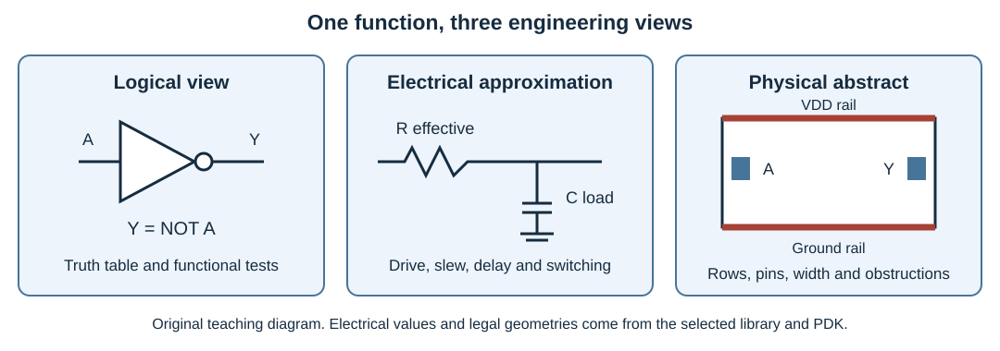

# Digital VLSI Design Fundamentals {#sec-vlsi-design}

## Concepts

An RTL description specifies state and transformations. A silicon implementation must realize them using transistors, wires, supplies and clocks that have finite resistance, capacitance and manufacturing variation. This chapter connects the microarchitectural choices made earlier in the book to those physical costs. It prepares the reader to interpret the OpenROAD and LibreLane experiments, rather than merely execute their commands.

The circuit background follows Weste and Harris, *CMOS VLSI Design: A Circuits and Systems Perspective*, fourth edition: Chapters 1–7 for CMOS, fabrication, delay, power, interconnect and robustness; Chapters 10–12 for sequential circuits, datapaths and memories; and Chapter 13 for power distribution and clocks [@westeCmosVlsi]. The examples and diagrams here are original teaching material. Technology-specific numbers must come from the selected PDK and characterized libraries, not from a historical process example in a textbook.

After studying the chapter, a student should be able to explain why a larger cell can make a path faster or slower, estimate simple RC and switching costs, read a cell's logical and physical views, distinguish cell area from die area, and propose a physical experiment with credible timing and power assumptions.

### From a transistor to a standard-cell design

A MOS transistor has gate, source, drain and body terminals. The gate voltage controls a conducting channel between source and drain. In a simple digital model, an nMOS device conducts when its gate is sufficiently above its source; a pMOS device conducts when its gate is sufficiently below its source. These are useful switch abstractions, but the on state has resistance and the off state has leakage. Gate and diffusion terminals also contribute capacitance.

A CMOS inverter combines a pMOS pull-up from the output to the positive supply and an nMOS pull-down from the output to ground. Both gates receive the input. A low input enables the pull-up; a high input enables the pull-down. In either stable logical state, the idealized circuit has no conducting path through both devices from supply to ground. Real circuits still dissipate leakage, and during a transition both devices can briefly conduct.

The output transition takes time because the conducting device must charge or discharge the output capacitance. Consequently, an inverter driving one small nearby gate and an inverter driving a long bus do not have the same delay, even though both implement exactly the same Boolean function.

{#fig-vlsi-cell-abstractions fig-alt="Three views of an inverter: logical inversion, a resistive driver with a capacitive load, and a standard cell with physical pins and supply rails"}

Static complementary gates generalize this arrangement. A two-input NAND has series nMOS devices in its pull-down network and parallel pMOS devices in its pull-up network. A NOR exchanges the series and parallel roles. Series devices increase effective resistance and introduce internal nodes. Therefore, two functions with similar Boolean complexity need not have identical rise/fall delays or cell sizes. Compound AOI/OAI gates can implement a useful logic expression with fewer stages than a decomposition into elementary gates, but their input arcs can have different delays.

For a standard-cell ASIC, the RTL designer normally does not choose individual transistor dimensions. Library designers characterize legal cells, and synthesis chooses among their functions and sizes. Full-custom design is appropriate for structures requiring specific electrical optimization, such as SRAM bit cells, sense amplifiers or analog circuits. The open digital flow in this book primarily uses standard cells and predesigned macros.

### Fabrication layers and layout rules

An integrated circuit is built through patterned processing steps. Device regions, wells, gate structures, contacts, metal layers and vias each have a manufacturing role. Lithography transfers patterns; deposition, etching, implantation and other steps create the structures. The digital designer encounters these steps through the PDK's layer map, legal device models and layout rules.

Lower metal layers generally serve local connections; higher layers can provide longer connections and power distribution. The exact resistance, thickness, pitch and allowed direction depend on the process. A via is a manufactured connection between layers, with its own resistance and enclosure rules. Repeated vias or a wider wire may improve current capacity but consume space and affect routing.

Design rules specify minimum widths, separations, enclosures, overlaps and other geometry constraints. Additional rules concern density, antenna exposure, wells and chip boundaries. A drawing can be electrically understandable yet impossible to manufacture reliably. Conversely, legal shapes can implement the wrong circuit. The distinction between geometric legality and connectivity motivates the separate DRC and LVS checks in @sec-physical-validation.

Do not transfer scalable textbook layout rules directly into SKY130. Use the actual PDK rules and approved cell views. The open SKY130 documentation is useful for inspecting the layer stack and manufacturing constraints, but its stated status and limitations must also be read [@skywaterPdkDocs].

### Resistance, capacitance and delay

For a first estimate, replace an enabled transistor network with an effective resistance and collect the capacitance it drives. A single lumped RC circuit reaches half its final value after approximately

$$
t_{50}\approx 0.69R_{\mathrm{eq}}C_L.
$$

This is a first-order step-response estimate, not a general gate-delay formula. Real transistor resistance is voltage dependent, the input transition is finite, and internal capacitances contribute. Cell characterization captures these effects more accurately. The approximation is nevertheless useful for explaining the direction of a change.

Suppose an illustrative driver has $R_{\mathrm{eq}}=2\,\mathrm{k\Omega}$ and drives $C_L=30\,\mathrm{fF}$. The estimate is $41.4\,\mathrm{ps}$. Adding another $30\,\mathrm{fF}$ approximately doubles the RC contribution. These are invented teaching values, not SKY130 measurements. A result from the actual technology must identify the cell, corner, input slew and output load.

The load contains receiver input capacitances, wire capacitance and any other connected terminals. Gate fanout as a count is only a proxy: ten tiny inputs can present less load than two large ones. A high-fanout reset, enable or cache-way select also has spatially distributed destinations, so both capacitance and route length matter.

Increasing transistor width usually lowers effective on resistance while increasing input and diffusion capacitance. Upsizing the final driver can improve its own output delay while loading the preceding stage more heavily. Timing repair must assess the whole path. Selecting the largest available drive strength everywhere increases area, power and routing demand and can make upstream stages slower.

### Logical effort and FO4

Logical effort provides a compact reasoning model for circuit topology and sizing [@westeCmosVlsi, Chapter 4]. In normalized units, a stage delay is approximated by

$$
d=gh+p,\qquad h=\frac{C_{\mathrm{out}}}{C_{\mathrm{in}}},
$$

where $g$ is logical effort, $h$ is electrical effort and $p$ is parasitic delay. An inverter is the reference with $g=1$. A gate implementing a more difficult function can require more input capacitance to provide comparable output drive.

For a path, let $G$ be the product of logical efforts, $B$ the product of branching efforts and $H$ the overall output-to-input capacitance ratio. Path effort is $F=GBH$. For $N$ stages, distributing effort approximately equally gives a stage effort of $F^{1/N}$. A common initial design heuristic is a stage effort around three to four; the best choice depends on parasitics, polarity, discrete cell sizes and wires.

Consider an inverter path with $H=64$ and no branching. One stage has electrical effort 64. Three stages sized with capacitance ratios 4, 4 and 4 divide that load more evenly. Four stages reduce each ratio to about 2.83 but add another stage's parasitic delay. The optimum is not obtained simply by maximizing the number of buffers. Also check the required logical polarity: an odd number of inverters changes the function.

FO4 denotes an inverter driving four equivalent inverter inputs. It is a useful reference delay for comparing logic depth within a characterized environment. Expressing a path in FO4 units does not remove wiring, slew, supply or process effects, and it is not a direct conversion from an FPGA timing result to ASIC frequency. Use it to reason about architecture, then use characterized STA to verify the implementation.

### Wires are part of the architecture

A uniform wire has resistance approximately proportional to length and inversely proportional to cross-sectional area. Its capacitance depends on geometry and neighboring conductors. If both resistance and capacitance grow with length, an unbuffered distributed wire's delay can grow approximately with the square of its length.

For an RC tree, an Elmore first-moment estimate sums each resistance multiplied by the capacitance downstream of it. For a driver resistance $R_d$, a uniform wire with total resistance $R_w$ and capacitance $C_w$, and a load $C_L$, a useful simplified time constant is

$$
\tau_E\approx R_d(C_w+C_L)+R_w\left(\frac{C_w}{2}+C_L\right).
$$

This quantity is a time constant estimate; interpreting it as a threshold-crossing delay requires an approximation to the waveform. RC extraction and the timer replace this hand model for actual implementation decisions. A broad branched net or a coupling-dominated route needs more detail than this expression.

Repeaters divide a long connection into shorter electrical segments. They add cell delay, capacitance, area and switching power, but can reduce the otherwise large distributed-wire delay. Layer selection, spacing and route topology are additional choices. Coupling capacitance can change effective delay depending on whether neighboring signals switch in the same or opposite direction, and can inject noise on a quiet victim [@westeCmosVlsi, Chapter 6].

These effects explain why locality matters in Wally. A global bypass network, wide register-file output, cache-way mux or distributed CSR control can be expensive even if its RTL expression is short. Duplicating a small decode function near its consumers can be preferable to transporting a global control signal. Such a change must preserve behavior and be evaluated after physical implementation, because synthesis cell count alone cannot establish the benefit.

### Standard-cell views and Liberty tables

A library cell has several complementary views. Liberty describes its function, timing arcs, pin capacitances, power and operating limits. LEF describes its placement outline, pins and obstructions. GDSII contains detailed layout. Functional Verilog supports logical simulation, and transistor-level netlists support circuit analysis or physical verification. All views must refer to the same cell and compatible library revision.

A standard cell normally has a legal row height, a width that aligns with the placement site, and supply rails that connect through the row structure. Tap and endcap cells support well ties and legal row boundaries. Tie cells supply constant logic using an approved implementation. Filler cells maintain required row continuity; decoupling cells add local capacitance. They have physical purposes even though they do not implement an RTL arithmetic operation.

In a nonlinear Liberty timing model, delay and output transition are commonly tabulated against input slew and output load. Rise and fall are characterized separately. A NAND input pin can have different timing from another input of the same cell, especially when internal transistor ordering affects the discharge path. Sequential cells additionally have clock-to-Q, setup, hold and other checks.

When reading a cell report, answer four questions: which transition and arc are being analyzed, which input slew and output load are used, which operating corner supplies the table, and whether those values are inside its characterized range. A library timing value without that context is not the delay of the cell in every possible circuit.

### Sequential cells, reset and clock distribution

An edge-triggered register is a circuit with a sampling aperture and internal storage, not an instantaneous mathematical assignment. Its setup, hold, clock-to-Q and clock-pin capacitance influence the pipeline. Adding a stage shortens combinational work but adds register delay, clock load, power and control complexity. See @sec-clocking-timing for the synchronous timing contract.

Reset style affects available cells and routing. An asynchronous reset pin has recovery/removal requirements and may require a different cell from a plain D flip-flop. A synchronous reset may become input logic or a specialized cell. Register enables can similarly become muxes or enable cells. Initialization used by an FPGA is not automatically a physical ASIC reset mechanism.

CTS distributes the clock through legal buffers and routes. It trades insertion delay, skew, transition, area and power. Treat clock and data arrival times together: changing capture-clock arrival can help setup and hurt hold. A short register-to-register path can fail hold even when the clock period is very generous. Reducing frequency does not generally repair a same-edge hold failure.

For a RISC-V SoC, clocks, resets and test controls also cross subsystem boundaries. Physical placement cannot turn an unsafe multi-bit crossing into a valid CDC protocol. Synchronizers, asynchronous FIFOs and reset-domain handling remain architectural obligations before layout, followed by structural and timing review after implementation.

### PVT, RC corners and operating modes

Manufactured devices differ from nominal models. Voltage and temperature change delay and leakage; metal variation changes route resistance and capacitance. A corner defines a modelled combination of these conditions. A mode defines behavior and constraints, such as functional operation or scan shift. Multi-mode, multi-corner analysis evaluates the required combinations rather than a single typical-condition run.

| Dimension | Example question | Evidence needed |
| --- | --- | --- |
| Process | Are cell delays and leakage evaluated at the required device conditions? | Characterized library/corner identity |
| Voltage | Does the design meet its minimum operating supply? | Supply assumptions and compatible cell models |
| Temperature | Are the specified operating extremes covered? | Timing and power results at required temperatures |
| Interconnect | Which extracted resistance/capacitance conditions are used? | Extraction model and RC corner |
| Mode | Are functional, test and low-power states constrained correctly? | Mode-specific clocks, constants and exceptions |

Do not assume that one named slow corner always governs setup or that one fast corner always governs hold. Actual paths combine clock and data behavior, cell types and wires. Temperature dependence can also vary with technology and voltage. Analyze the combinations required by the selected methodology. Larger industrial flows may use on-chip variation models and common-clock-path pessimism removal; support and qualification must be verified for the chosen tools.

### Dynamic power, leakage and energy

The first-order capacitive switching estimate is

$$
P_{\mathrm{switch}}\approx\alpha C V_{DD}^{2}f.
$$

Here $\alpha$ counts expected zero-to-one charging events per clock cycle for the represented capacitance. If activity is defined as total toggles, the factor must be converted accordingly. A clock has one charging event per cycle. Logic activity depends on data and can include glitches. Total dynamic power also includes internal cell activity and short-circuit current, while static power includes leakage.

For an illustrative aggregate capacitance of $20\,\mathrm{pF}$, $\alpha=0.15$, $V_{DD}=1.8\,\mathrm{V}$ and $f=100\,\mathrm{MHz}$, switching power is $0.972\,\mathrm{mW}$. At 1.6 V with everything else unchanged it would be $0.768\,\mathrm{mW}$. This arithmetic illustrates the squared voltage dependence; it does not establish that a real design still meets timing at the lower voltage.

Energy for a task is the integral of power over its execution. Halving frequency can halve switching power while doubling execution time, leaving capacitive switching energy approximately unchanged and increasing leakage energy. Extra parallel units can finish sooner but increase active capacitance. A pipeline can increase frequency while making the clock tree more expensive. Compare energy per useful result under the same workload, including idle and transfer periods.

Activity-based power estimation uses representative stimulus or switching records such as VCD/SAIF, where supported. RTL activity may miss gate-level glitches and physical clock-tree loads. Gate-level activity is more informative but needs cell models and appropriate timing. A report based on assumed activity must state that assumption. Never label a vectorless estimate as a measured board or chip power result.

### Clock gating, power gating and voltage domains

Clock gating suppresses clock transitions in idle regions. An integrated clock-gating cell holds the enable safely during the active phase to avoid narrow or extra pulses. Test-enable behavior must let manufacturing tests control gated regions. A combinational `Clk & Enable` expression is not an adequate general replacement for this implementation.

Power gating disconnects a region's supply to reduce leakage. It introduces power switches, wake-up current, isolation at outputs and possibly retained state. A controller must coordinate quiescence, isolation, power removal, power restoration and reset or retention restore. In a memory-connected accelerator, outstanding requests must be resolved before its interface becomes unavailable.

Different voltage domains may require level shifters and suitable isolation cells. Power intent, often expressed with UPF in supporting flows, describes these relationships. Availability of a parser or command does not prove that a specific open flow and PDK provide a complete multi-voltage implementation. Begin coursework with one supply domain, then treat power-domain design as an explicit extension with additional checks.

### Power distribution, reliability and thermal limits

The PDN connects package supplies to cell and macro pins through rings, straps, rails and vias. Its resistance causes static voltage drop, approximated locally by $\Delta V=IR$. Package and interconnect inductance also cause transient voltage disturbances proportional to $L\,di/dt$. Bypass capacitors supply charge over limited time scales; they do not replace adequate supply connections.

Electromigration concerns material transport under sustained current stress. Current density, temperature, geometry and lifetime matter. A route that meets signal DRC can still be unsuitable for the expected current. Supply analysis needs realistic source locations and power assumptions: an ideal source at every stripe can conceal the drop of the actual pad-fed network.

Temperature affects both timing and reliability. As a rough steady-state system estimate, junction temperature rise is $P\theta$, where the thermal resistance depends on package, board and cooling conditions. Local hot spots and transient heating require more detailed analysis. Raising voltage to meet timing can increase power and heat, which in turn affects the operating assumptions.

OpenROAD provides static PDN analysis with IR-drop and current reporting [@openroadPowerIntegrity]. It is useful for the laboratory, but does not by itself establish dynamic package-aware power integrity or lifetime reliability. The final validation chapter explains how to record these boundaries.

### SRAM macros and hierarchical implementation

A cache's RTL array may map efficiently into FPGA BRAM, but an ASIC needs a realizable memory implementation. Mapping a large array into flip-flops adds cell area, muxing, clock loads and routing. SRAM macros use dense bit-cell arrays with decoders, bit lines, sense amplifiers and write circuitry; their interfaces have specific read/write and collision behavior [@westeCmosVlsi, Chapter 12].

The integration package needs a simulation model, matching Liberty, LEF, GDSII and verification netlists. The wrapper adapts polarity, byte masks, latency and legal enables while preserving the architectural contract. Verify uninitialized contents, read-during-write behavior, power pins and test access. A black-box declaration that lets synthesis finish is not a substitute for these views.

Macro placement is a floorplan decision. Leave routing access around pins, reserve channels, plan power connections and avoid incompatible orientations. A cache can have many banks whose interfaces compete for nearby tracks. Placing macros close to their controllers reduces some wire costs, but packing them too tightly can prevent routing or PDN access.

Hierarchical design hardens blocks independently and integrates their abstracts at a higher level. A hardened block needs a timing model and an interface budget, not just a rectangle and GDS. Constraints assumed when hardening the block must agree with the surrounding implementation. This is the next step beyond the accumulator: a Wally core plus SRAMs, buses and peripherals needs budgets between blocks and validation at the assembled level.

### Verification across circuit and digital representations

Use @sec-verification-methodology to connect cell/circuit characterization to the digital hierarchy. Check that cell Boolean behavior, pin polarity, timing arcs, reset and power views agree with the intended circuit. Custom circuits require appropriate transient/DC and PVT scenarios with the technology models; standard-cell integration relies on identified characterized views and their permitted use. RTL arithmetic tests do not validate transistor noise margins or lifetime reliability. Record model/corner identity and carry the resulting interface assumptions into STA and physical review.

## Implementation

### Read one technology cell before running a flow

Choose the same PDK and standard-cell library used by the OpenROAD example. Record its revision and identify one inverter, one two-input NAND and one D flip-flop. Read their Liberty and LEF views, then inspect their layouts in a viewer. Keep extracted facts in a small table:

| Cell | Logical function | Physical width/height | Input capacitance | Timing arc/corner | Intended use |
| --- | --- | --- | --- | --- | --- |
| Selected inverter | Inversion | From cell LEF | From Liberty | One specified rise/fall arc | Local inversion or buffering |
| Selected NAND | Complement of AND | From cell LEF | Per pin | Compare the input arcs | Logic mapping |
| Selected DFF | Edge-triggered state | From cell LEF | Clock and data separately | Setup/hold and clock-to-Q | Pipeline state |

Do not fill the table with nominal numbers from this chapter. The exercise is to recover the technology facts and connect representations. Verify units in every file: capacitance units, timing units and LEF dimensions can differ from the units used in a report.

### Follow the accumulator's feedback path

Use `labs/07-implementation/rtl/accumulator.sv`, which has the uppercase `Clk` and `Reset` ports expected by the ASIC examples. Its next state combines the existing sum with two inputs. A likely interesting path begins at a sum register, passes through arithmetic and enable/reset selection, and returns to a sum register. The actual critical path must be found in the mapped implementation.

Start with `python labs/run.py run synthesis` in the supplied environment. This verifies the teaching RTL and produces generic synthesis evidence. Then use the technology-specific OpenROAD or LibreLane exercise to obtain mapped and physical results. The generic synthesis lab does not report a technology frequency or validated ASIC power.

At each physical checkpoint, record cell area, number of sequential cells, clock buffers, worst setup/hold slack, estimated/extracted interconnect and the critical path endpoints. Separate the clock contribution, cell contribution and wire contribution. Explain which change between stages caused a regression rather than only reporting the final slack.

### A worked timing-budget calculation

For a simple register path, define clock skew as capture-clock arrival minus launch-clock arrival. With this convention, a setup requirement can be written

$$
T\geq t_{cq,\max}+t_{data,\max}+t_{setup}+U_{setup}-t_{skew}.
$$

Assume illustrative values of 0.20 ns clock-to-Q, 2.50 ns data delay, 0.15 ns setup, 0.10 ns uncertainty and 0.05 ns positive skew. The minimum period from this path is 2.90 ns. At 3.00 ns, its approximate setup slack is 0.10 ns.

For hold, the corresponding simplified condition is

$$
t_{cq,\min}+t_{data,\min}\geq t_{hold}+U_{hold}+t_{skew}.
$$

With 0.06 ns clock-to-Q, 0.04 ns minimum data delay, 0.05 ns hold and 0.03 ns uncertainty, the same 0.05 ns skew produces a 0.03 ns hold violation. A longer period does not change that inequality. Inserted delay cells or a revised clock/data implementation are possible repairs. These numbers are a budget exercise, not measured accumulator results; real STA accounts for the chosen corners and detailed clock paths.

### Define a physical experiment

[Core option · P5 · C0 review / C3 rerun](../../learning-paths.qmd#sec-path-labels){#act-physical-experiment-plan .learning-activity}

Choose one controlled change: clock target, core utilization, register placement constraint or architecture. Preserve tool and PDK versions, interface loads and activity assumptions. Revalidate behavior for an RTL change, and rerun the relevant physical stages. Classify the result as a verified baseline, a failed candidate or an incomplete experiment.

For example, compare the original accumulator with a pipelined arithmetic implementation. The latter changes result latency and may need additional handling of feedback dependencies; inserting a register into the feedback sum cannot be assumed to preserve one accumulated update per cycle. State the new protocol and verify it before comparing PPA. An area or frequency improvement is irrelevant if the two circuits perform different work.

## Hands-on Experiments

### Experiment 1: electrical load and cell size

[Core · P5 · C0](../../learning-paths.qmd#sec-path-labels){#act-vlsi-design-01 .learning-activity}

Inspect two inverter drive strengths in the selected library. Compare area, input capacitance and delay at the same slew/load. Identify the preceding-stage cost of upsizing. Estimate a simple RC delay by hand and explain why the characterized result differs. Deliver the cell identities, table coordinates, units and a short interpretation.

### Experiment 2: effort and wire length

[Core option · P5 · C0 review / C3 rerun](../../learning-paths.qmd#sec-path-labels){#act-vlsi-design-02 .learning-activity}

Evaluate a load ratio of 64 using two, three and four inverter stages in the logical-effort approximation. Include parasitic delay and polarity. Then inspect a high-fanout net in a placed design and compare its route with the hand model. Discuss whether cell sizing, repeaters or physical locality would be the most plausible intervention.

### Experiment 3: timing closure at more than one corner

[Advanced · C3](../../learning-paths.qmd#sec-path-labels){#act-vlsi-design-03 .learning-activity}

Run the accumulator with the supported corners of the chosen physical flow. Tabulate setup, hold and electrical-limit results separately. Select one failing path and explain its startpoint, endpoint, cell arcs, route contribution and clock relation. Propose a repair, run it, and check that it has not created a failure in another analyzed corner.

### Experiment 4: active and idle energy

[Advanced · C3](../../learning-paths.qmd#sec-path-labels){#act-vlsi-design-04 .learning-activity}

Create stimulus representing active arithmetic, disabled accumulation and repeated clear/reset. Estimate power with the supported method and state the activity source. Compare energy per accepted operation, including clock and idle costs. A register enable that holds the output does not necessarily stop internal combinational switching when inputs continue changing.

### Experiment 5: a macro-aware Wally floorplan

[Advanced · C3](../../learning-paths.qmd#sec-path-labels){#act-vlsi-design-05 .learning-activity}

Select a documented Wally cache geometry and compute the required storage bits and ports. Propose compatible SRAM banks, or explicitly identify the missing macro collateral. Sketch controller placement, power access and routing channels. Explain how memory latency affects the pipeline described in @sec-core-v-wally. The deliverable is an integration plan; do not claim a hardened Wally implementation without its physical evidence.

The final report should connect each physical result to a design choice, name its verification boundary, and identify the next measurement needed. These practices prepare the reader for the implementation engines in @sec-openroad and the release evidence in @sec-physical-validation.

<!-- chapter-review:vlsi-design -->

## Key ideas {#review-vlsi-design-ideas .unnumbered .unlisted}

- Circuit and interconnect properties connect RTL choices to delay, energy and robustness.
- Characterized technology views determine the physical interpretation.

## What you should now be able to explain {#review-vlsi-design-explain .unnumbered .unlisted}

Explain a cell-size/load tradeoff and why an RTL memory array needs an explicit ASIC memory implementation.

## Common mistakes {#review-vlsi-design-mistakes .unnumbered .unlisted}

Copying textbook process numbers into another PDK; comparing PPA for designs with different behavior.

## Try it yourself {#review-vlsi-design-try .unnumbered .unlisted}

[Preparation · C0](../../learning-paths.qmd#sec-path-labels){#act-vlsi-design-review .learning-activity}

Use the existing library exercise to compare two drive strengths at the same slew/load. Record the preceding-stage cost as well as delay.

## Where this appears in Wally {#review-vlsi-design-wally .unnumbered .unlisted}

::: {.callout-note title="Wally Connection" icon=false}
The arrays and controls in [src/cache/cacheway.sv](https://github.com/antoniofloresgil/cvw/blob/3b30ba6b6519bd2c26c1437e6d61f632a35cef6c/src/cache/cacheway.sv) and [src/cache/cache.sv](https://github.com/antoniofloresgil/cvw/blob/3b30ba6b6519bd2c26c1437e6d61f632a35cef6c/src/cache/cache.sv) motivate the macro-aware exercise. Mapping them into a chosen ASIC technology remains physical integration work.
:::

## Further reading {#review-vlsi-design-reading .unnumbered .unlisted}

Continue with @sec-openroad and @sec-physical-validation. Follow the chapter sources [@westeCmosVlsi; @skywaterPdkDocs].
