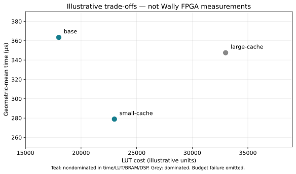

# Architectural Design Exploration {#sec-architecture-exploration}

## Concepts

Architectural design-space exploration (DSE) selects among implementable processor and SoC alternatives under defined objectives and constraints. A useful result connects a design decision to verified behavior, a workload, measured performance and implementation cost. A configuration table is a starting point; a defensible choice requires a controlled comparison and an explanation of its limits.

This chapter uses CORE-V Wally as the RTL platform and connects the performance-counter, verification, FPGA and ASIC chapters. Harris et al.'s performance verification in Chapter 21 establishes that cache and predictor measurements themselves need validation [@harrisRiscvSoc]. Weste and Harris connect design choices to implementation flows and physical constraints [@westeCmosVlsi, Chapter 14]. The complete files under `labs/11-dse/` provide a real Wally divider sweep and a separate, explicitly illustrative Pareto-analysis exercise.

### Define the decision before selecting parameters

Start with a use case: choose a bare-metal RV32 configuration for a fixed FPGA allocation, preserve its ISA/protection contract, and reduce the response time of a particular signal-processing workload. An average benchmark improvement does not automatically satisfy a deadline or memory budget.

Separate objectives from constraints. Objectives can minimize time, energy per job, resources or release effort. Constraints can require supported features, working interrupts, a resource allocation, timing closure or maximum latency. A design failing a mandatory constraint remains infeasible even if its average performance is excellent.

| Decision element | Example | Evidence needed |
| --- | --- | --- |
| Functional contract | Same results and required features | Independent checks and feature-specific regression |
| Performance objective | Reduce complete-job latency | ROI, workload identity and measurements |
| Physical budget | Fit allocated fabric and clocks | Mapping, routed timing and reserved resources |
| Integration obligation | Preserve boot/memory/driver interfaces | Platform tests and consistent software contract |
| Release constraint | Complete applicable checks | Current requirement/evidence dossier |

Write a falsifiable hypothesis: increasing divider work per cycle reduces a division-heavy region, but may increase cost or reduce achievable frequency. “A bigger core is faster” changes too many conditions to explain the result.

### Architecture, microarchitecture and implementation

The ISA specifies software-visible operations. The microarchitecture determines execution. Implementation maps the design into technology resources and wires. Comparisons across these axes need different controls.

For alternative dividers under one ISA, retain the same binary/input. For RV32 versus RV64, compressed instructions, an FPU or custom instructions, binaries and instruction counts may change. Preserve equivalent application work and numerical semantics, record recompilation, and identify an application/configuration comparison rather than identical-instruction isolation.

FPGA LUT/BRAM/DSP costs are not standard-cell area. FPGA frequency depends on mapping/routing; ASIC frequency depends on cells, parasitics, corners and constraints. A good FPGA result is evidence for that target, not portable ASIC power/performance/area proof.

### Work, cycles, frequency and performance

For a defined region,

$$
\mathrm{CPI}=C/I,\qquad T=C/f=I\,\mathrm{CPI}/f,
$$

where $C$ is cycles, $I$ retired instructions and $f$ implemented operating frequency. Fewer instructions can improve time while increasing CPI. Fewer cycles can lose their benefit if implementation forces a lower clock.

Suppose A takes 10,000 cycles at 50 MHz and B takes 8,000 at 35 MHz. Their times are 200 µs and about 228.6 µs. B reduces cycles by 20%, yet increases time. These values illustrate arithmetic; they are not Wally measurements.

| Metric | Meaning | Required qualification |
| --- | --- | --- |
| Cycles / retired instructions | Executed work within a window | Counter semantics, ROI and software identity |
| CPI / IPC | Cycles per instruction / instructions per cycle | Matching accounting; not a universal ranking |
| Time / throughput | Response latency / completed jobs per time | Operating clock, setup and transfers |
| MPKI | Events per thousand retired instructions | Event definition and denominator |
| Resources / area | Technology-dependent cost | Units, mapping and implementation stage |
| Energy / power | Energy per work / energy-use rate | Activity, voltage, clock and model/measurement scope |
| Verification effort | Qualification complexity | Features, regression and integration obligations |

For miss count $M$, $\mathrm{MPKI}=1000M/I$. Miss rate uses accesses instead. Neither describes cost alone: an overlapped miss and a blocking refill affect execution differently. State whether events are speculative, architectural, per instruction, per beat or per cycle. Do not add overlapping stall categories as an exclusive partition of execution time.

### Bounds guide effort

If fraction $p$ of baseline time is accelerated by $s$, with the remainder unchanged,

$$
S=\frac{1}{(1-p)+p/s}.
$$

If division occupies 5% of application time, eliminating its cost yields at most about 1.053× speedup under those assumptions. A large divider gain can be irrelevant to the application. The bound prioritizes measurement; it does not establish unchanged frequency, overhead or contention.

For accelerators, include setup, ownership transfer, DMA, computation and completion handling. Engine throughput can conceal poor small-job latency. The dot-product measurements in @sec-executable-project include setup/polling/result access, while their memory assumptions still need physical-platform validation.

## Experimental Method

### Establish a working, measurable baseline

Obtain correct execution in the smallest platform exercising the mechanism. Pin the RTL, derive a documented configuration and record elaborated parameters. Run independent checks before optimization. Apply @sec-verification-methodology before and after each change.

A source parameter is not evidence of active hardware. Internal memories can bypass caches; a disabled predictor makes its size irrelevant; compiler folding can remove arithmetic. Confirm the hardware path, instructions and enabled features. A cache study without cache traffic is an environment defect, not a useful zero-miss result.

Preserve local properties and configuration-specific coverage. Equivalence is useful when its relation fits the change. New latency, ISA or features can require a different comparison than arbitrary cycle equality.

### Select complementary workloads

Start with a predictable mechanism test, then a representative kernel and application scenario. A synthetic loop diagnoses behavior but is insufficient for deployment selection.

| Class | Mechanism | Control |
| --- | --- | --- |
| Integer arithmetic | Latency and dependencies | Retain operations and specify operands |
| Sequential/blocked memory | Locality and refill bandwidth | Working set, alignment and initialization |
| Pointer chasing | Dependent-access latency | Fixed graph/traversal and placement |
| Strided/conflicting access | Mapping and associativity | Stride, sets and translation |
| Branch-heavy control | Prediction and redirects | Pattern, addresses and code layout |
| Application/IP workflow | End-to-end interaction | Same useful work and completion policy |

Save compiler options, executable/input hashes and relevant disassembly. Recompile only when part of the comparison, retaining both binaries. Changed instruction mix can explain more than the hardware parameter.

Choose the suite before inspecting a preferred candidate's gains. Report regressions too. Production weights need justification; equal classroom weights are only a convention. Check that numerical ranges and termination paths do not make a fast benchmark perform less work.

### ROI, warm-up and machine state

The region of interest (ROI) can cover a kernel, application or complete job. Specify start/end events, overheads and termination. Separate boot, initialization, warming, measured work and correctness checks. A signature checked afterward does not establish that every other checker was excluded.

Declare cold or warm state. Resetting statistics does not reset caches, predictors, TLBs or queues. Warm-up can alter data and execution paths; use reproducible initialization and establish stable relevant behavior. For cold studies, describe which architectural/microarchitectural state is reset.

Use stable 64-bit CSR reads as in @sec-pmu. Sequential snapshots add boundary overhead and are not simultaneous sampling. Empty-window tests can characterize fixed instrumentation costs, but subtracting an unrelated loop does not isolate every effect. Short-window CPI needs particular care.

The current Wally FPGA path does not automatically expose the simulation logger as a hardware PMU service. Counter RTL may remain when configured, but software/event semantics and an observation path must be established. Record `COUNTERS`; do not populate board tables with simulation-only hierarchical observations.

### Factors, interactions and search

One-factor studies support an initial explanation: control compiler, inputs, memory latency and other parameters. Then examine interactions such as capacity × memory latency, predictor size × branch pattern, or unit structure × achieved clock.

For A and B, compare baseline, A-only, B-only and A+B. A's benefit may depend on B. Full factorial studies grow rapidly. Prune illegal/infeasible combinations before expensive evaluation, preserving reasons. Failed builds and wrong results remain part of the record.

Use coarse sweeps before refinement. Sampling and surrogate models can reduce evaluations, but a predicted optimum needs correctness and implementation checks. Keep fitted, validation and decision-confirmation points separate. Training-set agreement is weak evidence of generalization.

### Repetitions and uncertainty

Repeated deterministic RTL runs with identical input/reset should reproduce counts. That is not statistical diversity. Input seeds explore workloads; routing seeds explore implementation variability; board repetitions sample environmental/execution variation. These are different populations.

Preserve raw trials before medians, ranges or intervals. Alternate/randomize hardware candidate order when drift matters. An isolated best routing seed can exaggerate deliverability; record selection policy and failed seeds.

If differences are smaller than observed variability, qualify the conclusion. Thousands of instructions in one deterministic run are not independent repetitions. Do not average incompatible ROIs, inputs or operating conditions for a convenient number.

## Wally as the RTL Platform

### Configuration families and isolated changes

Wally is configurable RTL, not interchangeable benchmark labels. Inspect the pinned configurations, derived parameters, RTL assertions and wrapper. The runnable study uses `3b30ba6b6519bd2c26c1437e6d61f632a35cef6c`; later revisions need a reviewed mapping.

Families can include small uncached RV32, RV32 with a memory hierarchy and richer privileged/RV64 systems. Direct comparison changes ISA, software, memory and control together. Study isolated changes within a family first, then compare families using equivalent application work and explicit feature contracts.

| Axis | Wally controls | Conditions to preserve/review |
| --- | --- | --- |
| Divider | `IDIV_BITSPERCYCLE`, `IDIV_ON_FPU` | ISA support, signed behavior, operands and unit selection |
| Caches | Enables, ways, bytes per way, line length | TIM bypass, cacheability, memory latency and SRAM mapping |
| Predictor | Enable, type/size, BTB and RAS | Legal variant, addresses, branch pattern and redirects |
| ISA/XLEN | Base/extensions and `XLEN` | ABI/compiler, numerical and privilege contract |
| Observation | `COUNTERS` and counter extensions | Event definitions and board access |
| Platform | Memory/bus/peripheral fields | Boot/map, ownership and clock/reset |

A configuration can elaborate yet violate firmware assumptions. A deeper pipeline is an RTL redesign with new hazards/exception obligations, not a ready-made Wally parameter sweep. Account for engineering and verification cost when choosing a feasible course experiment.

### Caches: capacity is not the whole experiment

For $A$ ways, $W$ bytes per way and line size $L$ bytes,

$$
C=AW,\qquad \text{sets}=W/L.
$$

This is data capacity, excluding tags/replacement/valid/dirty state and mapping overhead. The referenced RV32IMC configuration has geometry fields even with caches disabled. Changing them without enabling caches and routing traffic through them is not a cache study.

For capacity, control associativity/line length. For associativity, decide whether capacity or bytes per way stays constant: these are different questions. Derive conflict addresses from actual indexing; translation and physical allocation can change mapping.

Measure accesses, misses, refill/writeback traffic and stalls after validating events. A lower miss rate can lose to longer timing or refill cost. BRAM use depends on ports, widths, metadata and mapping, not only bits. Verify geometry legality and available memory views.

A cached DMA platform also needs coherence or explicit ownership/maintenance. The executable project's uncached contract does not supply coherence when caches are added. Keep a cache mechanism study separate from a new DMA-consistency claim until both are verified.

### Prediction and functional units

Distinguish direction, target, return and other redirect events. Retain code/input/layout for an isolated predictor change. Measure branch frequency and wrong predictions alongside cycles. A modest prediction gain may matter little if branches are rare or front-end timing worsens.

For multiply/divide, distinguish latency, initiation interval and application exposure. Pipelining may benefit independent operations but not a dependent chain or blocking in-order integration. DSP mapping changes physical assumptions. Verify numerical/control corners before performance.

Following Harris's Chapter 21, check events on small predictable cases before using them to explain benchmarks. A plausible label does not establish counting at the intended boundary. Overlap and speculation complicate a simple events-times-penalty estimate.

## Implementation: a Real Wally Divider Study

### Hypothesis and controlled platform

The experiment varies the legal integer-divider `IDIV_BITSPERCYCLE` over 1, 2 and 4 while retaining one RV32IM/Zicsr executable. It asks whether increased work per divider cycle reduces a division-heavy ROI in the same functional platform.

`tb_wally_dse.sv` instantiates the actual `wallypipelinedcore`. It derives RV32IMC with internal memories, caches and prediction disabled; 64 KiB external zero-wait AHB RAM enabled; and three counter slots. Reset starts at `0x80000000`. No board, DDR controller or accelerator is modelled.

An independent Python oracle produces 64 numerator/divisor pairs and signed/unsigned quotient/remainder answers. Cases include zero divisors, signed overflow, negatives and seeded random values. Signed reference division truncates toward zero. Firmware retains 256 `DIV`, `REM`, `DIVU` and `REMU` instructions with inline assembly.

The ROI includes operand accesses, arithmetic, loop control and volatile result stores. Cycle/instruction snapshots surround it. Per-result comparisons and checksum run afterward. Expected answers are not created by firmware dividing with the same hardware it is testing.

### Reproduce the experiment

**Checked recipe:** the pinned RTL divider sweep and illustrative Python analysis. Cache/predictor/board extensions are exercises or adaptation templates. The later gem5 shell sketch requires a separately prepared environment/script and is not an executed package recipe.

Use the container in @sec-reproducible-labs and acquire Wally as in @sec-executable-project. From the repository/package root:

```bash
docker run --rm --network none --user "$(id -u):$(id -g)" --env HOME=/tmp --env WALLY_ROOT=/cvw \
  --mount "type=bind,source=$PWD,target=/work" \
  --mount "type=bind,source=$(cd ../cvw && pwd),target=/cvw,readonly" \
  from-concept-labs:2026.10 python labs/11-dse/run_wally.py --seed 2026
```

PowerShell uses the actual absolute clone location:

```powershell
docker run --rm --network none --env HOME=/tmp --env WALLY_ROOT=/cvw `
  --mount "type=bind,source=${PWD},target=/work" `
  --mount "type=bind,source=D:\Repos\cvw,target=/cvw,readonly" `
  from-concept-labs:2026.10 python labs/11-dse/run_wally.py --seed 2026
```

The exporter reads the pinned object without changing the clone's branch. One ELF/vector set serves all variants. Verilator compiles each instance, firmware checks every answer and the harness reports the actual parameter. Missing tools, wrong results, traps and timeouts fail.

Results reside under `labs/build/dse/`; numbered setup/variant logs are in `dse-setup/` and `dse-div*/`. JSON records source/tool/seed identity and comparison status. CSV uses divider=2 as baseline when included. Inspect records/logs before interpreting speedup. Preserve a complete campaign before a new run overwrites its artifacts.

### Actual measured results

These measurements used seed 2026, pinned source and the teaching environment (Verilator 5.020, Clang/LLD 18.1.3). They are **actual RTL simulation results**, unlike the illustrative dataset below.

| Divider bits/cycle | ROI cycles | Retired instructions | Instrumented-window CPI | Cycle speedup relative to 2 |
| ---: | ---: | ---: | ---: | ---: |
| 1 | 11,502 | 847 | 13.580 | 0.655 |
| 2 | 7,534 | 847 | 8.895 | 1.000 |
| 4 | 5,550 | 847 | 6.553 | 1.357 |

Equal retired counts and one binary support an isolated unit comparison. Reduction agrees with the hypothesis for this operand distribution/ROI. It is not divider-only latency: loads, stores, control and instrumentation remain. Sequential counter reads are not atomic multi-counter capture; this is an instrumented-window CPI.

None is physically implemented by this experiment. The simulation clock does not establish FPGA frequency, resources, energy or timing closure. Four bits/cycle wins the cycle comparison; the deployable choice remains open until physical costs and application workloads are measured. The finite experiment is not complete ISA qualification.

### Extend without silently changing the question

Use another operand seed, keeping identities separate. Add a divide-light application and estimate exposure. Test dependency patterns if the integration can exploit them. Explain which results follow from hardware and which from changed software work.

For physical selection, integrate variants into the actual FPGA wrapper, run synthesis/implementation and record clocks/resources. Fixture RAM is not the board memory/controller. Retain common software where possible, recheck correctness/platform behavior, then combine cycles with frequency and cost.

## Campaign Analysis and Selection

### Preserve observations before ranking

A manifest records factors, reference commit, elaborated parameters, target, toolchain, constraints, workload/input/ROI identities and seed/trial. Results distinguish correctness/timing status, measured counters, resource units and qualified operating frequency.

Keep illegal configurations, failures, timeouts, budget overflow and timing failure. Missing frequency is not zero; requested frequency is not achieved; skipped work is not fast work. Reject incomplete rows instead of plotting defaults.

Raw reports remain evidence; derived tables reference them. Hashes establish identity/freshness, not correct choice of top, ROI, event or corner. Carry scoped claims into selection using @sec-verification-methodology.

### Normalize by workload, then explain aggregation

For candidate $j$, workload $k$ and fixed baseline,

$$
S_{j,k}=T_{\mathrm{base},k}/T_{j,k},\qquad
G_j=\exp\left(\frac{1}{K}\sum_{k=1}^{K}\ln S_{j,k}\right).
$$

The equal-weight geometric mean aggregates ratios without a long workload dominating through raw duration. It does not establish production prevalence. Use justified weights or direct service-time objectives for a known mix. Show per-workload effects and worst regression too.

A good mean can hide a deadline violation. Add deadlines as constraints. Latency distributions and worst-case timing need separate treatment; a finite benchmark's worst observation is not a formal worst-case execution-time bound.

### Pareto analysis is a shortlist

A feasible design is dominated if another is no worse in every selected objective and strictly better in at least one. Equal points do not dominate each other. Define directions/units. Objectives, feasibility rules and tested candidates determine the frontier.

Membership is not release approval. A nondominated design may violate a worst-workload requirement or have unqualified features outside the objectives. Uncertainty and verification effort matter. A scalar score makes preferences explicit, but its weights are policy, not a discovered hardware property.

### Illustrative cache/frequency trade-off

`illustrative.csv` contains **invented teaching data**, not Wally/Nexys Video measurements.

| Candidate | Cycles: compute / memory / branch | MHz in example | LUT / BRAM / DSP |
| --- | --- | ---: | --- |
| base | 10,000 / 30,000 / 20,000 | 50 | 18,000 / 40 / 8 |
| small-cache | 10,000 / 15,000 / 16,000 | 48 | 23,000 / 60 / 8 |
| large-cache | 10,000 / 12,000 / 15,000 | 35 | 33,000 / 100 / 8 |
| too-large | 9,000 / 11,000 / 14,000 | 40 | 55,000 / 160 / 8 |

For memory, small-cache takes 312.5 µs and large-cache about 342.9 µs. Fewer cycles lose their benefit through lower frequency. Illustrative allocated budgets of 50,000 LUT and 150 BRAM reject too-large. These are not device-capacity claims; resource units must match the report.

```bash
python labs/11-dse/analyse.py labs/11-dse/illustrative.csv \
  --output-dir labs/build/dse-analysis
python labs/11-dse/test_analysis.py
```

Geometric-mean speedups are about 1.000, 1.303 and 1.046. Small-cache dominates large-cache in aggregate time/LUT/BRAM/DSP. Base and small-cache remain on the frontier. Small-cache still slows compute by about 4.17%; the mean does not erase that regression.

{#fig-dse-illustrative-pareto fig-alt="Base and small-cache are nondominated; large-cache is dominated despite its lower workload cycle counts"}

The SVG is labelled illustrative. Analysis refuses unmatched binary/input/ROI/target/origin and requested-clock substitution, retains rejected cases, and requires positive qualified frequency. Its schema has one aggregate observation per workload/candidate. Raw repeated trials and physical evidence are separate inputs to a real selection.

## FPGA Evidence and its Cost

### Why broad FPGA exploration is slow

Each variant may require elaboration, synthesis, mapping, placement, routing, timing review and bitstream generation. Board studies add programming, boot/calibration, transfers, execution and retrieval. Open tools remove vendor dependencies but not these costs.

A campaign combines build, qualification, execution and analysis:

$$
T_{\mathrm{campaign}}=\sum_j\left(T_{\mathrm{build},j}+T_{\mathrm{qualification},j}
+T_{\mathrm{run},j}+T_{\mathrm{analysis},j}\right).
$$

Parallelism, memory and shared boards affect elapsed time. Hardware can run long workloads quickly after implementation, while a small architectural change forces rebuilding. There is no universal rule that RTL simulation always runs workloads faster: compare amortized build/run cost for the actual campaign.

Incremental reuse is valid only when supported and its objects remain appropriate. Cache/divider changes can move critical paths beyond the block. UART, calibration and debug overhead may dominate short board tests. Define measurement windows and retain instrumented implementation identity.

### Confirm a shortlist physically

Begin broad searches with cheaper models/mechanism tests, advance candidates through RTL correctness/cycle checks, then use FPGA to confirm selected physical/integration trade-offs. Reserve fabric for controllers, clocking, debug and interfaces rather than allocating the whole device to the core.

Separate mapped/routed reports. Preserve clocks, slack, unconstrained paths and operating conditions. Failed candidates define practical boundaries. ASIC evaluation adds technology-specific cells/parasitics/corners; it is not a relabelled FPGA resource chart.

## gem5 for Broader Exploration

### Understand what the model represents

gem5 offers configurable processor/memory models for architecture research. Its CPU documentation distinguishes simpler execution models from detailed timing models [@dseGem5Cpu]. Running RISC-V does not make a model cycle-accurate for Wally's pipeline, forwarding, divider or cache controller.

Select mechanisms appropriate to the question: locality, queues, bandwidth, latency or execution organization. A generic cache sweep can expose working-set effects while leaving Wally-specific cycle ranking unresolved. Declare that scope rather than borrowing the RTL core's name.

Syscall emulation supports an application environment without modelling the complete guest OS/platform. Full-system work includes platform/software. Neither accepts every bare-metal image unchanged. The supplied DSE ELF expects machine-mode CSRs and fixed physical RAM/mailboxes; it is not a Linux user program to insert into syscall emulation.

### A disciplined workflow

Build/acquire a pinned simulator separately from the small teaching container. Follow that revision's official instructions and preserve compiler/dependency/binary identities [@dseGem5Build]. The standard-library tutorial demonstrates composing board, CPU, caches, memory and workload [@dseGem5Tutorial]. Begin with a compatible RISC-V workload and known configuration, then change one component.

For each candidate:

1. Record commit, script, workload and changed parameters.
2. Verify ISA, environment, hierarchy and actual CPU model.
3. Check correctness/termination before interpreting statistics.
4. Preserve instantiated configuration/statistics and ROI policy.
5. Compare mechanism tests and selected RTL observations.

gem5 emits configuration and statistics records. Inspect instantiated defaults as well as overrides. Multiple dumps can occur; select the correct interval rather than the first matching line [@dseGem5Stats]. Separate simulated time from host throughput and record metric/event mappings.

This shell sketch assumes a script/workload prepared for the pinned gem5 environment. Those inputs are not supplied or executed by this package:

```bash
for size in 4KiB 8KiB 16KiB; do
  "$GEM5_BINARY" --outdir="results/l1-$size" \
    study.py --l1-size="$size" --binary="$RISCV_WORKLOAD"
done
```

Arguments after the script are its reviewed interface, not universal gem5 options. The book provides executed Wally/analysis exercises; compatible gem5 workloads, scripts and calibration are additional research infrastructure.

### Calibration is not validation

Calibration adjusts a model against chosen reference observations. Validation tests different observations. Compare operation dependencies/latencies, redirects, misses/refills, bandwidth and dependent accesses in small cases, then applications/configurations not used for tuning.

Relative time/cycle error helps, but inspect events and ranking disagreements too. Compensating wrong penalties can match total time. Ranking near the decision boundary matters more than reassuring correlation across dissimilar workloads. Held-out workloads/configurations help reveal overfitting.

Do not tune a generic CPU and call it Wally just because it runs the ISA. Maintain correspondence between model parameters, RTL mechanisms and validated domain. Record unsupported behavior/uncertainty and confirm selected optima in the RTL/physical loop.

## XiangShan and XS-GEM5

XiangShan is a Chisel-based high-performance RISC-V project discussed in the other-architectures chapter. It illustrates research where full RTL/physical evaluation is costly and out-of-order mechanisms differ substantially from the scalar Wally experiment [@xiangshanRepository].

The community maintains **XS-GEM5**, the `OpenXiangShan/GEM5` fork. Its documented focus is a full-system RISC-V performance model calibrated against XiangShan RTL. Compatible workload/checkpoint and syscall-emulation paths have distinct limits; it is not a universal bare-metal image loader [@dseXsGem5]. Published calibration claims apply to stated configurations/campaigns rather than every future revision.

The architecture guide separates Python configuration, C++ timing mechanisms and observability. It identifies an RTL-aligned Kunminghu configuration and an ideal/performance-oriented configuration [@dseXsGem5Architecture]. An ideal model explores opportunities; its gain is not automatically realizable. Preserve the exact configuration rather than naming every result simply “XiangShan.”

The transferable lesson is a maintained mapping between model choices, RTL mechanisms and calibration. Functional differential checking and performance alignment are complementary: correct answers do not establish scheduling/prediction/cache timing; calibrated speed does not establish correctness or feasibility of a new RTL change.

A master's extension can reproduce a reduced model/RTL comparison, vary a mechanism and confirm one candidate. A complete campaign needs the project's toolchain, compatible checkpoints/workloads and compute. This package contains neither that campaign nor a validated Wally gem5 port.

## Hands-on Experiments and the Decision

### Experiment 1: reproduce and challenge the divider result

Run all three configurations. Check binary/vector identities and retired counts; explain why ROI time is not divider-only latency. Repeat with another seed, preserving both campaigns. Add a divide-light workload, estimate exposure and test whether the original gain predicts its behavior.

### Experiment 2: analyse the trade-off honestly

Use illustrative data to explain cycle/time reversal, budget rejection and compute regression. Add a per-workload deadline to the selection policy. Explain why a Pareto point or mean cannot decide acceptance alone. Change a binary identity or mark frequency requested and show rejection.

### Experiment 3: define a cache/predictor campaign

Choose a family; specify legal factors, working set, active hardware path, cold/warm state and events. Verify a mechanism baseline before sweeping. Preserve failing/unimplemented cases and reasons. Do not inherit uncached DMA correctness for a cached platform without ownership checks.

### Experiment 4: confirm a candidate

For FPGA, use the real board fabric and compare time/resources under stated memory/clock conditions. For gem5, prepare compatible workloads, calibrate mechanism tests and validate held-out configurations. Explain discrepancies rather than relabelling generic output as Wally evidence.

Without a board, confirm the candidate with an independent workload in real-Wally RTL simulation and preserve the binary/input/ROI contract. Run device implementation without programming when tools are available; otherwise analyse the instructor-provided baseline/variant timing/resources reports under [Lab 07's alternative](../../labs/07-implementation/README.md#without-a-physical-board). Report cycle effects separately from supplied physical data, list board validation as unexecuted and identify what missing frequency/memory/energy evidence could reverse the decision. This completes the online exercise within its declared scope; a measured board Pareto claim still needs actual physical evidence.

### Submit a decision, not only plots

The dossier contains objectives/constraints, hypothesis, manifests, ROI/workload contract, verification, raw/derived data, rejected cases, uncertainty, frontier and selection. Connect conclusions to @sec-verification-methodology.

In the supplied study, four bits/cycle reduces measured ROI cycles relative to two with identical retired work and correct results. Physical cost/timing, broader applications and energy remain separate questions. Retaining the simpler baseline after those checks is as valid as choosing the faster one when the decision follows its stated objective and evidence.

<!-- chapter-review:architecture-exploration -->

## Key ideas {#review-architecture-exploration-ideas .unnumbered .unlisted}

- A design-space choice needs matched workloads, validated behavior and measured cost.
- Functional models, timing models and hardware support different conclusions.

## What you should now be able to explain {#review-architecture-exploration-explain .unnumbered .unlisted}

Explain a controlled comparison, its region of interest and what missing evidence could overturn its apparent winner.

## Common mistakes {#review-architecture-exploration-mistakes .unnumbered .unlisted}

Comparing mismatched configurations; presenting illustrative Pareto data or emulator runtime as measured Wally PPA.

## Try it yourself {#review-architecture-exploration-try .unnumbered .unlisted}

Review one existing divider-sweep result. Identify the controlled variable, measured outputs and integration/physical limits of the conclusion.

## Where this appears in Wally {#review-architecture-exploration-wally .unnumbered .unlisted}

::: {.callout-note title="Wally Connection" icon=false}
Use [config/rv32gc/config.vh](https://github.com/antoniofloresgil/cvw/blob/3b30ba6b6519bd2c26c1437e6d61f632a35cef6c/config/rv32gc/config.vh) and [src/wally/wallypipelinedcore.sv](https://github.com/antoniofloresgil/cvw/blob/3b30ba6b6519bd2c26c1437e6d61f632a35cef6c/src/wally/wallypipelinedcore.sv) to anchor a configuration identity. The course sweep reports actual selected builds separately from illustrative analysis.
:::

## Further reading {#review-architecture-exploration-reading .unnumbered .unlisted}

Review @sec-pmu and @sec-final-review. Follow the chapter sources [@harrisRiscvSoc; @westeCmosVlsi].
