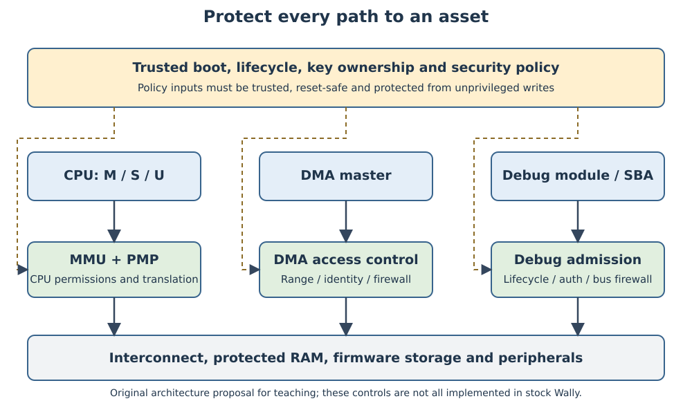

# Hardware Security: From Threat Models to Secure SoCs {#sec-hardware-security}

Security is a property of the complete system and its operating conditions. A processor can correctly enforce privilege rules while a DMA master reads the same protected memory through a different path. A signed boot image can be replaced after verification. A locked debug register can coexist with an unrestricted system-bus debug port. Designing each mechanism correctly is necessary, but the security argument must connect them.

This chapter synthesizes the protections developed throughout the book. Keep the detailed PMP/MMU discussion in @sec-privileged-mmu, memory behavior in @sec-memories-caches, debug mechanisms in @sec-riscv-debug, boot interfaces in @sec-boot-stack and DMA integration in @sec-accelerators. Here the question is how to combine those mechanisms into a stated security architecture and demonstrate that its boundaries work. The resulting design is a **proposal for a Wally-based SoC**, not a claim that the inspected Wally core constitutes a complete secure platform.

The chapter follows a threat model through implementation decisions and five experiments: architectural PMP denial, unauthorized DMA requests, debug admission, a cache-observation demonstration and a bounded formal security property. References include the RISC-V privileged architecture, OpenTitan's public architecture/design documents, firmware-resiliency guidance and primary side-channel/speculation research [@riscvPrivilegedSpec; @securityOtOverview; @securityNistFirmware; @securitySpectre]. These references inform the discussion; none certifies the teaching platform.

## Concepts

### Security objectives and the assets they protect

Start with assets and authorized operations. Confidentiality means information is disclosed only to permitted observers. Integrity means assets and control decisions are changed only in permitted ways. Availability means required services remain usable within the defined operating envelope. Authenticity identifies an approved source or device; freshness distinguishes a current request or image from an old valid one.

An asset can be data, authority or a service. A cryptographic key is sensitive data; permission to install firmware is authority; a deadline-bounded interrupt service is a service. Treating every asset as a secret byte array misses attacks that never read a secret but still change ownership or block operation.

| Asset in the course SoC | Security objective | Authorized operation |
|---|---|---|
| Boot firmware and verification policy | Integrity and authenticity | Install an approved version through an authenticated update path |
| Signing/attestation key material | Confidentiality and controlled use | Perform a specified cryptographic operation without exposing the key |
| Privilege and memory policy | Integrity | Trusted firmware configures permissions before lower-mode execution |
| Accelerator descriptors/results | Integrity and availability | A job owner uses permitted buffers and observes completion |
| Debug authority | Lifecycle-dependent authorization | Approved development access or constrained service access |
| Device identity and ownership state | Authenticity and freshness | Provision/transfer ownership according to the lifecycle policy |

The application determines what is secret. A buffer containing public benchmark inputs does not need the same confidentiality treatment as a private signing key. Conversely, a public boot policy can still require strong integrity. The final project's matrix should name those distinctions rather than assign one generic security level to every register.

### Threat models define capabilities, not just attacker names

A threat model states what the adversary controls, observes and can repeat. “An attacker has access to the board” is insufficient: that might mean sending UART input, attaching a JTAG probe, replacing external flash, measuring power, manipulating clocks or modifying silicon. Those capabilities lead to different controls and different evidence.

For a useful teaching baseline, assume adversarial lower-mode software can provide arbitrary accelerator descriptors and repeatedly call exposed interfaces. Firmware and the lifecycle controller are trusted. A second, stronger model permits a compromised DMA master to generate arbitrary bus transactions. A third permits physical observation or faults. A result established under the first model does not automatically cover the second or third.

Record what is excluded and why. A digital RTL simulation cannot measure laser-fault resistance. A protected external key store does not solve a threat in which the adversary controls the trusted signing service. An exclusion should bound a claim, rather than quietly remove the most important attack path from the design.

| Profile | Controlled inputs | Observations | Consequence for verification |
|---|---|---|---|
| Unprivileged software | Calls, pointers, lengths, scheduling of requests | Return values, allowed timers and shared microarchitectural effects | Test access denial, parser boundaries and observable differences |
| Malicious device/master | Addresses, transaction timing, IDs and errors at its interface | Responses and accessible memory | Enforce independent interconnect permissions |
| Board access | External image storage, reset and permitted debug pins | Console/debug outputs and externally available traces | Test boot/lifecycle policy across resets and image replacement |
| Physical adversary | Defined fault/measurement capabilities | Power/EM/timing or fault responses | Qualify physical assumptions and separate silicon/board evidence |

OpenTitan's security material is useful because it treats roots of trust, provisioning, ownership and lifecycle as one architecture, rather than equating security with a cipher block [@securityOtOverview]. The course proposal borrows that discipline without copying OpenTitan's complete feature set or implying equivalent assurance.

### Attack surfaces and trust boundaries

List every path through which authority or information crosses a boundary. Software-visible MMIO registers are one path. DMA channels, debug bus access, boot media, reset controls, scan chains and provisioning interfaces are others. A “disabled” feature remains an attack surface if its enable is writable by the adversary or a reset silently re-enables it.

A trust boundary is the point where an untrusted action requires a trusted decision. For CPU memory accesses, the decision can depend on translation, privilege and physical permissions. For DMA, it can depend on master identity and allowed buffer ranges. For debug, it can depend on lifecycle and authenticated authority. These are separate policies even when the final transaction reaches the same SRAM.

{#fig-security-boundaries width=100%}

The trusted computing base (TCB) contains the hardware, firmware and configuration whose correctness is required by the claim. Minimizing its size helps review, but a small firmware image is not a small TCB if it relies on an undocumented interconnect, debug controller and key store. Conversely, a large driver outside the trusted boundary can be acceptable if it cannot escape the hardware policy.

For each boundary, state the decision inputs, their owner, the point of enforcement and the response to denial. A CPU permission check in the retirement stage can be too late if an earlier request already reached a side-effecting device. A DMA descriptor check can be sufficient for a trusted engine, but not for an engine whose RTL or control state can generate unrelated addresses.

### Architectural correctness and information flow

{#fig-security-attack-surfaces fig-alt="External images and inputs, debug pins and physical access meet separate boot-policy, CPU PMP and DMA-debug enforcement points before reaching shared targets" width=100%}

For each entry in @fig-security-attack-surfaces, name the enforcing block and a negative test. For example, a rejected CPU access tests PMP, while a rejected DMA descriptor tests a different guard. Neither test establishes resistance to the physical fault and observation path on the right. The additions are a design proposal, consistent with the implemented-versus-proposed distinction later in this chapter.

Functional verification often checks that the allowed result is correct. Security additionally asks whether a forbidden effect can occur, whether an unauthorized observer learns something, and whether the policy remains active during exceptional conditions. A successful denied transaction should not modify memory, but an error response alone does not prove that no earlier write occurred.

A safety property can describe a single trace: whenever a DMA address is presented, its entire accessed span lies within the allowed window. Confidentiality often needs a relationship between traces. If two executions have the same public inputs but different secrets, the permitted observations should be equal, except for an explicitly authorized disclosure.

For public inputs P, secret S and observation O, a simplified noninterference goal is:

$$O(P,S_1)=O(P,S_2).$$

This equation is meaningful only after defining O. It might include UART output, bus traffic, timing, cache occupancy or power. Equal architectural outputs do not imply equal cache traces. A design review must specify which observations are protected and which are not modelled.

Declassification permits an intended disclosure, such as the public verification result of a signature. It should not permit the private key or arbitrary internal state to appear alongside that result. The allowed disclosure belongs in the interface specification, error behavior and tests.

### Hardware roots of trust

A root of trust anchors a decision that cannot be justified by another mutable stage. For boot integrity, that can be immutable verification code and an authentic key or key digest. For device identity, it can be protected, device-specific secret material and a constrained signing interface. For measurement, it can be a protected mechanism that records what actually ran.

Those roles are related but not identical. A public boot-verification key does not need confidentiality, but it does need integrity. A private attestation key requires controlled use and confidentiality. Storing either as a software constant in rewritable flash does not establish the assumed root.

An FPGA teaching platform can demonstrate signature verification and access policies, but its root depends on bitstream configuration, storage and board capabilities. A constant synthesized into a replaceable bitstream is not automatically immutable to a board owner. State whether the threat model includes replacing that bitstream, and use the board's actual authenticated-configuration mechanism if that capability is meant to be resisted.

Provisioning is part of the design. Define who creates identities, how public policy and secrets enter the device, which test facilities remain enabled during that process, and how the device changes owners. OpenTitan's key-manager documentation illustrates staged derivation and ownership of keys [@securityOtKeymgr]. The course design can specify a much smaller key interface, provided it states the protection and reset assumptions clearly.

### Secure boot, measured boot and authenticated updates

Secure boot authenticates an approved next stage before allowing it to execute. Measured boot records a digest or other description of a stage for later appraisal. A measurement can support attestation, but measuring a malicious image does not itself stop that image from running. The architecture must decide whether a failed appraisal blocks execution, changes permissions or is reported to an external verifier.

The boot chapter supplies the functional reset-to-Linux chain. A security layer adds ownership and policy to each handoff: who approves the firmware, which bytes are authenticated, what the stage may modify, and how the next stage is protected between checking and executing it. OpenSBI provides an SBI implementation; using OpenSBI is not itself a secure-boot mechanism.

OpenTitan's secure-boot overview gives a concrete ROM-to-authenticated-stage example, including lifecycle-dependent signing authority [@securityOtBoot]. For a Wally proposal, the important lesson is the anchored handoff. The chosen cryptographic algorithm, key storage and image format require an explicit implementation contract and independently reviewed library/IP.

A checksum detects a change relative to a trusted expected value. If an adversary can replace both an image and its expected checksum, the checksum does not authenticate the image. The practice ZIP's SHA-256 index and the kernel archive checksum identify supplied files; they are not a device's authenticated boot chain.

Rollback is a separate problem. An old correctly signed image can contain a fixed vulnerability. Security-version policy needs protected monotonic state or another justified freshness mechanism. A human-readable firmware version string in the same rewritable image is insufficient. Updating that state must also survive power interruption without accepting an unintended lower version or permanently disabling valid recovery.

Firmware resiliency combines protection, detection and recovery [@securityNistFirmware]. Recovery must not bypass the same policy it is meant to restore. A recovery UART that accepts an arbitrary unsigned image can invalidate an otherwise careful boot design. A useful policy supports an authenticated recovery image and records when recovery occurs.

### Memory protection and privilege isolation

Use @sec-privileged-mmu for the mechanics. In the security argument, virtual mappings define a process's view of memory, while PMP constrains physical accesses under the relevant hart privilege policy. The two protections compose; one does not replace the other. PMA and device semantics additionally determine whether an otherwise permitted access is meaningful and safe.

Ordinary unlocked PMP entries generally do not constrain normal M-mode accesses in the same way as lower-mode accesses. Locked rules and enhanced PMP such as Smepmp change parts of that policy [@riscvPrivilegedSpec; @securitySmepmp]. Do not claim that a U-mode denial protects a key from compromised machine firmware. Identify precisely which privilege context and access type the rule constrains.

The core's PMP check is not a universal SoC memory firewall. A DMA engine or Debug Module with system-bus access can reach memory without executing the CPU's protected load/store path. Protecting a physical asset requires a policy for every initiating master and, where relevant, a target-side enforcement point.

Protection configuration also needs integrity. If untrusted software can rewrite the DMA window or permission registers, the address checker can be perfectly implemented while enforcing an attacker-selected policy. Configure permissions before releasing the untrusted domain and lock or mediate subsequent changes. Include CSR/MMIO privilege checks and reset values in the evidence.

### DMA attacks, ownership and coherency

A DMA-capable IP is a bus master. Its descriptors are requests to exercise authority over memory, not merely arithmetic parameters. A hostile descriptor can target firmware, another task's buffer, executable code, an MMIO register or the engine's own control state. Invalid lengths and arithmetic wraparound can turn an apparently small range into unintended accesses.

An allowed start address is not enough. Validate the end of every source and destination span using arithmetic wide enough to reveal overflow. Account for element stride, result size, alignment, descriptor chaining and burst length. An overlapping output can also modify data that will be read later, violating the accepted computation even if all bytes lie in a permitted aperture.

The reference accelerator validates a descriptor before launch and latches its accepted fields. This defeats changes to its own descriptor registers during a job. A linked descriptor in ordinary RAM would need another ownership strategy: validation followed by a later reread introduces a time-of-check/time-of-use race.

Address choices must also compose across mechanisms. The isolated PMP demonstration below denies a word at `0x80008000`, which happens to lie inside the separate accelerator example's allowed DMA window. They are different experiments, not one integrated protected layout. Combining those settings unchanged would leave the word accessible to authorized DMA despite the CPU denial. A real platform must place private assets outside device windows or add a trusted device policy that also excludes them.

An address window prevents some unauthorized accesses, but does not authenticate which process owns a permitted buffer. A trusted driver may need per-request buffer ownership, IOMMU mappings or a narrower hardware allocation. A compromised bus master requires a firewall/IOMMU outside that master; its internal descriptor guard cannot be the only trusted protection.

Linux's DMA API distinguishes CPU addresses and device addresses and supplies synchronization/mapping rules [@bootLinuxDma]. Permission and coherency remain separate. A permitted DMA write can still be invisible to a CPU reading a stale cache line; a coherent write can still be unauthorized. Completion, cleanup and reset must preserve both contracts.

The executable Linux continuation in @sec-linux-accelerator makes this boundary concrete: a reserved pool, returned DMA-address validation, a root-only ioctl interface and quarantine after an unconfirmed timeout. Its QEMU negative controls test software error handling; the advanced Wally route adds the real accelerator/PLIC integration. Neither replaces the independent RTL aperture proof or establishes a secure-boot chain.

### Debug lifecycle and service access

Debug authority can stop software, examine state or issue system-bus transactions. The debug chapter explains the RISC-V mechanisms. The security policy must cover all relevant effects, rather than only the JTAG transport or a halt-request bit. Disabling hart halt while allowing SBA can leave memory fully exposed.

A lifecycle commonly distinguishes manufacturing/test, development, production and service/return states. Their permitted operations differ. An authenticated development session may allow broad inspection, while production allows only a restricted health/status interface. Service access may require erasure of customer secrets before invasive test paths become available.

OpenTitan's lifecycle and debug-control descriptions show why these controls extend beyond a single software lock [@securityOtLifecycle; @securityOtDebug]. The teaching guard later in this chapter models only admission to halt and bus requests. It consumes trusted lifecycle/authentication inputs; it does not implement authentication, OTP lifecycle storage or a full Debug Module.

Reset is especially important. A runtime sticky bit that clears on reset is not a permanent production lock. Cold reset, warm reset, debug reset and reset of one clock domain can have different policy consequences. If the authentication controller retains a session while the admission guard resets, access can reopen unexpectedly. Define reset ownership and session invalidation as interface contracts.

DFT and scan are separate surfaces. Manufacturing needs observability and controllability, but a scan path may expose state that ordinary debug cannot. @sec-physical-validation describes test preparation; the security release must additionally identify production test permissions, secret erasure, test-mode entry and ownership of scan/repair configuration.

### Side channels and timing/cache leakage

A side channel exposes information through an observation other than the intended functional result. Timing, cache occupancy, bus utilization, power and electromagnetic emissions can depend on secret values. A program can return the same public result for two secrets while leaving different observations.

For a cache example, the adversary can populate known sets, let a victim execute, then observe which sets were disturbed. A secret-dependent table lookup can change the observation even when the table's contents cannot be read directly. Published cache-channel work demonstrates that microarchitectural state can provide high-resolution observations under particular sharing assumptions [@securityFlushReload]. The experiment here uses a small synthetic Prime+Probe scenario with explicit assumptions, not that paper's complete attack setup.

Constant-time design means independence from secret data for the chosen observations; it does not mean every invocation takes the same time under arbitrary public inputs and interrupts. Avoid secret-dependent control flow and memory addressing, then inspect compiled code and the implementation of the required operations. A branchless source expression can still use a secret-dependent lookup or a variable-latency unit.

Random delays can make observation noisier without removing correlation. Cache partitioning can remove a particular sharing path without addressing power leakage. Restricting timers can change measurement difficulty without preventing an adversary from using another observable completion signal. Connect each countermeasure to a stated channel and capability model.

The PMU chapter is relevant here: counters and cycle timers are valuable for measurement, but their privilege policy can affect what untrusted software observes. Removing PMU access is not an automatic security proof. Conversely, a simulation-only counter is not evidence that an FPGA user can perform the same timing measurement.

### Speculative execution and transient effects

Speculative execution can perform work that later fails to retire. If that work changes observable microarchitectural state, architectural rollback can leave an information channel. The Spectre research demonstrates how prediction and a covert channel can combine into a disclosure mechanism [@securitySpectre].

The important architectural review separates three questions: when an access becomes authorized, when data becomes available to dependent operations, and which state changes are undone on a squash. Squashing a destination register does not necessarily undo a cache fill, replacement update or resource contention.

Do not infer that every RISC-V core has the same speculative vulnerabilities. An in-order pipeline differs from a wide out-of-order design, but can still have prediction, prefetching, queues or memory activity on uncommitted paths. The inspected Wally configuration needs its own timing/permission-path review. This chapter does not demonstrate a Spectre exploit against Wally or claim that the absence of an out-of-order backend proves immunity.

Possible design responses include preventing use of unauthorized data, controlling transient effects, isolating shared predictor/cache state and using architecture-supported ordering mechanisms where their documented semantics address the actual channel. Evaluate costs and remaining observations. A fence included without a specific semantic argument is a code annotation, not a complete mitigation.

### Fault injection and physical attacks

Fault injection changes computation or control under an adversary's specified physical capabilities. A voltage/clock disturbance, memory corruption or targeted physical stimulus might affect a state bit, comparison result, instruction execution or transaction. The security question is whether that change crosses a boundary before it is detected and contained.

Digital fault experiments can flip selected bits or force signals in a simulation. They are useful for testing a fault model, but they do not establish that a physical stimulus maps to exactly that model. Physical evaluation needs the target technology, board, equipment, calibration and repeatability record.

Fault countermeasures can include redundancy, encoded state, integrity checking and independent alert/escalation paths. Their implementation matters: equivalent duplicate computations can fail together; an alert arriving after an irreversible grant is too late; synthesis can simplify a proposed redundant representation. OpenTitan's hardware guidelines discuss these design concerns and the need for clearly bounded assumptions [@securityOtHardware].

Memory ECC detects/corrects classes of accidental or injected corruption according to its code. It is not a cryptographic authenticity mechanism against an adversary who can replace data and valid check bits. Likewise, a sparse FSM encoding improves resistance to a declared bit-fault model without proving resistance to arbitrary multi-bit faults.

Connect faults to the security objective. Test whether a corrupted lifecycle value opens debug, whether a skipped error state releases an unverified image, and whether a damaged DMA counter escapes its window. Define local denial, alert capture, secret cleanup and recovery. Fail-closed behavior can improve confidentiality/integrity while affecting availability; the system must choose that tradeoff explicitly.

### Cryptographic accelerators and secret handling

A cryptographic accelerator can reduce CPU work and keep some intermediate state out of ordinary registers. It does not automatically protect its keys, authenticate its caller or suppress side channels. Define allowed algorithms/modes, key ownership, provisioning, command authorization, output policy and erasure.

For an AES engine, distinguish data confidentiality from authenticity; the selected protocol/mode determines whether modified ciphertext is detected. For a hash engine, distinguish an unkeyed digest from a MAC or signature. A fast SHA block alone cannot decide whether a boot image came from an approved signer.

OpenTitan's AES and key-manager documentation illustrates hardware responsibilities such as key use, operation control and protection of internal state [@securityOtAes; @securityOtKeymgr]. A course extension should state which features it actually implements rather than inherit the security claims of a referenced IP.

An AXI crypto block has the same descriptor, DMA and reset obligations as the arithmetic accelerator, plus confidentiality of keys and intermediate state. Returning diagnostic registers or leaving key shares visible through scan can defeat an otherwise correct cipher. Completion/error timing and fault responses can also become observations. Use established cryptographic implementations and separately qualify their integration; writing an educational cipher does not produce a production cryptographic core.

## Implementation

### A security architecture for the Wally platform

Begin with the known scalar Wally configuration and the complete AXI/DMA reference project. Identify the actual masters, address decoder, firmware storage, RAM/cache regions, debug integration and reset tree. The proposal adds a trusted boot/policy domain and independently controlled CPU, DMA and debug paths. These additions must not be described as existing features of the pinned Wally repository.

The trust hierarchy for this proposal is: immutable/protected boot policy establishes trusted firmware; firmware installs memory and device policies; the OS/driver allocates permitted jobs; lower-mode applications supply untrusted requests; hardware enforces the accepted transaction envelope. Debug and manufacturing access are controlled by lifecycle authority that ordinary application software cannot rewrite.

| Boundary | Proposed owner/enforcement | Existing evidence and remaining work |
|---|---|---|
| CPU → physical memory | Firmware-configured PMP plus MMU/privilege logic | Architectural QEMU probe; separate Wally integration verification required |
| Driver → accelerator job | Descriptor checks and latched accepted fields | Existing accelerator RTL/tests and bounded assertions |
| DMA master → protected targets | Trusted engine window; independent firewall for stronger threats | Windowed engine checked; general external firewall not supplied |
| Debug → halt/system bus | Lifecycle/auth admission plus bus policy | Teaching guard checked; actual DTM/DM/SBA integration remains an exercise |
| Boot storage → execution | Anchored authentication and protected handoff | Functional Linux boot exists; secure-boot architecture is a proposal |
| Secret-dependent execution → observer | Defined leakage policy and qualified countermeasures | Synthetic cache observation only; no physical/leakage qualification |

This matrix avoids an aggregate “secure” label. A module can pass its tests while an unimplemented system boundary remains open. Release documentation should carry the missing obligation instead of converting it into a successful status by omission.

### PMP isolation as one layer

The executable probe uses a high-priority NAPOT PMP entry denying R/W/X to an eight-byte region, followed by a lower-priority RAM entry that permits U-mode code to execute. Matching priority matters: a broad permissive RAM entry placed first would override the intended narrower denial.

The denied word is at `0x80008000`. For an eight-byte naturally aligned NAPOT region, the example encodes its base divided by four in `pmpaddr0`. The first configuration byte is `0x18` (NAPOT with R/W/X clear); the second is `0x1f` for an allowed RAM region. The program reads back its configuration before entering U-mode.

U-mode executes one denied load and one denied store. The M-mode handler checks cause, saved PC and fault address, then resumes at the next known four-byte test instruction. After the final U-mode `ecall`, M-mode checks that the protected word still contains its initial value. These are precise-fault and forbidden-side-effect observations.

This is deliberately not a trusted execution environment. The U probe is fixed assembly; fault bookkeeping is not protected against an arbitrary U program, and the broad RAM entry does not isolate every machine stack or metadata object. The test establishes the stated PMP mechanism. A production monitor needs protected code/data/stacks, adversarial control-flow handling, correct trap entry and a complete policy for every device/master.

The unlocked configuration additionally demonstrates the scope of ordinary PMP: M-mode can inspect the denied word. If machine firmware is outside the trusted set, this policy is insufficient. Locked or enhanced policies require separate setup/permission tests, including reset behavior and the constraints imposed on firmware itself.

### Restricting the real accelerator's DMA accesses

The supplied `dotproduct_axi.sv` validates descriptors against the half-open physical window `[DMA_BASE, DMA_LIMIT)`, checks source word alignment and destination result alignment, rejects oversized/zero jobs and rejects output/source overlap. The default window is `[0x80008000, 0x8000c000)`.

The engine transfers operands as four-byte memory words and uses the signed low 16 bits for arithmetic. The result occupies eight bytes. Thus source spans are `4 × length`, not `2 × length`, despite the effective arithmetic element width. Security range calculations must use actual transactions, including padding/stride, rather than an abstract mathematical type.

For source address A and byte count N, the intended check is:

$$A \ge B, \quad A+N \le L, \quad \text{no address-width overflow},$$

where B and L are the permitted lower and exclusive upper bounds. The RTL uses wider arithmetic to make carry-out visible. Testing only A would permit an access starting inside the window but ending outside it.

Once accepted, the descriptor is copied to active fields and cannot be rewritten while the job owns them. Assertion checks also constrain emitted addresses to the window. This is a useful defense in depth for a trusted engine: both admission and actual address generation have evidence.

For a compromised engine threat, insert an independently trusted enforcement point. It must cover read and write channels, identities, burst spans, IDs/responses, reset and error behavior. Dropping an unauthorized request without completing its protocol can deadlock a master and become an availability problem. Define whether denial generates an error response, a controlled termination or an escalation.

### Securing debug admission

The teaching module has separate request/grant signals for hart halt and bus access. It accepts only the development lifecycle encoding and a trusted authenticated authority signal. Reset, invalid/production states, an immediate lock request or a previously latched lock all deny grants.

```systemverilog
assign permit = !reset && lifecycle == 2'b01 && authenticated
                && !locked && !lock_request;
assign halt_grant = permit && halt_request;
assign bus_grant = permit && bus_request;
```

The complete [guard](../../labs/14-security/debug_guard.sv) adds the sticky state and formal properties. `authenticated` is not a password comparator or a public input from JTAG. Its producer is a trusted authentication/lifecycle subsystem whose challenge, credential storage, session lifetime and reset behavior must be designed separately. The two-bit lifecycle encoding is a readable teaching interface, not a fault-hardened OTP lifecycle controller.

The guard is an admission component. It does not drain outstanding debug bus requests, suppress returned data, manage a halted hart or sanitize internal state. A real integration must define what happens when permission is revoked after a request is accepted. Put the enforcement point before authority is exercised and decide how already accepted work completes or is contained.

The sticky runtime lock lasts until reset. Production remains closed because its trusted lifecycle value is disallowed, not because this volatile bit is permanent. Authentication sessions should be invalidated according to the same reset policy; testing an isolated guard cannot verify that behavior in an external controller.

### Designing a minimal secure boot chain

The proposal extends @sec-boot-stack with an authenticated transition, leaving the established reset/OpenSBI/Linux interfaces intact. A small trusted first stage validates a manifest and image, configures execution permissions, then enters the approved next stage. The boot loader continues the chain for the kernel, DTB, root filesystem and relevant boot policy.

The manifest should bind identity/version, authorized load/entry addresses, image lengths and hashes, required platform features and the next-stage security policy. Choose a canonical, unambiguous encoding. Validate sizes and arithmetic before reading ranges, and reject an entry outside the authorized executable region. Authenticating bytes without authenticating where and how they execute is an incomplete policy.

```text
reset into trusted first stage
read manifest using bounded parser
select an allowed verification key from protected policy
validate format, sizes, entry, platform identity and security version
authenticate the manifest and its image digests
load/verify each image in an isolated destination
prevent untrusted writers from changing the checked bytes
install memory, DMA and debug policy
record the measurement and handoff state
enter the authorized stage; otherwise use authenticated recovery
```

This is an implementation template, not executable secure-boot firmware. The practical Linux chain currently checks reproducibility/functional behavior; it does not implement this trust anchor, signature validation or rollback storage. Retain that distinction in a project release.

Prevent modification between validation and execution. Keep DMA inactive, reject debug writes, protect storage/RAM permissions and account for caches and instruction synchronization. A verified image in a shared writable buffer is still mutable. If a later privileged stage can alter the policy, that stage is part of the TCB.

Consider signing all relevant execution inputs. A trusted kernel can receive an adversarial DTB describing usable firmware memory, an unexpected console, or a device with incorrect DMA semantics. Boot arguments, recovery selections and ownership policy can also change what authenticated code does. Specify which inputs are authenticated, which are measured and which remain intentionally user-controlled.

Test image corruption, unknown keys, malformed lengths, invalid entries, old security versions, interrupted updates and rejected recovery attempts. Test a known-valid image as a reachability case. A verifier that refuses every image is safe against execution of malicious firmware but does not provide a usable secure boot service.

### Hardware security monitors and failure containment

A security monitor observes or mediates a specified class of operations. Examples include checking address envelopes, authorizing lifecycle transitions, tracking allowed protocol state, enforcing key-use policy and collecting integrity alerts. Its interface must state the monitored event and whether action precedes or follows that event.

An assertion in simulation detects an error in the model; it does not become a blocking circuit merely by appearing in RTL. If hardware must prevent an access, implement a gate/firewall at the decision point and verify it. A separate monitor can then detect disagreement, illegal transitions or anomalous responses.

Define alert handling end to end. A sticky status bit can preserve evidence, but an unprivileged clear operation can erase it. An interrupt can notify software, but a disabled or compromised handler may never act. A reset can contain a failure, but might destroy evidence or reopen policy if its domains are inconsistent. Choose which faults require immediate hardware denial, local reset, secret cleanup or a trusted recovery path.

The monitor itself is security-critical. Protect its policy registers, reset and event inputs. If a bus master can forge its source identity, address checking by source ID is ineffective. If a fault corrupts both a grant and the checker that is meant to observe that grant, redundant-looking logic may not provide independent detection.

For IP reuse, document assumptions alongside guarantees. The DMA engine's guarantee depends on validated latched descriptors and a trusted policy window; the debug guard's guarantee depends on trusted lifecycle/authentication inputs; a cryptographic block's guarantee depends on key/entropy/control interfaces. SoC integration must discharge those assumptions, rather than concatenate module PASS reports.

## Hands-on Experiments

### Environments and evidence boundaries

The [security practice guide](../../labs/14-security/README.md) contains the full sources. Experiment 1 uses the optional boot container for QEMU/Clang. Experiments 2–5 use the existing unit-lab container for the real accelerator, Icarus, Yosys and Python. Both executions are offline after their images have been built. The complete source package includes the examples, not external cryptographic keys or secure firmware images.

Run the architectural part from the repository or extracted-package root on Linux/WSL:

```sh
docker build --platform linux/amd64 -f labs/12-boot/Dockerfile \
  -t from-concept-boot:2026.10 .
docker run --rm --platform linux/amd64 --network none \
  --user "$(id -u):$(id -g)" --env HOME=/tmp \
  --mount "type=bind,source=$PWD,target=/work" from-concept-boot:2026.10 \
  python3 labs/14-security/run.py pmp
```

Run the digital part separately:

```sh
docker build -f labs/Dockerfile -t from-concept-labs:2026.10 .
docker run --rm --network none --user "$(id -u):$(id -g)" --env HOME=/tmp \
  --mount "type=bind,source=$PWD,target=/work" from-concept-labs:2026.10 \
  python labs/14-security/run.py digital
```

Native PowerShell uses Docker Desktop Linux containers and Windows mount permissions:

```powershell
docker run --rm --platform linux/amd64 --network none --env HOME=/tmp `
  --mount "type=bind,source=${PWD},target=/work" from-concept-boot:2026.10 `
  python3 labs/14-security/run.py pmp
docker run --rm --network none --env HOME=/tmp `
  --mount "type=bind,source=${PWD},target=/work" from-concept-labs:2026.10 `
  python labs/14-security/run.py digital
```

Build both images first using the same `docker build` commands in PowerShell. Linux UID/GID matching prevents root-owned artifacts. Preserve the image identities and recorded versions for a course release. The optional security entry is outside `run all` and the current publication gate; the reused dot-product checks are already part of the standard validation baseline.

The runner writes separate architectural/digital reports under `labs/build/security/`. DMA evidence uses `labs/build/security/dma/` and therefore preserves the standard unit report. A timeout, failed compiler/simulator/prover or missing marker fails the experiment; expected denial is checked behavior, not an ignored execution error.

### Experiment 1: PMP isolation and access violations

Inspect [pmp.S](../../labs/14-security/pmp.S) and [pmp.ld](../../labs/14-security/pmp.ld). Identify the high-priority denied region, broad allowed RAM region and privilege transition. Explain why the test code can execute while its load/store to the protected word fails.

The expected UART signature is:

```text
PMP_PASS: U load/store faults, precise PC/address, secret unchanged, M bypass
```

The assembly checks load access fault 5, store/AMO access fault 7, their expected instruction addresses and `mtval`. It disables compressed instructions so that advancing the known test PC by four is correct. It is not a general handler that may blindly skip any instruction after any fault.

After both denied accesses, the final U-mode `ecall` reaches the M-mode observer, which confirms the protected value. The signature also states M-mode bypass: that read is intentionally legal under the unlocked baseline. Preserve compiler/emulator versions, ELF/source hashes and `uart.log` in the report.

Create a variant that replaces the first denial with an allow rule. The reference's expected fault sequence must fail; success would indicate a weak checker. A separate extension can test locked entries, execute permission and a Wally RTL port with bus-side evidence. The architectural QEMU pass is not a proof of Wally's PMP implementation or a DMA firewall.

### Experiment 2: unauthorized DMA access

The digital command invokes the real dot-product lab with its output namespace isolated. It simulates all legal lengths, protocol/error/reset behavior and invalid descriptors, then synthesizes the reference and runs its existing bounded checks. Inspect `digital/dma.log` and `dma/report.json`; follow their paths to the simulator and formal evidence.

For security, focus on the test cases for an out-of-window destination, a near-address-space-wrap source, excessive/zero length and overlapping output. The testbench snapshots actual memory-transaction counters before rejected jobs and requires them not to advance. This is stronger than merely observing an error register.

Explain the two authorities in the result. The CPU/driver is permitted to request a job, but the engine accepts only a descriptor inside its policy. Once the engine has bus-master authority, its emitted addresses remain constrained. This does not address a malicious independently redesigned master, which needs an external firewall.

Extend the test plan with window-edge spans, partial/burst access boundaries, policy reconfiguration and a reset during an accepted job. Do not label a permanently stalled bus as an unauthorized-write test unless the checker establishes both denial and protocol recovery. Preserve expected allowed jobs as positive controls.

### Experiment 3: debug interface locking

The [debug testbench](../../labs/14-security/tb_debug.sv) exercises the admission guard without a JTAG or Debug Module implementation. It checks denial on reset and without authority, an allowed development request, same-cycle lock denial, sticky denial after the request disappears, production denial across reset and invalid lifecycle encodings.

The expected marker is:

```text
PASS debug admission: auth, immediate/sticky lock, production reset and invalid lifecycle
```

Observe both halt and bus grants. If only hart halt were checked, a defect in SBA admission could remain invisible. Next, write an integration plan connecting those gates to the actual DM/DTM or debug master, including queued transactions and returned data.

The source is intentionally small enough to audit. It does not demonstrate a production authentication exchange, fault-hardened lifecycle state, scan locking or permanent fuse behavior. State those remaining requirements in the final project; do not rename the unit test “secure JTAG qualification.”

### Experiment 4: timing side-channel demonstration

The [timing script](../../labs/14-security/timing.py) reuses the existing teaching cache model: 16 sets, one way and 64-byte lines. It assigns a cost of one to a hit and twelve to a miss. Those values are synthetic and are not clock counts measured on Wally.

The observer primes one line in every set. The victim then reads a disjoint address whose set index depends on a synthetic secret 0–15. Probing the observer's own lines reveals one miss, identifying the selected set. This requires shared replacement state; it does not require a direct read of the victim's address or data.

| Probe cost | Model interpretation | Observer inference |
|---|---|---|
| 1 | Observer line remains cached | Victim did not evict this direct-mapped set |
| 12 | Observer line was displaced | Victim touched a conflicting address in this set |

The script repeats for all sixteen synthetic secrets and saves the observation vectors in `timing.json`. It then runs a uniform-address victim that touches every set in the same order. The observer receives the same vector for every secret, removing this particular modelled channel at an explicit memory-work cost.

This result is a useful multi-execution observation, not a physical constant-time qualification. Another cache organization, scheduler, speculative path, data-dependent unit or power measurement could expose a different channel. For a Wally extension, first establish a validated timing/PMU observation path, then collect repeated traces with a documented platform and noise model. Keep that physical/RTL measurement separate from the deterministic model output.

### Experiment 5: formal verification of a security property

Use @sec-formal-verification for the complete assertion/assumption/cover, BMC/induction and counterexample/repair workflow before interpreting this security-specific bounded result. Its FIFO proof and witnesses are separate evidence; they do not upgrade the debug guard's bound or establish a full secure-processor proof.

The digital script invokes Yosys SAT on the teaching debug guard with symbolic request, lifecycle and authentication inputs. Reset is asserted in the first step; initialized state and the bounded time horizon are recorded. The checked requirement is that unauthorized or locked operation never produces halt/bus grants within the modelled trace.

An independent history flag tracks whether a lock was requested since reset. Assertions require grants to remain denied even if authentication returns or a request changes after that event. This checks a temporal policy; a combinational assertion about the current lock-request signal alone would miss a forgotten sticky lock.

The proof uses twenty cycles. A separate two-step SAT query obtains an authorized-development grant witness, demonstrating that the intended positive path is reachable. Without that witness, a guard that denies everything could satisfy the denial assertions while failing its functional requirements.

The bounded proof is not an unbounded invariant proof, a cryptographic authentication proof or an analog fault model. Authentication and lifecycle values are authoritative inputs, and the RTL transition relation excludes arbitrary corruption of internal state. All claims must retain those assumptions. The project's existing DMA bounds similarly constrain a specified implementation/horizon rather than certifying arbitrary AXI masters.

As a negative control, remove the sticky-lock term from a student variant while leaving the property intact. Expect a counterexample after a lock request has been removed. Inspect the trace rather than relaxing the property to make the mutant pass. Yosys supplies the SAT command/property machinery; match options to the installed version [@securityYosysSat].

### Release evidence and the final security review

Deliver an asset/threat matrix, the trust-boundary diagram, policy ownership/reset descriptions and a requirement-to-evidence table. Link the actual source/image/configuration identities to each test. Preserve counterexamples and accepted positive cases; a collection of denied requests alone cannot show that an authorized service works.

| Requirement | Current evidence | Required extension for a broader claim |
|---|---|---|
| U-mode cannot load/store the selected word | QEMU fault/PC/address checks and unchanged value | Wally RTL PMP/bus trace, broader protected layout and adversarial software |
| Reference engine stays within its DMA window | Real RTL descriptor rejection/address assertions | External firewall/IOMMU for malicious-master threats |
| Teaching debug guard denies unauthorized access | Unit simulation and twenty-cycle SAT plus allowed witness | Actual DM/DTM/SBA, authentication, lifecycle storage and reset-domain integration |
| Secret-dependent cache access can leak an observation | Deterministic synthetic timing vectors | Validated platform measurements and a specific physical/channel model |
| Only approved stages execute | Architecture/negative-test plan | Implemented protected root, signature verification, rollback and recovery tests |
| Keys resist selected physical attacks | Stated assumptions and design review | Qualified crypto/key storage, fault/leakage evaluation and lifecycle/DFT evidence |

The methodology in @sec-verification-methodology applies to the whole dossier. Separate safety properties, information-flow observations, bounded formal evidence, integration tests and physical evaluation. A successful build or synthesis run does not make an unmeasured channel secure.

For defence, answer these questions with the actual implementation: Which master can still reach the secret when CPU PMP denies it? Who owns the debug authorization signal? What changes after cold reset? Which exact bytes and policy inputs are authenticated? Can an accepted descriptor be changed before use? Which observer was excluded from the side-channel model? What would the system do after a detected security fault?

Close with a residual-risk statement rather than an absolute label. The course references establish several concrete protection mechanisms and intentionally leave a complete secure Wally platform, authenticated boot firmware and physical attack resistance as integration/research work. That boundary is part of a defensible hardware system design.

<!-- chapter-review:hardware-security -->

## Key ideas {#review-hardware-security-ideas .unnumbered .unlisted}

- Security claims depend on assets, attacker capabilities and every access path.
- Protection mechanisms compose only when policy and reset assumptions agree.

## What you should now be able to explain {#review-hardware-security-explain .unnumbered .unlisted}

Explain why CPU PMP does not protect against every DMA/debug master, and distinguish functional denial from a confidentiality argument.

## Common mistakes {#review-hardware-security-mistakes .unnumbered .unlisted}

Calling a checksum secure boot; extending a bounded/modelled experiment into a complete secure-SoC claim.

## Try it yourself {#review-hardware-security-try .unnumbered .unlisted}

Use the chapter evidence matrix to follow one protected asset across CPU, DMA and debug paths. Identify its remaining unverified boundary.

## Where this appears in Wally {#review-hardware-security-wally .unnumbered .unlisted}

::: {.callout-note title="Wally Connection" icon=false}
Compare CPU protection in [src/mmu/pmpchecker.sv](https://github.com/antoniofloresgil/cvw/blob/3b30ba6b6519bd2c26c1437e6d61f632a35cef6c/src/mmu/pmpchecker.sv) with the course accelerator and debug-guard examples. These components do not constitute an integrated secure Wally platform by themselves.
:::

## Further reading {#review-hardware-security-reading .unnumbered .unlisted}

Revisit @sec-boot-stack and @sec-physical-validation. Follow the chapter sources [@riscvPrivilegedSpec; @securityOtOverview].
