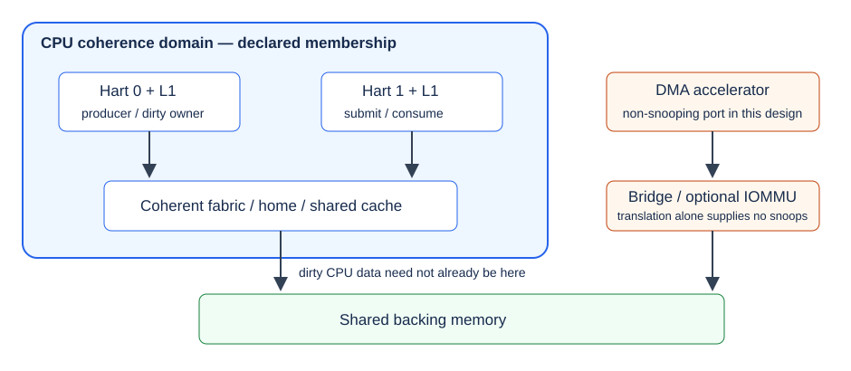
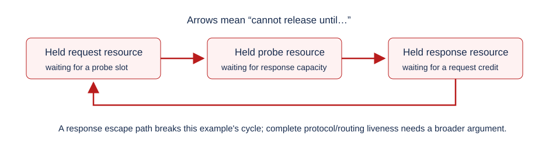

# Multicore SoC Integration: Coherence, Interconnects, and Verification {#sec-multicore}

::: {.callout-note title="Advanced reading — outside the twelve-week core" icon=false}
This chapter assumes familiarity with cache-coherence protocols and memory consistency models. Its objective is to integrate and evaluate a platform with several harts, shared memory and a DMA accelerator. It adds no compulsory activity to the 6 ECTS itinerary. The single-hart Wally project remains the assessed backbone; the executable two-CPU experiment uses a separately identified QEMU platform.
:::

The arithmetic unit that worked with one processor has not changed, yet adding a second hart creates new failure paths. A producer may leave input data dirty in its private cache. Another hart can see those data through CPU coherence while the accelerator still reads old backing memory. A completion interrupt may reach a different hart from the submitting task. Two correct drivers can corrupt one shared descriptor engine if their serialization scope is wrong. A fabric can transport every isolated transaction correctly and still deadlock when its queues fill together.

Treat multicore integration as a set of contracts across boundaries. Three questions should remain separate throughout the review:

| Question | What must the design establish? | A mechanism that does not establish it alone |
| --- | --- | --- |
| Cache coherence | Which agents observe which writes to a shared location, through which cache/ownership mechanism? | A software mutex or memory fence |
| Memory ordering | Which visibility and completion relationships are required across different accesses? | Coherence of each individual cache line |
| Software synchronization | Who may access/reuse an object, and how is that permission communicated? | A coherent interconnect without an ownership protocol |

The running example has two harts and the book's signed dot-product accelerator. Hart 0 produces a job, hart 1 submits it, and DMA reads operands and writes the result in shared memory. The engineering question is whether every transition has a justified visibility, ordering and lifetime rule. The answer depends on the actual agents and paths, not on the number of CPUs in a configuration file.

## Multicore integration challenges {#multicore-integration-challenges}

### Draw the platform before connecting the second hart

Start with the physical address map and the paths to each target. List private caches, shared caches, home nodes, memory controllers, MMIO bridges, interrupt controllers, debug masters and accelerators. Mark the coherence domain on the diagram, because the entire SoC is rarely coherent. The design in @fig-multicore-domains deliberately places DMA outside the CPU domain.

{#fig-multicore-domains}

A shared physical address is necessary for sharing a buffer, but does not identify how a reader obtains its newest value. Conversely, different CPU virtual addresses may identify the same shared physical allocation. Record the translation, cacheability, permissions and coherency attributes separately. A peripheral bus address may also differ from both CPU virtual and physical addresses.

### Establish one integration record

For each agent, record its transaction IDs, outstanding limits, address width, atomic support, ordering attributes and reset behavior. Include the buffers needed to accept responses and probes. For each shared allocation, name its owners and allowed mappings. A useful first review asks whether any agent can retain a copy that another writer cannot invalidate or update.

Instantiating the old top level twice is a trap. It may contain a private timer, a singleton interrupt target, duplicate memory decoding, a reset vector that clears shared RAM, or an unqualified assumption that only one master exists. Replicate hart-local state deliberately, centralize shared resources deliberately, and define the response path back to the requesting hart. Boot success on one CPU leaves these questions open.

## Coherent interconnect architectures

### Choose topology from traffic and completion obligations

A crossbar offers a direct starting point for a small design: inputs arbitrate for targets and responses return through known paths. Its costs grow with the number of ports, datapath width and connectivity. Pipelining changes latency and the amount of in-flight state. A crossbar carrying ordinary memory transactions does not automatically become coherent when private caches are added; some component must manage ownership requests, snoops, data forwarding and completion.

A network-on-chip distributes that transport across routers and links. It introduces route selection, packetization, credit flow and more places to retain partial work. A smaller physical connection count can help a large floorplan, while a short software transaction may acquire several transport and queueing delays. Compare the complete request/probe/data/acknowledgement route rather than only the forward request hop count.

The topology and coherence mechanism are different choices. A snooping design needs a way to reach the relevant observers and gather their responses. A directory design needs a home for each line and a reliable representation of owners/sharers, including transient transactions. Either can use arbitration, buffering and multiple transport channels. The integration review should explain where each responsibility lives rather than selecting a protocol name as the architecture.

For a two-hart design, simplicity can be a defensible objective. A centralized home and conservative outstanding limits may be easier to verify than a distributed high-throughput fabric. For a larger design, the same central point can become a bandwidth or response-capacity bottleneck. An early model should vary offered traffic, sharing patterns and response latency before committing to the physical topology.

### Follow one ownership transaction through finite resources

Consider hart 1 requesting a line modified by hart 0. The request must reach the responsible home, identify the current owner, obtain data or a writeback, update ownership metadata and complete to the requester. While that transaction is in flight, unrelated transactions can compete for the same queues. A lookup result saying “hart 0 owns it” is insufficient if the home cannot retain the request while waiting for hart 0's response.

Write down what is reserved at acceptance. If accepting a request can require two later responses, identify where those responses can go even when normal request queues are full. If probes can cause writebacks, reserve a way to carry those writebacks. If IDs can be reused, establish the point at which all messages from the earlier use are impossible. This is the same acceptance/completion discipline used for AXI/DMA in @sec-accelerators, extended across more participants.

Separate request order from response order. A fabric may reorder responses for different IDs while preserving the rules for a single transaction stream. A bridge that narrows IDs or serializes channels can change the usable concurrency. Its reorder storage must match the traffic it accepts. Increasing an outstanding limit without increasing return capacity is a correctness change, not just a performance parameter.

### TileLink, AXI and CHI at an integration boundary

TileLink has several conformance levels. TL-UL and TL-UH do not supply the same coherent-client obligations as TL-C. The coherent level adds channels and ownership-related operations; the exact supported messages, source/sink identifiers and acknowledgement rules belong in the interface contract [@multicoreTileLink]. A TileLink port on a block diagram therefore needs its level, capabilities and manager/client configuration identified.

Ordinary AXI4 carries reads and writes with independent channels and ordering rules. It does not, by that fact, snoop private CPU caches. AMBA's ACE extensions and CHI address coherent-system interfaces; CHI also separates transaction responsibilities into node roles and transport channels. The selected specification revision and actual endpoint capabilities matter [@multicoreAmba]. A bridge from a coherent network to an AXI DMA port needs a defined policy: the DMA can enter through a coherent proxy, use a software-managed non-coherent window, or be restricted to an appropriate uncached allocation.

| Boundary to review | Practical question | Evidence to request |
| --- | --- | --- |
| Coherent client → home | Can the client respond to probes while its own misses are stalled? | Overlapping miss/probe tests and buffer dependency analysis |
| Home → memory controller | When may metadata say a writeback has completed? | Data/response acceptance trace, including errors |
| Coherent fabric → ordinary AXI DMA | Who makes dirty CPU data available and invalidates stale CPU copies? | A documented proxy or software ownership/maintenance contract |
| ID or width adapter | Can split/merged transactions be reconstructed without aliasing? | Outstanding-ID scoreboard and boundary cases |
| Clock/reset crossing | Which state and credits survive a partial reset? | CDC/reset analysis plus interrupted-transaction tests |

Avoid making an adapter silently stronger than its implementation. Adding an attribute bit cannot create missing probe channels or a home-node directory. Likewise, declaring a request cacheable is not the same as making its requester a participant in the coherence protocol. At the software boundary, `dma-coherent` is a statement about the supplied platform contract; adding it to Device Tree does not implement that contract.

### Arbitration and physical topology interact

Two harts contending for one memory bank share the single-hart bandwidth and do not double it. Place the shared cache/home and memory interfaces with the actual access pattern in mind. A long return route, a narrow bridge or a single write-response slot can dominate a workload even when neither core is fully utilized.

Keep separate limits for accepted requests, pending probes, returned data and completed transactions. An average utilization figure can hide a saturated response queue. A proposed wider link should be evaluated against the queue that is actually blocking progress; it may otherwise increase upstream pressure without improving completion rate. Physical timing and clock-domain costs remain part of the final implementation decision, rather than being inferred from an abstract NoC diagram.

## Coherent and non-coherent agents {#coherent-and-non-coherent-agents}

### Classify agents by their real access path

An agent is coherent relative to an address domain and a supported transaction path. A CPU cluster can be coherent for normal shared RAM while its MMIO remains device memory and a peripheral bypasses the cluster's snoop path. An accelerator may be coherent for data reads but have a different rule for descriptor fetches or private local storage. Record those distinctions at each port.

An IOMMU answers an address-translation and protection question. It can restrict what DMA can reach, but translation alone does not provide data-cache snooping. The Devicetree specification describes DMA address ranges and coherency properties separately [@multicoreDevicetree]. A security review should also identify who can program the IOMMU, invalidate its translation caches and reuse a mapping while work remains outstanding.

The CPU virtual pointer used by a driver, the device-visible DMA address and the cache maintenance granularity are separate pieces of information. They can happen to align neatly in a small teaching system and are still different abstractions. Use the DMA address returned by the platform API; a userspace pointer or a guessed physical offset is the wrong source.

### Trace the dirty-input failure across two harts

Suppose memory initially contains operand value 0. Hart 0 changes it to 7 and retains the modified line in its private cache. The CPU coherence mechanism allows hart 1 to read 7 by consulting the dirty owner. An ordinary non-snooping DMA read still reaches backing memory and can return 0. The CPUs agree with one another while the accelerator computes the wrong job.

| Step | Hart 0 | Hart 1 | Backing memory / DMA |
| --- | --- | --- | --- |
| Initial state | No modified copy | No modified copy | Operand 0 |
| Produce | Store operand 7; line becomes dirty | Wait for publication | RAM can remain 0 |
| Publish | Release the software job token | Acquire the token; CPU load can obtain 7 | No automatic non-coherent DMA visibility follows |
| Incorrect launch | Retain the dirty line | Order MMIO start after earlier accesses | DMA can still read RAM value 0 |
| Repaired handoff | Complete the required platform visibility action | Launch only after ownership transfer completes | DMA reads 7 at the defined observation point |

@fig-multicore-dirty-input-trace draws the table above as a trace in time.

{#fig-multicore-dirty-input-trace width=100% fig-alt="A grid of hart 0, hart 1 and RAM or DMA over five steps, with the wrong read of 0 highlighted and the repaired read of 7"}

A fence can establish required ordering between actions already defined by the platform. It does not by itself write this dirty cache line back to RAM. A lock can ensure that only one task submits the job, but also does not perform that writeback. These are different failures from publishing a token before initializing a descriptor.

The second hart introduces a particularly revealing maintenance mistake: cleaning only hart 1's local cache when hart 0 owns the dirty data. Whether a particular architectural cache-block operation covers a coherent domain is defined by the implementation and ISA contract; it cannot be guessed from the executing hart. The finite model in Lab 20 deliberately models a **local-only** action and shows why it is insufficient. It does not claim that every RISC-V `cbo.clean` is local-only. Zicbom defines operations in relation to coherent agents and a common observation point [@multicoreCmo].

### Returning results is a separate ownership transfer

Now let DMA write result 49 to memory while hart 1 retains an old clean copy containing 0. Waiting for the device's completion indication does not inherently replace that cache copy. A later CPU load can return 0 unless the access path is coherent, the mapping avoids that cached alias, or the required invalidate/synchronization action has completed.

Input preparation and output consumption therefore need different obligations. Before a device reads, make its inputs visible and stop conflicting CPU writes. Before a CPU reads a device-written result, establish device completion and the required CPU visibility. For a bidirectional buffer, both transitions apply, with ownership changing in between. A completion event is part of that protocol; it is not permission to skip the other steps.

Specify what completion means in the accelerator. The last write request being issued is weaker than all required write responses being accepted. A posted bridge can add another distinction between local acceptance and visibility at the agreed target. The IP advertises a result-ready event only when its interface contract allows it, and the consuming driver must use the documented ordering mechanism. Revisit the premature-DONE negative test before adding a second submitting hart.

### Cache-line ownership prevents partial-buffer corruption

A buffer can be byte-disjoint and still share cache lines with CPU-owned control data. Imagine a result word and a flag in the same line. The CPU modifies the flag, retaining an older copy of the result word in that dirty line. DMA updates the result in RAM. A later CPU writeback can overwrite the device's new result with its stale word.

The resulting value can depend on eviction timing, so a small test may appear to work until unrelated traffic creates pressure. Extra fences cannot make a partial dirty writeback merge correctly. Design allocation and ownership at the maintenance granularity: separate independently owned regions, align their boundaries appropriately, and prohibit dirty aliases during the device-owned interval. An assumed 64-byte alignment in a teaching example is not a substitute for identifying the real target's granularity.

@fig-multicore-partial-line-corruption shows how a stale word can survive in a shared line.

{#fig-multicore-partial-line-corruption width=100% fig-alt="Three steps showing a cache line and RAM contents until the stale result overwrites the device result"}

| Object | Writer during the device interval | Other accesses allowed? | Return condition |
| --- | --- | --- | --- |
| Input payload | None after handoff | Device reads under the declared mapping | DMA no longer reads it |
| Output payload | Device | CPU must obey the selected visibility/ownership policy | Completion and synchronization for CPU consumption |
| Submission metadata | Submission owner until published | Device reads only after publication | Descriptor retired or explicitly reclaimed |
| CPU-only queue state | CPU participants under software synchronization | Keep it outside independently maintained device payload lines | Its own release/acquire or lock protocol |

### Use platform DMA APIs rather than instruction recipes

Linux distinguishes coherent allocations from streaming mappings. A coherent allocation still needs ordering around descriptor publication. Streaming mappings express transfer direction and ownership transitions; persistent mappings require the matching synchronization calls when ownership changes [@multicoreDmaGuide; @multicoreDmaApi]. Those APIs let the architecture/platform provide the appropriate mapping, cache or translation actions. A driver must not replace them with a userspace fence or an undocumented instruction sequence.

An allocation can satisfy the coherent DMA API through an uncached mapping on a non-coherent platform. Thus, a successful `dma_alloc_coherent()` call says nothing about whether the interconnect snoops. Conversely, using ordinary cacheable RAM on a genuinely coherent DMA path does not remove publication and lifetime rules. Ask what contract the API supplies for this device and mapping, instead of equating one API name with a physical cache architecture.

Lab 18's Wally profile explicitly uses an uncached DMA pool in the PMA checker. Its QEMU profile uses the emulator's shared-RAM device model. Both use the kernel coherent-allocation API, but their underlying mechanisms differ. Neither establishes a general two-hart coherent Wally fabric. Extending the CPU side requires a new integration and verification record.

### Serialize access to the whole hardware engine

Two processes can each have a correct numerical job and still interleave writes to a singleton descriptor register bank. A per-file or per-hart lock is insufficient if the device has one shared execution context. The serialization object must protect descriptor preparation, start, completion, result consumption and buffer reuse across all callers using that context.

The supplied Linux driver uses one device-wide mutex and one DMA allocation. Lab 20 exercises callers pinned to two CPUs against that shared context. It does not pretend that the engine executes jobs in parallel. The useful outcome is that accepted jobs receive their own result while callers contend safely. A multi-queue redesign would require queue identifiers, ownership and response accounting that this single-context interface does not provide.

Timeouts are especially dangerous across harts. A second task can only reuse the buffer once the device is done, which is a different event from the first task giving up its wait. The original IP has no abort/reset register, so the driver quarantines the device and retains its allocation after timeout. A production recovery design needs a way to establish that old DMA and old completions cannot affect a new generation. That lifecycle contract extends to IOMMU mappings, interrupts and any reset of the fabric.

## Memory ordering in a real SoC {#memory-ordering-in-a-real-soc}

### Put ordering edges on the job lifecycle

Adding the strongest fence to every access is the wrong place to begin. Draw the required chain: initialize payload, publish ownership, acquire ownership on the submitting hart, prepare DMA-visible state, order the doorbell, observe device completion, establish CPU visibility, publish the result, and finally permit reuse. Different edges involve different agents and APIs.

RVWMO is the baseline memory model for ordinary shared memory; the A extension supplies atomic operations and ordering annotations. Those architectural mechanisms must be connected to the compiler's concurrency rules and the platform's device-access rules [@multicoreRvwmo; @multicoreAtomics]. A C data race is not repaired merely because the processor eventually executes a fence. Use language atomics or kernel synchronization primitives for CPU communication, and the appropriate MMIO/DMA APIs for device communication.

@fig-multicore-job-lifecycle puts each ordering edge on its own step of the lifecycle.

{#fig-multicore-job-lifecycle width=100% fig-alt="Eight lifecycle steps in two rows colored by whether they synchronize CPUs or hand work to a device"}

In Lab 20, the producer writes a shared job before a release store of its epoch. The worker waits until an acquire load observes that epoch, then submits the stable job through the driver. The worker publishes completion with another release store; the producer acquires it before reading the result or changing the job. The acknowledgement is essential: it prevents the next producer iteration from modifying data that the worker or driver still uses.

```c
/* Lifecycle sketch: the executable source also checks affinity and deadlines. */
prepare_payload(job);
atomic_store_explicit(&request_epoch, epoch, memory_order_release);
/* On the other CPU: */
while (atomic_load_explicit(&request_epoch, memory_order_acquire) != epoch) {}
submit_via_driver(job);
atomic_store_explicit(&completed_epoch, epoch, memory_order_release);
```

The sequence is a sketch, not a generic queue implementation. An epoch can be reused only after no old participant can act on it. Multiple producers need a reservation/serialization mechanism in addition to this publication pair. The executable test uses one producer, one worker and a bounded non-wrapping epoch range.

### Keep ordinary memory and MMIO rules distinct

An atomic operation's ordering domain and a device doorbell are not interchangeable. A release operation used for CPU-to-CPU publication is not a universal MMIO barrier. Likewise, a normal compiler-visible store to a pointer is not necessarily a valid access to a device register. Use the platform's ordered register accessors and identify any required completion/readback point. Kernel barrier documentation distinguishes SMP, DMA and I/O obligations [@multicoreBarriers].

Atomicity at an interconnect bridge also needs an explicit answer. A bridge keeps an atomic read-modify-write whole, never splitting it into an unprotected read followed by a write. A reservation-based primitive can fail for legitimate reasons and must satisfy the required progress contract under its specified conditions. Supporting ordinary AXI reads/writes is no guarantee that all CPU atomic accesses to that path are valid.

For a software lock, identify who participates. CPU harts can share a lock in coherent memory. A DMA engine that never reads or honors that lock remains outside its protection. The driver must translate software ownership into a hardware rule, such as withholding start until preparation completes and refusing buffer reuse until completion. Mutual exclusion among CPUs and exclusion of device activity are related but different protocols.

### Diagnose ordering without inventing a memory model

Use a small message-passing test to name the failure. With atomic payload and token locations, ask whether seeing the new token while seeing old payload is allowed under the selected language/ISA model. Then test the selected release/acquire mapping using an appropriate formal litmus tool. Record the model file and version: an SC interpreter, the Linux kernel memory model and RVWMO answer different questions.

Lab 20 includes an intentionally smaller visibility-event enumerator. It shows stale outcomes when the necessary publication edges are missing, and none when its release/acquire edges are present. It is useful for checking the proposed handoff reasoning, but it is a small checker and leaves herd7 and a complete RVWMO validator to the real tools. The live QEMU program supplies a separate execution of the correct C11 synchronization. Absence of a rare forbidden outcome in repeated emulation does not prove the memory model.

## Interrupts and system management

### Bring up the second hart deliberately

Assign unique hart IDs and describe enabled CPUs consistently in firmware and Device Tree. Give each hart its own stack, trap context and initialized hart-local state. Clear shared BSS and initialize singleton resources once; a secondary hart repeating the bootstrap sequence can overwrite another hart's live data. Establish the visibility of shared boot data before publishing a release condition for secondaries.

On an SBI-based supervisor platform, distinguish firmware participation from the OS's hart-start protocol. The HSM extension describes hart lifecycle operations; IPI and remote-fence extensions provide other services [@multicoreSbiHsm; @multicoreSbiIpi; @multicoreSbiRfence]. A Linux CPU number need not be identical to a physical hart ID. The practice records both Device Tree hart nodes and the logical CPU affinities used by its tasks, rather than assuming their general identity.

Require evidence beyond a two-CPU emulator option. Check that the kernel reports two online CPUs, that each pinned worker actually executes on its requested logical CPU and that both make progress through shared work. A second CPU entry in Device Tree without successful startup is just a configuration artifact. Preserve the last boot checkpoint if startup fails.

### Route interrupts to a serviceable context

Define which supervisor/machine contexts can receive each device interrupt. A submitting task may run on CPU 1 while the handler runs on CPU 0. The completion primitive and device-wide state must remain correct across that split. The result is independent of whether the handler returns to the same task that submitted the job.

For a level interrupt, clearing the pending state in a controller is not the same as clearing the device's condition. The handler must honor the device/controller acknowledgement sequence. During migration or affinity changes, ensure at least one enabled context can service an outstanding completion. During shutdown, prevent a new job from depending on a context that has already been taken offline.

The QEMU experiment uses its existing PLIC-based device path and records the actual `/proc/interrupts` row. It does not require a particular distribution between CPUs. AIA/APLIC/IMSIC systems use a different interrupt delivery architecture and require their own configuration, affinity and lifecycle checks [@multicoreAia]. Replacing the PLIC in a diagram does not show that the new message-delivery path works.

### IPIs and translation synchronization are distinct jobs

An IPI is a notification mechanism. Its receiver still needs a well-defined shared-memory request and acknowledgement protocol. Sending an IPI without publishing its payload correctly can wake a hart that observes stale work. Coalesced notifications can also lose work if software treats one interrupt as exactly one job rather than inspecting an actual queue or sequence counter.

TLB shootdown requires more than cleaning data caches. If a mapping changes while another hart can use its old translation, publish the page-table update, arrange the required remote invalidation and wait for completion before reusing the affected memory. `fence.i`, data-cache maintenance and translation invalidation address different structures. An IOMMU can have its own translation caches and invalidation completion rules, separate from CPU TLBs.

### Reset is part of the transaction protocol

Specify what happens if a hart resets while owning dirty data, holding a lock or serving a probe. A coherent participant cannot simply disappear while another agent waits for its response. Similarly, when an accelerator resets, a late write response or old interrupt must never be mistaken for a new job.

A generation-tagged interface can reject obsolete completions only if all relevant paths preserve that generation and old memory effects are contained. The practice's tagged-completion example is hypothetical: the actual dot-product IP lacks that interface. Its timeout policy is quarantine, which stops short of a successful hot reset. Keep global reset, hart stop, device reset and runtime recovery as separate qualification obligations.

## Verification and performance

### Build a matrix around boundaries and ownership

Test the integration contract at more than one level. A coherence-controller unit test can isolate difficult state combinations, while a subsystem test supplies interconnect backpressure and multiple agents. Firmware adds address attributes, barriers and interrupts. An OS adds scheduling, migration, allocation and lifetime. Each level should preserve the assumptions it imports from the previous level.

| Boundary / requirement | Adversarial experiment | Observable evidence |
| --- | --- | --- |
| CPU dirty owner → DMA input | Produce on one hart, submit on another, retain dirty input | New operand reaches DMA only under the declared coherent/maintenance path |
| DMA output → CPU consumer | Preload an old cached copy before launching | Correct new result after completion and CPU visibility action |
| Software job ownership | Delay the worker while the producer wants to reuse storage | Epoch/acknowledgement prevents concurrent mutation |
| Singleton engine | Concurrent callers use different operands and completion modes | Every accepted job returns its own expected result |
| Response capacity | Stall data/acknowledgements while injecting probes/misses | Conservation of accepted work; no overwritten ID or lost response |
| Error and recovery | Fail a response, delay an interrupt, reset an owner | Error drains safely or remains explicitly quarantined |
| System management | Start/stop a hart or move interrupt affinity | No abandoned request or unserviceable completion |

Use acceptance-based scoreboards. A requested transfer does not enter the outstanding set until accepted. A result is not retired until the specified completion point. Track source/transaction identity across adapters and include generation when the interface provides one. If a response is legal out of order, compare by identity, because FIFO return order may not hold.

The numerical oracle must remain independent of descriptor/control code. Give simultaneous clients distinct data patterns so that swapped results cannot pass by coincidence. Vary lengths, signed extrema, operand strides and reuse. Keep at least one case whose output differs strongly from initialized memory and from the previous job; repeated zero results are a poor stale-data detector.

### Use litmus tests for specific questions

Organize tests by the edge being challenged. A producer/consumer publication test addresses ordering. A CPU-dirty/DMA-read test addresses visibility outside the coherence domain. A shared-line CPU-writeback/DMA-write test addresses ownership granularity. A two-caller descriptor test addresses serialization. Similar symptoms are no reason to merge these into one “coherence test.”

For a formal memory-model experiment, use an identified litmus language and model, retain all allowed/forbidden outcomes and include a positive witness that the test can exercise useful work. Linux's memory-model tooling documents a kernel-specific environment; the architectural RISC-V model has a different scope [@multicoreLkmm; @multicoreRvwmo]. An LKMM result does not carry over directly to arbitrary userspace C or a device protocol.

For RTL, vary response latency, eviction timing and queue pressure independently. A cache bug that requires an eviction can disappear if every test fits in L1. A probe/response dependency can remain invisible if the harness always accepts responses immediately. Add tests that first create the dangerous state, then force the event that exposes it. Record the minimized transaction trace rather than only a random seed and a timeout.

### Distinguish deadlock, starvation and slow progress

Deadlock means a set of participants cannot make the required progress because their dependencies cannot be satisfied. Starvation means one participant can be denied indefinitely while others continue. A long transaction can also be waiting for an external agent whose response assumption has not been met. A watchdog identifies a symptom; it does not decide among these explanations.

In @fig-multicore-dependencies, a held request waits for a probe resource, the probe waits for response capacity, and the response waits for a request credit. Every component may satisfy its isolated ready/valid rules while the combined dependency prevents completion. Increasing all queue depths may postpone the witness without removing the cycle.

{#fig-multicore-dependencies}

Break the actual dependency: reserve response capacity, introduce a proven escape path or change the admission rule so a request cannot occupy resources needed to complete older work. Then verify the repaired rule under pressure. A nominally separate channel is useful only if it has independent usable credits and a service path; two virtual channels sharing the same blocked final queue may not provide an escape.

For starvation, name the arbiter and eligibility conditions. Round-robin selection can bound service among continuously eligible requesters when the downstream accepts work, but cannot guarantee completion while the sink permanently refuses responses. A formal liveness property must state such environmental assumptions. A bounded test should state its bound and demonstrate that competing traffic really occurred.

### Preserve failures as well as passing regressions

The abstract practice supplies deliberately insufficient mechanisms: fence without cleaning dirty input, local-only cleaning by a non-owner, completion without invalidating a cached result, and a dirty shared-line overwrite. Keep these witnesses beside repaired cases. They show that the experiment distinguishes mechanisms and does not accept every configuration.

Do the same in a coherent RTL subsystem. Disable a required probe acknowledgement in a private fault variant, shrink a response resource incorrectly, or drop an identity bit at a bridge. The test must fail for the intended invariant, not because compilation broke. After repair, repeat the shortest witness and the relevant pressure regression. Formal proofs should retain antecedent/traffic witnesses and distinguish bounded safety from a progress argument under fairness assumptions.

### Measure completion and interference

Define the measured interval before collecting a speedup. A two-hart job can include producer work, publication, driver copies, queue waiting, device service, interrupt handling and consumer work. A lower accelerator service time can coexist with a higher end-to-end latency if coherence traffic or lock contention grows. Report throughput and latency distributions separately.

Use matched configurations and a fixed workload. Record affinity, worker count, input sizes, warm-up policy, cache state where controllable, interrupt routing and background traffic. Keep single-thread latency, two-thread throughput and total work completed distinct. A result based on half as many jobs on each hart needs the same total-work denominator as its comparison.

| Observation | Candidate bottleneck | Next controlled experiment |
| --- | --- | --- |
| More misses but little extra DRAM traffic | Cache-line ownership transfers | Separate CPU-owned fields or partition data |
| High DRAM bytes per useful operand | Write allocation, eviction or redundant copying | Change transfer granularity with the same numerical work |
| Device idle while callers wait | Submission lock, copies or queue policy | Instrument intervals inside and outside the critical section |
| Responses stall despite free request bandwidth | Return-path buffering or arbitration | Vary response capacity without widening requests |
| One hart progresses and another rarely does | Affinity, priority or eligibility | Inspect grant counts and interrupt/service routing |
| Average latency improves but deadline misses rise | Contention bursts or long ownership handoffs | Measure tails under the declared interference workload |

A useful first accounting model is:

$$
T_{job}=T_{produce}+T_{publish}+T_{queue}+T_{prepare}
       +T_{device}+T_{consume}+T_{return}.
$$

These terms are observation intervals, not necessarily independent constants. Queueing and coherence interference depend on offered load. Instrument boundaries so intervals are not double-counted, and report overlap when pipelining jobs. Attribute memory bandwidth using actual transferred bytes, including descriptors, results, writebacks and probes where the measurement system exposes them.

False sharing is a good example of a change that improves behavior without changing arithmetic. Compare independently updated counters in one line versus suitably separated storage, keeping the same number of updates and synchronization semantics. A faster emulator run is still only an emulator result. To claim a physical improvement, use a validated timing model or the implemented target with matching clocks, memory and cache configuration.

### Treat performance counters as evidence with a scope

Before interpreting a miss, retry or stall counter, identify the event definition and counting boundary. A cache may count a replay differently from the fabric's accepted request count. Per-hart events can omit shared-home activity, and shared counters can include both the workload and the interrupt handler. Check overflow, sampling and measurement perturbation.

Use conservation checks as well as performance totals. Accepted jobs should equal completed plus explicitly outstanding jobs; accepted response beats should match the applicable request shapes. A throughput increase accompanied by missing responses is a correctness failure. The practice checks exact DMA read/write counts in addition to numerical results, while retaining its clear limitation that QEMU supplies no hardware cache or NoC timing model.

## Hands-on Experiments

### Experiment A: two Linux CPUs and the existing DMA accelerator

[Advanced · C2 build / C1 run](../../learning-paths.qmd#sec-path-labels){#act-multicore-integration-01 .learning-activity}

[Lab 20](../../labs/20-multicore/README.md) builds a small additional initramfs on the existing Linux/QEMU accelerator image. It does not modify the preserved single-hart driver, device model, accelerator RTL or Wally profile. The emulator starts with two CPUs, 256 MiB RAM and the accelerator at `0x10080000`; the trusted DMA pool remains at `0x88000000`. QEMU is the executable software platform in this experiment [@multicoreQemu].

The application checks that Linux has two CPUs online. A producer process is pinned to logical CPU 0 and a worker to logical CPU 1; each checks its actual CPU during work. They share an allocation containing request/completion epochs and a job. Release/acquire publication protects the payload and prevents reuse before acknowledgement. The worker alternates interrupt and polling requests over 64 jobs, using lengths 1, 8, 32, 128 and 256. The producer computes expected values independently before handing over each job.

The application then exercises two concurrent callers with 16 private jobs per CPU. They share the driver's singleton hardware context, whose device-wide mutex must serialize descriptor programming and buffer use. The test checks all numerical results and completion status, waits for the child process, and retains the device's interrupt-count row. Across both phases the model must record exactly 96 jobs with the expected accepted operand reads and result writes.

| Evidence | What it establishes | What remains outside the result |
| --- | --- | --- |
| Two DT hart nodes and two online CPUs | Configured and booted software platform | A coherent two-hart Wally implementation |
| Checked affinity and epoch handoffs | Work executes on both selected Linux CPUs with the declared ownership discipline | Exhaustive C11/RVWMO proof |
| 96 independent numerical/status checks | Correct modeled DMA jobs across handoff and contending-call phases | RTL coherence/probe-channel correctness |
| Exact DMA transaction totals | No missing/extra modeled operand/result transfers | Physical bus timing and retries |
| Emulator elapsed intervals | The observed software/model run | Hardware speedup, cache-miss latency or energy |

The userspace shared job is not a zero-copy DMA buffer. The driver copies operands into its kernel-owned DMA allocation and copies the result back. This distinction is essential: the live run checks the software ownership/driver path, while the stale-cache examples belong to the separate explicit models. QEMU's shared-RAM device accesses do not create real private-cache dirty-owner scenarios.

Inspect the [execution report](../../labs/20-multicore/reference/report.json), [guest log](../../labs/20-multicore/reference/uart.txt) and [Device Tree](../../labs/20-multicore/reference/virt.dts). Explain the publication and acknowledgement edges, where the driver mutex applies, and why an interrupt serviced by another CPU can still complete the worker's request. Compare the actual source, image and dependency hashes before changing parameters.

### Experiment B: produce stale-data and ordering witnesses

[Advanced · C1](../../learning-paths.qmd#sec-path-labels){#act-multicore-integration-02 .learning-activity}

The same practice runs finite models of the failure scenarios from this chapter. Follow a dirty input from hart 0 to a non-snooping DMA, then apply an order-only fence and observe that the backing value remains old. Try a local-only clean on the non-owner. Apply the model's domain-wide clean and confirm the repaired input. For results, preload an old cached value, perform the DMA write, and compare consumption before and after invalidation.

Next reproduce a result/control false-sharing overwrite. The counterexample is about whole-line writeback and conflicting ownership, not arithmetic. Move the independently owned control state into a separate modeled line and repeat. Document what real target information would be needed to choose the actual allocation boundaries and maintenance operations.

The visibility-event enumerator examines four cases: neither publication edge, release only, acquire only, and both. Read the retained [model witnesses](../../labs/20-multicore/reference/models.json), identify the stale outcome in each insufficient case and explain the observation-point assumptions. Then inspect the dependency graph and arbitration examples. Their repaired cases establish their stated finite abstractions, not a complete coherence protocol, NoC routing proof or hardware performance result.

### Experiment C: integrate or study a coherent RTL subsystem

[Advanced · C2](../../learning-paths.qmd#sec-path-labels){#act-multicore-integration-03 .learning-activity}

This is the larger advanced route. Start from a processor subsystem that already supports the required coherent clients, or extend a small two-client cache subsystem with an explicit home and memory interface. Reusing the book's Wally core does not supply those components automatically. A second core instance needs a new shared fabric, probe/ownership contract and system-management path; retain the original single-hart platform as its own reference.

Freeze a manageable boundary: two harts, one shared memory target, one singleton DMA engine and a bounded number of outstanding requests. State whether DMA is coherent, uses a coherent proxy, or is explicitly non-coherent with a supported ownership/maintenance policy. Identify the required ISA, PMA/PMP, interrupt, reset and firmware configuration. Declare the unimplemented or externally assumed components before starting tests.

Begin without Linux. Boot both harts with private stacks, publish a shared work item and verify ordinary shared-memory synchronization. Then add an input prepared by one hart and submitted by the other. Force dirty-owner and stale-output situations in the cache model rather than relying on chance eviction. Add response stalls, simultaneous misses, conflicting writes, invalid descriptors and delayed interrupts. Finally bring the OS into the verified subsystem if resources permit.

For a study rather than a new implementation, select an identified coherent subsystem revision and follow one real request, probe, data return and acknowledgement through its source/configuration. Map the resource-dependency graph and explain its admission/progress rules. Produce your own directed trace or property for one boundary. A diagram copied from documentation is not the analysis of the selected configuration.

### Deliverable and engineering decision

Submit a topology/address/domain diagram, an agent capability table, a per-buffer ownership lifecycle, the required ordering edges and a source/configuration manifest. Add boot/affinity evidence where executed, independent numerical checks, one minimized failure and its repair, and an explicit statement of safety/progress/performance limits. Keep emulator, abstract-model, RTL and physical results in separate evidence categories.

The design decision should answer whether a second hart helps the intended workload and which integration cost dominates. It can be reasonable to retain a simpler single-hart system, isolate the accelerator's buffers, add a coherent proxy, or redesign the submission queue. Support that choice with matched evidence and a clearly bounded claim. This chapter's outcome is the ability to integrate and evaluate that platform; it is not a new compulsory multicore implementation project.

<!-- chapter-review:multicore-integration -->

## Key ideas {#review-multicore-integration-ideas .unnumbered .unlisted}

- Coherence, ordering and software ownership address different integration obligations.
- DMA participation, finite response capacity and lifecycle behavior belong in the platform contract.
- Software emulation, finite models, coherent RTL and physical performance require distinct evidence.

## What you should now be able to explain {#review-multicore-integration-explain .unnumbered .unlisted}

Trace a job from a dirty producer line to device-visible operands, accepted completion, CPU-visible result and safe reuse. Identify each responsible agent and mechanism.

## Common mistakes {#review-multicore-integration-mistakes .unnumbered .unlisted}

Five shortcuts recur in multicore work. A fence orders accesses and does not write back a cache. Declaring DMA coherent in metadata gives no coherent path unless the hardware has one. Per-hart locks do not protect a singleton engine that every hart shares. A watchdog that fires indicates a hang and does not prove a deadlock. And QEMU timings describe the emulator, not a physical multicore fabric.

## Try it yourself {#review-multicore-integration-try .unnumbered .unlisted}

[Advanced · C0](../../learning-paths.qmd#sec-path-labels){#act-multicore-integration-review .learning-activity}

Choose one failed model trace and identify the smallest contract change that repairs it. Explain which real hardware/software implementation would be needed to make that change valid on the selected target.

## Where this appears in Wally {#review-multicore-integration-wally .unnumbered .unlisted}

::: {.callout-note title="Wally Connection" icon=false}
The pinned course platform is a single-hart integration. Inspect the actual [SoC top](https://github.com/antoniofloresgil/cvw/blob/3b30ba6b6519bd2c26c1437e6d61f632a35cef6c/src/wally/wallypipelinedsoc.sv), cache, external-bus and interrupt boundaries before proposing replication. Lab 18's uncached DMA pool is a stated single-hart profile; Lab 20's two-CPU QEMU result does not qualify a coherent two-hart Wally SoC.
:::

## Further reading {#review-multicore-integration-reading .unnumbered .unlisted}

Use the selected TileLink/AMBA specifications, RISC-V ordering/CMO/SBI contracts and platform-matched Linux DMA documentation to review a concrete design. Continue to @sec-architecture-exploration for controlled comparison of feasible configurations; keep correctness and progress obligations as constraints on that exploration.
